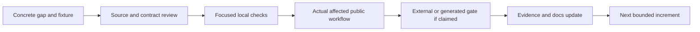

# Ferrule Compatibility and Product Roadmap

## Goal

Ferrule is an independent, portable data-mapping platform with an open project
model, a native visual editor, a CLI, host APIs, and generated Rust/C# libraries.
The goal is broad behavioral and workflow compatibility for applicable `.mfd`
designs while preserving Ferrule-native capabilities and public defaults.

Compatibility covers values, order, failures, artifacts, and external effects
for a specified format, feature, backend, platform, and workflow. Importing a
design or exporting it again does not establish all of those promises. The
[conformance inventory](conformance/README.md) remains incomplete; there is no
supported whole-product parity percentage.

To pick up work, follow [Contributing](CONTRIBUTING.md). GitHub issues are the
only live source for claims and status; [Parallel work](docs/parallel-work.md)
covers shared-file handoffs and verification resources.

The [explicit source ownership plan](docs/design/source-ownership.md) records
owner/path contracts, core interpreter and Rust/C# prerequisites, and scoped
operator qualification procedures with a dependency diagram.

This roadmap is an execution plan.

## Basic owned-source public-family milestone

The Rust and C# Basic emitter families support explicit static source ownership
for scalar fields and collection contexts. Source policies and selected-output
contracts describe which inputs an invocation may access. The
[source ownership design](docs/design/source-ownership.md) defines owner and
path relationships.

### Admission and generated-library contracts

- Target ValueMaps retain their input dependencies. Both backends use ordered
  matching, typed keys and results, literal defaults, and the existing null and
  coercion behavior. Input evaluation errors propagate before a literal default
  can be selected.
- Potential input dependencies include ordinary calls, both If branches, runtime
  parameter defaults and Raise messages. Actual evaluation retains lazy branch
  selection. Explicit empty frames replace the surrounding frame path.
- Retained expression inventory follows stored call order and the actual
  referenced function body. Dead valid ordinary nodes and unreferenced ordinary
  definitions are omitted. Stored source-ownership validation precedes emission.
- Private ordinary failure renderers support ValueMaps in source-rule predicates
  and messages. Failure processing preserves ordered rules and candidates,
  iteration before predicate before message, and complete typed error origins.
- Shared and public Basic failure admission retains its FailureRule refusal for
  ValueMaps. Dynamic sources, unsupported specialized failure domains and invalid
  owner/context requests keep their existing structural and capability errors.
- Public Basic emitters apply common admission before backend rendering. Their
  supported source contracts are independent of broader format, authoring,
  platform and external-workflow compatibility.

### Coordinating changes

Common admission and each backend's renderer are separate source responsibilities.
Coordinate common policy changes with both backend owners, and sequence edits to
the same renderer and its source tests. Runtime contracts and generated interfaces
must remain consistent with the admission profile they expose.

[Parallel work](docs/parallel-work.md#generated-code-source-ownership)
describes the reusable file-ownership and dependency conventions. Use the
[development procedures](docs/development.md) when changing a generated contract;
track task status and result records in the associated issue.

## Current Priorities

Check a box only when that specific gate has evidence. A checked implementation
box does not close its later desktop, generated, or external-runtime gates.

### 1. Complete the flat workbook user workflow

Exit: a user can choose both schemas, reach Configure/Create without an enlarged
viewport, save and reopen the mapping, and recover the same worksheet settings.
Physical workbook cell tests and desktop persistence are separate evidence.

### 2. Close exception-ordering and integer edge qualification

- [ ] Expand accepted shapes only with a concrete owner/order proof and
  counterexamples for ambiguous, shared, or fallible branches.

Exit: each claimed profile binds original inputs, expected values or errors,
produced/partial artifacts, and saved-design replay. Native partial publication
and I/O remain separately reported; schema-conforming mapping totality is not
an unrestricted publication-parity promise.

### 3. Finish generated boundary cohorts

These new sequence cohorts retain their own finite profiles and complete original
failures. They do not close broader desktop workflows, external saved-design
execution or whole-product compatibility gates. Earlier hosted jobs for the
sequence increments ran zero validation steps under a billing/spending restriction;
those failures remain distinct from later jobs. Hosted execution has resumed:
[#228](https://github.com/DeandreT/ferrule/pull/228), [#229](https://github.com/DeandreT/ferrule/pull/229) and
[#238](https://github.com/DeandreT/ferrule/pull/238) each have three successful jobs.
Other earlier mapping-job failures remain retained; pending PRs are not passes.

The four XML public-host cohorts above include small prerequisites and
separate opt-in boundary runs. The [XML qualification index](docs/generated-xml-qualification-index.md)
and [memory observations](docs/memory-and-limits.md#compiled-xml-host-observations)
were refreshed in [#133](https://github.com/DeandreT/ferrule/issues/133), merged in
[#147](https://github.com/DeandreT/ferrule/pull/147). Helper-only checks, external
execution, other designs, and a universal RAM guarantee remain separate.

Exit: compiled public calls agree with independent oracles under their declared
adapter profile. Neither a lowering pass nor one host cohort certifies every
survey design or backend.

### 4. Resolve JSON5 native metadata before widening export

Generated companions and native metadata are independent contracts. The
[guide refresh](https://github.com/DeandreT/ferrule/issues/154) is merged in
[PR #161](https://github.com/DeandreT/ferrule/pull/161), including the measured
whole-host memory ranges. The initial generated companion scope in
[#96](https://github.com/DeandreT/ferrule/issues/96) is complete and closed.
Separate allocation attribution in
[#160](https://github.com/DeandreT/ferrule/issues/160) is available, with no
production optimization included. Native token admission and original-byte
accounting are now separately qualified in #130/#163; generated-host evidence
does not establish native component metadata or desktop behavior. The JSON5
metadata lane [#106](https://github.com/DeandreT/ferrule/issues/106) records the observed settings and incompatible runtime boundary.

Exit: a self-authored fixture demonstrates metadata, values, errors, and a saved
round trip. A `.json5` filename is not enough to infer a native component flag.

### 5. Deepen memory and authoring coverage without changing contracts

- [ ] For every new wizard, verify ordinary viewport reachability and normal
  desktop save/reopen, as well as state-method tests.

Exit: a change remains usable and contract-compatible, with measurements limited
to the recorded route/profile and no inferred streaming or universal benefit.

## Workstreams

### 0. Versioned Conformance and Compatibility Profiles

- [ ] Complete the applicable inventory before a whole-profile claim.
- [ ] Track import, interpreter, external export execution, self-roundtrip,
  GUI/debugging, and each generated backend independently.
- [ ] Record schema dialect, platform, runtime, driver, and application version.
- [ ] Keep unknown, blocked, partial, and unsupported cells explicit.

### A. Mapping Semantics and Interoperability

#### A1. Executable `.mfd` Common Profile

Bounded flat variable records can establish one repeating target group through a
valid direct literal and scalar inputs in an existing plain parent frame. The
[import contract](docs/mfd-interop.md#import) preserves full physical schemas and
admits bounded exact scalar aliases that retain their selected schema. Copy-All
projects matching complete scalar item schemas in the existing frame when the
declared collections permit a singleton, preserving explicit target bindings.
Scalar assignments also admit bounded three-input core conditionals after
proving all operands in that frame; direct literals still establish presence.
Competing connectors, incompatible facets and new collection frames retain
their refusals.

- [ ] Extend one concrete supported-path mismatch at a time, with a self-authored
  triggering design and preserved refusal controls.
- [ ] Close remaining XML root/type/namespace and JSON composition boundaries
  only when the IR can preserve them exactly.
- [ ] Preserve repair imports and legacy extension round trips while keeping
  strict executable/native admission atomic.

#### A2. N-to-M Endpoint and Stage Model

- [ ] Extend beyond the bounded serial-chain/native fan-out profile with exact
  driver, schema, owner, and stage-priority evidence.
- [ ] Add general service-host and stage-graph import/export incrementally.
- [ ] Preserve applied stage snapshots, local draft history, path rebasing,
  cancellation, and main-project independence. The GUI already edits stage
  mappings; general imported graph shapes remain the open boundary.

#### A3. Functions and Reusable Mappings

- [ ] Extend catalog-backed functions and reusable contexts with matching
  validation, interpreter, Rust, C#, and authoring contracts.
- [ ] Define explicit same-scope singular-target multiple-feed semantics in
  [#241](https://github.com/DeandreT/ferrule/issues/241) before admitting them. Preserve
  distinct expressions and the existing duplicate-binding refusal; #239's
  declared ancestor branches do not supply an inferred winner.
- [ ] Define a faithful saved form in [#203](https://github.com/DeandreT/ferrule/issues/203).
  Public Ferrule observations and typed refusal do not establish external saved-
  design execution or save/reopen. Exact stage/capture/position/error preservation
  is required before importer/exporter implementation. XML annotations and JSON5
  metadata remain separate contracts.
- [ ] Qualify one admitted native saved-file reopen/execute/save2 cycle in
  [#263](https://github.com/DeandreT/ferrule/issues/263), after complete independent
  XML oracles from [#268](https://github.com/DeandreT/ferrule/issues/268).
  #268's original 68 helper, 17 admission and 41 byte-compatibility observations
  pass independent review. #281's read-only staging and #283's saved-metadata fixture
  repairs preserve the failed controls; corrected 41+17 reruns pass, with helper 68
  inherited separately. The checkpoint is recorded in [#287](https://github.com/DeandreT/ferrule/pull/287). Native execution
  timed out before first save; #285 diagnostics and #291's presentation experiment
  retain separate negatives. Exact owned-window proof and the full save/reopen cycle
  remain pending. No filter/map seed or faithful saved form is inferred from XML parsing.

### B. Visual Authoring and Debugging

- [ ] Cover supported advanced schemas/layouts with ordinary user-facing setup.
- [ ] Retain short readable summaries, full hover/details, reachable pins, and
  canvas positions as new nodes and controls are added.
- [ ] Deepen connector/source-row inspection and context-aware debugging using
  retained real inputs, not invented preview state.

### C. Connectors and Format Breadth

- [ ] Add a typed query/write model before general database mutation modes.
- [ ] Extend adapters and transport only with confinement, cancellation,
  original-error, resource, and publication contracts.
- [ ] Keep input-only adapters and unsupported schema/configuration variants
  explicit in the format matrix.

### D. Generated Execution

- [ ] Grow compile-and-call coverage for applicable mappings and public adapters.
- [ ] Add other language/backend targets as independent implementations and
  gates; the current emitters are Rust and C#.

### E. Product, Packaging, and Automation

- [ ] Package reproducible runtimes and examples with clear host boundaries.
- [ ] Design reusable libraries, projects, configuration, and automation without
  implying compatibility with another product's proprietary package format.
- [ ] Treat optional services and external server deployment as separately
  versioned profiles, not prerequisites for ordinary mapping.

## Release Gates

A broad milestone remains open until all its applicable cells are qualified.

| Gate | Evidence required |
| --- | --- |
| M0 — Measurable contract | Complete applicable inventory, independent evidence cells, and honest unknowns |
| M1 — Trustworthy native interchange | Strict import, local values/errors, export, external execution, and saved replay |
| M2 — General semantic foundation | Composable value/context/stage invariants and backward-compatible execution |
| M3 — Complete authoring and debugging | Real controls, locks/history, normal viewport, save/reopen, preview/run, and cancellation |
| M4 — Enterprise execution breadth | Applicable formats/connectors, external effects, rollback/faults, and measured resource envelopes |
| M5 — Full compatibility and product parity | All applicable generated and product-workflow cells qualified; blocked/unknown cells narrow the claim |

Failure at a gate keeps its original observations and narrows the claim; a
later correction does not erase the earlier result. See
[Development and verification](docs/development.md) for practical checklists.

## Compatibility Boundaries

- All checked-in fixtures are self-authored. External behavior and licensed
  resources remain separately controlled evidence, not copied repository data.
- Pixel-identical UI and byte-identical design serialization are not required;
  values, ordering, editable structure, failures, and applicable workflows are.
- Strict admission is useful only when it preserves the accepted semantics.
  Unsupported or unproved shapes must retain a typed refusal before publication.
- Ferrule-native capabilities stay available outside the strict native profile.
- Standard Boolean `and` and `or` calls accept two or more strict Bool operands
  with eager left-to-right evaluation and ordered type checking. The
  [variadic Boolean contract](docs/design/variadic-boolean-calls.md) keeps broader
  nullable logical compatibility separately qualified.
- A local round trip, a green test total, or a nearby qualified feature does not
  close an unknown capability or establish full-product compatibility.

## Primary References

Use the current source and focused contract documents linked above. Any external compatibility update must bind the exact
primary documentation and application version used for that update.
