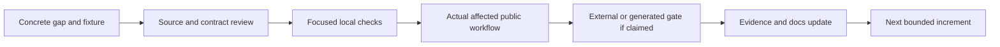

# Ferrule Compatibility and Product Roadmap

Updated: 2026-10-12

## Goal

Ferrule is an independent, portable data-mapping platform with an open project
model, a native visual editor, a CLI, host APIs, and generated Rust/C# libraries.
The goal is broad behavioral and workflow compatibility for applicable `.mfd`
designs while preserving Ferrule-native capabilities and public defaults.

Compatibility covers values, order, failures, artifacts, and external effects
for a specified format, feature, backend, platform, and workflow. Importing a
design or exporting it again does not establish all of those promises. The
[conformance inventory](conformance/README.md) remains incomplete; there is no
supported whole-product parity percentage.

Choose or claim an independent lane in [Parallel work](docs/parallel-work.md),
which links scoped issues, ownership, dependencies, and shared verification rules.

The [explicit source ownership plan](docs/design/source-ownership.md) records
owner/path contracts, core interpreter and Rust/C# prerequisites, and scoped
operator qualification procedures with a dependency diagram.

This roadmap is an execution plan.

## Basic owned-source public-family milestone

The additive Rust and C# public Basic emitter families under
[#519](https://github.com/DeandreT/ferrule/issues/519) are merged in separate
focused PRs: [PR591](https://github.com/DeandreT/ferrule/pull/591) and
[PR588](https://github.com/DeandreT/ferrule/pull/588). #519 is closed with its
acceptance checklist complete. This
[#615](https://github.com/DeandreT/ferrule/issues/615) documentation snapshot is
against merged main
[`7217639`](https://github.com/DeandreT/ferrule/commit/721763924e4051ce468d407eb22703ac574ec4aa),
tree `6120e1531c39857fc61a33a94b500a9a8c82f695`.

C#'s additive public Basic emitter family is merged in
[PR588](https://github.com/DeandreT/ferrule/pull/588), against main
[`5e9aaff`](https://github.com/DeandreT/ferrule/commit/5e9aaff86cf45c869edf9307e51c6e742ece0878).
The checked-input and ordinary source-failure bridges are also merged:
C# [PR579](https://github.com/DeandreT/ferrule/pull/579) and
[PR581](https://github.com/DeandreT/ferrule/pull/581), plus Rust
[PR584](https://github.com/DeandreT/ferrule/pull/584) and
[PR587](https://github.com/DeandreT/ferrule/pull/587).

### Public-family qualification and publication

| Increment | Recorded local qualification | Publication state |
| --- | --- | --- |
| C# public Basic family / [PR588](https://github.com/DeandreT/ferrule/pull/588) | 42 Basic source controls, eight existing controls, the 120-test inventory, default production compilation, strict checks, and seven nonfriend external consumers / 24 calls | Merged. Preserve those contracts in follow-on changes. |
| Rust public Basic family / [PR591](https://github.com/DeandreT/ferrule/pull/591) | Final current-main qualification covers the 141-test driver, exact 23-entry Basic module inventory, ordered completion of 17 source controls, four existing controls, and strict checks. Source correspondence retains accepted production compiler invocations for current IR, common codegen, and the Rust backend, public-symbol exposure, and five external modules / 14 calls, including the [#580](https://github.com/DeandreT/ferrule/issues/580) fixture correction. | Merged. Preserve those contracts in follow-on changes. |
| Private C# target ValueMap / [PR596](https://github.com/DeandreT/ferrule/pull/596) | All 48 focused source tests, eight existing controls, the 126-test default inventory, ordinary production compilation, strict checks, and six fresh friend hosts / eight calls passed. Complete typed inputs, results, errors, nodes, frames and catalogue observations were retained. | Merged; this target increment is included in #566's completed acceptance. |
| C# retained inventory / [#585 / PR598](https://github.com/DeandreT/ferrule/pull/598) | All 53 focused source tests, eight existing controls, the 131-test default inventory, production compilation, strict checks, and the corrected retention host's three probes passed. The original verifier failure and fixture corrections remain recorded. | Merged; #585 is closed. |
| Paired public target ValueMap / [#582 / PR599](https://github.com/DeandreT/ferrule/pull/599) | Common codegen's 403 tests, Rust's 24 active Basic tests / seven ignored, C#'s 55 Basic tests / eight existing controls, default inventories and production compilation, and strict checks passed. Two generated programs / seven matching calls per backend retained complete inputs, results and typed errors. | Merged; #582 is closed. Independent shared/public failure refusals remain intact. |
| Private Rust specialized-failure envelopes / [#595 / PR601](https://github.com/DeandreT/ferrule/pull/601) | Default production compilation, the 153-test inventory, all 28 active Basic tests / seven ignored, 54 new labeled controls, three existing owned controls, one package-validation control and strict checks passed. The JoinAggregate witness was corrected to expect its upstream root-context refusal. | Merged; #595 is closed. This diagnostic-only increment widens no operator admission and requires no new generated runtime hosts. |
| Private C# failure ValueMap / [#594 / PR607](https://github.com/DeandreT/ferrule/pull/607) | Default production compilation, the exact 138-test inventory, all 60 Basic source tests, eight existing controls and strict checks passed. Two matched generated programs / eight calls per backend retained complete typed outcomes, nodes and same-walk cohorts. Consumer corrections change only five `FromBool` calls to `FromBoolean` and four `Primary` uses to `Primary()`; the original failed build remains retained. | Merged; #594, #589 and #566 are closed after independent review. Shared/public failure-map admission stays closed. |

- [x] Merge both languages' checked-input and ordinary source-failure bridges in
  separate focused PRs.
- [x] Merge the qualified C# public family in PR588.
- [x] Accept the Rust family's final current-main inventory/source-order,
  ordinary-control, and strict checks, retaining its accepted production,
  symbol, and external-consumer contracts.
- [x] Merge the Rust public family in PR591 and record the actual main/tree above.
- [x] Close #519 with its acceptance checklist complete after both public
  families are merged.
- [x] Publish the two-document #590 refresh in
  [PR593](https://github.com/DeandreT/ferrule/pull/593).
- [x] Merge the private C# target ValueMap increment in PR596.
- [x] Merge C# retention in PR598 and close #585.
- [x] Merge paired public target ValueMap in PR599 and close #582.
- [x] Merge private Rust refusal-envelope alignment in PR601 and close #595.
- [x] Merge private C# failure ValueMap in PR607 after the matched two-program /
  eight-call checks per backend and complete source qualification.
- [x] Close #589 and #566 after independent review of the complete typed oracles,
  preserved failures and documented fixture corrections.
- [x] Publish the two-document #600 refresh in
  [PR602](https://github.com/DeandreT/ferrule/pull/602).
- [x] Merge #603's test-scoped borrowed exact-owner root/scalar foundation in
  [PR609](https://github.com/DeandreT/ferrule/pull/609) after all 375 engine
  library tests, including 14 new controls, and production/default-inventory/strict
  checks passed. Production admission stays unchanged.
- [x] Merge #604's test-scoped source walks and provenance frames in
  [PR614](https://github.com/DeandreT/ferrule/pull/614) after all 391 engine
  library tests passed, including the 30-test helper module (14 preserved root
  controls and 16 new frame controls), production compilation and strict lint.
  Independent contract and formatter/predecessor reviews accepted the source.
  Native execution integration and default admission remain unchanged.
- [x] Publish the two-document #608 refresh in
  [PR610](https://github.com/DeandreT/ferrule/pull/610).
- [ ] Deliver [#611](https://github.com/DeandreT/ferrule/issues/611): private root
  reads and exact potential source closure, with public admission closed.
- [ ] Complete [#616](https://github.com/DeandreT/ferrule/issues/616) within #611:
  explicitly requested, bounded success capture, off by default, with visible
  truncation/count metadata and independent complete first-error retention.
- [ ] Deliver [#612](https://github.com/DeandreT/ferrule/issues/612) after #611:
  occurrence frames, scope witnesses and Structural/Selection/Output positions.
- [ ] Deliver [#613](https://github.com/DeandreT/ferrule/issues/613) after #612:
  ordinary failure-row provenance and complete private trace/error witnesses;
  settle #605 from locally verified native outcomes.
- [ ] Qualify #606's Basic activation and affected #493 controls after #605;
  settle #436 only from actual execution evidence.
- [ ] Publish this two-document #615 refresh after documentation checks.

The Basic family admits explicit static source ownership in its qualified scalar
and collection contexts, with an explicit source policy and selected-output
contract. It is additive: ordinary generated interfaces retain their existing
ownership admission gates. Public target ValueMap admission is supported through
[#582 / PR599](https://github.com/DeandreT/ferrule/pull/599), using the existing
renderers and runtime behavior. Failure-rule ValueMap admission remains closed
in shared/public Basic gates. Private C# failure ValueMap is merged in
[#594 / PR607](https://github.com/DeandreT/ferrule/pull/607), matching the accepted
private Rust behavior. The private inventory and failure trackers #566 and #589
are complete. Native Basic interpreter ownership continues in
[#436](https://github.com/DeandreT/ferrule/issues/436); its admission remains
closed. This milestone adds no CLI selection mode or broader GUI/native-workflow
claim. Whole-product parity remains open.

### Focused follow-on lanes

| Lane | Current state and acceptance boundary |
| --- | --- |
| [#566 private inventory and ValueMap tracker](https://github.com/DeandreT/ferrule/issues/566) | Closed after the focused PR596, PR598, PR592, PR599, PR601 and PR607 increments and independent final acceptance. Complete typed oracles and fixture corrections are recorded; shared/public failure gates remain closed. |
| [#585 C# retention / PR598](https://github.com/DeandreT/ferrule/pull/598) | Merged and closed. Dead valid ordinary nodes and unreferenced ordinary definitions are omitted; stored calls and potential dependencies remain retained, exact referenced-function refusals remain, and unconditional stored owned validation stays first. |
| [#586 Rust dynamic failure diagnostics / PR592](https://github.com/DeandreT/ferrule/pull/592) | Merged after 22 source tests passed with six ignored, all 35 new labeled cases, four existing controls, and strict checks. Exact per-rule iteration/predicate/message origins and unrelated operator envelopes are preserved. |
| [#594 private C# failure ValueMap / PR607](https://github.com/DeandreT/ferrule/pull/607) | Merged and closed after the 138-entry inventory, 60 source tests, eight existing controls, production and strict checks, and two matched generated programs / eight calls per backend. Dynamic input, owned structure, actual called-body priority and shared/public refusals remain intact. |
| [#595 private Rust specialized-failure envelopes / PR601](https://github.com/DeandreT/ferrule/pull/601) | Merged and closed after 28 active source tests / seven ignored, 54 new controls, existing-three / package-one and strict checks. The 30 variants classify as eight upstream refusals, 11 specialized failure refusals, ten admitted and one dynamic refusal; the JoinAggregate witness retains its upstream root-context refusal. No new operator admission. |
| [#589 private failure alignment tracker](https://github.com/DeandreT/ferrule/issues/589) | Closed after PR601 and PR607 with independent review. Private ValueMap behavior and complete refusal envelopes match; target behavior and shared/public failure gates stay unchanged. |
| [#582 public target ValueMap / PR599](https://github.com/DeandreT/ferrule/pull/599) | Merged and closed. Target input edges, ordered/tagged/null/default results and lazy/error behavior are locally qualified in both public backends. Public failure maps remain outside this target scope. |
| [#436 native Basic interpreter core](https://github.com/DeandreT/ferrule/issues/436) | Open after completed #435 and merged #603 / PR609 and #604 / PR614 test-scoped foundations. Deliver #611 → #612 → #613 under #605, then #606 activation, as separate dependent increments. Native Basic admission remains closed until integrated controls and activation qualify. |
| [#603 borrowed exact-owner roots / PR609](https://github.com/DeandreT/ferrule/pull/609) | Merged and closed after all 375 engine library tests, including 14 new root/scalar controls, and production/default-inventory/strict checks passed. The test-scoped helper borrows declared primary/named roots and exact literal names without cloning input trees or reconstructing owners from the legacy wrapper. Interpreter execution and production admission remain unchanged. |
| [#604 source walks and provenance frames / PR614](https://github.com/DeandreT/ferrule/pull/614) | Merged after all 391 engine library tests, the 30-test helper module (14 preserved / 16 new), production compilation, strict lint and independent source reviews passed. Borrowed exact-owner walks, nested ancestry, pinned reads and Structural/Selection/Output positions are qualified within the private helper. Default admission and specialized provenance remain closed. |
| [#605 private execution integration](https://github.com/DeandreT/ferrule/issues/605) | Open after merged #603/#604. Serialize #611 → #612 → #613 over the overlapping evaluator and private seam/test files; read-only contract review and oracle preparation can run in parallel. Preserve acquisition, laziness, global failure order and public admission refusals in each buildable increment. |
| [#611 private root execution](https://github.com/DeandreT/ferrule/issues/611) | Implementation in progress; qualification and merge pending. Own `lib.rs`, `eval_expr.rs`, `required_sources.rs` and the new private `owned_source_execution` module/tests. Execute nonrepeating root fields with exact potential named-source closure and root-only global failure order; selectors, positions, repetitions, functions and specialized contexts stay refused. #616's bounded, opt-in success capture and complete first-error retention remain pending in the same scope. |
| [#612 private occurrence execution](https://github.com/DeandreT/ferrule/issues/612) | Pending after #611. Own `eval_expr.rs`, `eval_scope.rs`, `resolve.rs`, `required_sources.rs` and private seam/tests. Propagate exact-owner ancestry and the three position phases through actual scopes, with a private scope witness and explicit specialized refusals; row-dependent failures wait for #613. |
| [#613 private failure and trace integration](https://github.com/DeandreT/ferrule/issues/613) | Pending after #612. Own `failure.rs`, `eval_expr.rs`, `eval_scope.rs` and private seam/tests; reconcile additional files before editing. Qualify one stored-order pre-target failure pass, exact row provenance and complete private witnesses/outcomes, then settle #605. Public admission stays closed. |
| [#606 verified native Basic activation](https://github.com/DeandreT/ferrule/issues/606) | Queued after #605. Compare complete native/generated Basic outcomes before changing admission and updating affected #493 host controls. Grouping, joins, documents, dynamic loads, generated/function provenance, #440 controls and broader parity retain separate gates. |

[Parallel-work guide](docs/parallel-work.md)
show the exact engine paths and serialized implementation handoffs. Read-only
review and oracle preparation can proceed in parallel; overlapping evaluator
files need the previous increment merged before edits begin. These lanes do not close the broader format, operator, authoring,
platform, and release work elsewhere in this roadmap.

The Basic snapshot at `2d52eba` and the contributor/history sections below retain
their original dates, evidence, checklists, and diagrams. This milestone section
supersedes their Basic publication, inventory and private-failure status without
rewriting historical claims. The native sequence above is the current handoff;
the merged test-scoped foundation does not grant native execution or admission
credit.

## Current Priorities

Check a box only when that specific gate has evidence. A checked implementation
box does not close its later desktop, generated, or external-runtime gates.

### 1. Complete the flat workbook user workflow

Exit: a user can choose both schemas, reach Configure/Create without an enlarged
viewport, save and reopen the mapping, and recover the same worksheet settings.
Physical workbook cell tests and desktop persistence are separate evidence.

### 2. Close exception-ordering and integer edge qualification

- [ ] Resolve native XML root schema annotations in
  [#93](https://github.com/DeandreT/ferrule/issues/93) and retain the separately
  observed failure-publication differences. Controls and saved metadata remain
  unobserved; the latest attempt refused before settings inspection.
- [ ] Expand accepted shapes only with a concrete owner/order proof and
  counterexamples for ambiguous, shared, or fallible branches.

Exit: each claimed profile binds original inputs, expected values or errors,
produced/partial artifacts, and saved-design replay. Native partial publication
and I/O remain separately reported; schema-conforming mapping totality is not
an unrestricted publication-parity promise.

### 3. Finish generated boundary cohorts

These new sequence cohorts retain their own finite profiles and complete original
failures. They do not close broader desktop workflows, external saved-design
execution or whole-product compatibility gates. Earlier hosted jobs for the
sequence increments ran zero validation steps under a billing/spending restriction;
those failures remain distinct from later jobs. Hosted execution has resumed:
[#228](https://github.com/DeandreT/ferrule/pull/228), [#229](https://github.com/DeandreT/ferrule/pull/229) and
[#238](https://github.com/DeandreT/ferrule/pull/238) each have three successful jobs.
Other earlier mapping-job failures remain retained; pending PRs are not passes.

The four XML public-host cohorts above include small prerequisites and
separate opt-in boundary runs. The [XML qualification index](docs/generated-xml-qualification-index.md)
and [memory observations](docs/memory-and-limits.md#compiled-xml-host-observations)
were refreshed in [#133](https://github.com/DeandreT/ferrule/issues/133), merged in
[#147](https://github.com/DeandreT/ferrule/pull/147). Helper-only checks, external
execution, other designs, and a universal RAM guarantee remain separate.

Exit: compiled public calls agree with independent oracles under their declared
adapter profile. Neither a lowering pass nor one host cohort certifies every
survey design or backend.

### 4. Resolve JSON5 native metadata before widening export

- [ ] Observe the external application's JSON5 setting and saved metadata in
  isolated checkbox and filename controls.
- [ ] Identify an exact import/export representation before changing admission.

Generated companions and native metadata are independent contracts. The
[guide refresh](https://github.com/DeandreT/ferrule/issues/154) is merged in
[PR #161](https://github.com/DeandreT/ferrule/pull/161), including the measured
whole-host memory ranges. The initial generated companion scope in
[#96](https://github.com/DeandreT/ferrule/issues/96) is complete and closed.
Separate allocation attribution in
[#160](https://github.com/DeandreT/ferrule/issues/160) is available, with no
production optimization included. Native token admission and original-byte
accounting are now separately qualified in #130/#163; generated-host evidence
does not establish native component metadata or desktop behavior. The JSON5
metadata lane [#106](https://github.com/DeandreT/ferrule/issues/106) remains open.

Exit: a self-authored fixture demonstrates metadata, values, errors, and a saved
round trip. A `.json5` filename is not enough to infer a native component flag.

### 5. Deepen memory and authoring coverage without changing contracts

- [ ] For every new wizard, verify ordinary viewport reachability and normal
  desktop save/reopen, as well as state-method tests.

Exit: a change remains usable and contract-compatible, with measurements limited
to the recorded route/profile and no inferred streaming or universal benefit.

## Workstreams

### 0. Versioned Conformance and Compatibility Profiles

- [ ] Complete the applicable inventory before a whole-profile claim.
- [ ] Track import, interpreter, external export execution, self-roundtrip,
  GUI/debugging, and each generated backend independently.
- [ ] Record schema dialect, platform, runtime, driver, and application version.
- [ ] Keep unknown, blocked, partial, and unsupported cells explicit.

### A. Mapping Semantics and Interoperability

#### A1. Executable `.mfd` Common Profile

Bounded flat variable records can establish one repeating target group through a
valid direct literal and scalar inputs in an existing plain parent frame. The
[import contract](docs/mfd-interop.md#import) preserves full physical schemas and
admits bounded exact scalar aliases that retain their selected schema. Copy-All
projects matching complete scalar item schemas in the existing frame when the
declared collections permit a singleton, preserving explicit target bindings.
Scalar assignments also admit bounded three-input core conditionals after
proving all operands in that frame; direct literals still establish presence.
Competing connectors, incompatible facets and new collection frames retain
their refusals.

- [ ] Extend one concrete supported-path mismatch at a time, with a self-authored
  triggering design and preserved refusal controls.
- [ ] Close remaining XML root/type/namespace and JSON composition boundaries
  only when the IR can preserve them exactly.
- [ ] Preserve repair imports and legacy extension round trips while keeping
  strict executable/native admission atomic.

#### A2. N-to-M Endpoint and Stage Model

- [ ] Extend beyond the bounded serial-chain/native fan-out profile with exact
  driver, schema, owner, and stage-priority evidence.
- [ ] Add general service-host and stage-graph import/export incrementally.
- [ ] Preserve applied stage snapshots, local draft history, path rebasing,
  cancellation, and main-project independence. The GUI already edits stage
  mappings; general imported graph shapes remain the open boundary.

#### A3. Functions and Reusable Mappings

- [ ] Extend catalog-backed functions and reusable contexts with matching
  validation, interpreter, Rust, C#, and authoring contracts.
- [ ] Define explicit same-scope singular-target multiple-feed semantics in
  [#241](https://github.com/DeandreT/ferrule/issues/241) before admitting them. Preserve
  distinct expressions and the existing duplicate-binding refusal; #239's
  declared ancestor branches do not supply an inferred winner.
- [ ] Define a faithful saved form in [#203](https://github.com/DeandreT/ferrule/issues/203).
  Public Ferrule observations and typed refusal do not establish external saved-
  design execution or save/reopen. Exact stage/capture/position/error preservation
  is required before importer/exporter implementation. XML annotations and JSON5
  metadata remain separate contracts.
- [ ] Qualify one admitted native saved-file reopen/execute/save2 cycle in
  [#263](https://github.com/DeandreT/ferrule/issues/263), after complete independent
  XML oracles from [#268](https://github.com/DeandreT/ferrule/issues/268).
  #268's original 68 helper, 17 admission and 41 byte-compatibility observations
  pass independent review. #281's read-only staging and #283's saved-metadata fixture
  repairs preserve the failed controls; corrected 41+17 reruns pass, with helper 68
  inherited separately. The checkpoint is recorded in [#287](https://github.com/DeandreT/ferrule/pull/287). Native execution
  timed out before first save; #285 diagnostics and #291's presentation experiment
  retain separate negatives. Exact owned-window proof and the full save/reopen cycle
  remain pending. No filter/map seed or faithful saved form is inferred from XML parsing.

### B. Visual Authoring and Debugging

- [ ] Cover supported advanced schemas/layouts with ordinary user-facing setup.
- [ ] Retain short readable summaries, full hover/details, reachable pins, and
  canvas positions as new nodes and controls are added.
- [ ] Deepen connector/source-row inspection and context-aware debugging using
  retained real inputs, not invented preview state.

### C. Connectors and Format Breadth

- [ ] Complete worker-host [#326](https://github.com/DeandreT/ferrule/issues/326),
  ongoing on `feat/pdf-worker-host`. Initial worker/CLI and owned filesystem
  controls pass; strict-lint correction #348, affected reruns and remaining
  host failure controls are pending.
- [ ] Add borrowed filesystem reader
  [#344](https://github.com/DeandreT/ferrule/issues/344) after #326.
- [ ] Complete GUI filesystem cancellation
  [#327](https://github.com/DeandreT/ferrule/issues/327) after #326/#344.
- [ ] Add explicit preview input acquisition
  [#340](https://github.com/DeandreT/ferrule/issues/340) after #326/#344.
- [ ] Complete GUI preview ownership
  [#341](https://github.com/DeandreT/ferrule/issues/341) after #327/#340.
- [ ] Execute resource qualification
  [#328](https://github.com/DeandreT/ferrule/issues/328) after #326. Its source-only
  plan has 20 recipes, 15 exact cases and 82 planned requests; all execution
  remains unrun. This scope does not depend on #327.
- [ ] Add a typed query/write model before general database mutation modes.
- [ ] Extend adapters and transport only with confinement, cancellation,
  original-error, resource, and publication contracts.
- [ ] Keep input-only adapters and unsupported schema/configuration variants
  explicit in the format matrix.

### D. Generated Execution

- [ ] Grow compile-and-call coverage for applicable mappings and public adapters.
- [ ] Add other language/backend targets as independent implementations and
  gates; the current emitters are Rust and C#.

### E. Product, Packaging, and Automation

- [ ] Diagnose and repair the actual Pages deployment HTTP 404 in the available
  [#247](https://github.com/DeandreT/ferrule/issues/247) lane. The successful site build
  does not establish publication; workflow/configuration work stays separate from
  site content and mapping implementation.
- [ ] Package reproducible runtimes and examples with clear host boundaries.
- [ ] Design reusable libraries, projects, configuration, and automation without
  implying compatibility with another product's proprietary package format.
- [ ] Treat optional services and external server deployment as separately
  versioned profiles, not prerequisites for ordinary mapping.

## Release Gates

A broad milestone remains open until all its applicable cells are qualified.

| Gate | Evidence required |
| --- | --- |
| M0 — Measurable contract | Complete applicable inventory, independent evidence cells, and honest unknowns |
| M1 — Trustworthy native interchange | Strict import, local values/errors, export, external execution, and saved replay |
| M2 — General semantic foundation | Composable value/context/stage invariants and backward-compatible execution |
| M3 — Complete authoring and debugging | Real controls, locks/history, normal viewport, save/reopen, preview/run, and cancellation |
| M4 — Enterprise execution breadth | Applicable formats/connectors, external effects, rollback/faults, and measured resource envelopes |
| M5 — Full compatibility and product parity | All applicable generated and product-workflow cells qualified; blocked/unknown cells narrow the claim |

Failure at a gate keeps its original observations and narrows the claim; a
later correction does not erase the earlier result. See
[Development and verification](docs/development.md) for practical checklists.

## Compatibility Boundaries

- All checked-in fixtures are self-authored. External behavior and licensed
  resources remain separately controlled evidence, not copied repository data.
- Pixel-identical UI and byte-identical design serialization are not required;
  values, ordering, editable structure, failures, and applicable workflows are.
- Strict admission is useful only when it preserves the accepted semantics.
  Unsupported or unproved shapes must retain a typed refusal before publication.
- Ferrule-native capabilities stay available outside the strict native profile.
- Standard Boolean `and` and `or` calls accept two or more strict Bool operands
  with eager left-to-right evaluation and ordered type checking. The
  [variadic Boolean contract](docs/design/variadic-boolean-calls.md) keeps broader
  nullable logical compatibility separately qualified.
- A local round trip, a green test total, or a nearby qualified feature does not
  close an unknown capability or establish full-product compatibility.

## Primary References

Use the current source and focused contract documents linked above. Any external compatibility update must bind the exact
primary documentation and application version used for that update.
