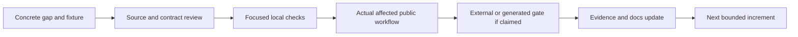

# Ferrule Compatibility and Product Roadmap

Updated: 2026-10-10

## Goal

Ferrule is an independent, portable data-mapping platform with an open project
model, a native visual editor, a CLI, host APIs, and generated Rust/C# libraries.
The goal is broad behavioral and workflow compatibility for applicable `.mfd`
designs while preserving Ferrule-native capabilities and public defaults.

Compatibility covers values, order, failures, artifacts, and external effects
for a specified format, feature, backend, platform, and workflow. Importing a
design or exporting it again does not establish all of those promises. The
[conformance inventory](conformance/README.md) remains incomplete; there is no
supported whole-product parity percentage.

Choose or claim an independent lane in [Parallel work](docs/parallel-work.md),
which links scoped issues, ownership, dependencies, and shared verification rules.

This roadmap is an execution plan.

## Current Baseline

Status snapshot: 2026-10-10, against merged main
[`6b94863`](https://github.com/DeandreT/ferrule/commit/6b94863beebbc90f0d094e1387391131f73c5a7c).
The [live coordination issue](https://github.com/DeandreT/ferrule/issues/89) tracks
later ownership and qualification changes. This two-document refresh is
[#349](https://github.com/DeandreT/ferrule/issues/349), following merged
[#337](https://github.com/DeandreT/ferrule/pull/337).

PDF isolation design [#329](https://github.com/DeandreT/ferrule/pull/329) and the
wire/library increment [#334](https://github.com/DeandreT/ferrule/pull/334) are
merged; [#325](https://github.com/DeandreT/ferrule/issues/325) is closed. The 216
local tests, 81 frozen wire cases, strict warnings and formatting pass; hosted
validation remains pending or unknown. Worker-host
[#326](https://github.com/DeandreT/ferrule/issues/326) is ongoing on
`feat/pdf-worker-host`. The primary `ResourceSetup` association is corrected;
11 worker and 52 regular CLI tests pass, alongside owned protocol, refusal,
routing, cache and signal controls. Strict-lint correction
[#348](https://github.com/DeandreT/ferrule/issues/348) and remaining host failure
controls are pending before merge. The synthetic resource-setup fixture does
not qualify a real resource-limit setup failure.
Borrowed filesystem reader [#344](https://github.com/DeandreT/ferrule/issues/344)
follows #326. GUI filesystem cancellation
[#327](https://github.com/DeandreT/ferrule/issues/327) and explicit preview input
acquisition [#340](https://github.com/DeandreT/ferrule/issues/340) follow #344;
GUI preview ownership [#341](https://github.com/DeandreT/ferrule/issues/341)
follows #327/#340. Resource qualification
[#328](https://github.com/DeandreT/ferrule/issues/328) depends on #326.
Its source-only plan has 20 recipes, 15 exact cases and
82 planned requests; all execution remains unrun. It does not depend on #327.

The [#309](https://github.com/DeandreT/ferrule/pull/309) duplication candidate
passes all 753 GUI tests and strict warnings. All 67 native calls match their
expectations: 60 successes and seven typed `MappingException` outcomes. Desktop
[#316](https://github.com/DeandreT/ferrule/issues/316) has independently accepted
all six phases with normal closure: Main copy/original/history/context has
4/6/10/6 saved pairs; Named copy/history and original/context has 10/9.
The total is 45 complete Project/layout pairs and 90 byte/JSON comparisons.
#316 is closed; earlier failed attempts remain retained. Native
Save/reopen/Save2 and main integration of #309 remain pending.

The remaining baseline observations retain the date of the
2026-10-10 10:53:09 UTC snapshot against main `0c7b2ca` in
[#299](https://github.com/DeandreT/ferrule/issues/299). The preceding
[#271](https://github.com/DeandreT/ferrule/issues/271) refresh merged in
[#280](https://github.com/DeandreT/ferrule/pull/280), with three successful hosted jobs. The earlier
[#252](https://github.com/DeandreT/ferrule/issues/252) snapshot merged in
[#255](https://github.com/DeandreT/ferrule/pull/255); its dependency maps remain dated views.
Memory-study [#249](https://github.com/DeandreT/ferrule/pull/249) and host-policy
[#251](https://github.com/DeandreT/ferrule/pull/251) are merged with three successful
hosted jobs each. Selected JSON APIs and their test-comparator correction are
merged in [#262](https://github.com/DeandreT/ferrule/pull/262): all 229 independent
native/Rust/C# calls pass. Bounded generated C# X12 options are merged in
[#265](https://github.com/DeandreT/ferrule/pull/265). Both later PRs also have three
successful hosted jobs. The #248 allocation campaign has eight measurements,
eight independent verifiers and four trace decoders accepted. Its report source and
one full rendered diagram are independently reviewed; the bounded report is
merged in [#279](https://github.com/DeandreT/ferrule/pull/279), with three successful hosted jobs.

#203's fixtures are merged in [#266](https://github.com/DeandreT/ferrule/pull/266),
with all three hosted jobs successful. The 24 public interpreter comparisons,
51 typed export refusals and 237 interchange library tests pass; fresh combined-
main 24+51 checks, workspace strict warnings and formatting pass. The test-only
parent-envelope correction #264 is closed. No faithful saved form is admitted.
The selected JSON guide [#270](https://github.com/DeandreT/ferrule/pull/270) is merged
in this main, closing #261. All three hosted jobs and fresh combined-main strict
warnings and formatting pass. Issue/PR observations were fetched individually;
they are not a claim that all remote state was observed simultaneously.

#263's earlier 41 simulated controller-policy controls remain separate from
#268's independently accepted 126 XML-oracle observations: 68 helper, 41 byte
compatibility and 17 admission checks. After the read-only staging correction
[#281](https://github.com/DeandreT/ferrule/issues/281), a saved-metadata fixture
failed before its expected rejection; [#283](https://github.com/DeandreT/ferrule/issues/283)
corrected it, and the same 41+17 controls passed fresh runs. The unchanged helper's
68 observations are inherited, not rerun or added to the distinct total.
The earlier observations are recorded in [#287](https://github.com/DeandreT/ferrule/pull/287), with three successful
hosted jobs. Read-only preparation passed, but the first native phase timed out at
180 seconds with a 398-byte XML artifact and no first save or reopen. Later read-only
#285 diagnostics also timed out; #291's presentation experiment refused its visible-UI
requirement. All 16 modeled query controls pass. The new read-only observer's
exception-path closure gap is tracked in [#302](https://github.com/DeandreT/ferrule/issues/302);
its correction is source-reviewed and all three exception models match in a completed
root-owned run, now independently accepted. These mocked branches do not
prove a live helper, thread or cleanup path; fresh observer qualification remains
pending. Live ownership/query/acknowledgment and native save/reopen
remain unproved. Source review and proven cleanup do not turn these retained negatives
into a completed native cycle.
#253's three tests / 11 internal controls, all 344 engine tests, ordinary engine
build and corrected workspace strict/format checks pass. The test-only let-chain
prerequisite [#277](https://github.com/DeandreT/ferrule/issues/277) preserves the original
warning failure and all observations. Both are merged in
[#278](https://github.com/DeandreT/ferrule/pull/278), with three successful hosted jobs.
The borrowed construction marker is not allocator telemetry or public/native parity.
#201's accepted corpus contains 28 controls (10 admitted and 18 refused), 87 snapshots
and 92 canvas tables. Three focused tests plan 29 duplication attempts. After #297
restored the locked dependency, [#298](https://github.com/DeandreT/ferrule/issues/298)'s
reviewed test-capture correction compiled and formatting passed. The first focused
unit then failed at an independent input edit: the Project changed to the new source,
but the test driver left the old canvas wire. The independently reviewed negative
retained nine primary local engine previews, zero named previews, two duplication
actions and 19 state records; 16 of 17 reached snapshot assertions matched before
the wire failure. [#300](https://github.com/DeandreT/ferrule/issues/300) corrects the
test driver's wire action and whole-checkpoint restoration;
[#301](https://github.com/DeandreT/ferrule/issues/301) corrects the frozen named-context
dispatch. The first paired source successor's type/module-path gaps and a later
pre-compilation invocation refusal remain separate from the actual wire failure.
The revised test-only source is independently reviewed, applied and formatted.
A fresh root-owned selected test now passes all ten admitted cases and all 67 local
engine previews (61 primary and six named), preserving the unchanged literals.
Independent review of those complete results is pending in this dated snapshot.
The refusal and keyboard tests, full GUI suite and two Main/Named physical sessions
with ten checkpoint pairs remain pending qualification here. Public-codec
materialization and all 29 modeled policy controls remain independently accepted.
#288's admitted child output route retained the complete ten-case run; later gates
still require fresh resource/source admission. These local engine previews do not
establish physical session or native saved/reopen parity.
No faithful new sequence saved
form is admitted. Earlier #173/#175, #182/#187 and #212/#215
snapshots remain historical records. This refresh preserves all three existing
Mermaid fence bodies and their earlier rendering/zoom limits; the current table
and prose dependencies do not establish a fresh render of those historical maps.
Compact GUI #194 and guidance #210
are merged in [#214](https://github.com/DeandreT/ferrule/pull/214). Fresh strict
warnings, formatting, one affected unit check and the production build pass;
earlier focused/full GUI and web-demo crate suites are retained separately.
Finite desktop inspection and editor-driven identity Rust/C# generation pass.
The two generated public String JSON calls each match the complete 172-byte
independent golden with normal owned host closure; earlier GUI parts needed owned
helper cleanup. Three earlier diagram fences rendered as three SVGs and six PNGs
with owned helper cleanup. The #212 final two parallel diagrams rendered as two SVGs
and four PNGs with owned helper cleanup; the unchanged roadmap fence reuses its
earlier rendered evidence. That historical current map needs scrolling or zoom at
1200 pixels, and the complete map's labels need zoom. All three hosted #214 jobs
ran zero validation steps because
of the account billing/spending restriction; those failures are not passes.

| Area | Available now | Boundary to keep visible |
| --- | --- | --- |
| Mapping | Typed graphs and scopes; nested iteration, filters, grouping, sorting, windows, aggregates, bounded ordered scalar filter/map sequences, multi-source inner joins, UDFs, dynamic properties, and ordered targets | Scalar sequence native/Rust/C# execution and the compact GUI increment are qualified in #190/#192/#193/#194; saved-design interchange, broader desktop workflows and general higher-order shapes remain separate |
| Error order | Global pre-target failure rules plus lazy, expression-owned Raise; bounded item-ordered XML exception import is explicit opt-in | Global and item-ordered failures are different; strict native export refuses unproved ordering |
| Native editor | Compact icons with full hover/details, primary/named/function canvases, undo/layout, Preview/Run/debugging, stage snapshots, and guarded import/export | Local widget tests do not establish every desktop chooser/platform workflow |
| Setup | Schema/layout import, CSV/fixed-width/FlexText/SQLite/Protocol Buffers setup, and flat XLSX worksheet settings | The flat workbook wizard does not author advanced hierarchical layouts |
| Formats | XML, JSON, JSON5, tabular, database, EDI, structured text, binary, and document adapters | Direction and exact subset are in [Supported formats](docs/formats.md); some adapters are input-only |
| JSON Schema | Per-resource reference policies, required-only object-reference siblings, exact intervals in String-or-Int and String-or-Float fields, signed-integer Float bound normalization, redundant scalar composition type siblings, and outer scalar composition bounds | Scalar domains and admission rules are in [Supported formats](docs/formats.md); broader compositions and restrictive intersections remain separately scoped |
| Generated libraries | Deterministic Rust and package-free C#; typed, strict JSON, eligible XML, explicit optional JSON5 or bounded flat CSV companions, [flat CSV input to singular X12](docs/code-generation.md#flat-csv-input-to-x12), and [static JSON/X12 selected-document companions](docs/design/generated-x12-csharp.md#static-named-documents-and-selected-output) | Every static endpoint retains its own admitted boundary; supported emission, compiled calls, physical resource checks, and external execution are separate gates |
| Large files | Per-boundary byte/item/work budgets, CSV temporary-row release and borrowed ordinary JSON output text | Input/target trees and output Strings remain materialized; the boundary budgets do not establish a total-RAM cap or streaming |
| `.mfd` | Repair-oriented default import, strict executable admission, native/extension export profiles, bounded serial chains, and guarded multi-source joins | General stage graphs, unsupported contexts, and unknown profiles remain explicit |

See [Architecture](docs/architecture.md), [Code generation](docs/code-generation.md),
[Memory use](docs/memory-and-limits.md), and [`.mfd` interoperability](docs/mfd-interop.md)
for the contracts behind these summaries.

## Current Priorities

Check a box only when that specific gate has evidence. A checked implementation
box does not close its later desktop, generated, or external-runtime gates.

### 1. Complete the flat workbook user workflow

Exit: a user can choose both schemas, reach Configure/Create without an enlarged
viewport, save and reopen the mapping, and recover the same worksheet settings.
Physical workbook cell tests and desktop persistence are separate evidence.

### 2. Close exception-ordering and integer edge qualification

- [ ] Resolve native XML root schema annotations in
  [#93](https://github.com/DeandreT/ferrule/issues/93) and retain the separately
  observed failure-publication differences. Controls and saved metadata remain
  unobserved; the latest attempt refused before settings inspection.
- [ ] Expand accepted shapes only with a concrete owner/order proof and
  counterexamples for ambiguous, shared, or fallible branches.

Exit: each claimed profile binds original inputs, expected values or errors,
produced/partial artifacts, and saved-design replay. Native partial publication
and I/O remain separately reported; schema-conforming mapping totality is not
an unrestricted publication-parity promise.

### 3. Finish generated boundary cohorts

These new sequence cohorts retain their own finite profiles and complete original
failures. They do not close broader desktop workflows, external saved-design
execution or whole-product compatibility gates. Earlier hosted jobs for the
sequence increments ran zero validation steps under a billing/spending restriction;
those failures remain distinct from later jobs. Hosted execution has resumed:
[#228](https://github.com/DeandreT/ferrule/pull/228), [#229](https://github.com/DeandreT/ferrule/pull/229) and
[#238](https://github.com/DeandreT/ferrule/pull/238) each have three successful jobs.
Other earlier mapping-job failures remain retained; pending PRs are not passes.

The four XML public-host cohorts above include small prerequisites and
separate opt-in boundary runs. The [XML qualification index](docs/generated-xml-qualification-index.md)
and [memory observations](docs/memory-and-limits.md#compiled-xml-host-observations)
were refreshed in [#133](https://github.com/DeandreT/ferrule/issues/133), merged in
[#147](https://github.com/DeandreT/ferrule/pull/147). Helper-only checks, external
execution, other designs, and a universal RAM guarantee remain separate.

Exit: compiled public calls agree with independent oracles under their declared
adapter profile. Neither a lowering pass nor one host cohort certifies every
survey design or backend.

### 4. Resolve JSON5 native metadata before widening export

- [ ] Observe the external application's JSON5 setting and saved metadata in
  isolated checkbox and filename controls.
- [ ] Identify an exact import/export representation before changing admission.

Generated companions and native metadata are independent contracts. The
[guide refresh](https://github.com/DeandreT/ferrule/issues/154) is merged in
[PR #161](https://github.com/DeandreT/ferrule/pull/161), including the measured
whole-host memory ranges. The initial generated companion scope in
[#96](https://github.com/DeandreT/ferrule/issues/96) is complete and closed.
Separate allocation attribution in
[#160](https://github.com/DeandreT/ferrule/issues/160) is available, with no
production optimization included. Native token admission and original-byte
accounting are now separately qualified in #130/#163; generated-host evidence
does not establish native component metadata or desktop behavior. The JSON5
metadata lane [#106](https://github.com/DeandreT/ferrule/issues/106) remains open.

Exit: a self-authored fixture demonstrates metadata, values, errors, and a saved
round trip. A `.json5` filename is not enough to infer a native component flag.

### 5. Deepen memory and authoring coverage without changing contracts

- [ ] For every new wizard, verify ordinary viewport reachability and normal
  desktop save/reopen, as well as state-method tests.

Exit: a change remains usable and contract-compatible, with measurements limited
to the recorded route/profile and no inferred streaming or universal benefit.

## Workstreams

### 0. Versioned Conformance and Compatibility Profiles

- [ ] Complete the applicable inventory before a whole-profile claim.
- [ ] Track import, interpreter, external export execution, self-roundtrip,
  GUI/debugging, and each generated backend independently.
- [ ] Record schema dialect, platform, runtime, driver, and application version.
- [ ] Keep unknown, blocked, partial, and unsupported cells explicit.

### A. Mapping Semantics and Interoperability

#### A1. Executable `.mfd` Common Profile

- [ ] Extend one concrete supported-path mismatch at a time, with a self-authored
  triggering design and preserved refusal controls.
- [ ] Close remaining XML root/type/namespace and JSON composition boundaries
  only when the IR can preserve them exactly.
- [ ] Preserve repair imports and legacy extension round trips while keeping
  strict executable/native admission atomic.

#### A2. N-to-M Endpoint and Stage Model

- [ ] Extend beyond the bounded serial-chain/native fan-out profile with exact
  driver, schema, owner, and stage-priority evidence.
- [ ] Add general service-host and stage-graph import/export incrementally.
- [ ] Preserve applied stage snapshots, local draft history, path rebasing,
  cancellation, and main-project independence. The GUI already edits stage
  mappings; general imported graph shapes remain the open boundary.

#### A3. Functions and Reusable Mappings

- [ ] Extend catalog-backed functions and reusable contexts with matching
  validation, interpreter, Rust, C#, and authoring contracts.
- [ ] Define explicit same-scope singular-target multiple-feed semantics in
  [#241](https://github.com/DeandreT/ferrule/issues/241) before admitting them. Preserve
  distinct expressions and the existing duplicate-binding refusal; #239's
  declared ancestor branches do not supply an inferred winner.
- [ ] Define a faithful saved form in [#203](https://github.com/DeandreT/ferrule/issues/203).
  Public Ferrule observations and typed refusal do not establish external saved-
  design execution or save/reopen. Exact stage/capture/position/error preservation
  is required before importer/exporter implementation. XML annotations and JSON5
  metadata remain separate contracts.
- [ ] Qualify one admitted native saved-file reopen/execute/save2 cycle in
  [#263](https://github.com/DeandreT/ferrule/issues/263), after complete independent
  XML oracles from [#268](https://github.com/DeandreT/ferrule/issues/268).
  #268's original 68 helper, 17 admission and 41 byte-compatibility observations
  pass independent review. #281's read-only staging and #283's saved-metadata fixture
  repairs preserve the failed controls; corrected 41+17 reruns pass, with helper 68
  inherited separately. The checkpoint is recorded in [#287](https://github.com/DeandreT/ferrule/pull/287). Native execution
  timed out before first save; #285 diagnostics and #291's presentation experiment
  retain separate negatives. Exact owned-window proof and the full save/reopen cycle
  remain pending. No filter/map seed or faithful saved form is inferred from XML parsing.

### B. Visual Authoring and Debugging

- [ ] Cover supported advanced schemas/layouts with ordinary user-facing setup.
- [ ] Retain short readable summaries, full hover/details, reachable pins, and
  canvas positions as new nodes and controls are added.
- [ ] Deepen connector/source-row inspection and context-aware debugging using
  retained real inputs, not invented preview state.

### C. Connectors and Format Breadth

- [ ] Complete worker-host [#326](https://github.com/DeandreT/ferrule/issues/326),
  ongoing on `feat/pdf-worker-host`. Initial worker/CLI and owned filesystem
  controls pass; strict-lint correction #348, affected reruns and remaining
  host failure controls are pending.
- [ ] Add borrowed filesystem reader
  [#344](https://github.com/DeandreT/ferrule/issues/344) after #326.
- [ ] Complete GUI filesystem cancellation
  [#327](https://github.com/DeandreT/ferrule/issues/327) after #326/#344.
- [ ] Add explicit preview input acquisition
  [#340](https://github.com/DeandreT/ferrule/issues/340) after #326/#344.
- [ ] Complete GUI preview ownership
  [#341](https://github.com/DeandreT/ferrule/issues/341) after #327/#340.
- [ ] Execute resource qualification
  [#328](https://github.com/DeandreT/ferrule/issues/328) after #326. Its source-only
  plan has 20 recipes, 15 exact cases and 82 planned requests; all execution
  remains unrun. This scope does not depend on #327.
- [ ] Add a typed query/write model before general database mutation modes.
- [ ] Extend adapters and transport only with confinement, cancellation,
  original-error, resource, and publication contracts.
- [ ] Keep input-only adapters and unsupported schema/configuration variants
  explicit in the format matrix.

### D. Generated Execution

- [ ] Grow compile-and-call coverage for applicable mappings and public adapters.
- [ ] Add other language/backend targets as independent implementations and
  gates; the current emitters are Rust and C#.

### E. Product, Packaging, and Automation

- [ ] Diagnose and repair the actual Pages deployment HTTP 404 in the available
  [#247](https://github.com/DeandreT/ferrule/issues/247) lane. The successful site build
  does not establish publication; workflow/configuration work stays separate from
  site content and mapping implementation.
- [ ] Package reproducible runtimes and examples with clear host boundaries.
- [ ] Design reusable libraries, projects, configuration, and automation without
  implying compatibility with another product's proprietary package format.
- [ ] Treat optional services and external server deployment as separately
  versioned profiles, not prerequisites for ordinary mapping.

## Release Gates

A broad milestone remains open until all its applicable cells are qualified.

| Gate | Evidence required |
| --- | --- |
| M0 — Measurable contract | Complete applicable inventory, independent evidence cells, and honest unknowns |
| M1 — Trustworthy native interchange | Strict import, local values/errors, export, external execution, and saved replay |
| M2 — General semantic foundation | Composable value/context/stage invariants and backward-compatible execution |
| M3 — Complete authoring and debugging | Real controls, locks/history, normal viewport, save/reopen, preview/run, and cancellation |
| M4 — Enterprise execution breadth | Applicable formats/connectors, external effects, rollback/faults, and measured resource envelopes |
| M5 — Full compatibility and product parity | All applicable generated and product-workflow cells qualified; blocked/unknown cells narrow the claim |

Failure at a gate keeps its original observations and narrows the claim; a
later correction does not erase the earlier result. See
[Development and verification](docs/development.md) for practical checklists.

## Compatibility Boundaries

- All checked-in fixtures are self-authored. External behavior and licensed
  resources remain separately controlled evidence, not copied repository data.
- Pixel-identical UI and byte-identical design serialization are not required;
  values, ordering, editable structure, failures, and applicable workflows are.
- Strict admission is useful only when it preserves the accepted semantics.
  Unsupported or unproved shapes must retain a typed refusal before publication.
- Ferrule-native capabilities stay available outside the strict native profile.
- Standard Boolean `and` and `or` calls accept two or more strict Bool operands
  with eager left-to-right evaluation and ordered type checking. The
  [variadic Boolean contract](docs/design/variadic-boolean-calls.md) keeps broader
  nullable logical compatibility separately qualified.
- A local round trip, a green test total, or a nearby qualified feature does not
  close an unknown capability or establish full-product compatibility.

## Primary References

Use the current source and focused contract documents linked above. Any external compatibility update must bind the exact
primary documentation and application version used for that update.
