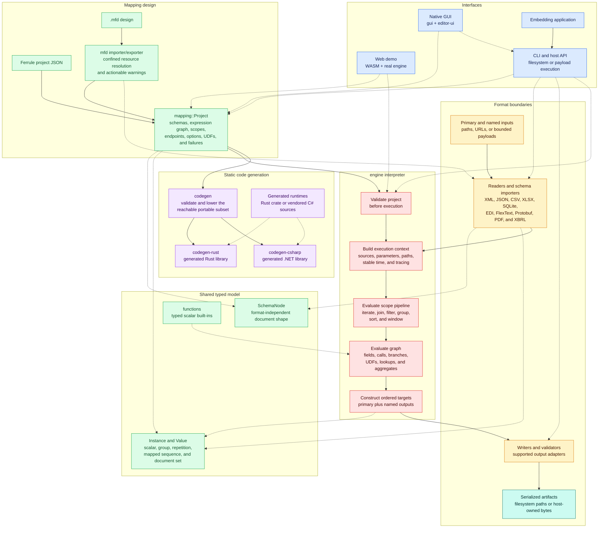
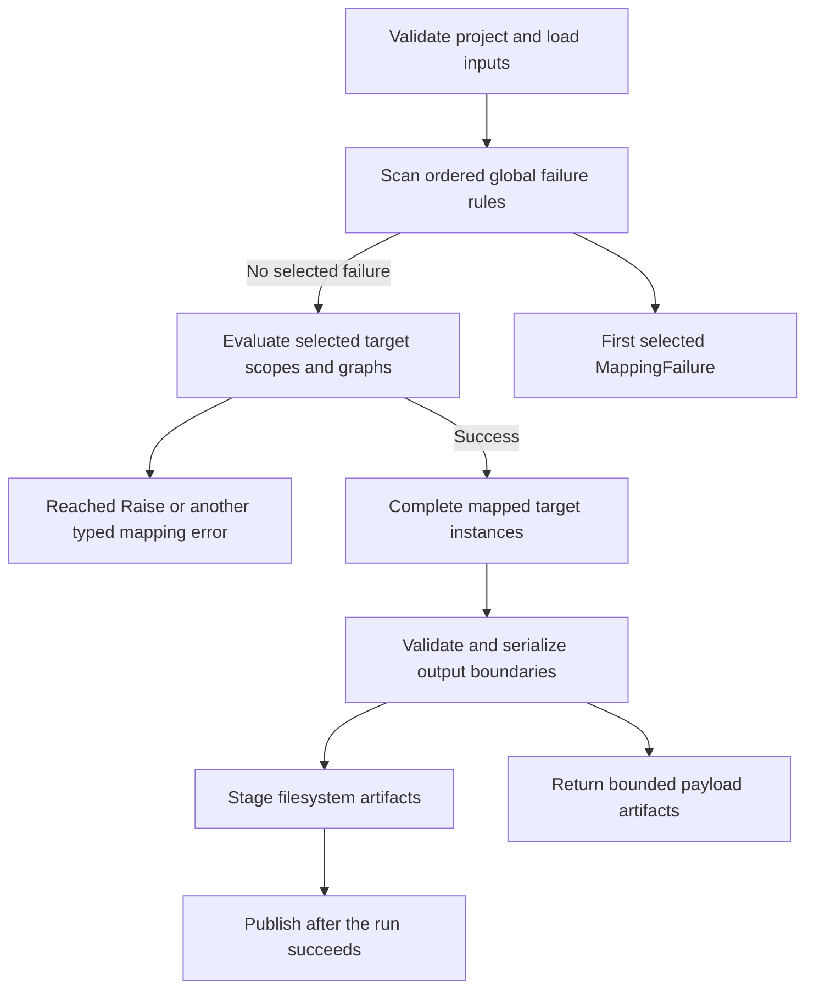

# Mapping Model and Workspace Architecture

## System Architecture

Solid arrows show data and emitted-artifact flow. Dotted arrows show crate
dependencies or design-time relationships. An [editable draw.io version](architecture-parity.drawio)
contains the architecture and qualification-gate views.

## Project Model

A ferrule project is plain JSON built from four main concepts:

1. **Schemas** describe source and target trees. Nodes are named scalar or group
   values and may be repeating, attributes, nullable, fixed, or dynamically
   named where the target format permits it. `SchemaNode::effective_view`
   derives, without changing the saved schema, one node's cardinality (single
   with required or optional declared XML presence, or repeated with exact JSON
   item bounds and value or nested-array items) and the null-like values each
   layer admits: XML nil, and JSON null for a single occurrence or separately
   for an array and its items. Absence is never one of those values.
   Contradictory role metadata has no view. `effective_xml_view` and
   `effective_json_nullability` derive one layer alone, so a boundary that
   consults only XML or only JSON is unaffected by the other format's metadata;
   the XSD and JSON Schema exporters write occurrences, attribute use, nil and
   null from these layers, and the JSON range validator admits null from the
   scalar value layer. The JSON instance reader and writers accept and emit
   object, array-container, object-item and scalar null from the same JSON
   layers and refuse a schema whose JSON null metadata has no view before any
   value is read or written. The XML instance readers and writer admit
   `xsi:nil` from the XML layer, and the structured XML input profile and the
   primary-root gate read root presence and nil from it.
   `json_property_presence` reports a JSON object property's declared presence
   from its parent's required list, independent of its null admission. `.mfd`
   import proofs that need present or non-null source paths derive those
   facts from the views, keeping object-item null
   separate from occurrence and array-container null. Consumers that combine
   these facts should use the views rather than re-reading the individual
   flags. `check_json_array_wrapper_frame` is the single exact-shape check
   for a nested-array wrapper frame and names its first departure from that
   shape; saved-project deserialization, the JSON readers and writers and
   JSON Schema export refuse a malformed frame, and engine validation reports
   it at the frame's schema location.
2. **Graph nodes** compute scalar values. Nodes read source fields and positions,
   hold constants, call built-in functions, branch lazily, translate value maps,
   perform lookups and joins, reduce collections, and access selected runtime
   values, or raise a typed error when their expression is reached.
3. **Scopes** construct target groups. A scope can iterate source collections,
   generated scalar sequences, document sets, or validated joins, or construct
   zero or one group in its parent context from a Boolean presence expression,
   then filter,
   group, sort, window, bind fields, and construct child scopes. The default
   `Constructed` constructor requires a group target schema; scalar targets use
   explicit `Scalar` construction. Project validation checks this shape for
   primary and named targets before lowering or executable design admission.
4. **Endpoints** identify the primary input and output plus optional named
   sources and targets. Stored paths can be overridden by the host or CLI.

Library hosts execute through `cli::RunOptions`, which combines path overrides,
bounded typed runtime parameters, and optional tracing. A successful
`RunOutcome` retains every atomically published file in deterministic
primary-then-extra target order. `RunOptions::with_target` can instead evaluate
one primary or named target; unselected target scopes are not evaluated or
published, while the default all-target mode keeps its collision checks.

Every host route (`run`, standard streams, `run-pipeline`, payload execution,
`run-rest-json`, and generation) prepares an immutable request before it
acquires anything. Preparation resolves the known input and output identities
into a `cli::RoutePlan`, admits the requested trace and debug observers, applies
the execution policy to every known location, and refuses an unsupported route
combination with a typed error such as `cli::RouteRefusal`. No input, standard
stream, request file, output, trace stage, or directory is touched by a refused
request. `PreparedFileRun` and `PreparedStreamRun` execute such a request,
refusing any observer it did not admit; `plan_run`, `plan_file_run`,
`plan_pipeline_run`, `plan_payload_run`, `plan_rest_json_run`, and
`plan_generate` report the plan without executing it. The generation plan
applies the selected `GenerateProfile`'s backend requirement and boundary
policies, lowering, runtime resolution, and in-memory emission in the
generating call's order, so it refuses whatever generation would refuse before
writing.
`RunOptions::with_cancellation` and `PipelineRunOptions::with_cancellation`
stop a run at acquisition, interpreter control, and publication boundaries
without a trace sink or host debug hook. They cannot interrupt one synchronous
parser or request.

The GUI queries these plans before Run, Debug Run, a pipeline run or preview,
or Generate saves the project or starts a worker, and shows the refusal
instead. Run JSON request queries `plan_rest_json_run` before its form asks for
request files or a grant, and again for the exact project snapshot a started
request owns, before any request file is read or connection opened. Preview,
pipeline, live-request, and library-generation workers are owned by their
exact thread handles: an outcome is reported only after the thread has been
joined, and dropping an unfinished owner cancels it where cancellation exists
and then waits for the thread to exit.

These host services stay in the `cli` crate, re-exported from its root. Route
capability is a query over the runners themselves: its plans come from
`PreparedFileRun`, `PreparedStreamRun`, the pipeline runner, generation
preparation, and the REST JSON preflight, so a separate crate would either
carry those runners and their format, code-generation, and HTTP dependencies
with it or hide them behind traits that only `cli` implements. Neither removes
a dependency from any consumer: the GUI also executes, previews, traces,
imports, and generates through `cli`, so it would still depend on the whole
crate. `OwnedWorker` is a standard-library-only type private to the GUI and
tested in place. Extract a crate only when a consumer can drop `cli` or a
heavy dependency as a result.

Hosts that own transport and persistence can instead use
`cli::PayloadRunOptions`. Each input carries bounded bytes plus a logical path
that selects its format and supplies dynamic-source identity. The runner accepts
named static and dynamic secondary documents and returns bounded serialized
`PayloadArtifact` values in the same target order without touching output
paths. It supports the same explicit target selection, including applying a
logical output-path override to the selected named target. SQLite and
update-existing XLSX stay on the filesystem runner because their behavior
depends on persistent prior state.

The CLI exposes that payload boundary as `ferrule run PROJECT - -`: stdin is
the primary document and stdout receives raw bytes only when exactly one
artifact is produced. The configured source and target paths remain the
logical format identities; named sources remain ordinary local paths. This
mode rejects per-item dynamic named sources and all persistent-state operations
before stdout is written.

The `run --trace-json PATH` option streams interpreter events into a private
sibling staging file and publishes it only after successful execution. Each
JSON Lines record has a versioned envelope, deterministic sequence number, and
a tagged node or scope/control event. Failed mappings leave an existing trace
untouched. See [Execution tracing](tracing.md) for the stable wire contract.

During execution, source contexts form a stack. Field resolution begins at the
innermost frame and falls outward, which allows parent values to broadcast into
nested target rows. Repeating source paths can cross several collection levels;
generated sequences and joins use their own typed iteration contexts. Absent
values remain explicit rather than terminating a run.

## Evaluation and Publication Order

Global failure rules and graph Raise nodes have different ownership and timing.
An ordered failure rule scans its collection before any target evaluation; its
message is evaluated only for the first selected item. Raise is an ordinary
expression node: an unselected lazy branch never raises, while a reached Raise
reports its node identity. Import/export must preserve that distinction rather
than infer equivalence from two similar filter branches.

Selected-target execution skips unrelated targets, while global rules still
precede target evaluation. Preview returns in-memory results without output
publication. Filesystem and payload hosts have distinct stateful-operation and
budget contracts; this diagram does not promise a transaction over arbitrary
external services or databases. See [Pipelines](mapping-pipelines.md) for
stage ordering and [Memory use](memory-and-limits.md) for materialization.

## Authoring and Compatibility Boundaries

The native editor uses the same project model for primary, named-target, and
function canvases. Compact glyphs keep closed nodes small; full hover identities,
pin semantics, and property/details popovers retain the information needed to
edit them. Layout is adjacent metadata rather than mapping behavior.
Editor history is one linear sequence of typed commands, which name the node,
scope, binding, scope-setting, and child-scope identities they change and apply
or invert atomically, and snapshots of edits still applied in place. Node
removal, wire connection and disconnection, palette insertion, node property
edits, binding panel additions, retargets, and removals, scope-setting edits
(source iteration, filter, grouping, sort, windows, and output), computed
property rows, child scope addition, subtree expansion, and scope removal, join
creation, key edits, and joined outputs, filter/map creation and stage edits,
XML type selection and inference, and sequence consumer duplication are
commands, including those made in a pipeline stage's embedded editor. A frame's
commands form one history step only when together they explain the frame's
change, and the frame becomes a snapshot otherwise; continued typing or
dragging in one property or setting extends its step. Separate semantic and
layout revisions track the save point, so a layout-only change never marks
mapping content as changed.

Imported repair drafts, strict executable projects, native-compatible exports,
and generated libraries are distinct products of validation. Each has an
explicit admission boundary. The [roadmap](../ROADMAP.md) tracks the remaining
workflow and cross-runtime gates, and [Development](development.md) explains
what evidence closes each gate.

## Workspace Layout

<!-- BEGIN GENERATED workspace from docs/reference/workspace.toml; edit that file and run `cargo run -p reference-docs` -->
### Core model and execution

- `crates/ir`: Format-independent schema, scalar value, and instance trees
- `crates/mapping`: Serialized project, graph, scope, join, and format-option
  model
- `crates/functions`: Scalar built-in function library
- `crates/engine`: Project validation and mapping interpreter

### Code generation

- `crates/codegen`: Backend-neutral lowering, validation, and artifact model
- `crates/codegen-schema`: Lossless embedded schema descriptors for generated
  mappings
- `crates/codegen-runtime`: Runtime primitives linked by generated Rust mappings
- `crates/codegen-rust`: Deterministic Rust library emitter
- `crates/codegen-csharp`: Deterministic C# library emitter

### Format adapters

- `crates/format-xml`: XSD-lite and DTD import and XML instance I/O
- `crates/format-json`: JSON Schema import and JSON, JSON Lines, and JSON5
  instance I/O
- `crates/json-pattern`: Bounded portable JSON Schema `pattern` compiler and
  matcher
- `crates/format-csv`: Delimited and fixed-width flat file I/O
- `crates/format-xlsx`: XLSX worksheet I/O
- `crates/format-db`: SQLite introspection and instance I/O
- `crates/format-edi`: X12, EDIFACT, HL7 v2, TRADACOMS, SAP IDoc, and SWIFT MT
  I/O
- `crates/format-flextext`: Bounded FlexText layout I/O
- `crates/format-protobuf`: Validated proto2/proto3 layouts and binary I/O
- `crates/format-pdf`: Bounded visual PDF source extraction
- `crates/pdf-worker`: Bounded PDF worker wire protocol and opt-in filesystem
  host
- `crates/format-xbrl`: Bounded XBRL instance table projection

### Interfaces and interoperability

- `crates/mfd`: `.mfd` import and export
- `crates/cli`: Headless validation, execution, schema import, interop, and code
  generation
- `crates/editor-ui`: Shared editor presentation and interaction logic
- `crates/gui`: Native egui mapping editor
- `crates/web-demo`: WebAssembly playground built around the real mapping engine
- `site`: Static project site and web-demo deployment shell

### Project tooling

- `crates/mfd-conformance`: Versioned MFD capability inventory and evidence
  validation
- `crates/reference-docs`: Generator and freshness check for shared technical
  references
<!-- END GENERATED workspace -->

See [Supported formats](formats.md) for adapter direction and boundaries.

## Design Principles

- Format adapters depend on the shared instance model instead of one another.
- Unsupported imports should preserve useful work and emit an actionable warning.
- Runtime errors remain typed and identify the responsible mapping construct.
- Generated mappings contain static scope and expression functions rather than
  embedding the complete project interpreter.
- Project files remain open and inspectable; pre-1.0 public APIs may evolve as
  invalid states move into stronger types.
