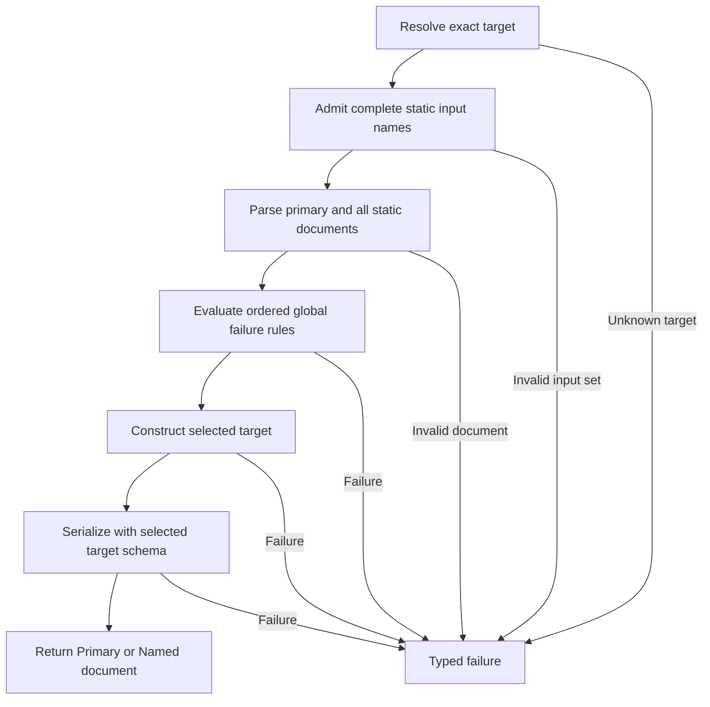

# Rust and C# Code Generation

Generate a standalone Rust crate or package-free .NET 10 library from a
validated mapping. From the repository root, try the
[example mapping](../examples/codegen/project.json); choose a new output directory:

```sh
cargo run -p cli -- generate --project examples/codegen/project.json --language csharp --out generated-csharp
cargo run -p cli -- generate --project examples/codegen/project.json --language rust --rust-runtime-path crates/codegen-runtime --out generated-rust
```

The [paired hosts](../examples/codegen/README.md) show how to build the libraries
and compare their results with the expected JSON. Both backends lower the same
reachable program. An unsupported reachable construct refuses generation before
publication; a successful typed mapping does not guarantee every document adapter.

| What will the host pass? | Where to start |
| --- | --- |
| Typed instances; optional execution context, parameters or named inputs | [C#](#c) or [Rust](#rust); [library identities and manifests](#library-identities-and-compatibility-manifests) |
| Strict JSON or XML text/bytes | [JSON](#json-host-boundary) or [XML](#xml-host-boundary); distinguish selecting one target from returning the primary of a complete run |
| Flat files, EDI or a filename-driven document | [CSV](#flat-csv-output), [X12](#explicit-c-x12-companions), [JSON5](#explicit-json5-companions), [workbooks](generated-flat-xlsx.md) or [filename plans](design/primary-document-filenames.md) |
| A mapping with explicit source/frame ownership | [Basic presets and their exact capabilities](#owned-generation-capabilities-and-presets) |
| The portable operations and their limits | [Portable subset](#portable-subset) |

## Generate a Library in the Native Editor

Choose **File → Generate Library** to generate Rust or C# library source for the
entire project. Select the language and enter a new library folder. **Choose
parent...** selects its parent folder while retaining the new folder name.
Rust also requires ferrule’s `codegen-runtime` folder containing `Cargo.toml`;
C# includes its package-free runtime sources.

Select **Include CSV output** to add CSV methods for a flat row table using the
mapping’s output settings. The choice is saved with the generation request; it
does not change the mapping itself.

**Save and generate** saves first. For an untitled mapping, the folder finally
chosen in Save As determines relative library and runtime paths. A failed or
canceled save leaves generation unstarted. During generation the editor locks
project actions and defers close until the background writer finishes. Build
the published source with the [project toolchain](toolchains.md).

<a id="output-safety"></a>

## Output Filesystem

The source writer stages a complete library beside its destination, then
publishes it with an atomic directory rename that refuses an existing
destination. This protects folders that appear during generation, including
empty folders. The destination filesystem and the CLI's operating-system
runtime must support that operation. On Linux, this requires the filesystem's
[`RENAME_NOREPLACE` support](https://man7.org/linux/man-pages/man2/rename.2.html).

On failure the writer retains the OS cause and attempts to remove its own staging
tree. Use a destination filesystem with no-replace rename support. For example,
use the Linux filesystem with a WSL CLI, or a native Windows CLI for a Windows
destination. The same requirement applies to optional companions.

## Owned generation capabilities and presets

In the Basic Rust and C# profiles, a target ValueMap retains its input
dependencies, ordered cases, typed keys and results, null handling and literal
default. An input error is returned before the default can be selected. Input
planning includes both branches of an If, parameter defaults and Raise
messages; execution still evaluates only the selected branch. An explicit empty
frame replaces the surrounding path.

Both emitters validate stored source ownership before emission. They inventory
called functions in stored order and omit dead ordinary nodes and unused
ordinary definitions. Private ordinary failure renderers can evaluate ValueMaps
in predicates and messages, in iteration, predicate, then message order. Public
Basic failure rules still refuse ValueMaps.

Explicit owned generation admits exactly one `codegen::OwnedCapabilities` set.
Each field is an independent permission; a closed permission keeps that
construct's existing typed refusal:

| Field | Admits |
| --- | --- |
| `controls.filter`, `controls.sort`, `controls.windows` | Static Basic filtered, sorted, and windowed (or implicit `First`) scope shapes; a sorted shape may filter and a windowed shape may filter and sort |
| `grouping` (`by`, `adjacent_by`, `starting_with`, `ending_with`, `into_blocks`) | Static grouped scopes in each listed mode, with filters, sorts, windows and member retention |
| `failures.primary_rows`, `failures.owned_sources` | Owned reads in authenticated primary-row failure rules; failure rules that walk one exact owned endpoint |
| `sequences` (`item_at`, `exists`, `aggregate`, `owned_recursive_item_at`) | `SequenceItemAt`, `SequenceExists` and `SequenceAggregate` over the four scalar producers; `SequenceItemAt` over an owned recursive collection walk |
| `constructions` (`path_hierarchy`, `adjacency_tree`, `recursive_filter`) | Owned path-hierarchy collections, owned adjacency-tree rows, and recursive filtering of a scope's own owned selector |
| `search.lookup_find`, `search.collection_aggregates` | Owned `Lookup`/`CollectionFind`; owned collection aggregates |
| `dynamic_fields` | Owned dynamic source-field reads |
| `dynamic_loading` | Owned dynamic driver loading: a loading scope walks its endpoint's exact driver collection, evaluates the path in each driver item, and exact field and position reads see the loaded document |
| `xml` (`Closed`, `Serialize`, `MixedContent`, `MixedConstruction`) | Nested owned XML operator levels |
| `joins` | Owned inner join scopes, their tuple reads, and owned joined aggregates |
| `document_sets` | Ungrouped owned scopes over a document-set endpoint walk each member as its owner's root, and owned document-path reads return the exact owner's active member location |
| `dynamic_document_paths` | With `dynamic_loading`, owned document-path reads of an owned dynamic endpoint return the logical path that loaded its active document |
| `xml_document_sets` | XML document-set entry points: the primary and every static named endpoint arrive as ordered XML member lists read through the structured profile; composes with `document_sets` |

`OwnedCapabilities` is read by one closed-context validator, one Basic emission
validator, the named-input planner, lowering (owned join scopes pass the
lowering preflight only with `joins`), and both emitters. The Rust emitter
chooses the narrowest renderer covering the set (filter, sort, or the general
renderer for windows and beyond); the general renderer and the C# emitter read
grouping modes, failure permissions, sequence consumers, constructions and
joins from the same set.

Every public explicit entry point is a named `codegen::OwnedPreset`. Its
capabilities come from one declarative table in `crates/codegen/src/capabilities.rs`:

| Preset | Entry suffix | Controls | Grouping | Failures | Sequences | Constructions | Search | Dynamic fields | Dynamic loading | XML | Joins | Document sets | Loaded document paths | XML document sets |
| --- | --- | --- | --- | --- | --- | --- | --- | --- | --- | --- | --- | --- | --- | --- |
| `ControlFree` | `sources` | — | — | — | — | — | — | — | — | — | — | — | — | — |
| `Filters` | `filters` | filter | — | — | — | — | — | — | — | — | — | — | — | — |
| `Sort` | `sort` | filter, sort | — | — | — | — | — | — | — | — | — | — | — | — |
| `Windows` | `windows` | all | — | — | — | — | — | — | — | — | — | — | — | — |
| `RowFailures` | `row_failures` | all | — | rows | — | — | — | — | — | — | — | — | — | — |
| `GroupBy` | `group_by` | all | By | rows | — | — | — | — | — | — | — | — | — | — |
| `SequenceItemAt` | `sequence_item_at` | all | By | rows | ItemAt | — | — | — | — | — | — | — | — | — |
| `GroupAdjacentBy` | `group_adjacent_by` | all | By–AdjacentBy | rows | ItemAt | — | — | — | — | — | — | — | — | — |
| `GroupStartingWith` | `group_starting_with` | all | By–StartingWith | rows | ItemAt | — | — | — | — | — | — | — | — | — |
| `GroupEndingWith` | `group_ending_with` | all | By–EndingWith | rows | ItemAt | — | — | — | — | — | — | — | — | — |
| `GroupIntoBlocks` | `group_into_blocks` | all | all | rows | ItemAt | — | — | — | — | — | — | — | — | — |
| `FailureSources` | `failure_sources` | all | By–EndingWith | rows, owned | ItemAt | — | — | — | — | — | — | — | — | — |
| `PathHierarchy` | `path_hierarchy` | all | By–EndingWith | rows, owned | ItemAt | hierarchy | — | — | — | — | — | — | — | — |
| `AdjacencyTree` | `adjacency_tree` | all | By–EndingWith | rows, owned | ItemAt | hierarchy, tree | — | — | — | — | — | — | — | — |
| `RecursiveCollect` | `recursive_collect` | all | By–EndingWith | rows, owned | ItemAt, owned recursive | hierarchy, tree | — | — | — | — | — | — | — | — |
| `RecursiveFilter` | `recursive_filter` | all | By–EndingWith | rows, owned | ItemAt, owned recursive | all | — | — | — | — | — | — | — | — |
| `LookupFind` | `lookup_find` | all | all | rows, owned | ItemAt, owned recursive | all | Lookup/Find | — | — | — | — | — | — | — |
| `DynamicField` | `dynamic_field` | all | all | rows, owned | ItemAt, owned recursive | all | Lookup/Find | yes | — | — | — | — | — | — |
| `DynamicLoading` | `dynamic_loading` | all | all | rows, owned | ItemAt, owned recursive | all | Lookup/Find | yes | yes | — | — | — | — | — |
| `CollectionAggregates` | `collection_aggregates` | all | all | rows, owned | ItemAt, owned recursive | all | all | — | — | — | — | — | — | — |
| `Joins` | `joins` | all | all | rows, owned | ItemAt, owned recursive | all | Lookup/Find | — | — | — | yes | — | — | — |
| `SequenceExists` | `sequence_exists` | all | By–EndingWith | rows | ItemAt, Exists | — | — | — | — | — | — | — | — | — |
| `SequenceAggregate` | `sequence_aggregate` | all | By–EndingWith | rows | ItemAt, Exists, Aggregate | — | — | — | — | — | — | — | — | — |
| `XmlSerialize` | `xml_serialize` | all | all | rows, owned | ItemAt, owned recursive | all | Lookup/Find | yes | — | Serialize | — | — | — | — |
| `XmlMixedContent` | `xml_mixed_content` | all | all | rows, owned | ItemAt, owned recursive | all | Lookup/Find | yes | — | MixedContent | — | — | — | — |
| `XmlMixedConstruction` | `xml_mixed_construction` | all | all | rows, owned | ItemAt, owned recursive | all | Lookup/Find | yes | — | MixedConstruction | — | — | — | — |
| `DocumentPaths` | `document_paths` | all | — | — | — | — | — | — | — | — | — | yes | — | — |
| `DynamicDocumentPaths` | `dynamic_document_paths` | all | all | rows, owned | ItemAt, owned recursive | all | Lookup/Find | yes | yes | — | — | yes | yes | — |
| `XmlDocumentSets` | `xml_document_sets` | all | — | — | — | — | — | — | — | — | — | yes | — | yes |

Each row backs `lower_with_basic_owned_<suffix>`,
`validate_program_with_basic_owned_<suffix>`, the matching
`validate_basic_owned_*_emission`, `legacy_named_input_admission_plan_with_basic_owned_<suffix>`
and `emit_with_basic_owned_<suffix>` in both emitters. `ControlFree` keeps its
existing `validate_basic_owned_emission` and `emit_with_basic_owned_sources`
entries, and ordinary `lower`, `validate_program` and
`legacy_named_input_admission_plan` validate with its capabilities and without
the Basic gate. `DynamicLoading` libraries also expose loader-taking execution
entries. Hosts can also call `lower_with_owned_capabilities`,
`validate_program_with_owned_capabilities`,
`validate_basic_owned_emission_with_capabilities` and
`legacy_named_input_admission_plan_with_owned_capabilities` with a preset's
`capabilities()`.

The `owned_capability_presets` CLI test applies every preset entry point to
every owned conformance subject and compares accept/refuse results, diagnostic
digests, plan digests and generated-artifact digests with the record in
`crates/cli/tests/code_generation/fixtures/owned_capability_presets.txt`. Set
`FERRULE_UPDATE_OWNED_CAPABILITY_PRESETS=1` to rewrite the record after an
intended admission change.

To add a capability:

1. Add a field (or a variant of an existing component) to `OwnedCapabilities`
   in `crates/codegen/src/capabilities.rs`, extend `is_within`, and set it in
   the preset table rows that grant it. Existing rows keep their value.
2. Put its validator checks in their own module under
   `crates/codegen/src/validate/owned_sources/` as `OwnedCapabilities` methods,
   and consult them at the one closed-context arm (`admission.rs`) and Basic
   inventory arm (`basic.rs`) for the construct; structural checks belong in
   `validate_structure`.
3. Read the field in the Rust general renderer and the C# Basic renderer where
   the construct is rendered.

To add a preset, add one `OwnedPreset` variant and table row, one
`owned_presets!` row in `crates/codegen/src/presets.rs`, and one
`owned_presets!` row in each emitter's `lib.rs`, plus its row in the
`owned_capability_presets` test and a regenerated record.

## Explicit Basic owned-source JSON documents

`emit_with_basic_owned_sources` adds compact JSON document adapters to the
control-free Basic typed entry family. Rust exposes
`execute_json_outputs_with_basic_owned_sources` and
`execute_json_selected_target_with_basic_owned_sources`, plus the corresponding
`execute_json_bytes_outputs_with_basic_owned_sources` and
`execute_json_bytes_selected_target_with_basic_owned_sources` UTF-8 methods.
C# exposes `ExecuteJsonOutputsWithBasicOwnedSources`,
`ExecuteJsonSelectedTargetWithBasicOwnedSources`,
`ExecuteJsonBytesOutputsWithBasicOwnedSources`, and
`ExecuteJsonBytesSelectedTargetWithBasicOwnedSources`.

Every call requires the explicit five-field owned-source policy and an execution
context argument (`None` / `null` is permitted for the context). Rust all-output
arguments are `(source, inputs, execution, limits)`; selected calls append
`selection`. C# all-output arguments are `(source, inputs, limits, execution)`;
selected calls place `selection` immediately after `source`. There are no
implicit-policy overloads. A zero-valued policy is a supplied policy, not an
omitted argument.

Selected calls resolve the exact target identity before policy admission or
input parsing; C# first checks its source and selection arguments for null.
Admission then checks the complete catalogue and bounded metadata before
inspecting supplied document handles. Unexpected and duplicate names are
reported in supplied order, followed by missing legacy-required bindings in
catalogue order. Owned-only inputs may be omitted; reaching an unavailable
owner during evaluation preserves its typed failure. A supplied optional input
is still parsed even when its consuming target is not selected.

After metadata admission, parsing consumes the primary document first, then
each captured supplied document in its original order. C# reads the supplied
list's count once and each reached item once. The adapter preserves original
declaration ordinals, constructs one checked Basic root context and executes
the selected or all-output route once. All required serialization completes
before an output set is returned.

Outputs use schema field order and compact UTF-8 without a BOM or trailing
newline. For example, `{"Value":"P.root"}` and `{"Value":"N.root"}` each
occupy 18 bytes; `[{"Value":"N1"},{"Value":"N2"}]` occupies 31 bytes. A
selected document matches the corresponding all-output document. Ordinary
JSON adapters retain their pretty-printed, trailing-newline format.

The strict byte routes preserve original UTF-8 failures: Rust's additive
`parse_json_bytes_with_utf8_cause` returns `JsonBoundaryError::InvalidUtf8` with
the original `Utf8Error` as its source; C# retains its decoder exception.
Existing Rust `parse_json_bytes` keeps its original error representation.
Document/schema size and shape validation remain independent of owned-source
limits; output validation uses normalized typed values without reparsing
floating-point text.

Admission retains at most two fixed-record buffers: `N` snapshot slots for the
complete named catalogue and `M <= N` parsed slots. A checked companion
reservation `A = 2N + 16` is disjoint from the existing base Basic primitive
allowance `P`; the combined envelope is checked as `P + A`. Native buffer
representability is checked separately. The factory retains its original
policy and allowance. These bounds cover adapter bookkeeping and the base
Basic primitives, not document trees, codec allocations or process memory.
Filter, sort, window and row-failure emitters retain their separate API profiles.

## Owned reads in scalar targets

Scalar target construction belongs to the common Basic owned-source subset, so
the control-free `emit_with_basic_owned_sources` companion and every later
owned companion admit owned field and position reads in it. This covers a root
scalar target, a nested non-repeating scalar field and a repeated scalar field
driven by an ordinary or owned source iteration, in primary and named targets.
The scalar expression evaluates once in its receiving context and creates no
source frame. Owned reads keep their exact owner, frame pins and positions;
branches stay lazy and call arguments evaluate left to right. The target domain
applies the ordinary exact numeric adaptation: an integer becomes a float only
when representable, an integral float becomes an integer, and other values keep
their runtime tag. An absent field yields Null, while an unsupplied owner fails
only when the selected target reaches it.

Owned reads must be schema-compatible scalar fields or positions. A generated
item, a join, document iteration, a user function or an aggregate argument keeps
its own capability diagnostic beneath a scalar target. Grouped scalar scopes
remain limited to the grouping companions, and exact whole-group copies remain
closed special construction. The ordinary emitters keep refusing every owned
read. The [scalar construction corpus](../conformance/basic-owned-scalar-construction/README.md)
records the shared expected outcomes, including each explicit limit.

## Explicit Basic owned-source windows

Library hosts can select the static Basic owned-source window profile with
`codegen::lower_with_basic_owned_windows`, followed by
`codegen_rust::emit_with_basic_owned_windows(&program, &options)` or
`codegen_csharp::emit_with_basic_owned_windows(&program)`. The profile supports
ordinary static primary/named `Source` and `OwnedSource` iterations over Group
or Scalar values, optional boolean filtering, stable multi-key sorting, and
ordered `SkipFirst`, `First`, `From`, inclusive `FromTo`, and `Last` windows.
Implicit First output applies to nonrepeating Group targets; repeated Scalar
targets can use explicit windows.

Bounds evaluate once in the parent context, in declaration order. Without
sorting, bounds precede predicates. With filter-then-sort, bounds follow the
predicate and key passes; with sort-then-filter, bounds follow the key pass and
precede predicates. Every required predicate runs before window selection or
target construction. Later bounds still evaluate when an earlier window empties
the cohort. Implicit First appends a final `First(1)` operation. Raw positions
are visible to sort keys and pre-sort predicates, sorted positions to post-sort
predicates, and compact final positions to target bindings and children. Outer
iteration positions remain attached to their original frames.

Generated calls use `execute_with_basic_owned_sources` /
`execute_selected_with_basic_owned_sources` in Rust and
`ExecuteWithBasicOwnedSources` / `ExecuteSelectedWithBasicOwnedSources` in C#.
Each call supplies an explicit owned-source policy bounding roots, active frames,
path segments, metadata bytes, and walk contexts. Window processing validates
the complete source-cohort witness and charges retained contexts, sort keys,
and selection storage to the same cumulative operation budget. Typed predicate,
key, bound, and target errors preserve their evaluation order and original cause.

The window companion has its own admission gate. Grouping, joins, generated or
document iteration, dynamic sources, user functions, and special construction
are outside this Basic profile. Ordinary generation and the narrower
owned-source, filter, and sort companions retain their respective contracts.

## Explicit Basic primary-row failures

`codegen::lower_with_basic_owned_row_failures` combines the window target profile
with a separate global-failure permission. Emit with
`codegen_rust::emit_with_basic_owned_row_failures(&program, &options)` or
`codegen_csharp::emit_with_basic_owned_row_failures(&program)`. Direct Program
callers can use `validate_basic_owned_row_failure_emission`; the corresponding
`legacy_named_input_admission_plan_with_basic_owned_row_failures` retains global
failure dependencies for every target selection. Existing generation companions
keep their previous failure gates.

A potentially owned rule must use one nonempty static source-collection segment
under the Primary Group schema. At execution, its selected base must be the
actual Primary Group root: named-source fallback, even to an aliased payload,
does not establish ownership. The bounded observed walk retains borrowed row
frames and raw structural positions, including null slots. A plain singleton
does not gain a repetition position. Named owned fields read immutable static
roots with no frame pin or an explicit empty root pin; named positions and
nonempty named pins are outside this profile.

The authenticated collection path does not require a same-name named input.
Legacy reads in the rule's predicate or message still contribute their eager
named-input requirements. Ordinary rules retain the ordinary collection-alias
requirement, including when mixed with authenticated rules.

Rules run once in stored order before any selected or all-target output. Each
complete row cohort's count and metadata are admitted before predicates; each
reached terminal is checked before its predicate or message. An earlier selected
failure therefore precedes an unsupported later terminal. Predicates and scalar
branches retain their normal evaluation rules, and messages run only for the
first selected row. Ordinary rules without potential owned reads keep their
ordinary route, independently of owned targets or other rules.

Generated execution uses the same explicit-policy Basic entry points described
above. Authentication failures are bare `UnsupportedPrimaryFailureContext`
bridge errors. Reached specialized terminals retain `UnsupportedBasicContext`
with their exact kind. Owned leaf failures retain their original node and typed
cause; absent messages remain distinct from explicitly empty messages. Deeper
or named-row iterations, repeated-root `Source[]`, generated/dynamic/specialized
failure profiles remain closed. Observer APIs are outside this generated profile.
For native Basic `TraceSink`/`DebugHook` observers, see
[Execution Tracing](tracing.md#basic-owned-source-observers).

## Choose an owned operator

Select the **same preset** when lowering, validating, planning named inputs and
emitting. For example, `lower_with_basic_owned_group_by` pairs with the Rust or
C# `emit_with_basic_owned_group_by`; it does not enable joins. Use the [preset capability table](#owned-generation-capabilities-and-presets)
for permitted combinations, and these contracts for the wire forms, ordering,
budgets and typed refusals. The typed calls retain the explicit Basic policy.

| Preset and contract | When to use it |
| --- | --- |
| <a id="explicit-owned-group-by"></a>[`GroupBy`](design/owned-group-by.md) | Group by exact typed key, in first-seen order. Keep the whole group if any member passes; the first member remains its representative. |
| <a id="explicit-owned-sequence-itemat"></a>[`SequenceItemAt`](design/owned-sequence-item-at.md) | Choose the one-based item using the parent context. |
| <a id="explicit-owned-sequence-exists"></a>[`SequenceExists`](design/owned-sequence-exists.md) | Evaluate the predicate in the generated item's context. |
| <a id="explicit-owned-sequence-aggregate"></a>[`SequenceAggregate`](design/owned-sequence-aggregate.md) | Reduce generated values with the operation's typed empty and error behavior. |
| <a id="explicit-owned-adjacent-grouping"></a>[`GroupAdjacentBy`](design/owned-group-adjacent-by.md) | Keep contiguous equal-key runs; A, B, A is three groups. |
| <a id="explicit-owned-starting-boundary-grouping"></a>[`GroupStartingWith`](design/owned-group-starting-with.md) | The first item starts a group; a later true predicate starts the next one. |
| <a id="explicit-owned-ending-boundary-grouping"></a>[`GroupEndingWith`](design/owned-group-ending-with.md) | Include the closing item in its current group. |
| <a id="explicit-owned-fixed-block-grouping"></a>[`GroupIntoBlocks`](design/owned-group-into-blocks.md) | Partition ordered candidates by the admitted block size. |
| <a id="explicit-owned-failure-rule-iteration"></a>[`FailureSources`](design/owned-failure-sources.md) | Check failure-rule iteration, predicate and message against the same owned endpoint. |
| <a id="explicit-owned-path-hierarchy"></a>[`PathHierarchy`](design/source-ownership.md#owned-path-hierarchy-input-collections) | Construct the bounded directory tree from one owned collection. |
| <a id="explicit-owned-adjacency-tree"></a>[`AdjacencyTree`](design/source-ownership.md#owned-adjacency-tree-row-collections) | Build a recursive group from one owned row collection. |
| <a id="explicit-owned-recursive-collection"></a>[`RecursiveCollect`](design/owned-recursive-collect.md) | Walk the owned root and its child frames; include only the admitted recursive consumer. |
| <a id="explicit-owned-recursive-filter"></a>[`RecursiveFilter`](design/owned-recursive-filter.md) | Filter a recursive scope's own source selector. |
| <a id="explicit-owned-lookup-and-collectionfind"></a>[`LookupFind`](design/owned-lookup-find.md) | Search the owned collection, retaining selection and item identity. |
| <a id="explicit-owned-dynamic-source-fields"></a>[`DynamicField`](design/owned-dynamic-field.md) | Resolve a dynamic field on its selected owned source. |
| <a id="explicit-owned-dynamic-driver-loading"></a>[`DynamicLoading`](design/owned-dynamic-loading.md) | Load a document for the exact driver item; the host owns transport. |
| <a id="explicit-owned-document-set-paths"></a>[`DocumentPaths`](design/owned-document-path.md) | Read the logical location of the active member of the exact document set. |
| [`DynamicDocumentPaths`](design/owned-document-path.md#loaded-documents) | Inside the owned loading scope, read the logical path that loaded the current document. |
| <a id="explicit-owned-xml-document-set-inputs"></a>[`XmlDocumentSets`](../conformance/basic-owned-xml-document-set/README.md) | Read ordered Structured XML members for the primary and each static named endpoint. |
| <a id="explicit-owned-xml-serialization"></a>[`XmlSerialize`](design/source-ownership.md#owned-xml-element-serialization) | Serialize a schema-known element from the primary or one named endpoint. |
| <a id="explicit-owned-collection-aggregates"></a>[`CollectionAggregates`](design/owned-collection-aggregates.md) | Evaluate the aggregate in the declared collection and frame. |
| <a id="explicit-owned-inner-joins-and-joined-aggregates"></a>[`Joins`](design/owned-joins.md) | Use exact-owner inner joins, tuple reads and joined aggregates. |
| <a id="explicit-owned-xml-mixed-content"></a>[`XmlMixedContent`](design/source-ownership.md#owned-xml-mixed-content-atomization) | Read ordered mixed content and replace selected direct children. |
| <a id="explicit-owned-xml-mixed-content-construction"></a>[`XmlMixedConstruction`](design/source-ownership.md#owned-xml-mixed-content-construction) | Construct ordered mixed content from an owned scope selector. |

The `XmlDocumentSets` preset returns **typed** instances. Rust's
`execute_xml_document_sets_with_basic_owned_sources` and
`execute_selected_xml_document_sets_with_basic_owned_sources` take ordered
`XmlDocumentSetMember` lists; C# has `ExecuteXmlDocumentSetsWithBasicOwnedSources`
and `ExecuteSelectedXmlDocumentSetsWithBasicOwnedSources`. Both have strict
UTF-8 byte variants. Resolve the target and validate supplied names first.
Before parsing, the whole set must fit 4,096 members, 64 MiB per document and
256 MiB total. A member path and any supplied resolved location must be nonempty.
Parse primary members first, then named sets in supplied order. A member failure
identifies its source, zero-based index and path; a mapping failure keeps its
typed cause without assigning blame to a member. An empty list is an empty set.
An omitted owned-only source keeps its `SourceUnavailable` behavior. The
[document-set corpus](../conformance/basic-owned-xml-document-set/README.md)
distinguishes this Structured input profile from RootView and per-driver loaders.

## C#

### Build and test environment

C# test and conformance launchers set
`DOTNET_ADD_GLOBAL_TOOLS_TO_PATH=false` explicitly in each .NET child
environment. Preserve this setting when constructing an environment allowlist
or clearing inherited variables. A fresh `DOTNET_CLI_HOME` otherwise lets SDK
first-run setup append the temporary home's global-tools directory to the
persistent Windows User PATH. Removing the temporary directory does not remove
that entry. Keep sandbox tool paths local to the child process and preserve the
ordinary user global-tools directory.

`DOTNET_SKIP_FIRST_TIME_EXPERIENCE` is unsupported in .NET Core 3.0 and later;
`DOTNET_NOLOGO` controls messages. Neither substitutes for the PATH opt-out.

### Library composition

The [C# composition model](../crates/codegen-csharp/src/composition.rs)
assembles typed class parts, companion compilation units and their runtime
sources before rendering the project file. `GeneratedMapping` is partial only
when extended. Complete CSV documents extend CSV output; primary document
companions retain their filename evaluator and their own admission rules.

#### EDI source validation

The generic EDI document inputs enforce retained `edi_value_constraints` on
the decoded, schema-projected source spelling before scalar conversion or
implied-decimal scaling. Length counts Unicode scalar characters and code
lists match exactly: integer `0001`, float `01.00`, and an implied-decimal
wire value `1234` are checked in those spellings, not as `1`, `1.0`, or
`12.34`. Composite string projections use the active segment's component
separator; HL7 escapes and IDoc UTF-8/padding are decoded before checking.
Only consumed schema fields are checked, not skipped lenient segments or
unprojected components and repetitions. Empty or missing wire positions retain
their existing Null/cardinality behavior and are exempt from lexical rules,
even with a positive minimum length. This is distinct from the separate strict
generated X12 API's empty-value policy. `edi_lexical_formats` remain output-only.

Invalid source constraint metadata, duplicate paths, and paths that do not
select scalar schema fields are refused during boundary preparation, including
when optional data is absent. Source failures retain exact repeated locations
and the adapter's source owner. C# exposes `FerruleEdiError.Constraint` with a
`ValidationReport`; native/Rust expose `EdiFormatError::Validation`. Reports
retain at most 10,000 length/code-list issues and mark truncation, without
including raw input values in diagnostics. Source refusal occurs before mapping
or output serialization, including mappings with constant targets. Each call
owns its validation state; source acquisition and byte budgets are unchanged.
Validation follows the existing parser descent without retaining a second value
tree. Reports follow consumed field order; a constraint violation already
observed on a field remains a constraint failure if its scalar conversion fails.

An explicit filename-endpoint `DocumentProject` may instead read one direct EDI
document and return one strict JSON document through those primary EDI byte APIs.
Its retained output filename is available through `evaluate_output_filename` /
`EvaluateOutputFilename`; the library never publishes it. Both filenames must
resolve before the input host is called. This opt-in plan does not admit mixed
formats for existing same-format document projects. See the
[MFD filename route](mfd-interop.md#import) for import and transport boundaries.

Basic owned mappings render their own compilation unit; the optional Basic
JSON document methods extend it. For contributor checks over the emitted API
and text, see the [composition fixture](../crates/cli/tests/code_generation/csharp_composition.rs).

### Generate the library

Use `--language csharp` as in the [example above](#rust-and-c-code-generation).

The result is a standalone, package-free .NET 10 library. Its generated artifact
tree includes the C# runtime sources required by the mapping. The generated
class retains `Execute(source)` and adds `Execute(source, executionContext)` for
host-supplied mapping paths, the run's stable current date-time text, and
bounded typed parameters attached through `FerruleRuntimeParameters`.
`ExecuteOutputs` returns the primary instance plus every named target in project
order. The legacy `Execute` overloads still evaluate all named targets before
returning the primary instance, so later target failures are not hidden.
Projects with static named sources use `ExecuteWithSources` or
`ExecuteOutputsWithSources` and pass `NamedInput` values. Inputs may arrive in
any order; the generated boundary validates their exact ordinal names and
normalizes them to project order before evaluating the mapping.
Projects with per-driver dynamic sources use
`ExecuteWithDynamicSourceLoader`,
`ExecuteWithSourcesAndDynamicSourceLoader`, or the corresponding
`ExecuteOutputs...` and execution-context variants. The host implements
`IFerruleDynamicSourceLoader` and returns one schema-shaped `FerruleInstance`
for each generated `(sourceName, logicalPath)` request.

## Rust

Rust generation currently requires `--rust-runtime-path`. The generated crate
links that local runtime until the runtime is published as a versioned package.
It exposes both `execute(source)` and `execute_with_context(source, execution)`.
The execution context can borrow a validated `RuntimeParameters` set containing
the mapping's named scalar host inputs. `RuntimeParameterDefault` evaluates its
connected default only when the host omits that name. Supplied null and invalid
values take precedence; invalid values retain typed parameter errors. The same
lazy behavior is available inside isolated user functions and through the
generated typed and JSON APIs in Rust and C#.
The corresponding `execute_outputs` functions return the primary instance and
ordered named targets; the legacy functions evaluate that complete result and
then move out its primary instance.
For projects with static named sources, `execute_with_sources` and
`execute_outputs_with_sources` accept borrowed `NamedInput` values, with
matching variants that also accept an execution context. No source instance is
cloned while building the generated scope context.
Per-driver sources use `execute_with_dynamic_source_loader`,
`execute_with_sources_and_dynamic_source_loader`, or their output/context
variants. The host implements `DynamicSourceLoader` and returns one
schema-shaped `Instance` for each source-name/logical-path request.

## Library Identities and Compatibility Manifests

Each generation request can name the generated library and ask for a
compatibility manifest. Omitted settings keep the names generation has always
used, so existing calls produce byte-identical artifacts.

```sh
cargo run -p cli -- generate --project orders.json --language csharp \
  --out generated-orders \
  --csharp-assembly-name Acme.Orders \
  --csharp-namespace Acme.Orders \
  --csharp-class OrderMapping \
  --compatibility-manifest

cargo run -p cli -- generate --project invoices.json --language rust \
  --out generated-invoices \
  --rust-runtime-path crates/codegen-runtime \
  --rust-package-name invoices-mapping \
  --compatibility-manifest
```

The library API takes the same settings: `codegen_csharp::Options` holds an
`Identity` and a `ManifestSelection` for `codegen_csharp::Generator`, and
`codegen_rust::Generator` adds a `ManifestSelection` to the existing
`codegen_rust::Options`, whose `package_name` names the crate. Each generator
method runs the free emitter function of the same name; under default settings
it returns exactly that function's artifacts. The CLI passes its settings
through `cli::generate_project_with_settings` and `cli::GenerateSettings`. The
Basic owned emitters keep the default identity.

### Identities

| Setting | Default | Rules |
| --- | --- | --- |
| C# assembly name | `Ferrule.Generated` | Dotted segments of ASCII letters, digits, `_` and `-`, each starting with a letter or `_`; at most 128 bytes; not a Windows device name or `Ferrule.Runtime`. Also names the project file, `<assembly>.csproj`. |
| C# root namespace | `Ferrule.Generated` | Dotted ASCII C# identifiers, none a C# keyword; at most 128 bytes. The first segment may not be `Ferrule`, `System`, `Microsoft` or `global`, or any name spelled in the vendored runtime sources, which would hide that name from the runtime's own lookups. |
| C# mapping class | `GeneratedMapping` | An ASCII C# identifier that is not a keyword, ends with `Mapping` (and is longer than it) and differs from every namespace segment. No other generated member or top-level type ends with `Mapping`. |
| Rust package name | `ferrule-generated-mapping` | ASCII letters, digits, `-` and `_`, starting with a letter; at most 64 bytes; the derived crate name is not a Rust keyword, `std`, `core`, `alloc`, `test`, `proc_macro`, a Cargo artifact directory name, a Windows device name or `codegen_runtime`. |

Each refusal is a typed `codegen::IdentityError` naming the setting, the value
and the violated rule, raised before anything is rendered or written. Language
mismatches, such as a C# identity for a Rust target, are refused as well.

### Hosting several mappings

One process can host any number of generated mappings with distinct
identities:

- C#: each library is its own assembly with its own root namespace and mapping
  class. Every library vendors its runtime under the `Ferrule.Runtime`
  namespace, so runtime types are distinct per assembly. A host that only uses
  the string or byte document methods references the libraries directly. A
  host that names runtime types, such as `FerruleInstance`, of more than one
  library gives each further reference an `extern alias`
  (`<ProjectReference ... Aliases="Invoices" />`, then
  `Invoices::Ferrule.Runtime.FerruleInstance`). Instances are not exchanged
  between libraries; exchange documents instead.
- Rust: each library is its own crate, and every generated item is scoped by
  the crate. Crates with distinct package names build together in one Cargo
  build and share one bound `codegen-runtime`.

### Compatibility manifests

`--compatibility-manifest` (`ManifestSelection::Included`) is opt-in because
its files would otherwise change every existing artifact inventory. It adds
`ferrule-manifest.json`, a typed record (`codegen::CompatibilityManifest`)
with:

- `format` and `format_version` (`ferrule-generated-library`, version 1);
- `generator`: name and version;
- `runtime`: package, version, source `identity` (`sha256:` and 64 hex digits)
  and `binding`: `vendored`, `path`, `version` or `git`;
- `profile`: the selected companion profile, such as `complete`, `typed_only`,
  `csv_output`, `json5` or `x12`;
- `library`: the C# assembly, namespace and class, or the Rust package and
  crate names.

`CompatibilityManifest::from_json` refuses another format or format version
before reading the rest of the record, and `require_runtime` refuses a library
generated for another runtime identity.

The generated library carries the same record and checks it:

- C#: `Runtime/FerruleRuntimeIdentity.cs` records the identity of the vendored
  runtime sources, `ferrule-manifest.json` is an embedded resource, and
  `GeneratedMapping.Compatibility.cs` declares the `CompatibilityManifest` and
  `RuntimeIdentity` constants and a static constructor of the mapping class.
  Before the class is first used, `FerruleCompatibility.Verify` refuses a
  vendored runtime with another identity, an embedded manifest that differs
  from the compiled record, or a manifest of another format, version or
  runtime. The refusal is a `TypeInitializationException` whose inner
  exception is a `FerruleCompatibilityException` naming the failed `Field`.
- Rust: `src/ferrule_compatibility.rs` exports `COMPATIBILITY_MANIFEST` and
  `RUNTIME_IDENTITY` and is declared at the end of `src/lib.rs`. Constant
  assertions make compilation fail when the bound `codegen-runtime` reports
  another `codegen_runtime::RUNTIME_IDENTITY`, or when
  `ferrule-manifest.json` differs from the embedded record.

The C# runtime identity hashes every vendored `Runtime/` source except the
identity file, each as its path, a NUL, its little-endian 64-bit length and its
bytes, in path order. The Rust runtime identity hashes the `codegen-runtime`
package sources the same way: `Cargo.toml`, `build.rs`, `identity.rs` and every
file under `src/`. The runtime's build script exports it, and the generator
records the identity of the runtime it was built with.

### Rust runtime binding

C# output stays vendored and package-free. Generated Rust crates bind
`codegen-runtime` through a Cargo dependency: a local path by default, or a
version or Git revision through the library API. Without a manifest the path is
used as given. With a manifest the binding is explicit: the recorded runtime
identity is checked when the crate compiles, whichever source Cargo resolves,
and the CLI also refuses a declared runtime path whose sources have another
identity (`codegen_rust::RuntimeBindingError::Mismatch`) before anything is
written. A versioned shared runtime package remains optional; the same recorded
identity applies to it.

## Prepared Boundary Emission and Typed-Only Libraries

Both emitters validate a Program once through
`codegen::prepare_boundary_emission(program, companions)`. Its refusals are
exactly those of `codegen::validate_program`, in the same order. The returned
`BoundaryEmissionPlan` borrows the Program and keeps what validation proved
about its XML document adapter: the `XmlOutputMode`, how the adapter accepts
inputs (`XmlDocumentInputs`), each output's single-document or document-list
cardinality, and the validated policies. Both renderers dispatch on that plan;
neither re-derives the classification from the Program.
`Program::xml_output_mode` remains a public query that validates the complete
Program on every call.

`CompanionSelection` chooses the API families rendered beside the typed
instance entry points:

| Selection | Rust | C# | Renders |
| --- | --- | --- | --- |
| `Complete` | `emit`, `emit_with_companions` | `emit`, `emit_with_companions` | Typed entry points, JSON and selected-target JSON companions, and the Program's XML adapter |
| `TypedOnly` | `emit_with_companions` | `emit_with_companions` | Typed `execute...` / `Execute...` entry points only |

A typed-only library admits no JSON or XML companion descriptor, so a schema
beyond the embedded JSON descriptor limit does not block it. The Program,
including any XML boundary policy it carries, is still validated. C# typed-only
libraries also omit the JSON document records and the dynamic-input XML runtime
source. `emit` and the CLI keep the complete inventory.

A new boundary format adds its own proved facts to the plan and its own
selection, rather than combining independent flags or sharing one codec
abstraction across formats.

## Explicit C# X12 Companions

Use `--language csharp --x12-adapters` for raw X12 text or strict UTF-8 bytes.
The ordinary typed and JSON APIs remain available. ISA12/GS08 must match an
admitted version pair: `00401`/`004010`, `00501`/`005010` or `00604`/`006040`.
Single-transaction envelopes are the default. Use `--x12-source-envelope-profile`
or `--x12-target-envelope-profile` to choose `grouped-transactions` or
`repeating-interchanges` on the corresponding X12 side. Repetition punctuation
is inactive under 00401; modern profiles use ISA11. The host context supplies
the date/time for contextual output completion.

For static named JSON/X12/EDIFACT inputs and a selected output, use the separate
`--static-document-adapters` profile. It preflights names and parses all supplied
documents before selected execution. The two generation flags are mutually
exclusive. See the [X12 companion contract](design/generated-x12-csharp.md)
and [static EDIFACT boundaries](design/static-edifact-documents.md) for
direction-specific schemas, limits, versions and typed failures.

## Explicit JSON5 Companions

Add `--json5-adapters` for a single closed, non-repeating object input with
supported scalar leaves and static nested groups. Both backends return strict
JSON with a final LF. Filename suffixes and stored format options do not select
this profile. The [JSON5 companion contract](generated-json5-contract.md)
lists methods, encoding, syntax, typed causes, resource limits and exclusions.

## Flat CSV Output

Add `--csv-output` to either generation command to include CSV output methods.
The target must be a closed, non-repeating row schema with unique scalar columns
and a mapping that produces repeated rows. Stored CSV delimiter, quote,
quote-disabled, header and UTF-8 BOM settings are baked into the library. A stored
target path must select `.csv`, `.txt`, or the explicit CSV fallback identity;
without a stored path, the flag explicitly selects the CSV adapter.

Rust adds `execute_csv`, `execute_csv_bytes`, `execute_csv_with_context` and
`execute_csv_bytes_with_context`. C# adds `ExecuteCsv` and `ExecuteCsvBytes`,
with source-only and execution-context overloads. Each call executes the mapping
once, validates every output row, and returns one complete CSV text or byte
buffer. Existing typed, JSON and XML generation is unchanged when the flag is
absent.

Mappings with static named inputs also add `execute_csv_with_sources` and
`execute_csv_bytes_with_sources`, with their context counterparts. C# provides
`ExecuteCsvWithSources` and `ExecuteCsvBytesWithSources`, each with an optional
execution-context overload. The complete static input-name set is validated by
the ordinary mapping API before any mapping or CSV output is evaluated.

Mappings with per-driver dynamic named sources add text and byte methods for
three existing typed-loader forms: loader only, static named inputs plus loader,
and static named inputs plus execution context plus loader. Rust uses
`execute_csv_with_dynamic_source_loader`,
`execute_csv_with_sources_and_dynamic_source_loader`, and
`execute_csv_with_sources_context_and_dynamic_source_loader`, with parallel
`execute_csv_bytes_` names. C# uses the corresponding `ExecuteCsvWith...` and
`ExecuteCsvBytesWith...` methods. These methods execute the ordinary typed mapping
once, then serialize its complete primary row result. Loader resolution,
confinement, caching and side effects remain the host's responsibility; these
methods do not parse JSON documents or impose JSON input byte limits.

Each CSV document is limited to 64 MiB of UTF-8 output, including BOM, headers,
delimiters, doubled quotes and LF record endings. This output limit does not
bound the input tree, mapped rows, formatted records or total memory use.
Mapping failures and native CSV row/type/dialect failures retain typed causes;
no partial buffer is returned. Named outputs, dynamic document iteration,
scalar unions and conflicting physical adapters are refused before any
generated files are published. Dynamic loaded documents and mapped rows remain
materialized, so the CSV output limit is not a total memory limit.

## Complete CSV Documents

For multiple path-bearing CSV outputs, use the separate
`--csv-document-output` profile. It accepts typed primary rows and returns an
ordered list of filenames and complete CSV documents, under one aggregate
output budget. See [CSV document output](design/csv-document-output.md).

Use `--csv-document-adapters` with either backend to accept a complete CSV input
and return one complete CSV output. Both endpoints need explicit CSV identities
(`tabular_kind: "csv"`, or a `.csv` path when no tabular identity is stored).
The adapter accepts closed, non-repeating row schemas with unique, nonempty
scalar column names and canonical metadata. The mapping must produce repeated
primary rows. Named endpoints and dynamic document iteration are refused.

Rust adds `parse_csv`, `parse_csv_bytes`, `execute_csv_document`,
`execute_csv_document_bytes`, and both execution methods' `_with_context`
variants. C# adds `ParseCsv`, `ParseCsvBytes`, `ExecuteCsvDocument` and
`ExecuteCsvDocumentBytes`; execution methods also accept an execution context.
The library APIs are `generate_project_with_csv_document_adapters`,
`codegen::CsvDocumentBoundaryPolicy` and each backend's
`emit_with_csv_document_adapters`.

The stored input and output dialects are independent. Input uses positional
columns, skips the first logical record when headers are enabled, accepts UTF-8
with or without a leading BOM, and keeps the native permissive CSV syntax.
Missing columns are null; present empty text follows
`csv_preserve_empty_strings`. Input is fully parsed before mapping begins, and
all mapping work finishes before serialization. A call returns a complete
document or an error, never a partial document. Grouped rows still form one
output document, including a header-only result when the selected output policy
requires a header and the mapping produces no rows.

Input admission limits are 8 MiB of physical UTF-8, 1 MiB per decoded cell,
100,000 logical records including a skipped header, 256 columns and 1,000,000
instance nodes. Output uses the existing 64 MiB CSV writer limit, LF record
terminators and its selected quoting/header/BOM policy. These are data limits,
not process-memory bounds. Rust preserves input causes in
`CsvDocumentError::Input` and mapping/writer causes in
`CsvDocumentError::Output`; C# preserves the existing typed CSV-input,
mapping-runtime and CSV-writer exceptions.

These APIs take document contents. A saved primary filename document project
instead generates with `--primary-documents`: its library selects, loads
and maps every document its filename names through a host, as described in
[primary document filenames](design/primary-document-filenames.md).

### Explicit CSV byte decoding

Existing byte methods remain strict UTF-8. To select a different byte contract,
Rust adds `parse_csv_bytes_with_decoding_policy` and
`execute_csv_document_bytes_with_decoding_policy` (plus `_with_context`);
C# adds `ParseCsvBytesWithDecodingPolicy` and
`ExecuteCsvDocumentBytesWithDecodingPolicy` (with an optional context overload).
Pass `CsvByteDecodingPolicy::BomAwareNonFlushingReplacement` in Rust or
`FerruleCsvByteDecodingPolicy.BomAwareNonFlushingReplacement` in C# explicitly.

This policy recognizes UTF-8, UTF-16LE/BE and UTF-32LE/BE BOMs, testing the UTF-32LE
marker before UTF-16LE. Unmarked input uses UTF-8. Malformed interior sequences
produce U+FFFD; incomplete terminal byte/code-unit state is not flushed and is
omitted. No other encoding is inferred. `StrictUtf8` delegates to the unchanged
strict entry point, including its existing error order.

The non-flushing policy first bounds physical input at 8 MiB, then bounds the
decoded UTF-8 text at 8 MiB before schema/dialect validation and parsing. A
decoded-size failure is distinct from a physical-size failure. Parsing and output
retain their existing limits and typed errors. The policy is a runtime argument,
not a saved mapping field, and is never selected from filenames or quoting rules.

### Explicit raw-delimited CRLF output

Add `--raw-delimited-crlf` to `--csv-document-adapters` to write target fields
without escaping and terminate every record with CRLF. The target must already
disable quoting (`csv_quote_disabled: true`) and must not specify a quote
character. The library entry point is
`generate_project_with_raw_delimited_document_adapters`; direct emitter callers
set `CsvDocumentBoundaryPolicy.target.raw_delimited_crlf` along with
`quote_disabled`.

The writer inserts one delimiter between modeled fields and preserves each
formatted field's text, including embedded delimiters, quotes and line breaks.
A trailing delimiter inside the final field remains field content. A single
empty field or a zero-field row produces CRLF. Header and UTF-8 BOM settings
remain explicit; zero rows with both disabled produce zero bytes. This text
format need not round-trip as CSV. Ordinary CSV settings never select it.

Input parsing and scalar formatting retain their existing policies. Complete
row validation precedes output encoding, and the 64 MiB limit counts all UTF-8
bytes, including separators, CRLF, headers and any BOM. Generated text and byte
methods return the same complete document or the existing typed stage failure.

## Flat CSV Input to X12

Select `--csv-x12-adapters` with `--language csharp` to generate flat CSV text
and UTF-8 byte input methods plus singular X12 output methods. The source must
retain an explicit CSV family or `.csv` identity, and the target must retain
an explicit X12 family or `.x12`/`.edi` identity. Schema contents never select
the physical formats. Other optional adapter flags are mutually exclusive.

The source row schema is a closed, non-repeating group with zero to 256
non-repeating String, Int, Float or Bool fields. Field names are nonempty and
ordinally unique. Other schema metadata, named boundaries, unresolved text
repair settings and foreign format options are refused. Root and field names
share a 1 MiB UTF-8 admission budget; the existing schema descriptor limit
also applies to the encoded representation. The X12 target retains its own
bounded schema, syntax, constraints and completion policy. Both borrowed
schemas are admitted before ordinary lowering or recursive validation.

`ParseCsv` and `ParseCsvBytes` return every supplied data row as one ordered
repeated instance, including an empty collection for zero rows. The row schema
itself remains non-repeating. `ExecuteCsvToX12`,
`ExecuteCsvToX12WithContext`, `ExecuteCsvToX12Bytes` and
`ExecuteCsvToX12BytesWithContext` parse the entire input, execute the ordinary
typed mapping once, then serialize its complete primary X12 result. A body
scope using `source: []` can iterate all rows while the root constructs one
envelope. These libraries expose ordinary typed methods and the CSV input
companions. JSON source entry points are not generated for this profile.

Input honors the native positional header, delimiter, quote, quote-disabled
and empty-string settings. Header labels and width do not change field order.
Missing trailing cells remain Null; physically empty String cells are retained
only when selected. Input accepts one leading UTF-8 BOM. Int and finite Float
lexical values are untrimmed ASCII numbers; Bool accepts native Unicode
whitespace around lowercase `true`, `false`, `1` or `0`.

CSV parsing is bounded by 8 MiB of input, 1 MiB per decoded cell, 100,000
logical records including a skipped header, 256 physical columns and
1,000,000 instance nodes. The root, each data row and every declared field
slot count as nodes. Cell/column and record limits precede row width; width
precedes row node reservation and scalar conversion. Byte APIs check input
length before strict UTF-8 decoding. Text APIs validate all Unicode before
checking UTF-8 byte size. A parsing or mapping failure returns no partial
result. Mapped target trees and completed output remain materialized, so these
limits establish no total process memory bound.

## Flat CSV Input to JSON

Select `--csv-json-adapters` with `--language csharp`, or call
`generate_project_with_csv_json_adapters`, to add CSV text and UTF-8 byte input
with selected JSON document output. This profile requires one explicitly
identified flat CSV primary source and strict JSON primary and named targets.
Each target retains its own admitted schema and format options. Named physical
inputs, dynamic document boundaries and repeating or iterating document roots
are refused. Other optional adapter flags are mutually exclusive.

The flat source proof, positional dialect, absence rules, parser errors and
resource budgets are the same as [CSV input to X12](#flat-csv-input-to-x12).
All borrowed endpoint schemas are bounded and encoded before ordinary lowering
and whole-program validation, including unselected targets.

`ParseCsv` and `ParseCsvBytes` return the complete ordered row collection.
`ExecuteCsvJsonSelectedTarget` and `ExecuteCsvJsonBytesSelectedTarget`, with
corresponding `WithHost` methods, parse the entire source, execute the ordinary
typed selected-target mapping once, then serialize the selected target using
its own JSON schema. The result carries either the primary document or the
exact named target identity, JSON format, and complete text or UTF-8 bytes.
`WithHost` accepts an explicit execution context. The generated library exposes
typed mapping methods and CSV input companions.

One singular JSON root can contain repeated children driven by an explicit
`source: []` scope. An uniterated scalar source lookup follows ordinary Ferrule
semantics: it reads the first row or yields Null when the row collection is
empty. The adapter adds no implicit output iteration or row selection. A later
malformed row fails complete parsing even if the selected mapping would read
only the first row.

Missing CSV fields and empty scalar lookups retain the ordinary Null tag.
An optional JSON property holding Null is omitted; required properties and
scalar document roots retain their existing writer errors. Explicit JsonNull
requires nullable schema metadata and serializes as JSON null. Typed tags,
Float values and JSON serialization constraints remain distinct.

Calls check source and selection nulls, resolve the exact target name, then
check an explicit `WithHost` context before parsing. Complete CSV parsing
precedes ordinary mapping and selected-target JSON serialization. Unselected
runtime target failures are not evaluated; global failure rules still apply.
Parsing, mapping and writer failures return no partial document. Input rows,
mapped target trees and output Strings remain materialized.

## Dynamic Source Host Boundary

Dynamic source paths remain graph expressions evaluated once for every item in
their declared primary-source driver iteration. Requests are issued in driver
order. An absent or explicit JSON-null path skips that driver; a non-string path
is a typed error. Each loaded document is paired with only the driver context
that requested it, so fields from another driver item cannot leak into its
mapping result.

Generated code never opens a file or URL. Resolving, authorizing, confining, and
optionally caching each logical path is the host's responsibility. The typed
loader must return one document matching the named source's embedded schema.
Dynamic declarations are not part of the ordinary `NamedInput` list, so static
missing/duplicate/unexpected-name validation remains independent.

Both runtimes cap a dynamic source at 1,000,000 driver requests and each UTF-8
logical path at 4,096 bytes. Missing loaders, non-string paths, excessive paths
or request counts, and host load failures retain distinct runtime error
categories with the source name, expression node where applicable, and logical
path for load failures.

### Tagged load failures

A load failure has one of three phases. Acquisition failures belong to the
host. Codec failures (`Encoding`, `Document`, `UndeclaredSource`) and resource
failures (`DocumentBytes`, `TotalBytes`, `RequestCount`, with observed amount
and limit) belong to the generated boundary that admitted the returned
document. Each failure keeps the endpoint name, logical path and original cause.

In Rust, `DynamicSourceFault` is the tagged failure. Generated mappings call
`load_tagged` on `DynamicSourceLoader`, `DynamicJsonSourceLoader` and
`DynamicXmlSourceLoader`. Its provided default adapts the existing string-returning
`load` method, so existing hosts compile and behave as before: their original
`String` reaches `RuntimeError::DynamicSourceLoad` unchanged. A host that reports
typed failures implements `TaggedDynamicSourceLoader` or
`TaggedDynamicBytesLoader` and passes `TaggedLoaderAdapter(&host)` to the
generated method. Its faults reach `RuntimeError::DynamicSourceFailure`, whose
`DynamicSourceLoadFailure` holds the source, path and fault, with the original
cause available through `cause()` and the standard error chain. The adapter's
string `load` methods render the same fault's message.

In C#, a loader throws `FerruleDynamicSourceFault`, an
`InvalidOperationException` built with `ForAcquisition`, `ForCodec`,
`ForUndeclaredSource` or `ForResource`. Its inner exception is the original
cause. Any other exception remains a host acquisition failure and stays the
inner exception unchanged. Both forms are wrapped, as before, in
`FerruleRuntimeException` with category `DynamicSourceLoad`, `SourceField` and
`Detail` (the logical path).

The generated JSON adapters (`JsonDynamicSourceAdapter` and
`FerruleJsonDynamicSourceAdapter`) call the host first. They then check the
64 MiB document limit, the 256 MiB execution total, strict UTF-8 and the
endpoint schema, in that order. Host failures pass through unchanged. The
adapters report their own refusals as tagged codec or resource faults and keep
the original cause, such as the UTF-8 decoding error or the retained
`format_json` failure in `JsonBoundaryError::InvalidDocument`. Rust message
text matches the previous string messages. The generated XML adapter keeps its
product-refusal recovery protocol. Tagged host faults pass through it as
unowned `Mapping` failures with their original cause.

`DynamicSourceDiagnostic` / `FerruleDynamicSourceDiagnostic` project any of
these failures to a small stable record: phase, endpoint, category, optional
path and optional resource limit. `find` / `Find` walk an error's cause chain,
including generated JSON, CSV and XML boundary errors and recovered XML
dynamic-input requests. The phase tokens are `request`, `acquisition`, `codec`
and `resource`. The category tokens are `missing_loader`, `path_type`,
`path_too_long`, `too_many_requests`, `host`, `encoding`, `document`,
`undeclared_source`, `document_bytes`, `total_bytes` and `request_count`. Both
runtimes use the same tokens. Tokens may be added but are never renamed. The
projection never parses message text.

### Interpreter host loaders

The interpreter uses the same split for its own host loaders.
`engine::DynamicSourceLoader` has provided `load_tagged` and
`load_restricted_tagged` methods, which the engine calls. Their defaults adapt
`load` and `load_restricted`, so a string loader behaves as before and its
message reaches `EngineError::DynamicSourceLoad` unchanged. A loader with typed
failures returns `engine::DynamicSourceFault`, which reaches
`EngineError::DynamicSourceFailure`. Its `DynamicSourceLoadFailure` holds the
source name, logical path and fault, and `DynamicSourceFault::find_cause` walks
the original cause chain. The failure renders the legacy
`DynamicSourceLoad` text, and `EngineError` does not report the fault as its
`source()`, so CLI and GUI error text is unchanged. Request order and error
precedence are unchanged.

A restricted-policy refusal stays `EngineError::DynamicSourceRefused`. Its
`DynamicSourceRefusal` holds the source name, logical path and typed
`PolicyRefusal`, which remains the error's `source()`. `engine::DynamicSourceDiagnostic`
uses the generated runtimes' tokens and projects a refusal as `acquisition` /
`host`: generated libraries have no policy of their own, so the same refusal
made by a confining host reaches them as an acquisition fault. The interpreter
checks no path length, request count or byte totals for dynamic sources, so it
reports only the `missing_loader` and `path_type` request categories itself.

The CLI and GUI filesystem loader classifies each failed read from the typed
errors in its cause chain and keeps the whole chain in
`cli::DynamicSourceReadError`. A policy refusal or I/O error is acquisition.
Invalid UTF-8 is an encoding fault, including the payload-free `InvalidData`
error that `read_to_string` reports. Any other `InvalidData` error or format
reader error is a document fault. A failure without typed evidence, such as a
transport or configuration message, remains a host acquisition failure. A
source the project does not declare is an `UndeclaredSource` codec fault. The
payload loader decodes documents before execution. A logical path the host did
not supply is an acquisition fault (`cli::UnsuppliedPayloadSource`).

## JSON Host Boundary

Both generated libraries also expose schema-shaped JSON entry points. These
methods parse a primary JSON document with the mapping's embedded source schema,
execute the same generated functions as the typed API, and serialize the
primary and ordered named targets with their embedded target schemas.

Object arrays retain separate array-container and object-item nullability in
both generated readers and writers. Schemas with explicit
`json_object_item_nullable` metadata use embedded descriptor version 4, which
older runtimes reject. Schemas without this metadata keep their existing
descriptor bytes and item behavior. The selected JSON5 companion profile
rejects explicit object-item metadata. Scalar arrays likewise admit a null
item only when the item's own value domain is nullable, independent of
array-container nullability.

Schemas that contain a [JSON tuple frame](design/json-tuple-arrays.md) use
embedded descriptor version 5, which older runtimes reject, and the selected
JSON5 companion profile rejects frames. Generated Rust JSON entry points share
the native JSON codec's tuple-frame reading and writing, and their embedded
allowed-value, `multipleOf` and `uniqueItems` checks reach every tuple
position. The C# runtime applies the same frame check to version 5
descriptors, and reads and writes frames with the native codec's absence
rules and first-error order. After applicable raw-input uniqueness checks,
reading applies the null rule, requires an array, checks its length, then reads
each position and tail item. Positional decoding errors name their one-based
position; raw uniqueness errors remain unwrapped. Gaps and length bounds are
typed errors on output, and recursive frames are refused. Generated CSV output
in both languages refuses a target schema that contains a frame.

Rust:

```rust
let outputs = ferrule_generated_mapping::execute_json_outputs_with_sources(
    source_json,
    &[ferrule_generated_mapping::NamedJsonInput {
        name: "catalog",
        document: catalog_json,
    }],
)?;
publish(outputs.primary);
for output in outputs.extras {
    publish_named(output.name, output.document);
}
```

C#:

```csharp
var outputs = GeneratedMapping.ExecuteJsonOutputsWithSources(
    sourceJson,
    new[] { new NamedJsonInput("catalog", catalogJson) });
Publish(outputs.Primary);
foreach (var output in outputs.Extras)
{
    PublishNamed(output.Name, output.Document);
}
```

Hosts that already own UTF-8 bytes can use the parallel
`execute_json_bytes...` / `ExecuteJsonBytes...` APIs without performing their
own text conversion. Named inputs use `NamedJsonBytesInput`, and output-set
variants return owned byte buffers for the primary target and every ordered
named target:

```csharp
var outputs = GeneratedMapping.ExecuteJsonBytesOutputsWithSources(
    sourceBytes,
    new[] { new NamedJsonBytesInput("catalog", catalogBytes) });
Publish(outputs.Primary);
foreach (var output in outputs.Extras)
{
    PublishNamed(output.Name, output.Document);
}
```

The byte boundaries enforce the same 64 MiB document limit, require strict
UTF-8, and accept a UTF-8 BOM. Exact named-source validation completes before
the primary or named documents are decoded, so missing, duplicate, and
unexpected names are reported independently of malformed payload bytes.

The singular `execute_json` / `ExecuteJson` variants return only the primary
document but still evaluate every named target. Context-aware variants accept
the same mapping paths, stable date-time, and typed runtime parameters as the
instance APIs. Named inputs are exact, ordinal, duplicate-checked, and normalized
to project order before execution.

Dynamic JSON sources use `execute_json_with_dynamic_source_loader` in Rust or
`ExecuteJsonWithDynamicSourceLoader` in C#, with source-aware, output-set, and
execution-context variants matching the typed APIs. The host implements
`DynamicJsonSourceLoader` or `IFerruleDynamicJsonSourceLoader` and returns
bytes. Generated adapters require strict UTF-8, parse each document against the
correct embedded dynamic-source schema, and then invoke the same typed mapping.

### Select one JSON target

Use a selected-target method when the host needs one primary or named JSON
document. `TargetSelection::Primary` in Rust and
`FerruleTargetSelection.Primary()` in C# select the primary target.
`TargetSelection::Named("report")` and
`FerruleTargetSelection.Named("report")` select a declared named target by its
exact name. Matching is ordinal and case-sensitive; names are not trimmed or
Unicode-normalized.

| Boundary | Rust method | C# method |
| --- | --- | --- |
| Text | `execute_json_selected_target` | `ExecuteJsonSelectedTarget` |
| UTF-8 bytes | `execute_json_bytes_selected_target` | `ExecuteJsonBytesSelectedTarget` |
| Text with named inputs, execution context and loader | `execute_json_selected_target_with_host` | `ExecuteJsonSelectedTargetWithHost` |
| Bytes with named inputs, execution context and loader | `execute_json_bytes_selected_target_with_host` | `ExecuteJsonBytesSelectedTargetWithHost` |
| Text with scalar-sequence limits and cancellation | `execute_json_selected_target_with_filter_map_controls` | Use `ExecuteJsonSelectedTargetWithHost` with a configured execution context |
| Bytes with scalar-sequence limits and cancellation | `execute_json_bytes_selected_target_with_filter_map_controls` | Use `ExecuteJsonBytesSelectedTargetWithHost` with a configured execution context |

The simple methods supply no named inputs. For a mapping with static named
sources, use a host method and supply the complete declared input set, including
sources unused by the selected target. Missing, duplicate and unexpected names
are checked before JSON decoding. After name admission, the primary document
and **all static named documents** are parsed against their embedded schemas.
Dynamic sources are supplied through the loader, rather than this static set.

An unknown target is rejected before input admission, JSON parsing, failure
rules or loader calls. C# first checks `source` and `selection` for null, resolves the target, then
checks `extraSources` for null before name admission.
After input parsing, global failure rules run once in declaration order, then
only the selected target is constructed and serialized with that target's
schema. A global failure rule can itself request a dynamic source or charge
scalar-sequence work. Selection skips dynamic loads reached solely from
unselected targets; it does not skip global failure rules or static admission.



The following simple examples assume no static named inputs, and that the
mapping declares the named target `report`. Rust text results are
`SelectedJsonTargetOutput::Primary(String)` or
`SelectedJsonTargetOutput::Named(NamedJsonOutput)`. Byte results are
`SelectedJsonBytesTargetOutput::Primary(Vec<u8>)` or
`SelectedJsonBytesTargetOutput::Named(NamedJsonBytesOutput)`. Both named output
structs retain the exact `name` and the owned `document`.

```rust
use ferrule_generated_mapping::{
    SelectedJsonBytesTargetOutput, SelectedJsonTargetOutput, TargetSelection,
};

let primary = ferrule_generated_mapping::execute_json_selected_target(
    source_json,
    TargetSelection::Primary,
)?;
match primary {
    SelectedJsonTargetOutput::Primary(document) => publish(document),
    SelectedJsonTargetOutput::Named(output) => {
        publish_named(output.name, output.document);
    }
}

let report = ferrule_generated_mapping::execute_json_bytes_selected_target(
    source_bytes,
    TargetSelection::Named("report"),
)?;
match report {
    SelectedJsonBytesTargetOutput::Primary(document) => publish_bytes(document),
    SelectedJsonBytesTargetOutput::Named(output) => {
        publish_named_bytes(output.name, output.document);
    }
}
```

C# text results are `SelectedJsonTargetOutput.Primary` with a `Document`, or
`SelectedJsonTargetOutput.Named` with an `Output` containing `Name` and
`Document`. The byte result types expose the same properties with `byte[]`
documents; text documents are .NET strings.

```csharp
using Ferrule.Runtime;

var primary = GeneratedMapping.ExecuteJsonSelectedTarget(
    sourceJson, FerruleTargetSelection.Primary());
switch (primary)
{
    case SelectedJsonTargetOutput.Primary primaryOutput:
        Publish(primaryOutput.Document);
        break;
    case SelectedJsonTargetOutput.Named namedOutput:
        PublishNamed(namedOutput.Output.Name, namedOutput.Output.Document);
        break;
}

var report = GeneratedMapping.ExecuteJsonBytesSelectedTarget(
    sourceBytes, FerruleTargetSelection.Named("report"));
switch (report)
{
    case SelectedJsonBytesTargetOutput.Primary primaryOutput:
        PublishBytes(primaryOutput.Document);
        break;
    case SelectedJsonBytesTargetOutput.Named namedOutput:
        PublishNamedBytes(namedOutput.Output.Name, namedOutput.Output.Document);
        break;
}
```

Host variants retain the existing execution-context and dynamic-loader
contracts. In Rust, the argument order is document, named inputs, optional
execution context, optional JSON loader, then selection:

```rust
let report = ferrule_generated_mapping::execute_json_selected_target_with_host(
    source_json,
    &[ferrule_generated_mapping::NamedJsonInput {
        name: "catalog",
        document: catalog_json,
    }],
    Some(&execution),
    Some(&loader),
    TargetSelection::Named("report"),
)?;
```

The byte host method takes `&[u8]` and `NamedJsonBytesInput` in the same order.
C# places selection immediately after the document, followed by the named
inputs and the optional context and loader:

```csharp
var report = GeneratedMapping.ExecuteJsonSelectedTargetWithHost(
    sourceJson,
    FerruleTargetSelection.Named("report"),
    new[] { new NamedJsonInput("catalog", catalogJson) },
    executionContext: executionContext,
    loader: loader);
```

The C# byte host method takes `byte[]` and `NamedJsonBytesInput` with the same
argument order. These host examples assume that `catalog` is the complete
static named-source set. The loader implements Rust's
`DynamicJsonSourceLoader` or C#'s `IFerruleDynamicJsonSourceLoader` and returns
bytes for reached dynamic requests.

Rust methods return `JsonBoundaryError`. Target and mapping errors are retained
as `JsonBoundaryError::Execution(RuntimeError)`, including
`RuntimeError::UnknownTarget { name }`; malformed documents and invalid or
oversized output retain their boundary variants. C# keeps typed
`FerruleRuntimeException.Error` categories such as `UnknownTarget` and
`JsonBoundary`, and scalar-sequence failures retain their existing
`FerruleFilterMapException` boundary and inner cause. Inspect these structured
errors rather than matching message text.

Rust's controlled variants add `FilterMapLimits` and an optional
`FilterMapCancellation` after selection. They return
`Result<FilterMapExecution<SelectedJsonTargetOutput, JsonBoundaryError>,
JsonBoundaryError>`, or the corresponding byte output type. Resolution,
static-name admission and JSON parsing failures are outer `Err` values before
an execution run exists. Once a run starts, its `outcome` can be `Err` for a
failure rule, selected evaluation or selected output serialization, while its
`counters` remain available:

```rust
use codegen_runtime::FilterMapLimits;

let attempt =
    ferrule_generated_mapping::execute_json_selected_target_with_filter_map_controls(
        source_json,
        &[ferrule_generated_mapping::NamedJsonInput {
            name: "catalog",
            document: catalog_json,
        }],
        None,
        None,
        TargetSelection::Named("report"),
        FilterMapLimits::default(),
        None,
    )?;
let counters = attempt.counters;
match attempt.outcome {
    Ok(output) => publish_selected(output),
    Err(error) => report_failure(&error, counters),
}
```

`counters.source_items` and `counters.work` describe charged scalar-sequence
work. Each call creates fresh run state shared across its reached scopes;
these counters are not allocation or whole-process memory measurements.
Cancellation is the existing synchronous boundary checker supplied by the
host. C# uses the same existing controls through its execution context and
continues to return a document or throw a typed exception:

```csharp
var controlledContext = executionContext
    .WithFilterMapLimits(FerruleFilterMapLimits.Default)
    .WithFilterMapCancellation(cancellationChecker);
var report = GeneratedMapping.ExecuteJsonSelectedTargetWithHost(
    sourceJson,
    FerruleTargetSelection.Named("report"),
    new[] { new NamedJsonInput("catalog", catalogJson) },
    executionContext: controlledContext,
    loader: loader);
```

`cancellationChecker` implements `IFerruleFilterMapCancellation`. Limits retain
the existing fixed ceilings and can be lowered through the runtime's limits
constructors. See [route-specific limits](memory-and-limits.md#limits-are-route-specific)
and the [JSON validation and document limits](#json-validation-and-document-limits)
below. These methods parse complete input documents and return an owned complete
output document; the document ceiling is not a total memory budget.

The existing singular `execute_json` / `ExecuteJson` and all-output methods
keep their evaluation behavior. Choose a selected-target method explicitly to
avoid constructing unselected targets.

### JSON validation and document limits

Each JSON input and output document is limited to 64 MiB, and each trusted
embedded schema is limited to 1 MiB. Invalid JSON shape, non-exact numeric
conversion, output serialization, and size failures remain typed boundary
errors.

Ordinary collections within that byte limit have no general instance-node
count cap. Keyword-specific validation budgets, such as `uniqueItems` and
pattern matching, retain their own limits.

Both runtimes prepare each embedded JSON schema descriptor once per process and
share the immutable result across repeated and concurrent calls. Each call keeps
its own document byte, depth, pattern work and output accounting. Rust's
descriptor-taking functions use a bounded registry keyed by descriptor text, and
`PreparedJsonSchema` lets a caller own one preparation. C# keys prepared schemas
by descriptor string identity. Failed preparations are not retained, so errors
and their order are unchanged. Prepared schemas stay in memory for the process
lifetime and are not counted by the document limits.

JSON5, XML and X12 endpoints prepare their descriptors the same way. Rust's
descriptor-taking JSON5, XML and X12 functions use bounded registries keyed by
descriptor text. C# keys each role's prepared schema or profile by descriptor
string identity. Each route still applies its own document limits, schema checks
and per-call budgets in their original order. Rust JSON and JSON5 output text is
measured before it is written, so an output above its byte limit is refused
without being materialized. C# JSON, JSON5 and X12 byte routes encode the
completed output directly to UTF-8, without first building the UTF-16 string,
and C# JSON and JSON5 apply their output limit before either route materializes
the document. The Rust JSON, JSON5 and X12 registries each retain at most
64 descriptors and 4 MiB of descriptor text; the XML registry allows 8 MiB.
A full registry starts over, and an oversized descriptor is prepared only for
that call. Document validation, UTF-8 checks and work budgets remain per call.

JSON text and property names must contain valid Unicode scalar values. Both
backends reject malformed UTF-8, unpaired escaped surrogates, and numbers
outside the finite JSON number domain throughout the input document, including
values later overwritten by a duplicate property. C# text entry points report
raw unpaired UTF-16 as a typed JSON boundary error; its public scalar and field
constructors reject such text before it enters a mapping. Invalid encoded JSON
held in an ordinary graph string remains a JSON string when written through an
arbitrary-JSON target, preserving the interpreter's fallback behavior.

Arbitrary JSON source values retain the interpreter's canonical compact text
inside the graph, including Unicode escaping, exact signed/unsigned integers,
finite floating-point normalization, and negative zero. Duplicate object names
keep their first position and their last value. C# uses the same numeric parsing
contract for typed JSON leaves and integral schema metadata; integer-to-number
conversion still requires exact representation. Raw JSON and embedded schema
parsing accept at most 127 nested containers, matching the interpreter.
Over-depth encoded JSON in an ordinary graph string uses the same string
fallback as other invalid encoded JSON. Schema-shaped output traversal retains
its separate depth bound. Canonical intermediate strings can grow beyond the
input document size, so document limits do not establish complete allocation
isolation.

The `json_serialize_object` function also preserves the interpreter's exact
compact text, including Unicode property names, floating-point scalar tags,
and negative zero. Its C# renderer walks nested objects iteratively, so deep
constructed property paths do not inherit the raw JSON reader's depth limit.
Malformed path descriptors retain typed function errors.

Generated JSON outputs use the interpreter's pretty formatting, Unicode
escaping, and floating-point text in both languages. The Rust and C# JSON
runtimes now correctly round accepted floating-point tokens; integer token
classification remains separate. Output constraints inspect the normalized
value before serialization. Generated Rust validates its normalized JSON tree
directly; valid arbitrary-JSON leaves also retain their own input depth check
when nested into a deeper final target document.

Both emitters check embedded schemas before returning generated artifacts.
JSON boundary descriptors must fit 1 MiB; XML serialization expressions keep
their separate 8 MiB descriptor limit. Stable schemas retain their ordinary
JSON descriptors. Floating metadata that the default JSON parser would change
uses the shared `codegen-schema` codec's versioned descriptor, preserving exact
binary64 bits in numeric bounds, allowed values, and alternative constraints,
including nested private predicates. Prefix and marker bytes count toward the
same limits. The encoder verifies complete metadata before artifacts exist;
size and unsupported descriptor failures remain typed and name the schema.

Generated Rust JSON/XML adapters decode these descriptors directly. Generated
C# uses the dedicated `ParseEmbedded`, `ParseEmbeddedBytes`,
`SerializeEmbedded`, and `SerializeEmbeddedBytes` JSON methods and
`FerruleXml.SerializeEmbedded`. Ordinary C# JSON/XML methods retain their
existing plain JSON contract. [Project file loading](project-files.md) separately
preserves exact floating-point values before generation.

The `json_parse_field` graph function parses its raw schema descriptor and
input string using the interpreter's function contract. It does not inherit
the generated host entry points' schema/document byte caps or a general
instance-node cap. Both backends still enforce JSON syntax depth, recursive
schema and keyword-specific validation limits, and valid Unicode/numbers.
Null inputs return Null before either descriptor is parsed; non-null calls
validate the schema, field path, and input in that order.

Graph-level schema descriptors carry no file capability or descriptor version.
The Rust and C# evaluators of `json_parse_field`, `json_parse_object_exists`,
`json_parse_array_length`, and `json_parse_array_field` therefore refuse a
descriptor that contains a [JSON tuple frame](design/json-tuple-arrays.md)
during schema validation.

Main-graph JSON projection helpers share an invocation-owned completely
validated document for the same source expression and exact input/schema
contents. Path checks and typed operation errors remain independent; new
executions and user-function graphs do not share the state. See
[JSON projection work](design/json-projection-work.md) for the full-parse
call-count bound, ownership, instrumentation and remaining costs.

Both generated languages enforce the admitted [JSON Schema constraints](formats.md#json-schema)
on parsed input and on the normalized output after coercion. For `uniqueItems`,
object member order is immaterial but array order is significant. A mismatch is
a typed boundary error. Invalid embedded metadata and matcher budget exhaustion
are fatal, not ordinary predicate nonmatches.

Nested schema-valued arrays retain an explicit `json_array_wrapper` role in
embedded descriptors. A marked repeated group has exactly one repeated child
named `item`; each outer element carries that child's complete inner array.
Generated descriptors carrying this role use embedded-schema version 3, with
the existing exact finite-float metadata representation. Older descriptor
readers reject the version before treating the wrapper as an ordinary object.
Rust and C# JSON boundaries transparently read and write this declared role,
enforcing count, uniqueness, supported contains predicates, and nullability at
each level. Typed execution keeps the group and child fields visible to paths
and nested iteration. The default false marker is omitted, so ordinary object
properties named `item` retain their existing shape. Invalid marked descriptors
refuse before document processing, and XML, CSV, and EDI boundaries do not
reinterpret the JSON role.

A positional schema can become an ordinary repeated item or an exact tuple
frame. The [tuple contract](design/json-tuple-arrays.md) defines the dialect,
tail and count rules. Generated strict JSON can read and write admitted frames;
the JSON5 companion and graph-level parser descriptors cannot.

For objects, missing and explicit JSON null differ. Required properties must be
present on input and on the emitted object after Ferrule `Null` omission.
Duplicate input names use their last value; counts and dependencies operate
on that distinct property set. Text and byte entry points use the same rules
for primary and named documents. See [object constraints](formats.md#object-properties-and-dependencies)
for typed dynamic properties, selectors, conditional dependencies and their limits.

These entry points use JSON regardless of stored suffix or format options. For
XML, see the [XML host boundary](#xml-host-boundary); for other physical formats
choose an explicit adapter or the [interpreter payload host](running-mappings.md#rust-payload-host).

Dynamic JSON documents share the 64 MiB per-document limit and additionally
have a 256 MiB combined budget per execution.

## XML Host Boundary

The [XML entry-point reference](generated-xml-qualification-index.md) maps
public route families, error ownership and source fixtures, and separates written
controls from retained execution and remaining verification cells.

Supported primary XML mappings expose XML document entry points:

| Input and result | Rust | C# |
| --- | --- | --- |
| XML text | `execute_xml` | `GeneratedMapping.ExecuteXml` |
| UTF-8 bytes | `execute_xml_bytes` | `GeneratedMapping.ExecuteXmlBytes` |
| XML text with execution context | `execute_xml_with_context` | `GeneratedMapping.ExecuteXml(source, executionContext)` |
| UTF-8 bytes with execution context | `execute_xml_bytes_with_context` | `GeneratedMapping.ExecuteXmlBytes(source, executionContext)` |

These entry points parse the source XML using the embedded source schema,
execute the generated mapping, and return one serialized primary target.
For admitted static named targets, they evaluate and serialize the complete
output set before selecting its primary document.
JSON entry points continue to parse JSON; they do not reconstruct an XML type
annotation that was absent from their input.

### Closed Ordinary Structured Input

The `Structured` input profile reads a closed primary XML document and admitted
static named XML documents into
nested groups, repeated fields, attributes and String, Int, Float or Bool
leaves. Nillable scalar leaves and attribute-only or scalar-text groups are
supported. Absent scalars remain Null, absent groups remain omitted, present
empty groups remain present, and repeated fields retain every matching item.
Singular fields select their first matching occurrence.

Source options for the primary and every named input must be defaults
with only `xml_document=true`. Each input has its own closed embedded schema.
Each primary or static named target must likewise have XML identity and can
retain its own literal XML schema hints.
The source reader flags `xml_allow_inactive_root_type_members` and
`xml_root_view_read_policy` remain false. Per-driver dynamic sources can use the
separate loader methods below. Dynamic primary output uses the document-list
methods below. Derived-type alternatives,
runtime-named fields, generic or mixed-content elements, recursive schemas,
fixed/default values and JSON-only constraints are outside this input profile.

Schema names and physical element, attribute, prefix and processing-instruction
names use the supported BMP XML name range. Schema data attributes named
`xmlns` reject in every namespace. Physical prefixed local `xmlns` attributes
and `xmlns:xmlns` declarations also reject, including content the schema would
ignore. These conservative restrictions do not change the general XML reader.
Input requires valid UTF-8, permits a BOM and a UTF-8 declaration, and refuses
DTDs. Numeric leaves retain strict typed lexical and finite-number checks.

This adapter is optional for ordinary XML format identity. Unsupported ordinary
input or target shapes can retain otherwise supported typed/JSON core lowering
without XML entry points. Embedded schema validation still runs before emission:
successful lowering alone does not guarantee that an artifact tree can be
produced. An observed root-view policy remains a separate strict request and
does not fall back to `Structured`.

### Isolated Selected XML Byte Output

Ordinary Structured mappings with static named inputs and single-document
primary/named outputs also expose a separate selected-target byte API. It uses
the existing typed selected executor; it does not call the complete-output API
and discard unrelated results.

```rust
pub fn execute_xml_bytes_selected_target(
    source: &[u8], selection: TargetSelection<'_>,
) -> Result<SelectedXmlBytesTargetOutput, codegen_runtime::XmlExecutionError>;

pub fn execute_xml_bytes_selected_target_with_host(
    source: &[u8], inputs: &[NamedXmlBytesInput<'_>],
    execution: Option<&ExecutionContext<'_>>, selection: TargetSelection<'_>,
) -> Result<SelectedXmlBytesTargetOutput, codegen_runtime::XmlExecutionError>;
```

```csharp
public static SelectedXmlBytesTargetOutput ExecuteXmlBytesSelectedTarget(
    byte[] source, FerruleTargetSelection selection);

public static SelectedXmlBytesTargetOutput ExecuteXmlBytesSelectedTargetWithHost(
    byte[] source, FerruleTargetSelection selection,
    IReadOnlyList<NamedXmlBytesInput> extraSources,
    FerruleExecutionContext? executionContext = null);
```

The result is `Primary` with owned document bytes, or `Named` with the exact
declared name and owned document bytes. The input names must equal the selected
target's static source requirements, including those of global failure rules.
An unused supplied source is an unexpected name, not an instruction to parse it.
The original declaration indices remain attached to errors even when required
inputs form a subset or arrive in a different order. Primary input is always
required and parsed. Target resolution, input count, exact names, all original
sizes and combined bytes are checked before any XML is parsed.

After input parsing, global failure rules run normally and only the selected
target is evaluated and serialized. An unrelated target's mapping or writer
failure therefore cannot fail this call. The existing per-document XML parser
and writer limits and complete typed cause chains apply. Name/selection/mapping
failures are unowned `XmlExecutionError` / `FerruleXmlExecutionException` values;
input parsing and output serialization retain their exact input or output owner.
No error returns partial document bytes. Publication remains the caller's job.

This API has no text, dynamic-loader, RootView or document-list variant and does
not change the Basic-owned document-set family. Existing complete-output and
singular XML methods keep their original semantics, including complete input
admission and evaluation/serialization of every output before selecting primary.

### Static Named Inputs

For `Structured` XML, use the [XML route table](generated-xml-qualification-index.md#route-families)
to choose text or bytes, optional context, and primary, named-set or document-list
results. The complete-input methods require every declared static source,
including unused ones. Supply exact names; the checks run in declaration order
after names have been admitted. An unknown or missing name and an oversized
later document can therefore fail before a malformed primary is parsed.

Rust:

```rust
let inputs = [
    ferrule_generated_mapping::NamedXmlInput {
        name: "rates",
        document: rates_xml,
    },
    ferrule_generated_mapping::NamedXmlInput {
        name: "labels",
        document: labels_xml,
    },
];
let outputs = ferrule_generated_mapping::execute_xml_outputs_with_sources(
    source_xml, &inputs,
)?;
publish(outputs.primary);
for output in outputs.extras {
    publish_named(output.name, output.document);
}
```

C#:

```csharp
var inputs = new[] {
    new NamedXmlInput("rates", ratesXml),
    new NamedXmlInput("labels", labelsXml),
};
var outputs = GeneratedMapping.ExecuteXmlOutputsWithSources(sourceXml, inputs);
Publish(outputs.Primary);
foreach (var output in outputs.Extras)
{
    PublishNamed(output.Name, output.Document);
}
```

### Dynamic XML Input Loader

Dynamic names are not static bindings. Loaded documents are requested in driver
order through a host callback. Missing inputs, callback refusal, an invalid
returned document and a mapping failure have different owners. The [XML phase
order](generated-xml-qualification-index.md#phase-order-resources-and-ownership)
defines the shared count and byte budgets, request identity, callback timing,
and which original cause a failed request preserves.

### Static Named Output Sets

Complete-output methods return primary then named targets in declaration order;
singular methods on these mappings serialize the complete set before returning
primary. To skip an unrelated target use the [selected-target byte API](#isolated-selected-xml-byte-output).

### Dynamic Primary Documents

`execute_xml_documents` / `ExecuteXmlDocuments` return ordered members with
logical paths. A path is not a filesystem instruction; duplicate member paths
are preserved. The output driver must be a nonempty path to a repeating group
of the primary input and the member schema a closed non-repeating group.

<a id="static-named-inputs-and-dynamic-primary-documents"></a>
<a id="dynamic-named-inputs-and-dynamic-primary-documents"></a>
The named-input and loader variants retain those same output requirements.
Static declarations supply documents, dynamic declarations supply callbacks.
Observed root views and drivers rooted in named inputs are outside these modes.

### Static Primary and Dynamic Named Documents

<a id="static-named-inputs-with-static-primary-and-dynamic-named-documents"></a>
<a id="dynamic-named-inputs-with-static-primary-and-dynamic-named-documents"></a>
A static primary plus named document lists uses `execute_xml_document_outputs`
/ `ExecuteXmlDocumentOutputs` and the applicable named-input or loader variant.
Each endpoint has its own schema and policy. The primary is a closed,
non-repeating group with a non-iterating root; each list's driver ends in a
repeated primary-source group. An ordinary mapping outside these profiles can
still generate its typed/JSON core without XML methods.

### Static named documents beside named document lists

A Structured XML primary with no named inputs can expose one static primary,
one static named document, and one or more independent dynamic named document
lists. Named declarations retain their original order. The `StaticPrimaryMixedNamedXmlOutputs`
mode requires flat, ordinary Group roots; each list root uses its own primary
repeating Group driver. Existing all-static and all-list modes keep their APIs.

Generated Rust provides `execute_xml_mixed_outputs` and
`execute_xml_bytes_mixed_outputs`, each with a `_with_context` companion.
Generated C# provides `ExecuteXmlMixedOutputs` and `ExecuteXmlBytesMixedOutputs`,
each with a context overload. `XmlMixedExecutionOutputs` and
`XmlMixedBytesExecutionOutputs` contain one primary document and ordered named
variants: `SingleDocument` has an original declaration index, name and document;
`DocumentList` has an original declaration index, name and ordered path-bearing
members. An empty list retains its envelope. Static documents have no fabricated
path or member index. Existing DTOs are unchanged.

The complete core mapping finishes before any writer. Writers run Primary first,
then named declarations and final list members in order. Failure returns no
partial result. `XmlMixedExecutionError` (Rust) and `XmlMixedExecutionException`
(C#) preserve the original boundary and cause. `XmlMixedOutputOwner` distinguishes
`Primary`, static `Named` (declaration index/name), and `Member` (declaration
index/name/final member index/original opaque path). Input, mapping, descriptor
Schema, alignment and total-count failures are unowned. Logical paths are neither
normalized nor opened.

One shared budget counts `2 + the sum of every list’s members` and charges actual serialized UTF-8
bytes. The existing limits remain 4096 artifacts, 64 MiB per document and 256 MiB
per output set. Charge occurs before retaining/converting each new document.
These are admission limits, not streaming or peak-memory guarantees: mapped
values and previously accepted buffers may coexist. Runtime and vendored source
files are unchanged. Adding a public `XmlOutputMode` variant requires downstream
exhaustive matches to include the new case; old mapping-specific APIs and their
result meanings remain unchanged.

### Observed Root-View Input

The existing `RootView` profile preserves the source reader's observed root
type identity and physical attribute presence. A required primary-root field
fails only when the mapping evaluates its read, so a conditional branch can
leave that read unevaluated.

The admitted source is a closed, nonrepeating XML root with 1–32 String
attributes, 2–32 declared type alternatives, an explicit default type, and
qualified or explicitly unqualified names. Its input options must enable
`xml_document`, `xml_allow_inactive_root_type_members`, and
`xml_root_view_read_policy`.
A static constructed primary XML output can also use static named XML inputs
whose individual schemas and options satisfy the closed `Structured` profile.
The source-aware text, byte and context methods above retain each named source's
original declaration identity. They validate the complete input set and original
UTF-8 sizes before parsing the observed primary, then the named declarations.
Their shared input admission and `XmlExecutionError` / `FerruleXmlExecutionException`
wrappers are the same as the static named-input adapter. The zero-named observed
methods retain their existing signatures and boundary wrappers.

With no named inputs, an observed primary can also feed a static constructed
primary XML document and one or more static constructed named XML documents.
The plural route requires flat, closed nonrepeating output groups with independent
schemas, namespaces and literal hints. Root labels may be empty or each output's
own schema name. The existing text, byte and context output-set methods return
primary then named outputs in declaration order; the singular methods serialize
the same complete set before returning primary. Mapping completes before any
writer, and serialization
failures retain the exact Primary or Named target. This route does not perform
file publication or add document-member paths.

Static `Structured` named inputs can also accompany one or more flat static
named XML outputs. This combined route requires every primary and named output
root to be a nonrepeating constructed group with no children, dynamic bindings,
iteration, filters, grouping, sorting, windows or alternative construction. A
root label is empty or exactly its own schema name. These checks apply even with
one named output and no primary-metadata expressions. Every named input keeps
its own closed `Structured` schema, XML options and declaration policy; named
observed profiles remain unsupported.

The existing source-aware text, byte, output-set, singular and context APIs serve
this route. Primary metadata readers retain the original primary owner, while
ordinary named fields read their named document. Required primary fields never
fall back to a same-named secondary field. Named conditions retain lazy required
and context reads. Mapping completes for every target before any writer, and
the singular APIs serialize that same complete set before returning primary.
Input failures retain the exact input declaration; writer failures retain the
exact output declaration. Names and original input sizes are checked before
parsing, and a failure returns no partial output set. Existing zero-source and
input-only routes retain their previous admission rules and wrappers.

Dynamic XML document inputs, observed named inputs and dynamic outputs remain
outside this observed-primary adapter. Unsupported input or target schemas fail during
generation, before the artifact destination is created.

### Output and Limits

The target supports closed structured XML, including nested and repeating
fields and known `xsi:type` alternatives. Runtime-named elements, substitution
groups, and ordered mixed element/text schemas remain outside this adapter.
Physical schema names must be local XML NCNames; namespaces are retained
separately from those names. Declared type identities must be canonical.
The generated input parser and hinted-output parser cannot accept
supplementary Unicode characters in physical names, so generation rejects
those profiles. Unhinted output names retain the supported XML name range.
Ordinary qualified `xml:` attributes are supported; schema metadata that would
create illegal reserved namespace declarations is rejected.

Project generation uses the native XML writer defaults: an XML declaration
and indentation, with namespaces taken from the target schema. It retains the
project's literal XML schema-hint settings, including beside an explicit XML
scalar output policy. Schema locations are emitted as metadata; the generated
host does not open them or resolve them against a filesystem path. Hint
provenance is not emitted. A project without an XML adapter, such as a CSV or
JSON source feeding an XML target, still generates its typed and JSON APIs; it
writes no XML document, so the host that serializes the typed output owns any
schema hint. The host owns publication of the returned document.

Each input and returned output document is limited to 64 MiB of UTF-8.
Embedded XML schemas have an 8 MiB limit, and the runtime schema-hint descriptor
has a separate 2 MiB limit. String and byte entry points use the same mapping
and output policy. Byte input must be valid UTF-8, and oversized input is
rejected before parsing or mapping. Serialization checks the output limit
before returning a document.

The ordinary `Structured` reader also enforces these independent resource
counts; they are acceptance limits rather than memory estimates:

| Structured input budget | Maximum |
| --- | ---: |
| Logical schema depth and physical element depth | 64 each |
| Embedded descriptor JSON container depth, including ignored properties | 127 |
| Schema nodes, physical nodes and materialized Instance nodes | 1,000,000 each |
| Materialized field-name/String bytes and numeric-text temporaries | 64 MiB |
| Projection work | 100,000,000 |
| Raw `<` plus `=` reservation slots | 1,000,000 |
| Conservative namespace references | 1,000,000 |
| Parser structural work | 100,000,000 |
| Normalized namespace registry UTF-8 bytes | 64 MiB |

Descriptor JSON nesting is separate from logical schema depth. Its container
limit can refuse a schema before the logical depth bound is reached; for example,
42 single-child groups followed by a scalar have logical depth 43 and require
128 JSON containers.
The emitter checks descriptor transport before returning artifacts. Schema and
document byte limits can likewise mask a later node or work limit.

Rust returns `codegen_runtime::XmlBoundaryError`; C# throws
`FerruleXmlBoundaryException`. Both distinguish `Schema`, `DocumentLimit`,
`Utf8`, `Input`, `Mapping`, and `Output` failures. `DocumentLimit` failures
retain the observed byte count and limit. Mapping failures retain the original typed
runtime error, including a required primary-root field's node and path.
Parser-resource guard failures retain the underlying resource identifier,
observed count and limit. Those units remain separate from document-byte errors.

These are eager in-memory document APIs. Each reader builds a DOM and an
Instance; earlier parsed sources stay alive while later documents are read.
All parsed sources, typed outputs, mapping intermediates, serialization buffers
and caller-owned inputs can coexist. The named-input 256 MiB budget counts
original UTF-8 only. The structured node, field/String and work ledgers remain
per document and do not impose an aggregate materialized-instance limit. Output
sets separately count serialized UTF-8. These acceptance counts do not establish
a peak memory limit or provide streaming execution. Measurements for one
document are not measurements or bounds for a complete named-input set.

## Runnable Hosts

[`examples/codegen`](../examples/codegen/README.md) contains the checked-in
project, input, expected result and both host programs. Run
`./examples/codegen/run.sh` from the repository root to regenerate and execute
both. The [Rust](../examples/codegen/rust/) and [C#](../examples/codegen/csharp/)
hosts call the JSON methods and compare the complete filtered and sorted result.

## Portable Subset

The current portable model includes:

- exact-bit scalar constants, source fields, frame-pinned fields, and 1-based
  positions
- explicit active/main mapping paths and an optional stable current date-time
  supplied by the execution host
- bounded named host parameters with declared string, integer, floating-point,
  or boolean types, scalar coercion, and distinct missing/type failures
- typed reusable scalar user functions, including nested calls and access to
  the same stable runtime values and bounded host parameters as the main graph
- heterogeneous scalar-union source and target fields at JSON boundaries, with
  runtime tag preservation, exact-only numeric adaptation, and matching
  ambiguity or invalid-output failures in Rust and C#
- lazy conditionals and a closed set of 97 boolean, arithmetic, comparison,
  scalar text, pinned [Unicode casing](unicode-casing.md), Unicode
  whitespace/substring/padding/character translation/literal replacement, finite
  numeric detection, integer-first conversion, numeric picture formatting, SQL LIKE, bounded regex
  matching/replacement, ISBN, rounding (away from zero, or exact halves toward
  positive infinity on decimal digits), date extraction, composition, picture parsing, exact
  duration arithmetic, and EDIFACT date-time conversion,
  missing-value, XML-nil, lexical path, schema-guided JSON-string field
  projection and typed object serialization, and validated pure
  delay-pass-through functions
- validated embedded delimited FlexText field projection with multi-character
  field separators, quoted fields, typed columns, and complete-record
  validation before first-row selection
- ordered value maps with optional declared-input coercion, first-match wins,
  and explicit or Null fallback
- first-match lookups over exact repeating collections in the primary or a
  static named source, with strict scalar-tag equality and Null on a miss
- expression-driven collection search over flattened source paths, with
  nullable predicates, raw nested positions, lazy values, and first-match wins
- complete structured XML source serialization from ordinary or frame-pinned
  paths, with an embedded closed schema, document declaration/indent/default-
  namespace controls, attributes, text, repetition, Null omission, recursive
  groups, XML nil, and closed exclusive `xsi:type` group alternatives with
  exact namespace-qualified identities and required-member validation, plus
  singular exclusivity and ordered occurrences from closed XML choices;
  substitution-group, unresolved expanded-name alternatives,
  inclusive/value-constrained, generic-element, and mixed schemas reject before
  artifact creation
- ordered XML mixed-content reconstruction with graph-computed direct-child
  replacements evaluated in each original occurrence context
- root-context static inner joins across two or more primary or named-source
  collections plus bounded per-item scopes anchored by at least one exact
  current-item singleton scalar or non-empty repeating descendant, and
  optionally augmented with independent primary/named singleton scalars and
  repeating sources or sources owned by any exact lexically enclosing repeated
  runtime frame, with left-deep composite equality,
  scalar coercion, stable duplicate-preserving order, Null/XML-nil exclusion,
  exact joined fields, raw source positions, compacted tuple positions,
  ordinary scope controls, and nested target construction
- root-context inner-join aggregates plus bounded per-item correlated reductions
  anchored by at least one exact current-item singleton scalar or non-empty
  repeating descendant, and optionally augmented with independent primary/named
  singleton scalars and repeating sources or sources owned by any exact
  lexically enclosing repeated runtime frame, with direct tuple counts, computed
  per-tuple values, and parent-context scalar arguments
- single-valued computed join keys in those join scopes and aggregates: the
  key is evaluated once per join execution in the receiving context, before
  any source is walked, and anchors a per-item join; Null-like keys yield no
  tuples, `""` is a value, and comparison, order and duplicates follow the
  interpreter. A joined aggregate evaluates its key before its tuple
  expression and argument. Sequence-valued computed keys remain
  interpreter-only and refuse with their own scope or node diagnostic
- collection aggregates over direct fields or computed per-item expressions
- nested, repeating-group, repeating-scalar, scalar-union, and exact
  whole-current-group target construction with exact numeric target adaptation
- bounded recursive-filter target construction with sparse-field preservation,
  item-local predicates, frame-pinned fields, and exact recursion-depth failures
- bounded path-hierarchy target construction from repeated scalar paths, with
  first-seen directory/file order, duplicate-file preservation, null omission,
  exact single-root validation, and matching depth/materialization failures
- bounded adjacency-tree target construction from flat string-keyed rows, with
  graph-computed root selection, source-order children, unreachable-cycle
  omission, and matching duplicate/root/cycle/depth failures
- one primary target plus ordered, independently shaped named targets evaluated
  from the same source context and graph
- ordered static named inputs shared by every target, including field access,
  source iteration, aggregates, lookups, and recursive collection generation
- deterministic per-driver dynamic named sources supplied through explicit
  typed or bounded JSON host loaders, with graph-computed paths, driver-context
  isolation, and no generated filesystem access
- ordered mapping failure rules over source or generated sequences, with exact
  true/false selection, first-item short-circuiting, and lazy optional messages
- source-backed empty, nested, and multi-hop iteration
- ordered nonempty scope concatenation, with independently controlled branch
  contexts and repeated or mapped-sequence output flattened in declaration order
- optional presence, which evaluates one Boolean condition in the parent context
  and constructs zero or one repeated group without adding an item frame; it
  admits no item controls and stays closed on owned-source routes
- exact first-seen key grouping, contiguous starting-marker grouping, and
  positive fixed-size block grouping over source or generated iteration;
  grouped bindings read the first member while aggregates and empty-path child
  scopes retain the complete member collection, and post-group filters keep a
  group when any member satisfies the predicate
- filters, stable multi-key sorting, ordered sequence windows, and mapped output;
  grouping runs after the declared filter/sort order and before windows
- literal and bounded regular-expression tokenization, Unicode-scalar
  fixed-length tokenization, bounded inclusive integer ranges, and bounded
  recursive depth-first collection
- ordinary scope iteration, failure rules, existential predicates, 1-based
  scalar `item-at`, and count/sum/average/minimum/maximum/string-join reductions
  over raw, filtered, or per-item computed generated values; predicates and
  value expressions execute in a private generated-item and position context
- active collection identity, outward source-field fallback, and compacted
  output positions

Validation checks generated item permissions at each expression's evaluation
site. Generator inputs, window bounds, and block sizes use the enclosing scope;
candidate controls and content can use that scope's item and active ancestors.
Primary and named targets and concatenated segments keep independent contexts.
Exists and aggregate predicates and computed values use only their private item;
aggregate generator inputs and optional scalar arguments can read an active
parent item. Scalar item-at keeps its existing isolated input/index policy.
Dynamic named-source paths have no outer generated item permission. They can
still read ordinary source driver fields and introduce private reducer contexts.
An ancestor item ID grants permission without pinning a runtime frame: its value
still resolves from the innermost active scalar frame. CLI and editor execution
hosts validate before running; the low-level interpreter APIs keep their existing
caller-managed validation contract.

The generated source contains static expression and scope functions rather than
a serialized project plus the general-purpose interpreter. Arguments retain the
engine's left-to-right evaluation and lazy-branch behavior, while aggregate and
sequence size failures remain structured. Floating-point constants preserve
their complete IEEE-754 bit patterns, including infinities and NaN payloads.
The legacy no-context entry points remain valid and produce a typed missing
runtime-value or missing-parameter error only when a reachable host value is
actually evaluated.
When a project declares static named sources, those legacy entry points produce
a typed missing-source error; callers must use a source-aware entry point and
supply the exact declared set. Duplicate and unexpected names are also typed
before any expression or target is evaluated.
Failure rules run after the input boundary is validated but before the primary
or any named target. Their structured error retains the one-based rule number
and distinguishes an absent message from an evaluated empty message.
Stored output paths and format options remain host metadata: generated libraries
return instances or JSON documents and do not write files.
Embedded JSON schemas are validated recursively before emission and again at
the generated boundary. Rust and C# enforce scalar constants, exact scalar
allowed-value sets, numeric ranges, exact decimal `multipleOf` constraints,
array item-count and `contains` match-count intervals, object property-count
intervals, object property dependencies and dependent-schema predicates,
property-name constraints, exact closed homogeneous pattern-property
selectors, exact structural `uniqueItems`,
Unicode-scalar string-length intervals, and portable JSON Schema `pattern`
assertions on both input and normalized output.
Embedded recursive group references retain nested fields when their named
anchor is unique and concrete. Malformed or ambiguous references fail at the
JSON boundary, and each parse or serialization is limited to 64 recursive
references. Nested array assertions, including `uniqueItems`, still apply.
Pattern constraints retain conjunctions and exact disjunctions, nullable
bypass, array items, typed dynamic properties, and scalar-union runtime tags. Both generated
runtimes use Ferrule's bounded Thompson-NFA matcher rather than a host regex
engine, share one 100-million-unit work budget across each JSON document parse
or serialization call, and report malformed or over-budget embedded metadata as a
typed boundary error.
Both runtimes evaluate `multipleOf` through the same canonical decimal
coefficient/exponent model rather than epsilon comparison. This keeps ordinary
decimal cases such as `0.3` divided by `0.1` exact while preserving a distinct
computed value such as `0.30000000000000004`.

Features outside this model produce a specific diagnostic naming the unsupported
node, function, scope control, endpoint, or target construction. The portable
function implementations preserve the interpreter's typed arity, type, and
invalid-argument failures, including the one-million-character padding bound.
Rust and C# SQL `LIKE` matching truncates both strings at their first NUL,
folds ASCII case only, and uses Unicode scalars for `_`. It rejects patterns
over 50,000 UTF-8 bytes before truncation and matching work over 100 million
value-scalar by normalized-pattern-scalar cell updates. Both limits produce
typed invalid-argument failures; consecutive `%` tokens collapse before the
work calculation.
Generated scopes, failure rules, and sequence reducers support bounded regex
tokenization with the common `i`, `m`, `s`, and `x` flags. C# matching,
replacement, and tokenization lower consuming atoms to complete Unicode
scalars, including supplementary literals, dot, classes, ranges, categories,
and case folding. Paired compiled mappings check these operations through
both JSON string and UTF-8 byte APIs against the interpreter and Rust.
Numeric replacements use source capture opening order, including mixed named
and unnamed groups and Python named headers. Scalar Unicode hex escapes and
supported repetition bounds are validated before host compilation; malformed
opening-brace quantifiers retain typed failures instead of becoming literals.
Nested character classes retain union/range precedence and left-associative
intersection (`&&`), difference (`--`), and symmetric difference (`~~`), including
scalar complements, active case folding, and all 14 ASCII POSIX class terms.
C# class compilation has a 100-million interval-work bound in addition to its
source, depth, and translated-size limits; exact backend compilation budgets
still differ.
General-category aliases, one-letter property forms, and `gc`/`General_Category`
queries retain loose name normalization, query inversion, and scalar case folding.
`LC`, `Any`, `ASCII`, and `Assigned` use the same scalar sets. Recognized
`Cs`/`Surrogate` queries reject because the Rust scalar property data has no such
set. `IsPrivateUse` retains the complete Co category, including supplementary
private-use planes.
C# `\b`, `\B`, `\b{start}` / `\<`, `\b{end}` / `\>`,
`\b{start-half}`, and `\b{end-half}` compare the same Unicode scalar word set
as `\w`, preserving
supplementary letters, combining marks, join controls, source-order captures,
greedy/lazy choices, and global match spans. A prioritized non-backtracking
matcher handles patterns containing these assertions or consecutive repetitions,
explicit inline Unicode, ungreedy or CRLF modes, and eligible captured unbounded nullable loops.
Start/end assertions require the corresponding word transition; half assertions
check only the non-word side and can match an empty input. Special boundary braces
must immediately follow `\b`; `x` whitespace/comments are accepted inside the
brace and between its name characters. Numeric braces still repeat the assertion.
Consecutive operators such as `a{2}{3}` and `a++` create nested repeats, with one
lazy suffix per operator. Source-order capture values, nullable repeated bodies,
and outer zero counts retain the same behavior as Rust. Ordinary captured nullable
loops such as `(a?)+` retain the last consumed capture. A bounded speculative
parser selects this route only for supported ordinary syntax; host-only forms
and source syntax height above 250 retain their previous host behavior. Once the
route is selected, compilation limits cannot fall back to the host engine.
Patterns without these constructs retain the existing host engine.

Inline `u` / `-u` selects a strict scalar profile. Disabled Unicode mode supports
positive ASCII classes, ranges, POSIX terms, `\\d`, `\\s`, `\\w`, and ASCII case
folding; all word assertions use ASCII word membership in that mode. Exact
non-ASCII literals remain supported outside classes without Unicode folding.
Scoped flags restore the enclosing mode, and `u` restores Unicode sets/folding.
Disabled-mode dot, complements, properties, non-ASCII classes, and high-byte
escapes reject because they can match invalid UTF-8. The entire selected profile
uses Rust class-union grammar and a source syntax-height limit of 250; host-only
groups/escapes reject even before a later `u` directive or a zero-count repeat.
Public flags remain `imsx`.

Inline `U` / `-U` also selects the strict scalar profile. `U` makes each
repetition ungreedy by default; a `?` suffix reverses that priority. Numeric and
consecutive repetitions apply this independently to each operator. Scoped flags
restore the enclosing mode, while bare directives remain active until their
surrounding group ends. For example, `(?U)(a+)(a*b)` captures `a` then `aaaab`
from `aaaaab`; adding `?` to the first repetition captures `aaaaa` then `b`.
Escaped flag-like text, classes and comments retain their existing route.

Inline `R` / `-R` selects the same strict scalar profile. In `R` mode, dot
excludes CR and LF unless `s` is enabled. Multiline anchors recognize isolated
CR, isolated LF and a complete CRLF pair; neither anchor matches the middle of
that pair. Non-multiline anchors remain strict document anchors. Scoped flags
restore the enclosing mode, including combinations with `u`, `U` and `s`.
Captures, replacements and token separators retain the original line endings;
input text is never normalized.

The selected strict scalar profile supports the pinned Unicode 16 `Script`
and `Script_Extensions` catalogs: 170 sets in each domain and 334 normalized
value aliases. Bare `Greek`/`Grek`/`IsGreek` denotes Script; explicit
`sc`/`Script` and `scx`/`Script_Extensions` queries select distinct sets.
For example, a combining Greek perispomeni matches `scx=Greek` while its
single Script assignment is Inherited. General categories retain precedence
for bare `Sc`, `Cf` and `Lc`. Colon, equals and not-equals queries preserve
complement and case-folding order. Unknown/Zzzz and Hrkt retain typed errors
because the pinned catalog has no corresponding table. Ordinary host blocks
outside this selected profile keep their existing behavior.

The same profile supports 64 publicly reachable Unicode 16 binary properties
and 121 normalized aliases. `Alphabetic`, `Lowercase` and `Uppercase` retain
their exact scalar sets rather than substituting general categories. Aliases
share a canonical binary cache identity; case folding still precedes complement,
and class operations retain their existing work limits. `InCB` and Boolean-valued
binary queries remain unsupported in the pinned Rust vocabulary. Ordinary
no-profile host property behavior remains unchanged.

Explicit `gcb` / `Grapheme_Cluster_Break` queries retain 13 pinned Unicode 16
sets and 18 value aliases in that profile, including combining marks, Hangul
classes and regional indicators. Category names keep their meaning: `gcb=L`
selects leading Hangul Jamo, while bare `L` selects letters. Inversion, folding
and class-work limits use the same bounded scalar operations. The pinned
obsolete emoji values and `Other` remain unsupported. These queries select
character sets; grapheme segmentation remains outside the generated subset.

The scalar matcher rejects unsupported host groups and escapes. It caps its AST
at 8,192 nodes and structural height at
256 before recursive compilation, expanded instructions at 163,840,
VM allocations at 64 MiB, and actual
execution work at 100 million units shared across one operation's searches.
Source group depth remains separately bounded; noncapturing groups retain their
body's structural height. Deferred host lowering adds at most 256 consecutive
wrappers per operand and counts them toward its translated-size limit.
These local caps preserve typed failures without claiming identical backend
compilation or execution budgets.
Rust and .NET still expose different regex dialects. Word-assertion escapes
inside ordinary host character classes, ordinary
single-dash host subtraction, property vocabularies, and some
host-only capture/escape forms remain backend differences; some patterns produce
different results as well as backend-specific invalid-pattern errors.
Nullable loops retained on the host path can still select different final capture
values for host-only or over-depth source syntax.
Existing host block spellings outside the selected strict profile can differ
from Rust script membership. Binary, age and segmentation property domains
remain outside this profile; no host block approximation is used for scripts.
This applies to mapping-language regex operations only;
JSON Schema `pattern` uses Ferrule's separate portable matcher and has identical
Rust/C# behavior. Correlated join scopes and joined-tuple aggregates without an
exact current-owned singleton or non-empty descendant anchor, with an empty
repeating source path, or with a source hidden behind a non-frame ancestor
without a path rooted at an active runtime frame remain interpreter-only; their
ownership and parent-context rules need a broader portable join model. Code
generation is expanding incrementally toward interpreter parity; see the
[roadmap](../ROADMAP.md) for the broader direction.

For language-specific regression coverage, see the
[authored examples](../examples/codegen/) and the [optional local corpus tests](../crates/cli/tests/code_generation/reference_corpus_generic.rs).
With the local sample corpus and .NET 10 SDK, run the
[interpreter, Rust and C# comparison](../crates/cli/tests/code_generation/reference_corpus.rs#L1-L4):
`cargo test -p cli --features codegen-tests --test code_generation reference_corpus -- --ignored --nocapture`.
A fixture comparing typed or JSON values does not establish physical file output,
native-design round trips or editor behavior.

Closed schemas may declare a field more than once. Generated C# retains each
typed declaration in order, resolves the first slot during field lookup, and
validates every effective output declaration before retaining the final JSON
assignment for each property. Unique property order and object constraints
apply to that normalized object. Deep copies retain those declaration slots;
public group construction and dynamic output still reject duplicate names.
Embedded structured-text field projection retains its validated layout and field
path as generated parser configuration. Only the input expression executes at
runtime; configuration constants also used by ordinary expressions remain
reachable. Strict generated Rust builds cover main mappings and nested functions.

For XSD-derived alternatives whose populated member sets overlap, the JSON
host accepts a value only when one matching type's member set is strictly
contained in every other match for that shape; ordinary overlapping JSON `oneOf` remains ambiguous. The
JSON host still cannot preserve an explicit `xsi:type` identity when two types
have identical populated fields.
For flat CSV-style sources, the JSON host input is a root array of row objects
even when the embedded row schema itself is non-repeating. Each row is checked
against that schema; arrays inside a row still require repeating fields.
