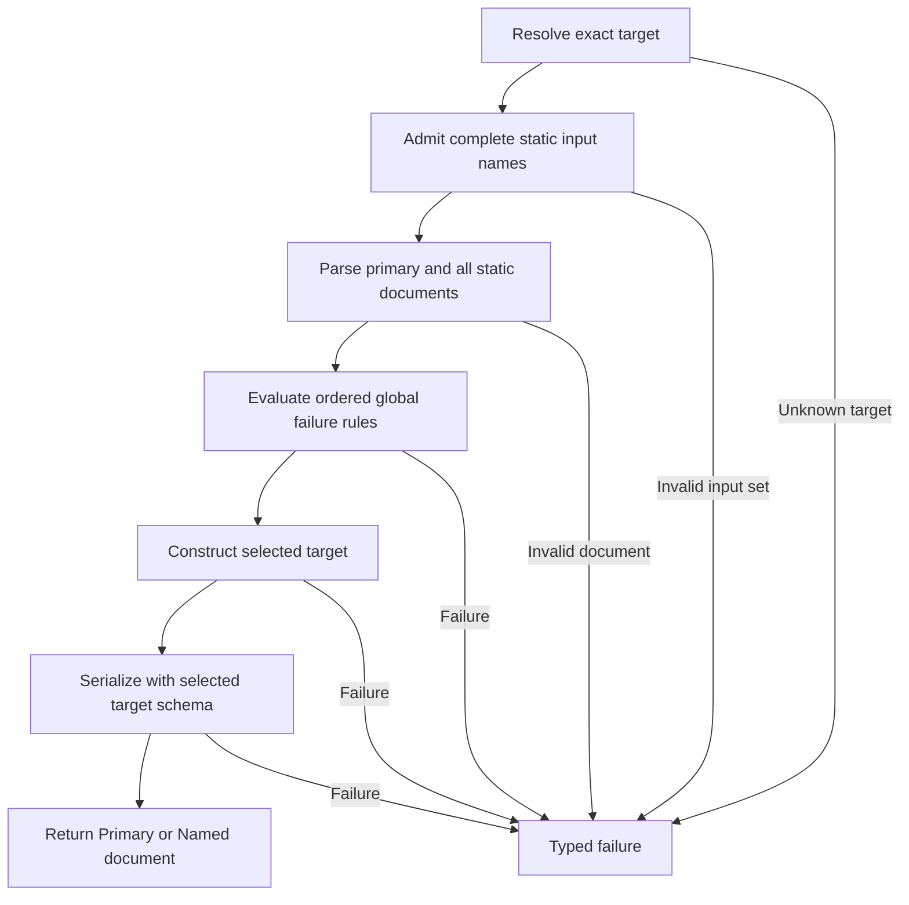

# Rust and C# Code Generation

ferrule can lower the portable subset of a validated project into a buildable
mapping library. Both backends use the same backend-neutral program, so supported
projects retain matching evaluation order, Null behavior, output shape, and
typed failures.

Standard Boolean `and` and `or` calls accept two or more strict Bool operands
and evaluate every argument in declaration order. See
[Variadic Boolean calls](design/variadic-boolean-calls.md) for type and error
ordering, including the strict Null boundary.

Generation rejects unsupported reachable constructs with capability diagnostics
before creating the destination. Unreachable graph nodes do not prevent an
otherwise portable project from being generated.

## Generate a Library in the Native Editor

Choose **File → Generate Library** to generate Rust or C# library source for the
entire project. Select the language and enter a new library folder. **Choose
parent...** selects its parent folder while retaining the new folder name.
Rust also requires ferrule’s `codegen-runtime` folder containing `Cargo.toml`;
C# includes its package-free runtime sources.

Select **Include CSV output** to add CSV methods for a flat row table using the
mapping’s output settings. The choice is saved with the generation request; it
does not change the mapping itself.

Select **Save and generate** to save the mapping before generation. An untitled
mapping opens Save As. Relative library and Rust runtime paths resolve from the
folder where the mapping is actually saved. Canceling Save As or a failed save
prevents generation from starting; the settings remain available to correct or
retry.

Generation runs in the background through the same public writer used by the
CLI. It publishes the complete source tree into a new folder and does not
replace an existing destination. Mapping or generation failures appear in the
settings window and diagnostics, including their full error details. Build the
generated source with the Rust or .NET toolchain to obtain a compiled library.

While generation runs, project actions are locked. A request to close the editor
waits for generation to finish, then follows the editor's usual close guards.

## Output Filesystem

The source writer stages a complete library beside its destination, then
publishes it with an atomic directory rename that refuses an existing
destination. This protects folders that appear during generation, including
empty folders. The destination filesystem and the CLI's operating-system
runtime must support that operation. On Linux, this requires the filesystem's
[`RENAME_NOREPLACE` support](https://man7.org/linux/man-pages/man2/rename.2.html).

The writer retains the original OS cause and attempts to remove its staging
tree on failure. An unavailable-operation diagnostic suggests choosing a supporting
filesystem or a CLI built for the destination's native operating system.
For a Linux CLI running under WSL, choose a new folder on the WSL Linux
filesystem, such as `/tmp/generated-csharp` or a folder under the Linux home
directory. To generate directly onto a Windows filesystem, use a Windows build
of the CLI. The same publication requirement applies to ordinary generation
and explicitly selected companions.

## Explicit Basic owned-source JSON documents

`emit_with_basic_owned_sources` adds compact JSON document adapters to the
control-free Basic typed entry family. Rust exposes
`execute_json_outputs_with_basic_owned_sources` and
`execute_json_selected_target_with_basic_owned_sources`, plus the corresponding
`execute_json_bytes_outputs_with_basic_owned_sources` and
`execute_json_bytes_selected_target_with_basic_owned_sources` UTF-8 methods.
C# exposes `ExecuteJsonOutputsWithBasicOwnedSources`,
`ExecuteJsonSelectedTargetWithBasicOwnedSources`,
`ExecuteJsonBytesOutputsWithBasicOwnedSources`, and
`ExecuteJsonBytesSelectedTargetWithBasicOwnedSources`.

Every call requires the explicit five-field owned-source policy and an execution
context argument (`None` / `null` is permitted for the context). Rust all-output
arguments are `(source, inputs, execution, limits)`; selected calls append
`selection`. C# all-output arguments are `(source, inputs, limits, execution)`;
selected calls place `selection` immediately after `source`. There are no
implicit-policy overloads. A zero-valued policy is a supplied policy, not an
omitted argument.

Selected calls resolve the exact target identity before policy admission or
input parsing; C# first checks its source and selection arguments for null.
Admission then checks the complete catalogue and bounded metadata before
inspecting supplied document handles. Unexpected and duplicate names are
reported in supplied order, followed by missing legacy-required bindings in
catalogue order. Owned-only inputs may be omitted; reaching an unavailable
owner during evaluation preserves its typed failure. A supplied optional input
is still parsed even when its consuming target is not selected.

After metadata admission, parsing consumes the primary document first, then
each captured supplied document in its original order. C# reads the supplied
list's count once and each reached item once. The adapter preserves original
declaration ordinals, constructs one checked Basic root context and executes
the selected or all-output route once. All required serialization completes
before an output set is returned.

Outputs use schema field order and compact UTF-8 without a BOM or trailing
newline. For example, `{"Value":"P.root"}` and `{"Value":"N.root"}` each
occupy 18 bytes; `[{"Value":"N1"},{"Value":"N2"}]` occupies 31 bytes. A
selected document matches the corresponding all-output document. Ordinary
JSON adapters retain their pretty-printed, trailing-newline format.

The strict byte routes preserve original UTF-8 failures: Rust's additive
`parse_json_bytes_with_utf8_cause` returns `JsonBoundaryError::InvalidUtf8` with
the original `Utf8Error` as its source; C# retains its decoder exception.
Existing Rust `parse_json_bytes` keeps its original error representation.
Document/schema size and shape validation remain independent of owned-source
limits; output validation uses normalized typed values without reparsing
floating-point text.

Admission retains at most two fixed-record buffers: `N` snapshot slots for the
complete named catalogue and `M <= N` parsed slots. A checked companion
reservation `A = 2N + 16` is disjoint from the existing base Basic primitive
allowance `P`; the combined envelope is checked as `P + A`. Native buffer
representability is checked separately. The factory retains its original
policy and allowance. These bounds cover adapter bookkeeping and the base
Basic primitives, not document trees, codec allocations or process memory.
Filter, sort, window and row-failure emitters retain their separate API profiles.

## Owned reads in scalar targets

Scalar target construction belongs to the common Basic owned-source subset, so
the control-free `emit_with_basic_owned_sources` companion and every later
owned companion admit owned field and position reads in it. This covers a root
scalar target, a nested non-repeating scalar field and a repeated scalar field
driven by an ordinary or owned source iteration, in primary and named targets.
The scalar expression evaluates once in its receiving context and creates no
source frame. Owned reads keep their exact owner, frame pins and positions;
branches stay lazy and call arguments evaluate left to right. The target domain
applies the ordinary exact numeric adaptation: an integer becomes a float only
when representable, an integral float becomes an integer, and other values keep
their runtime tag. An absent field yields Null, while an unsupplied owner fails
only when the selected target reaches it.

Owned reads must be schema-compatible scalar fields or positions. A generated
item, a join, document iteration, a user function or an aggregate argument keeps
its own capability diagnostic beneath a scalar target. Grouped scalar scopes
remain limited to the grouping companions, and exact whole-group copies remain
closed special construction. The ordinary emitters keep refusing every owned
read. The [scalar construction corpus](../conformance/basic-owned-scalar-construction/README.md)
records the shared expected outcomes, including each explicit limit.

## Explicit Basic owned-source windows

Library hosts can select the static Basic owned-source window profile with
`codegen::lower_with_basic_owned_windows`, followed by
`codegen_rust::emit_with_basic_owned_windows(&program, &options)` or
`codegen_csharp::emit_with_basic_owned_windows(&program)`. The profile supports
ordinary static primary/named `Source` and `OwnedSource` iterations over Group
or Scalar values, optional boolean filtering, stable multi-key sorting, and
ordered `SkipFirst`, `First`, `From`, inclusive `FromTo`, and `Last` windows.
Implicit First output applies to nonrepeating Group targets; repeated Scalar
targets can use explicit windows.

Bounds evaluate once in the parent context, in declaration order. Without
sorting, bounds precede predicates. With filter-then-sort, bounds follow the
predicate and key passes; with sort-then-filter, bounds follow the key pass and
precede predicates. Every required predicate runs before window selection or
target construction. Later bounds still evaluate when an earlier window empties
the cohort. Implicit First appends a final `First(1)` operation. Raw positions
are visible to sort keys and pre-sort predicates, sorted positions to post-sort
predicates, and compact final positions to target bindings and children. Outer
iteration positions remain attached to their original frames.

Generated calls use `execute_with_basic_owned_sources` /
`execute_selected_with_basic_owned_sources` in Rust and
`ExecuteWithBasicOwnedSources` / `ExecuteSelectedWithBasicOwnedSources` in C#.
Each call supplies an explicit owned-source policy bounding roots, active frames,
path segments, metadata bytes, and walk contexts. Window processing validates
the complete source-cohort witness and charges retained contexts, sort keys,
and selection storage to the same cumulative operation budget. Typed predicate,
key, bound, and target errors preserve their evaluation order and original cause.

The window companion has its own admission gate. Grouping, joins, generated or
document iteration, dynamic sources, user functions, and special construction
are outside this Basic profile. Ordinary generation and the narrower
owned-source, filter, and sort companions retain their respective contracts.

## Explicit Basic primary-row failures

`codegen::lower_with_basic_owned_row_failures` combines the window target profile
with a separate global-failure permission. Emit with
`codegen_rust::emit_with_basic_owned_row_failures(&program, &options)` or
`codegen_csharp::emit_with_basic_owned_row_failures(&program)`. Direct Program
callers can use `validate_basic_owned_row_failure_emission`; the corresponding
`legacy_named_input_admission_plan_with_basic_owned_row_failures` retains global
failure dependencies for every target selection. Existing generation companions
keep their previous failure gates.

A potentially owned rule must use one nonempty static source-collection segment
under the Primary Group schema. At execution, its selected base must be the
actual Primary Group root: named-source fallback, even to an aliased payload,
does not establish ownership. The bounded observed walk retains borrowed row
frames and raw structural positions, including null slots. A plain singleton
does not gain a repetition position. Named owned fields read immutable static
roots with no frame pin or an explicit empty root pin; named positions and
nonempty named pins are outside this profile.

The authenticated collection path does not require a same-name named input.
Legacy reads in the rule's predicate or message still contribute their eager
named-input requirements. Ordinary rules retain the ordinary collection-alias
requirement, including when mixed with authenticated rules.

Rules run once in stored order before any selected or all-target output. Each
complete row cohort's count and metadata are admitted before predicates; each
reached terminal is checked before its predicate or message. An earlier selected
failure therefore precedes an unsupported later terminal. Predicates and scalar
branches retain their normal evaluation rules, and messages run only for the
first selected row. Ordinary rules without potential owned reads keep their
ordinary route, independently of owned targets or other rules.

Generated execution uses the same explicit-policy Basic entry points described
above. Authentication failures are bare `UnsupportedPrimaryFailureContext`
bridge errors. Reached specialized terminals retain `UnsupportedBasicContext`
with their exact kind. Owned leaf failures retain their original node and typed
cause; absent messages remain distinct from explicitly empty messages. Deeper
or named-row iterations, repeated-root `Source[]`, generated/dynamic/specialized
failure profiles remain closed. Observer APIs are outside this generated profile.
For native Basic `TraceSink`/`DebugHook` observers, see
[Execution Tracing](tracing.md#basic-owned-source-observers).

## Explicit owned group-by

Select this profile with `codegen::lower_with_basic_owned_group_by`, then
`codegen_rust::emit_with_basic_owned_group_by(&program, &options)` or
`codegen_csharp::emit_with_basic_owned_group_by(&program)`. Direct Program hosts
use `validate_basic_owned_group_by_emission`; named-input admission uses
`legacy_named_input_admission_plan_with_basic_owned_group_by`. The profile
combines static By grouping and member-retention predicates with the qualified
filter, sort, window and primary-row-failure controls. Generated libraries expose
the two typed explicit-policy Basic execution methods described above.

Each group retains its exact source owner and absolute endpoint-local collection
identity. Group bindings read the first surviving ordered member. Nested
iteration over that collection enumerates all its members with independent
one-based member positions; it does not return the group as an identity row.
The final groups have compact one-based group ordinals. Other owners and outer
frames remain available under their own identities, even when collection names
and key values collide. An explicit empty root pin at a grouped root selects the
immutable registered root; a repeated registered root cannot be read as a
representative. A nested ordinary repeated-root member instead retains its
existing active-frame pin behavior. A nonrepeating owned root groups as one
member in one group.

Grouping uses exact tagged value equality and first-seen bucket order. For
example, integer `1` and floating-point `1.0` are different keys; signed floating
zeros compare equal, and each NaN creates a distinct bucket. Members preserve
their filtered/sorted order. A post-group predicate evaluates once for every
reached member: any true result retains the whole group, including members whose
predicate was false. It neither filters individual members nor changes the
representative to the first true member.

Filter-then-sort evaluates every source predicate before sort keys. Otherwise,
grouping evaluates each surviving candidate's filter, key and post predicate
before advancing to the next candidate. Sort keys use structural positions;
group keys and post predicates use the selected candidate's position. Explicit
window bounds evaluate once in the receiving parent after sorting and before
group keys. Windows, including implicit First, select retained groups afterward.
Consequently `First(0)` cannot suppress a group-key error, and an empty source
still evaluates its parent bounds. Global failure rules finish before target
grouping begins.

The paired runtime authenticates the complete original cohort and terminal
observations before semantic callbacks. One checked operation budget accounts
for fixed-capacity order, key, bucket, member-link and window storage, prefix
templates, sorted views and output metadata. Templates preserve the first
member's intermediate source prefix; grouped payloads and context identities
cannot be reused as provenance for another group. Known metadata is admitted
before operation-owned allocation. String keys are admitted immediately after
their scalar callback returns and before comparison or retention. These are
metadata bounds, not limits on source/output payload allocation or process RAM.
Rust and C# have representation-specific slot ceilings under the same five-field
policy and admission ordering. The [paired runtime design](design/owned-group-by.md)
defines the terminal witnesses, storage layout and checked slot envelope.

The group-by profile has its own capability gate. Other owned grouping modes,
specialized consumers and grouped observer snapshots retain typed refusals.
Ordinary static legacy grouping subtrees without owned demand or owned ancestry
keep their ordinary dispatch. A paired By scope establishes grouped ancestry
even when its only owned read is in the key or post predicate. Existing generation
profiles retain their gates and saved Projects require no new wire fields.

## Explicit owned sequence ItemAt

Use `codegen::lower_with_basic_owned_sequence_item_at`, followed by
`codegen_rust::emit_with_basic_owned_sequence_item_at(&program, &options)` or
`codegen_csharp::emit_with_basic_owned_sequence_item_at(&program)`. Direct Program
validation and named-input admission use the corresponding
`validate_program_with_basic_owned_sequence_item_at`,
`validate_basic_owned_sequence_item_at_emission`, and
`legacy_named_input_admission_plan_with_basic_owned_sequence_item_at` APIs.

This profile composes the By/filter/sort/window and primary-row-failure controls
with `SequenceItemAt` over Generate, Tokenize, TokenizeByLength and TokenizeRegex.
Owned scalar reads are allowed in both the producer's parent arguments and its
index, including nested eligible ItemAt expressions. The generated libraries use
the two typed Basic execution entries and the mandatory five-field policy.

The producer materializes its complete scalar sequence before evaluating the
index exactly once, including when production returns an empty sequence. Both
phases use the receiving source context: exact owners, parent pins, grouped
representatives and member positions remain available. A producer exception
prevents index evaluation. A node shared by a producer argument and the index is
evaluated separately at each semantic edge.

Selection is one-based. Integer indexes are used directly; Float indexes round
ties away from zero, and trimmed integer strings are parsed. Other index kinds,
NaN and out-of-range positions produce Null. The selected scalar retains its
type before ordinary target adaptation. Producer null suppression and existing
pure-sequence limits apply independently of the owned metadata policy.

This permission is scoped to the four scalar producers and their parent-context
consumer. RecursiveCollect, FilterMap, other sequence consumers, generated-source
iteration and inherited specialized contexts have separate capability gates.
The permission does not apply to owned failure predicates or messages. Existing
generation and JSON-adapter profiles keep their own admission rules; native
export, GUI authoring and observer eligibility are independently gated.
See [the ownership contract](design/owned-sequence-item-at.md) and
[the genuine-Project corpus](../conformance/basic-owned-sequence-item-at/README.md).

## Explicit owned sequence Exists

Use `codegen::lower_with_basic_owned_sequence_exists`, followed by
`codegen_rust::emit_with_basic_owned_sequence_exists(&program, &options)` or
`codegen_csharp::emit_with_basic_owned_sequence_exists(&program)`. Direct Program
validation and named-input admission use
`validate_program_with_basic_owned_sequence_exists`,
`validate_basic_owned_sequence_exists_emission` and
`legacy_named_input_admission_plan_with_basic_owned_sequence_exists`.

This profile admits `SequenceExists` over Generate, Tokenize, TokenizeByLength
and TokenizeRegex beside the ItemAt permission and the By, AdjacentBy, StartingWith
and EndingWith controls with their filter, sort, window and primary-row-failure
permissions. Owned scalar reads are allowed in the producer arguments and the
predicate, including nested eligible Exists and ItemAt consumers. The generated
libraries use the two typed Basic execution entries and the mandatory
five-field policy.

Producer arguments evaluate once in the receiving context and materialize the
complete sequence. Items are then visited in order; the first true predicate
returns true and later items are not evaluated, so their predicate errors are
not raised. An empty or null-suppressed sequence returns false without
evaluating the predicate. A producer exception prevents every predicate, and a
non-Boolean predicate fails with a typed error naming the predicate node.

Each predicate evaluation appends the private item to the receiving context as
an empty-path collection frame. The item declaration, empty-path ordinary reads
and empty legacy positions see that item. Owned reads ignore it: exact owners,
root and collection pins, grouped representatives and member positions keep
their receiving meaning, and an unavailable selected owner fails only when a
reached predicate reads it. The generated Rust and C# contexts copy the paired
view for each reached item and admit that copy against the caller's policy.

Legacy and owned RecursiveCollect, FilterMap, closed operators inside the predicate, owned
failure predicates and generated-sequence scopes keep their refusals. Existing
generation profiles, including ItemAt and EndingWith, continue to reject
`SequenceExists` in owned contexts. See [the ownership contract](design/owned-sequence-exists.md)
and [the genuine-Project corpus](../conformance/basic-owned-sequence-exists/README.md).

## Explicit owned sequence aggregate

Use `codegen::lower_with_basic_owned_sequence_aggregate`, followed by
`codegen_rust::emit_with_basic_owned_sequence_aggregate(&program, &options)` or
`codegen_csharp::emit_with_basic_owned_sequence_aggregate(&program)`. Direct
Program validation and named-input admission use
`validate_program_with_basic_owned_sequence_aggregate`,
`validate_basic_owned_sequence_aggregate_emission` and
`legacy_named_input_admission_plan_with_basic_owned_sequence_aggregate`.

This profile admits `SequenceAggregate` over Generate, Tokenize, TokenizeByLength
and TokenizeRegex beside everything the SequenceExists profile admits: the Exists
and ItemAt consumers and the By, AdjacentBy, StartingWith and EndingWith controls
with their filter, sort, window and primary-row-failure permissions. Owned
scalar reads are allowed in the producer arguments, predicate, value expression
and argument, including nested eligible aggregate, Exists and ItemAt consumers.
The generated libraries use the two typed Basic execution entries and the
mandatory five-field policy.

Producer arguments evaluate once in the receiving context and materialize the
complete sequence. Items are then visited in order: the predicate, then the
value expression of a selected item; rejected items never evaluate the
expression. The argument evaluates once afterwards in the receiving context,
including for an empty or null-suppressed sequence. A producer exception
prevents every later phase, an item-phase exception prevents later items and the
argument, and a non-Boolean predicate fails with a typed error naming the
predicate node. Count, sum, avg, min, max, join and item_at keep their ordinary
empty results, numeric parsing, integer/float tags and typed overflow and
non-finite failures.

Each item phase appends the private item to the receiving context as an
empty-path collection frame. The item declaration, empty-path ordinary reads and
empty legacy positions see that item, with raw positions that do not compact
after rejected items. Owned reads ignore it: exact owners, root and collection
pins, grouped representatives and member positions keep their receiving
meaning, and an unavailable selected owner fails only when a reached phase reads
it. The generated Rust and C# contexts copy the paired view for each item and
admit that copy against the caller's policy.

Legacy and owned RecursiveCollect, FilterMap, collection and joined aggregates,
closed operators in any phase, owned failure predicates and generated-sequence
scopes keep their refusals. Every other generation profile, including
SequenceExists, RecursiveFilter, owned Lookup/CollectionFind and owned dynamic
source fields, continues to reject `SequenceAggregate` in owned contexts. See
[the ownership contract](design/owned-sequence-aggregate.md) and
[the genuine-Project corpus](../conformance/basic-owned-sequence-aggregate/README.md).

## Explicit owned adjacent grouping

Use `codegen::lower_with_basic_owned_group_adjacent_by`, then
`codegen_rust::emit_with_basic_owned_group_adjacent_by(&program, &options)` or
`codegen_csharp::emit_with_basic_owned_group_adjacent_by(&program)`. This explicit
profile adds contiguous exact-key runs to the By/filter/sort/window controls and
composes the parent-context ItemAt permission. Existing execution entry names
and the mandatory five-field Basic policy remain the same.

`A,B,A` forms three runs. A member-retention predicate retains the whole run when
any member matches; dropping an intervening run does not merge its neighbors.
Group bindings use the first surviving representative, while nested members
have independent positions. Parent window bounds evaluate before keys, and the
windows select retained groups afterward, so `First(0)` does not hide key errors.

Direct Program validation and named-input discovery use the corresponding
`_with_basic_owned_group_adjacent_by` companions. Earlier generation profiles
keep their gates. The [adjacent grouping contract](design/owned-group-adjacent-by.md)
defines exact-owner root pins, phase ordering, storage bounds and closed contexts.

## Explicit owned starting-boundary grouping

Use `codegen::lower_with_basic_owned_group_starting_with`, then
`codegen_rust::emit_with_basic_owned_group_starting_with(&program, &options)` or
`codegen_csharp::emit_with_basic_owned_group_starting_with(&program)`. The matching
validation and named-input companions select the same explicit profile. Existing
execution entry names, five-field policy and earlier profile gates remain intact.

The first selected candidate creates a group even with a false boundary. Each
later true boundary starts a new group at that candidate. Boundary evaluation
precedes member retention; both use candidate positions. Windows evaluate their
bounds in the parent before boundaries and select retained groups afterward.
Only selected groups evaluate bindings and children.

The runtimes use Boolean start controls with the unchanged grouping metadata
shape. A start boundary consumes no grouping-key text credits. The
[Starting contract](design/owned-group-starting-with.md) defines the full callback,
authenticated-member, resource and qualification requirements.

## Explicit owned ending-boundary grouping

Use `codegen::lower_with_basic_owned_group_ending_with`, then
`codegen_rust::emit_with_basic_owned_group_ending_with(&program, &options)` or
`codegen_csharp::emit_with_basic_owned_group_ending_with(&program)`. The matching
validation and named-input companions select the same explicit profile, which
also admits By, AdjacentBy and StartingWith. Existing execution entry names,
five-field policy and earlier profile gates, including Starting's, remain intact.

A true boundary closes the current group at that candidate; candidates after
the last true boundary form a trailing group, and an empty cohort forms none.
Every selected candidate's boundary is evaluated, including the last. Boundary
evaluation precedes member retention; both use candidate positions. Windows
evaluate their bounds in the parent before boundaries and select retained groups
afterward. Only selected groups evaluate bindings and children.

The runtimes use Boolean end controls with the unchanged grouping metadata
shape. An end boundary consumes no grouping-key text credits. The
[Ending contract](design/owned-group-ending-with.md) defines the full callback,
authenticated-member, resource and qualification requirements.

## Explicit owned fixed-block grouping

Use `codegen::lower_with_basic_owned_group_into_blocks`, then
`codegen_rust::emit_with_basic_owned_group_into_blocks(&program, &options)` or
`codegen_csharp::emit_with_basic_owned_group_into_blocks(&program)`. The
matching validation and named-input companions select the same explicit
profile, which also admits By, AdjacentBy, StartingWith and EndingWith.
Existing execution entry names, five-field policy and earlier profile gates,
including Ending's, remain intact.

The block size is a parent expression evaluated once after the window bounds and
before candidate controls, even for an empty cohort. It converts like an item
count; zero after clamping is a typed `InvalidBlockSize` and a non-count is a
typed `NotAnItemCount`. Selected candidates fill blocks in order and the last
block may be partial. Retention runs per candidate and keeps whole blocks;
windows select retained blocks afterward. Only selected blocks evaluate
bindings and children.

The runtimes use a parent block-size control with the unchanged grouping
metadata shape and charge no grouping-key text. The
[IntoBlocks contract](design/owned-group-into-blocks.md) defines the full
callback, authenticated-member, resource and qualification requirements.

## Explicit owned failure-rule iteration

Use `codegen::lower_with_basic_owned_failure_sources`, then
`codegen_rust::emit_with_basic_owned_failure_sources(&program, &options)` or
`codegen_csharp::emit_with_basic_owned_failure_sources(&program)`. Direct Program
hosts use `validate_program_with_basic_owned_failure_sources` and
`validate_basic_owned_failure_source_emission`; named-input discovery uses
`legacy_named_input_admission_plan_with_basic_owned_failure_sources`.

The profile composes the EndingWith target controls, scalar-producer ItemAt and
primary-row failures with failure rules whose iteration is `owned_source`. Such
a rule walks rows from exactly its declared Primary or named endpoint; rules,
selection modes, first-failure and lazy-message semantics are unchanged, and
another endpoint never supplies rows when the selected collection is absent. An
unsupplied owner fails with the typed owned-source error. Predicates and
messages keep a closed scalar subset that adds exact owned reads, positions and
pins for every static endpoint. Owned walks keep their endpoint optional in the
named-input catalogue.

Generated libraries use the existing typed Basic execution entries and
mandatory five-field policy. Earlier profiles and the ordinary emitters keep
refusing owned walks. The [owned failure contract](design/owned-failure-sources.md)
defines the wire form, row and absence rules, and qualification.

## Explicit owned path hierarchy

`ScopeConstruction::OwnedPathHierarchy` builds the bounded directory tree of the
legacy path-hierarchy construction from one explicitly owned input collection.
Use `codegen::lower_with_basic_owned_path_hierarchy`, then
`codegen_rust::emit_with_basic_owned_path_hierarchy(&program, &options)` or
`codegen_csharp::emit_with_basic_owned_path_hierarchy(&program)`. The matching
`validate_program_with_basic_owned_path_hierarchy`,
`validate_basic_owned_path_hierarchy_emission` and
`legacy_named_input_admission_plan_with_basic_owned_path_hierarchy` APIs select
the same profile. It composes the EndingWith controls, scalar-producer ItemAt,
primary-row failures and owned failure-rule walks; the execution entries and
five-field Basic policy are unchanged.

Only the collection carries an owner. The directory, file and name fields
describe the generated recursive target and never select a source. The
collection is read from its exact endpoint: an active same-owner frame pins its
prefix, otherwise the endpoint root is used. Other endpoints, legacy aliases and
outward fallback never supply items. A supplied endpoint whose collection is
empty or missing produces the ordinary zero-root error; an unsupplied optional
named endpoint reports the typed unavailable-source error when reached.

Item order, separator rules, null and top-level-file omission, single-root
validation, depth and materialization bounds, and the value-type error are
shared with the legacy builders. The scope cannot contain bindings, children,
controls or iteration, and the collection must be a repeating scalar in its
owner's schema. Validation reports unknown, empty and unresolved owners as owned
structure errors. The default validator and every earlier profile refuse the
construction as a tree operator, and closed contexts (generated items, dynamic
owners and other specialized scopes) keep their typed refusals. The legacy
`PathHierarchy` plan, its wire form and its errors are unchanged; it continues
to use the ordinary emitters. See [the ownership design](design/source-ownership.md#owned-path-hierarchy-input-collections)
and [the corpus](../conformance/basic-owned-path-hierarchy/README.md).

## Explicit owned adjacency tree

`ScopeConstruction::OwnedAdjacencyTree` builds the bounded recursive group of
the legacy adjacency-tree construction from one explicitly owned row
collection. Use `codegen::lower_with_basic_owned_adjacency_tree`, then
`codegen_rust::emit_with_basic_owned_adjacency_tree(&program, &options)` or
`codegen_csharp::emit_with_basic_owned_adjacency_tree(&program)`. The matching
`validate_program_with_basic_owned_adjacency_tree`,
`validate_basic_owned_adjacency_tree_emission` and
`legacy_named_input_admission_plan_with_basic_owned_adjacency_tree` APIs select
the same profile. It composes the owned path-hierarchy profile (EndingWith
controls, scalar-producer ItemAt, primary-row failures, owned failure-rule walks
and owned path hierarchies); the execution entries and five-field Basic policy
are unchanged.

Only the collection carries an owner. Rows are read from the exact endpoint: an
active same-owner frame pins its prefix, otherwise the endpoint root is used,
including an endpoint whose root is the row collection. Other endpoints, legacy
aliases and outward fallback never supply rows, so equal keys in another
endpoint neither merge nor parent the selected rows. The key and parent paths
are relative to each selected row, and the target key and children names only
describe the output. The optional root expression is evaluated once in the
receiving context, after the rows are read, and may read any static endpoint.
A supplied endpoint whose collection is empty or absent selects no root row; an
unsupplied endpoint, for the rows or the root, reports the typed
unavailable-source error when reached.

Source-order children, unreachable-row omission, and the duplicate-key, row
field, root value, root count, cycle and depth errors are shared with the legacy
builders. The scope cannot contain bindings, children, controls or iteration;
the collection must be a repeating group in its owner's schema whose key and
parent are non-repeating strings. Validation reports unknown, empty and
unresolved owners as owned structure errors, and the root expression keeps the
Basic scalar subset. The default validator and every earlier profile refuse the
construction as a tree operator, and closed contexts (generated items, dynamic
owners and other specialized scopes) keep their typed refusals. The legacy
`AdjacencyTree` plan, its wire form and its errors are unchanged; it continues
to use the ordinary emitters. See [the ownership design](design/source-ownership.md#owned-adjacency-tree-row-collections)
and [the corpus](../conformance/basic-owned-adjacency-tree/README.md).

## Explicit owned recursive collection

Use `codegen::lower_with_basic_owned_recursive_collect`, then
`codegen_rust::emit_with_basic_owned_recursive_collect(&program, &options)` or
`codegen_csharp::emit_with_basic_owned_recursive_collect(&program)`. Direct
Program hosts use `validate_program_with_basic_owned_recursive_collect` and
`validate_basic_owned_recursive_collect_emission`; named-input discovery uses
`legacy_named_input_admission_plan_with_basic_owned_recursive_collect`.

The profile composes the owned adjacency-tree profile (EndingWith controls,
scalar-producer ItemAt, primary-row failures, owned failure-rule walks, owned
path hierarchies and owned adjacency trees) with SequenceItemAt over an
`owned_recursive_collect` producer. The producer's root collection belongs to
exactly one Primary or named endpoint; child, descent and value paths stay
relative to each selected group. Prefix, separator and index keep the receiving
parent context and may read exact owned fields. A same-owner active frame pins
the root collection's prefix, otherwise the walk starts at the endpoint root;
another endpoint never supplies roots, and an unsupplied owner fails with the
typed owned-source error at the consuming ItemAt node. Owned roots keep their
endpoint optional in the named-input catalogue.

Only ItemAt consumes the owned producer, including in an owned adjacency tree's
parent-context root expression. Generated scope iteration,
generated-sequence failure rules, SequenceExists, SequenceAggregate, closed
parent contexts and function bodies keep refusing it, as do every earlier
profile (including the adjacency-tree and fixed-block companions) and the
ordinary emitters. The legacy `recursive_collect` form keeps its
wire, admission and emission. The
[owned recursive collection contract](design/owned-recursive-collect.md)
defines the wire form, phases, limits and qualification.

## Explicit owned recursive filter

Use `codegen::lower_with_basic_owned_recursive_filter`, then
`codegen_rust::emit_with_basic_owned_recursive_filter(&program, &options)` or
`codegen_csharp::emit_with_basic_owned_recursive_filter(&program)`. Direct
Program hosts use `validate_program_with_basic_owned_recursive_filter` and
`validate_basic_owned_recursive_filter_emission`; named-input discovery uses
`legacy_named_input_admission_plan_with_basic_owned_recursive_filter`.

The profile composes the owned recursive-collect profile with recursive-filter
scopes whose source is an owned selector and whose output is repeated. The
selector is the filter's only owner: generated Rust calls
`codegen_runtime::owned_recursive_filter` and generated C# calls
`FerruleRecursiveFilter.ApplyOwned` with that exact owner and collection. Each
item's predicate runs in a paired Basic context whose owned frames give every
group the owner's collection identity and every item that collection plus the
item field, so owned reads and positions resolve the current item and innermost
group without falling back; legacy reads keep the legacy filter's stacked
frames. Traversal order, the 256-group depth limit, copied fields, the rebuilt
ordered XML stream and typed errors match the legacy filter. Each level also
adds one legacy frame to the paired view, bounded by the host's legacy-frame
limit. The owner stays optional in the named-input catalogue.

Legacy recursive filters, scope controls, First and mapped-sequence output,
generated or dynamic parents and closed predicate operators keep their typed
refusals, as do every earlier profile (including the recursive-collect,
adjacency-tree, fixed-block and SequenceExists companions) and the ordinary
emitters. The
[owned recursive filter contract](design/owned-recursive-filter.md) defines the
wire form, frames, limits and qualification.

## Explicit owned Lookup and CollectionFind

Use `codegen::lower_with_basic_owned_lookup_find`, then
`codegen_rust::emit_with_basic_owned_lookup_find(&program, &options)` or
`codegen_csharp::emit_with_basic_owned_lookup_find(&program)`. Direct Program
hosts use `validate_program_with_basic_owned_lookup_find` and
`validate_basic_owned_lookup_find_emission`; named-input discovery uses
`legacy_named_input_admission_plan_with_basic_owned_lookup_find`.

The profile composes the owned recursive-filter profile (and through it the
owned recursive-collect, adjacency-tree, path-hierarchy, failure-source and
EndingWith profiles) and owned IntoBlocks grouping with `owned_lookup` and
`owned_collection_find` expressions. Each walks one
collection of exactly its
declared Primary or named endpoint, anchored by the latest active frame of that
owner; another endpoint never supplies items. A lookup needle executes once in
the parent before the walk, keys and values are owned reads of the selected
item, Null-like keys never match, and a miss is `Null`. A find predicate and
value run in each item's context in source order; Null-like predicates skip an
item and other non-Booleans fail at the predicate. Owned searches keep their
endpoint optional in the named-input catalogue.

Earlier profiles, including the path-hierarchy, adjacency-tree, IntoBlocks,
recursive-collect, SequenceExists and recursive-filter companions, refuse
owned search
with `AggregateLookup`, and owned joins (admitted by the join companion below)
and legacy Lookup or CollectionFind stay closed. Owned aggregates stay closed in
this profile and open in its explicit aggregate companion below. The
[owned search contract](design/owned-lookup-find.md) defines the wire form,
selection rules and qualification.

## Explicit owned dynamic source fields

Use `codegen::lower_with_basic_owned_dynamic_field`, then
`codegen_rust::emit_with_basic_owned_dynamic_field(&program, &options)` or
`codegen_csharp::emit_with_basic_owned_dynamic_field(&program)`. Direct Program
hosts use `validate_program_with_basic_owned_dynamic_field` and
`validate_basic_owned_dynamic_field_emission`; named-input discovery uses
`legacy_named_input_admission_plan_with_basic_owned_dynamic_field`.

The profile composes the owned lookup/find profile with
`owned_dynamic_source_field` reads. The key is evaluated first in the receiving
context; a non-string key reads nothing. The open object belongs to exactly one
Primary or named endpoint and is selected through that owner's latest active
frame, an explicit frame or the explicit root pin, never through another
endpoint or frame. Absent and structural properties are Null and a present JSON
null stays distinct; crossing an uniterated repetition, an inactive explicit
frame and an unsupplied owner are typed owned-source failures at the read's
node. The generated Rust and C# runtimes expose the read as
`BasicScopeContext::owned_dynamic_field` and
`FerruleBasicScopeContext.ResolveOwnedDynamicField`. Owned objects keep their
endpoint optional in the named-input catalogue.

Failure-rule expressions, function bodies and closed contexts keep refusing
the owned read, as do every other profile (including the lookup/find,
recursive-filter, recursive-collect and SequenceExists companions) and the
ordinary emitters; only the owned XML serialization profile composes it.
Legacy `dynamic_source_field` reads keep their wire and ordinary emission and
stay closed in Basic owned profiles. The
[owned dynamic-field contract](design/owned-dynamic-field.md) defines the wire
form, order and qualification.

## Explicit owned XML serialization

`Node::OwnedXmlSerialize` serializes one schema-known structured element read
from exactly one Primary or named endpoint. Use
`codegen::lower_with_basic_owned_xml_serialize`, then
`codegen_rust::emit_with_basic_owned_xml_serialize(&program, &options)` or
`codegen_csharp::emit_with_basic_owned_xml_serialize(&program)`. The matching
`validate_program_with_basic_owned_xml_serialize`,
`validate_basic_owned_xml_serialize_emission` and
`legacy_named_input_admission_plan_with_basic_owned_xml_serialize` APIs select
the same profile. It composes the owned dynamic source-field profile (and
through it owned Lookup and CollectionFind, owned IntoBlocks grouping and the
recursive-filter, recursive-collect, adjacency-tree, path-hierarchy,
failure-source and EndingWith profiles); the execution entries and five-field
Basic policy are unchanged. The SequenceExists and SequenceAggregate companions
are a separate branch and keep refusing the owned serializer.

The element path is endpoint-local and an optional frame prefixes it, with the
owned field's selection rules: an explicit frame selects the latest exact
same-owner occurrence, an explicit empty frame reads the declared nonrepeating
endpoint root, and an unframed read uses the latest same-owner occurrence that
prefixes the path or else the endpoint root. A group-member occurrence supplies
its first member. The selected owner is authoritative: a missing element is a
typed owned-source failure attributed to the node and is never repaired from
another endpoint, a legacy alias or an outer frame. The read never reduces an
uniterated repetition to its first item; it reports the typed repetition error.
Inactive frames and unsupplied named endpoints report their typed errors when
the node is evaluated.

The serializer schema, declaration, indent and default-namespace options keep
the legacy meaning and the legacy writer, so XML bytes, writer type failures,
size limits and the read-then-write error order are shared. Validation checks
the schema name and kind against the exact owner's schema and keeps the legacy
document checks (non-repeating schema, non-empty namespace, closed schema
features). Unknown, empty and unresolved owners, frames that do not prefix the
path and frames that are not collections are owned structure errors. The
default validator and every earlier profile refuse the expression as an XML
operator; failure rules, generated items, isolated functions, dynamic owners and
other specialized contexts keep their typed refusals. The legacy
`XmlSerialize` node, its wire form, defaults, fallback and errors are unchanged
and continue to use the ordinary emitters. See
[the ownership design](design/source-ownership.md#owned-xml-element-serialization)
and [the corpus](../conformance/basic-owned-xml-serialize/README.md).

## Explicit owned collection aggregates

Use `codegen::lower_with_basic_owned_collection_aggregates`, then
`codegen_rust::emit_with_basic_owned_collection_aggregates(&program, &options)`
or `codegen_csharp::emit_with_basic_owned_collection_aggregates(&program)`.
Direct Program hosts use
`validate_program_with_basic_owned_collection_aggregates` and
`validate_basic_owned_collection_aggregates_emission`; named-input discovery uses
`legacy_named_input_admission_plan_with_basic_owned_collection_aggregates`.

The profile composes the complete owned search profile with `owned_aggregate`
expressions. Each qualifies one collection of exactly its declared Primary or
named endpoint once, anchored by the latest active frame of that owner, so a
grouped or block scope reduces only its members; another endpoint never
supplies items. A value path is an owned read of each item and a value
expression runs in each item's context in source order; Count never reads a
value path. The optional `join` separator or `item_at` index then runs once in
the parent context. All seven reducers keep their legacy empty, null, numeric
and typed overflow/non-finite behavior, and owned aggregates keep their
endpoint optional in the named-input catalogue.

Every other profile, including the owned search companion, the dynamic-field and
XML-serialization companions built beside it and the generated-sequence
aggregate companion, refuses owned aggregates with `AggregateLookup`; owned
dynamic source fields and XML serializers, joins, the legacy aggregate, Lookup
and CollectionFind, generated-item contexts and SequenceExists stay closed. The
[owned aggregate contract](design/owned-collection-aggregates.md) defines the
wire form, evaluation order and qualification.

## Explicit owned inner joins

Use `codegen::lower_with_basic_owned_joins`, then
`codegen_rust::emit_with_basic_owned_joins(&program, &options)` or
`codegen_csharp::emit_with_basic_owned_joins(&program)`. Direct Program hosts
use `validate_program_with_basic_owned_joins` and
`validate_basic_owned_joins_emission`; named-input discovery uses
`legacy_named_input_admission_plan_with_basic_owned_joins`.

The profile composes the owned Lookup and CollectionFind profile with owned
inner-join scopes. Each source walks exactly its declared endpoint, anchored by
the latest active frame of that owner, and tuples keep left-major order and
duplicates. `owned_join_field` and `owned_join_source_position` read one member
by its owner and collection; `join_position` reads the flattened position, which
filters, sorts and windows treat like the legacy join while raw member
positions never change. Join scopes admit Group or Scalar construction,
Repeated or First output, filters, sorts, windows and static descendant groups.
Generated Rust calls `BasicScopeContext::owned_inner_join` and generated C#
calls `FerruleBasicScopeContext.OwnedInnerJoin`. Join sources keep their
endpoints optional in the named-input catalogue.

Earlier profiles, the ordinary emitters and directly constructed Program
validation refuse owned joins with the `Join` capability, as do tuple contexts
for every read other than owned join reads, the join position and pure scalar
nodes. Owned joined aggregates and legacy joins stay closed in the Basic
profiles, and owned dynamic source-field reads, owned XML serialization and
owned collection aggregates keep their separate sibling companions. The [owned join contract](design/owned-joins.md) defines the wire
form, members, positions and qualification.

## C#

### Build and test environment

C# test and conformance launchers set
`DOTNET_ADD_GLOBAL_TOOLS_TO_PATH=false` explicitly in each .NET child
environment. Preserve this setting when constructing an environment allowlist
or clearing inherited variables. A fresh `DOTNET_CLI_HOME` otherwise lets SDK
first-run setup append the temporary home's global-tools directory to the
persistent Windows User PATH. Removing the temporary directory does not remove
that entry. Keep sandbox tool paths local to the child process and preserve the
ordinary user global-tools directory.

`DOTNET_SKIP_FIRST_TIME_EXPERIENCE` is unsupported in .NET Core 3.0 and later;
`DOTNET_NOLOGO` controls messages. Neither substitutes for the PATH opt-out.

### Generate the library

```sh
cargo run -p cli -- generate \
  --project project.json \
  --language csharp \
  --out generated-csharp
```

The result is a standalone, package-free .NET 10 library. Its generated artifact
tree includes the C# runtime sources required by the mapping. The generated
class retains `Execute(source)` and adds `Execute(source, executionContext)` for
host-supplied mapping paths, the run's stable current date-time text, and
bounded typed parameters attached through `FerruleRuntimeParameters`.
`ExecuteOutputs` returns the primary instance plus every named target in project
order. The legacy `Execute` overloads still evaluate all named targets before
returning the primary instance, so later target failures are not hidden.
Projects with static named sources use `ExecuteWithSources` or
`ExecuteOutputsWithSources` and pass `NamedInput` values. Inputs may arrive in
any order; the generated boundary validates their exact ordinal names and
normalizes them to project order before evaluating the mapping.
Projects with per-driver dynamic sources use
`ExecuteWithDynamicSourceLoader`,
`ExecuteWithSourcesAndDynamicSourceLoader`, or the corresponding
`ExecuteOutputs...` and execution-context variants. The host implements
`IFerruleDynamicSourceLoader` and returns one schema-shaped `FerruleInstance`
for each generated `(sourceName, logicalPath)` request.

## Rust

```sh
cargo run -p cli -- generate \
  --project project.json \
  --language rust \
  --out generated-rust \
  --rust-runtime-path crates/codegen-runtime
```

Rust generation currently requires `--rust-runtime-path`. The generated crate
links that local runtime until the runtime is published as a versioned package.
It exposes both `execute(source)` and `execute_with_context(source, execution)`.
The execution context can borrow a validated `RuntimeParameters` set containing
the mapping's named scalar host inputs. `RuntimeParameterDefault` evaluates its
connected default only when the host omits that name. Supplied null and invalid
values take precedence; invalid values retain typed parameter errors. The same
lazy behavior is available inside isolated user functions and through the
generated typed and JSON APIs in Rust and C#.
The corresponding `execute_outputs` functions return the primary instance and
ordered named targets; the legacy functions evaluate that complete result and
then move out its primary instance.
For projects with static named sources, `execute_with_sources` and
`execute_outputs_with_sources` accept borrowed `NamedInput` values, with
matching variants that also accept an execution context. No source instance is
cloned while building the generated scope context.
Per-driver sources use `execute_with_dynamic_source_loader`,
`execute_with_sources_and_dynamic_source_loader`, or their output/context
variants. The host implements `DynamicSourceLoader` and returns one
schema-shaped `Instance` for each source-name/logical-path request.

## Explicit C# X12 Companions

Add `--x12-adapters` to the C# CLI generation command for explicit raw X12
input/output methods around the ordinary typed mapping. Fixed ISA12/GS08
schemas select `00401`/`004010`, `00501`/`005010`, or `00604`/`006040`.
The flag defaults
to false and conflicts with `--csv-output` and `--json5-adapters`. The public
writer is `generate_project_with_x12_adapters`; ordinary generation retains its
existing typed/JSON APIs and artifact tree. The optional, package-free .NET 10
boundary embeds its admitted schema and metadata and returns complete text or
strict UTF-8 bytes. Selected input metadata supports bounded lenient traversal
and Float implied-decimal scaling; selected output metadata supports compact
date/time and plain-decimal formatting plus explicit X12 envelope completion.
Repetition punctuation is inactive metadata under 00401 and active ISA11
syntax in the modern profiles, where declared repeating body elements read and
write ordered occurrences.
The envelope defaults to one functional group and transaction. Explicit
`--x12-source-envelope-profile grouped-transactions` or
`--x12-target-envelope-profile grouped-transactions` selects declared repeated
GS/GE and ST/SE owners within one interchange on that X12 side. The value
`mapforce-interchanges` selects MapForce's standard X12 `Envelope.Config`
ownership: repeated interchanges, functional groups and messages, with the
version taken from the retained interchange version. Each selected
side has its own schema/version agreement, counts and controls. Both flags
require `--x12-adapters`; an explicit selection on JSON refuses. The additive
`generate_project_with_x12_envelope_profiles` writer accepts the two optional
selections while the existing writer keeps default singleton behavior.
Contextual output
completion uses the host-supplied execution-context dateTime, formats a private
view, completes permitted fields, and validates final controls and counts.
The ordinary `x12_dotnet` integration target includes an independently authored
saved-profile compiled-host gate and requires the .NET 10 SDK; the additional
strict companion cohort remains an explicit ignored test. Native and compiled
checks compare complete values, scalar types, bytes and typed failures.
See [the schema, syntax, API and limit contract](design/generated-x12-csharp.md)
for direction selection, rejected metadata and typed boundary failures.

For complete static named JSON/X12 inputs and explicitly selected primary or
named output, use C# `--static-document-adapters` and
`generate_project_with_static_document_adapters`. Every endpoint retains its
own admitted schema and format identity, including unused sources and
unselected targets. The generated text and UTF-8 byte carriers retain the
selected target name and format. Name/list preflight precedes primary parsing;
all supplied documents parse before typed selected execution. The same context
reaches selected X12 completion. This flag is separate from, and conflicts with,
the primary `--x12-adapters` flag. The normal `code_generation` integration
target contains the authored native and compiled static-document contracts;
it requires `--features codegen-tests` and the .NET 10 SDK. See the
[static document API and error order](design/generated-x12-csharp.md#static-named-documents-and-selected-output).

## Explicit JSON5 Companions

Add `--json5-adapters` to either CLI generation command to include singular
JSON5 document companions. The flag defaults to false and conflicts with
`--csv-output`. The public writer also provides
`generate_project_with_json5_adapters`; ordinary `generate_project` retains its
existing artifact tree. File suffixes and stored JSON5 options do not select
these methods.

Rust adds `execute_json5`, `execute_json5_with_context`, `execute_json5_bytes`
and `execute_json5_bytes_with_context`. C# adds `ExecuteJson5` and
`ExecuteJson5Bytes`, each with source-only and execution-context overloads.
They accept one closed, non-repeating object with supported scalar leaves and
static nested groups, and return complete strict JSON with a final LF.
Unsupported schemas, format options and mapping routes refuse before publication.
See [the profile and syntax contract](generated-json5-contract.md) for admission,
encoding, limits, typed causes and the current identifier restrictions. Named
inputs or outputs, root arrays, JSON Lines and dynamic routes are outside this
companion profile. Physical resource-boundary qualification is separate from
the small public-host tests.

## Flat CSV Output

Add `--csv-output` to either generation command to include CSV output methods.
The target must be a closed, non-repeating row schema with unique scalar columns
and a mapping that produces repeated rows. Stored CSV delimiter, quote,
quote-disabled, header and UTF-8 BOM settings are baked into the library. A stored
target path must select `.csv`, `.txt`, or the explicit CSV fallback identity;
without a stored path, the flag explicitly selects the CSV adapter.

Rust adds `execute_csv`, `execute_csv_bytes`, `execute_csv_with_context` and
`execute_csv_bytes_with_context`. C# adds `ExecuteCsv` and `ExecuteCsvBytes`,
with source-only and execution-context overloads. Each call executes the mapping
once, validates every output row, and returns one complete CSV text or byte
buffer. Existing typed, JSON and XML generation is unchanged when the flag is
absent.

Mappings with static named inputs also add `execute_csv_with_sources` and
`execute_csv_bytes_with_sources`, with their context counterparts. C# provides
`ExecuteCsvWithSources` and `ExecuteCsvBytesWithSources`, each with an optional
execution-context overload. The complete static input-name set is validated by
the ordinary mapping API before any mapping or CSV output is evaluated.

Mappings with per-driver dynamic named sources add text and byte methods for
three existing typed-loader forms: loader only, static named inputs plus loader,
and static named inputs plus execution context plus loader. Rust uses
`execute_csv_with_dynamic_source_loader`,
`execute_csv_with_sources_and_dynamic_source_loader`, and
`execute_csv_with_sources_context_and_dynamic_source_loader`, with parallel
`execute_csv_bytes_` names. C# uses the corresponding `ExecuteCsvWith...` and
`ExecuteCsvBytesWith...` methods. These methods execute the ordinary typed mapping
once, then serialize its complete primary row result. Loader resolution,
confinement, caching and side effects remain the host's responsibility; these
methods do not parse JSON documents or impose JSON input byte limits.

Each CSV document is limited to 64 MiB of UTF-8 output, including BOM, headers,
delimiters, doubled quotes and LF record endings. This output limit does not
bound the input tree, mapped rows, formatted records or total memory use.
Mapping failures and native CSV row/type/dialect failures retain typed causes;
no partial buffer is returned. Named outputs, dynamic document iteration,
scalar unions and conflicting physical adapters are refused before any
generated files are published. Dynamic loaded documents and mapped rows remain
materialized, so the CSV output limit is not a total memory limit.

## Complete CSV Documents

Use `--csv-document-adapters` with either backend to accept a complete CSV input
and return one complete CSV output. Both endpoints need explicit CSV identities
(`tabular_kind: "csv"`, or a `.csv` path when no tabular identity is stored).
The adapter accepts closed, non-repeating row schemas with unique, nonempty
scalar column names and canonical metadata. The mapping must produce repeated
primary rows. Named endpoints and dynamic document iteration are refused.

Rust adds `parse_csv`, `parse_csv_bytes`, `execute_csv_document`,
`execute_csv_document_bytes`, and both execution methods' `_with_context`
variants. C# adds `ParseCsv`, `ParseCsvBytes`, `ExecuteCsvDocument` and
`ExecuteCsvDocumentBytes`; execution methods also accept an execution context.
The library APIs are `generate_project_with_csv_document_adapters`,
`codegen::CsvDocumentBoundaryPolicy` and each backend's
`emit_with_csv_document_adapters`.

The stored input and output dialects are independent. Input uses positional
columns, skips the first logical record when headers are enabled, accepts UTF-8
with or without a leading BOM, and keeps the native permissive CSV syntax.
Missing columns are null; present empty text follows
`csv_preserve_empty_strings`. Input is fully parsed before mapping begins, and
all mapping work finishes before serialization. A call returns a complete
document or an error, never a partial document. Grouped rows still form one
output document, including a header-only result when the selected output policy
requires a header and the mapping produces no rows.

Input admission limits are 8 MiB of physical UTF-8, 1 MiB per decoded cell,
100,000 logical records including a skipped header, 256 columns and 1,000,000
instance nodes. Output uses the existing 64 MiB CSV writer limit, LF record
terminators and its selected quoting/header/BOM policy. These are data limits,
not process-memory bounds. Rust preserves input causes in
`CsvDocumentError::Input` and mapping/writer causes in
`CsvDocumentError::Output`; C# preserves the existing typed CSV-input,
mapping-runtime and CSV-writer exceptions.

These APIs take document contents. Filename enumeration, acquisition,
multi-document partitioning and publication require separate host contracts.

### Explicit CSV byte decoding

Existing byte methods remain strict UTF-8. To select a different byte contract,
Rust adds `parse_csv_bytes_with_decoding_policy` and
`execute_csv_document_bytes_with_decoding_policy` (plus `_with_context`);
C# adds `ParseCsvBytesWithDecodingPolicy` and
`ExecuteCsvDocumentBytesWithDecodingPolicy` (with an optional context overload).
Pass `CsvByteDecodingPolicy::BomAwareNonFlushingReplacement` in Rust or
`FerruleCsvByteDecodingPolicy.BomAwareNonFlushingReplacement` in C# explicitly.

This policy recognizes UTF-8, UTF-16LE/BE and UTF-32LE/BE BOMs, testing the UTF-32LE
marker before UTF-16LE. Unmarked input uses UTF-8. Malformed interior sequences
produce U+FFFD; incomplete terminal byte/code-unit state is not flushed and is
omitted. No other encoding is inferred. `StrictUtf8` delegates to the unchanged
strict entry point, including its existing error order.

The non-flushing policy first bounds physical input at 8 MiB, then bounds the
decoded UTF-8 text at 8 MiB before schema/dialect validation and parsing. A
decoded-size failure is distinct from a physical-size failure. Parsing and output
retain their existing limits and typed errors. The policy is a runtime argument,
not a saved mapping field, and is never selected from filenames or quoting rules.

### Explicit raw-delimited CRLF output

Add `--raw-delimited-crlf` to `--csv-document-adapters` to write target fields
without escaping and terminate every record with CRLF. The target must already
disable quoting (`csv_quote_disabled: true`) and must not specify a quote
character. The library entry point is
`generate_project_with_raw_delimited_document_adapters`; direct emitter callers
set `CsvDocumentBoundaryPolicy.target.raw_delimited_crlf` along with
`quote_disabled`.

The writer inserts one delimiter between modeled fields and preserves each
formatted field's text, including embedded delimiters, quotes and line breaks.
A trailing delimiter inside the final field remains field content. A single
empty field or a zero-field row produces CRLF. Header and UTF-8 BOM settings
remain explicit; zero rows with both disabled produce zero bytes. This text
format need not round-trip as CSV. Ordinary CSV settings never select it.

Input parsing and scalar formatting retain their existing policies. Complete
row validation precedes output encoding, and the 64 MiB limit counts all UTF-8
bytes, including separators, CRLF, headers and any BOM. Generated text and byte
methods return the same complete document or the existing typed stage failure.

## Flat CSV Input to X12

Select `--csv-x12-adapters` with `--language csharp` to generate flat CSV text
and UTF-8 byte input methods plus singular X12 output methods. The source must
retain an explicit CSV family or `.csv` identity, and the target must retain
an explicit X12 family or `.x12`/`.edi` identity. Schema contents never select
the physical formats. Other optional adapter flags are mutually exclusive.

The source row schema is a closed, non-repeating group with zero to 256
non-repeating String, Int, Float or Bool fields. Field names are nonempty and
ordinally unique. Other schema metadata, named boundaries, unresolved text
repair settings and foreign format options are refused. Root and field names
share a 1 MiB UTF-8 admission budget; the existing schema descriptor limit
also applies to the encoded representation. The X12 target retains its own
bounded schema, syntax, constraints and completion policy. Both borrowed
schemas are admitted before ordinary lowering or recursive validation.

`ParseCsv` and `ParseCsvBytes` return every supplied data row as one ordered
repeated instance, including an empty collection for zero rows. The row schema
itself remains non-repeating. `ExecuteCsvToX12`,
`ExecuteCsvToX12WithContext`, `ExecuteCsvToX12Bytes` and
`ExecuteCsvToX12BytesWithContext` parse the entire input, execute the ordinary
typed mapping once, then serialize its complete primary X12 result. A body
scope using `source: []` can iterate all rows while the root constructs one
envelope. These libraries expose ordinary typed methods and the CSV input
companions. JSON source entry points are not generated for this profile.

Input honors the native positional header, delimiter, quote, quote-disabled
and empty-string settings. Header labels and width do not change field order.
Missing trailing cells remain Null; physically empty String cells are retained
only when selected. Input accepts one leading UTF-8 BOM. Int and finite Float
lexical values are untrimmed ASCII numbers; Bool accepts native Unicode
whitespace around lowercase `true`, `false`, `1` or `0`.

CSV parsing is bounded by 8 MiB of input, 1 MiB per decoded cell, 100,000
logical records including a skipped header, 256 physical columns and
1,000,000 instance nodes. The root, each data row and every declared field
slot count as nodes. Cell/column and record limits precede row width; width
precedes row node reservation and scalar conversion. Byte APIs check input
length before strict UTF-8 decoding. Text APIs validate all Unicode before
checking UTF-8 byte size. A parsing or mapping failure returns no partial
result. Mapped target trees and completed output remain materialized, so these
limits establish no total process memory bound.

## Flat CSV Input to JSON

Select `--csv-json-adapters` with `--language csharp`, or call
`generate_project_with_csv_json_adapters`, to add CSV text and UTF-8 byte input
with selected JSON document output. This profile requires one explicitly
identified flat CSV primary source and strict JSON primary and named targets.
Each target retains its own admitted schema and format options. Named physical
inputs, dynamic document boundaries and repeating or iterating document roots
are refused. Other optional adapter flags are mutually exclusive.

The flat source proof, positional dialect, absence rules, parser errors and
resource budgets are the same as [CSV input to X12](#flat-csv-input-to-x12).
All borrowed endpoint schemas are bounded and encoded before ordinary lowering
and whole-program validation, including unselected targets.

`ParseCsv` and `ParseCsvBytes` return the complete ordered row collection.
`ExecuteCsvJsonSelectedTarget` and `ExecuteCsvJsonBytesSelectedTarget`, with
corresponding `WithHost` methods, parse the entire source, execute the ordinary
typed selected-target mapping once, then serialize the selected target using
its own JSON schema. The result carries either the primary document or the
exact named target identity, JSON format, and complete text or UTF-8 bytes.
`WithHost` accepts an explicit execution context. The generated library exposes
typed mapping methods and CSV input companions.

One singular JSON root can contain repeated children driven by an explicit
`source: []` scope. An uniterated scalar source lookup follows ordinary Ferrule
semantics: it reads the first row or yields Null when the row collection is
empty. The adapter adds no implicit output iteration or row selection. A later
malformed row fails complete parsing even if the selected mapping would read
only the first row.

Missing CSV fields and empty scalar lookups retain the ordinary Null tag.
An optional JSON property holding Null is omitted; required properties and
scalar document roots retain their existing writer errors. Explicit JsonNull
requires nullable schema metadata and serializes as JSON null. Typed tags,
Float values and JSON serialization constraints remain distinct.

Calls check source and selection nulls, resolve the exact target name, then
check an explicit `WithHost` context before parsing. Complete CSV parsing
precedes ordinary mapping and selected-target JSON serialization. Unselected
runtime target failures are not evaluated; global failure rules still apply.
Parsing, mapping and writer failures return no partial document. Input rows,
mapped target trees and output Strings remain materialized.

## Dynamic Source Host Boundary

Dynamic source paths remain graph expressions evaluated once for every item in
their declared primary-source driver iteration. Requests are issued in driver
order. An absent or explicit JSON-null path skips that driver; a non-string path
is a typed error. Each loaded document is paired with only the driver context
that requested it, so fields from another driver item cannot leak into its
mapping result.

Generated code never opens a file or URL. Resolving, authorizing, confining, and
optionally caching each logical path is the host's responsibility. The typed
loader must return one document matching the named source's embedded schema.
Dynamic declarations are not part of the ordinary `NamedInput` list, so static
missing/duplicate/unexpected-name validation remains independent.

Both runtimes cap a dynamic source at 1,000,000 driver requests and each UTF-8
logical path at 4,096 bytes. Missing loaders, non-string paths, excessive paths
or request counts, and host load failures retain distinct runtime error
categories with the source name, expression node where applicable, and logical
path for load failures.

## JSON Host Boundary

Both generated libraries also expose schema-shaped JSON entry points. These
methods parse a primary JSON document with the mapping's embedded source schema,
execute the same generated functions as the typed API, and serialize the
primary and ordered named targets with their embedded target schemas.

Object arrays retain separate array-container and object-item nullability in
both generated readers and writers. Schemas with explicit
`json_object_item_nullable` metadata use embedded descriptor version 4, which
older runtimes reject. Schemas without this metadata keep their existing
descriptor bytes and item behavior. The selected JSON5 companion profile
rejects explicit object-item metadata.

Rust:

```rust
let outputs = ferrule_generated_mapping::execute_json_outputs_with_sources(
    source_json,
    &[ferrule_generated_mapping::NamedJsonInput {
        name: "catalog",
        document: catalog_json,
    }],
)?;
publish(outputs.primary);
for output in outputs.extras {
    publish_named(output.name, output.document);
}
```

C#:

```csharp
var outputs = GeneratedMapping.ExecuteJsonOutputsWithSources(
    sourceJson,
    new[] { new NamedJsonInput("catalog", catalogJson) });
Publish(outputs.Primary);
foreach (var output in outputs.Extras)
{
    PublishNamed(output.Name, output.Document);
}
```

Hosts that already own UTF-8 bytes can use the parallel
`execute_json_bytes...` / `ExecuteJsonBytes...` APIs without performing their
own text conversion. Named inputs use `NamedJsonBytesInput`, and output-set
variants return owned byte buffers for the primary target and every ordered
named target:

```csharp
var outputs = GeneratedMapping.ExecuteJsonBytesOutputsWithSources(
    sourceBytes,
    new[] { new NamedJsonBytesInput("catalog", catalogBytes) });
Publish(outputs.Primary);
foreach (var output in outputs.Extras)
{
    PublishNamed(output.Name, output.Document);
}
```

The byte boundaries enforce the same 64 MiB document limit, require strict
UTF-8, and accept a UTF-8 BOM. Exact named-source validation completes before
the primary or named documents are decoded, so missing, duplicate, and
unexpected names are reported independently of malformed payload bytes.

The singular `execute_json` / `ExecuteJson` variants return only the primary
document but still evaluate every named target. Context-aware variants accept
the same mapping paths, stable date-time, and typed runtime parameters as the
instance APIs. Named inputs are exact, ordinal, duplicate-checked, and normalized
to project order before execution.

Dynamic JSON sources use `execute_json_with_dynamic_source_loader` in Rust or
`ExecuteJsonWithDynamicSourceLoader` in C#, with source-aware, output-set, and
execution-context variants matching the typed APIs. The host implements
`DynamicJsonSourceLoader` or `IFerruleDynamicJsonSourceLoader` and returns
bytes. Generated adapters require strict UTF-8, parse each document against the
correct embedded dynamic-source schema, and then invoke the same typed mapping.

### Select one JSON target

Use a selected-target method when the host needs one primary or named JSON
document. `TargetSelection::Primary` in Rust and
`FerruleTargetSelection.Primary()` in C# select the primary target.
`TargetSelection::Named("report")` and
`FerruleTargetSelection.Named("report")` select a declared named target by its
exact name. Matching is ordinal and case-sensitive; names are not trimmed or
Unicode-normalized.

| Boundary | Rust method | C# method |
| --- | --- | --- |
| Text | `execute_json_selected_target` | `ExecuteJsonSelectedTarget` |
| UTF-8 bytes | `execute_json_bytes_selected_target` | `ExecuteJsonBytesSelectedTarget` |
| Text with named inputs, execution context and loader | `execute_json_selected_target_with_host` | `ExecuteJsonSelectedTargetWithHost` |
| Bytes with named inputs, execution context and loader | `execute_json_bytes_selected_target_with_host` | `ExecuteJsonBytesSelectedTargetWithHost` |
| Text with scalar-sequence limits and cancellation | `execute_json_selected_target_with_filter_map_controls` | Use `ExecuteJsonSelectedTargetWithHost` with a configured execution context |
| Bytes with scalar-sequence limits and cancellation | `execute_json_bytes_selected_target_with_filter_map_controls` | Use `ExecuteJsonBytesSelectedTargetWithHost` with a configured execution context |

The simple methods supply no named inputs. For a mapping with static named
sources, use a host method and supply the complete declared input set, including
sources unused by the selected target. Missing, duplicate and unexpected names
are checked before JSON decoding. After name admission, the primary document
and **all static named documents** are parsed against their embedded schemas.
Dynamic sources are supplied through the loader, rather than this static set.

An unknown target is rejected before input admission, JSON parsing, failure
rules or loader calls. C# first checks `source` and `selection` for null, resolves the target, then
checks `extraSources` for null before name admission.
After input parsing, global failure rules run once in declaration order, then
only the selected target is constructed and serialized with that target's
schema. A global failure rule can itself request a dynamic source or charge
scalar-sequence work. Selection skips dynamic loads reached solely from
unselected targets; it does not skip global failure rules or static admission.



The following simple examples assume no static named inputs, and that the
mapping declares the named target `report`. Rust text results are
`SelectedJsonTargetOutput::Primary(String)` or
`SelectedJsonTargetOutput::Named(NamedJsonOutput)`. Byte results are
`SelectedJsonBytesTargetOutput::Primary(Vec<u8>)` or
`SelectedJsonBytesTargetOutput::Named(NamedJsonBytesOutput)`. Both named output
structs retain the exact `name` and the owned `document`.

```rust
use ferrule_generated_mapping::{
    SelectedJsonBytesTargetOutput, SelectedJsonTargetOutput, TargetSelection,
};

let primary = ferrule_generated_mapping::execute_json_selected_target(
    source_json,
    TargetSelection::Primary,
)?;
match primary {
    SelectedJsonTargetOutput::Primary(document) => publish(document),
    SelectedJsonTargetOutput::Named(output) => {
        publish_named(output.name, output.document);
    }
}

let report = ferrule_generated_mapping::execute_json_bytes_selected_target(
    source_bytes,
    TargetSelection::Named("report"),
)?;
match report {
    SelectedJsonBytesTargetOutput::Primary(document) => publish_bytes(document),
    SelectedJsonBytesTargetOutput::Named(output) => {
        publish_named_bytes(output.name, output.document);
    }
}
```

C# text results are `SelectedJsonTargetOutput.Primary` with a `Document`, or
`SelectedJsonTargetOutput.Named` with an `Output` containing `Name` and
`Document`. The byte result types expose the same properties with `byte[]`
documents; text documents are .NET strings.

```csharp
using Ferrule.Runtime;

var primary = GeneratedMapping.ExecuteJsonSelectedTarget(
    sourceJson, FerruleTargetSelection.Primary());
switch (primary)
{
    case SelectedJsonTargetOutput.Primary primaryOutput:
        Publish(primaryOutput.Document);
        break;
    case SelectedJsonTargetOutput.Named namedOutput:
        PublishNamed(namedOutput.Output.Name, namedOutput.Output.Document);
        break;
}

var report = GeneratedMapping.ExecuteJsonBytesSelectedTarget(
    sourceBytes, FerruleTargetSelection.Named("report"));
switch (report)
{
    case SelectedJsonBytesTargetOutput.Primary primaryOutput:
        PublishBytes(primaryOutput.Document);
        break;
    case SelectedJsonBytesTargetOutput.Named namedOutput:
        PublishNamedBytes(namedOutput.Output.Name, namedOutput.Output.Document);
        break;
}
```

Host variants retain the existing execution-context and dynamic-loader
contracts. In Rust, the argument order is document, named inputs, optional
execution context, optional JSON loader, then selection:

```rust
let report = ferrule_generated_mapping::execute_json_selected_target_with_host(
    source_json,
    &[ferrule_generated_mapping::NamedJsonInput {
        name: "catalog",
        document: catalog_json,
    }],
    Some(&execution),
    Some(&loader),
    TargetSelection::Named("report"),
)?;
```

The byte host method takes `&[u8]` and `NamedJsonBytesInput` in the same order.
C# places selection immediately after the document, followed by the named
inputs and the optional context and loader:

```csharp
var report = GeneratedMapping.ExecuteJsonSelectedTargetWithHost(
    sourceJson,
    FerruleTargetSelection.Named("report"),
    new[] { new NamedJsonInput("catalog", catalogJson) },
    executionContext: executionContext,
    loader: loader);
```

The C# byte host method takes `byte[]` and `NamedJsonBytesInput` with the same
argument order. These host examples assume that `catalog` is the complete
static named-source set. The loader implements Rust's
`DynamicJsonSourceLoader` or C#'s `IFerruleDynamicJsonSourceLoader` and returns
bytes for reached dynamic requests.

Rust methods return `JsonBoundaryError`. Target and mapping errors are retained
as `JsonBoundaryError::Execution(RuntimeError)`, including
`RuntimeError::UnknownTarget { name }`; malformed documents and invalid or
oversized output retain their boundary variants. C# keeps typed
`FerruleRuntimeException.Error` categories such as `UnknownTarget` and
`JsonBoundary`, and scalar-sequence failures retain their existing
`FerruleFilterMapException` boundary and inner cause. Inspect these structured
errors rather than matching message text.

Rust's controlled variants add `FilterMapLimits` and an optional
`FilterMapCancellation` after selection. They return
`Result<FilterMapExecution<SelectedJsonTargetOutput, JsonBoundaryError>,
JsonBoundaryError>`, or the corresponding byte output type. Resolution,
static-name admission and JSON parsing failures are outer `Err` values before
an execution run exists. Once a run starts, its `outcome` can be `Err` for a
failure rule, selected evaluation or selected output serialization, while its
`counters` remain available:

```rust
use codegen_runtime::FilterMapLimits;

let attempt =
    ferrule_generated_mapping::execute_json_selected_target_with_filter_map_controls(
        source_json,
        &[ferrule_generated_mapping::NamedJsonInput {
            name: "catalog",
            document: catalog_json,
        }],
        None,
        None,
        TargetSelection::Named("report"),
        FilterMapLimits::default(),
        None,
    )?;
let counters = attempt.counters;
match attempt.outcome {
    Ok(output) => publish_selected(output),
    Err(error) => report_failure(&error, counters),
}
```

`counters.source_items` and `counters.work` describe charged scalar-sequence
work. Each call creates fresh run state shared across its reached scopes;
these counters are not allocation or whole-process memory measurements.
Cancellation is the existing synchronous boundary checker supplied by the
host. C# uses the same existing controls through its execution context and
continues to return a document or throw a typed exception:

```csharp
var controlledContext = executionContext
    .WithFilterMapLimits(FerruleFilterMapLimits.Default)
    .WithFilterMapCancellation(cancellationChecker);
var report = GeneratedMapping.ExecuteJsonSelectedTargetWithHost(
    sourceJson,
    FerruleTargetSelection.Named("report"),
    new[] { new NamedJsonInput("catalog", catalogJson) },
    executionContext: controlledContext,
    loader: loader);
```

`cancellationChecker` implements `IFerruleFilterMapCancellation`. Limits retain
the existing fixed ceilings and can be lowered through the runtime's limits
constructors. See [route-specific limits](memory-and-limits.md#limits-are-route-specific)
and the [JSON validation and document limits](#json-validation-and-document-limits)
below. These methods parse complete input documents and return an owned complete
output document; the document ceiling is not a total memory budget.

The existing singular `execute_json` / `ExecuteJson` and all-output methods
keep their evaluation behavior. Choose a selected-target method explicitly to
avoid constructing unselected targets.

### JSON validation and document limits

Each JSON input and output document is limited to 64 MiB, and each trusted
embedded schema is limited to 1 MiB. Invalid JSON shape, non-exact numeric
conversion, output serialization, and size failures remain typed boundary
errors.

Ordinary collections within that byte limit have no general instance-node
count cap. Keyword-specific validation budgets, such as `uniqueItems` and
pattern matching, retain their own limits.

JSON text and property names must contain valid Unicode scalar values. Both
backends reject malformed UTF-8, unpaired escaped surrogates, and numbers
outside the finite JSON number domain throughout the input document, including
values later overwritten by a duplicate property. C# text entry points report
raw unpaired UTF-16 as a typed JSON boundary error; its public scalar and field
constructors reject such text before it enters a mapping. Invalid encoded JSON
held in an ordinary graph string remains a JSON string when written through an
arbitrary-JSON target, preserving the interpreter's fallback behavior.

Arbitrary JSON source values retain the interpreter's canonical compact text
inside the graph, including Unicode escaping, exact signed/unsigned integers,
finite floating-point normalization, and negative zero. Duplicate object names
keep their first position and their last value. C# uses the same numeric parsing
contract for typed JSON leaves and integral schema metadata; integer-to-number
conversion still requires exact representation. Raw JSON and embedded schema
parsing accept at most 127 nested containers, matching the interpreter.
Over-depth encoded JSON in an ordinary graph string uses the same string
fallback as other invalid encoded JSON. Schema-shaped output traversal retains
its separate depth bound. Canonical intermediate strings can grow beyond the
input document size, so document limits do not establish complete allocation
isolation.

The `json_serialize_object` function also preserves the interpreter's exact
compact text, including Unicode property names, floating-point scalar tags,
and negative zero. Its C# renderer walks nested objects iteratively, so deep
constructed property paths do not inherit the raw JSON reader's depth limit.
Malformed path descriptors retain typed function errors.

Generated JSON outputs use the interpreter's pretty formatting, Unicode
escaping, and floating-point text in both languages. The Rust and C# JSON
runtimes now correctly round accepted floating-point tokens; integer token
classification remains separate. Output constraints inspect the normalized
value before serialization. Generated Rust validates its normalized JSON tree
directly; valid arbitrary-JSON leaves also retain their own input depth check
when nested into a deeper final target document.

Both emitters check embedded schemas before returning generated artifacts.
JSON boundary descriptors must fit 1 MiB; XML serialization expressions keep
their separate 8 MiB descriptor limit. Stable schemas retain their ordinary
JSON descriptors. Floating metadata that the default JSON parser would change
uses the shared `codegen-schema` codec's versioned descriptor, preserving exact
binary64 bits in numeric bounds, allowed values, and alternative constraints,
including nested private predicates. Prefix and marker bytes count toward the
same limits. The encoder verifies complete metadata before artifacts exist;
size and unsupported descriptor failures remain typed and name the schema.

Generated Rust JSON/XML adapters decode these descriptors directly. Generated
C# uses the dedicated `ParseEmbedded`, `ParseEmbeddedBytes`,
`SerializeEmbedded`, and `SerializeEmbeddedBytes` JSON methods and
`FerruleXml.SerializeEmbedded`. Ordinary C# JSON/XML methods retain their
existing plain JSON contract. [Project file loading](project-files.md) separately
preserves exact floating-point values before generation.

The `json_parse_field` graph function parses its raw schema descriptor and
input string using the interpreter's function contract. It does not inherit
the generated host entry points' schema/document byte caps or a general
instance-node cap. Both backends still enforce JSON syntax depth, recursive
schema and keyword-specific validation limits, and valid Unicode/numbers.
Null inputs return Null before either descriptor is parsed; non-null calls
validate the schema, field path, and input in that order.

Embedded scalar constants, bounded exact scalar allowed-value sets, and
exact integer/finite-number ranges are enforced on both input and generated
output in Rust and C#, including after supported output coercion. Embedded
array `uniqueItems` assertions compare complete raw input values and normalized
output values, ignoring object member order while retaining nested array order.
Embedded array `contains` assertions count members accepted by each retained
item predicate. Plain assertions require at least one match, while retained
`minContains`/`maxContains` intervals apply exactly. Input checks the parsed
array and output checks the normalized emitted array; nullable array null
bypasses the assertions. Multiple compatible `allOf` assertions are
conjunctive, and predicate pattern matching shares the bounded document work
budget. A count mismatch remains a typed input/output boundary error, while
invalid embedded metadata and matcher work exhaustion remain fatal instead of
being treated as ordinary nonmatches.

Nested schema-valued arrays retain an explicit `json_array_wrapper` role in
embedded descriptors. A marked repeated group has exactly one repeated child
named `item`; each outer element carries that child's complete inner array.
Generated descriptors carrying this role use embedded-schema version 3, with
the existing exact finite-float metadata representation. Older descriptor
readers reject the version before treating the wrapper as an ordinary object.
Rust and C# JSON boundaries transparently read and write this declared role,
enforcing count, uniqueness, supported contains predicates, and nullability at
each level. Typed execution keeps the group and child fields visible to paths
and nested iteration. The default false marker is omitted, so ordinary object
properties named `item` retain their existing shape. Invalid marked descriptors
refuse before document processing, and XML, CSV, and EDI boundaries do not
reinterpret the JSON role.

The exact homogeneous `prefixItems` importer subset adds no generated-runtime
feature or new code-generation IR form. Draft 2020-12 and
undeclared schemas whose bounded finite prefix entries normalize to
one item shape lower to the existing repeated-item schema and item-count
interval. A closed tail becomes the equivalent `maxItems` bound, and canonical
export uses ordinary `items` plus that bound. Rust and C# therefore execute the
same existing homogeneous array boundary; heterogeneous prefixes
and tails remain import-time rejections.

Homogeneous legacy tuple-form `items` uses the same lowering for Draft 4, 6, 7,
and 2019-09 resources and for schemas without `$schema`. Its 1 to 4,096
identical positional members become one repeated-item schema. A `false`
`additionalItems` tail becomes `maxItems` at the tuple length; an identical
tail remains unbounded. An absent or `true` tail is accepted for an
arbitrary-JSON item shape or when the explicit maximum makes the tail
unreachable; a different schema tail requires that same maximum proof.
Canonical export again uses schema-valued `items` and an optional `maxItems`,
so generated Rust and C#
need no positional-array IR or runtime path. Draft 2020-12 array-valued `items`
and all reachable heterogeneous positional shapes reject during import.

Embedded object-property requirements are enforced on input and generated output:
explicit JSON null satisfies presence when nullable, while an omitted property
or Ferrule `Null` does not. Object openness is exact as well: omitted or `true`
`additionalProperties` preserves arbitrary JSON-valued fields, schema-valued
`additionalProperties` validates each unknown field against its retained type,
and explicit `false` produces a typed undeclared-property boundary error rather
than dropping data. Exact object `minProperties`/`maxProperties` intervals
count distinct parsed input properties before decoding and normalized output
members after Ferrule `Null` omission. Duplicate input names use the parser's
last value and count once. Nullable object null bypasses the interval; nested,
repeated, primary, and named documents apply the same rule. Embedded object
schemas may also carry exact closed homogeneous `patternProperties`. A
nonempty selector map requires an explicit `object` or `object | null`,
`additionalProperties: false`, and one identical exactly representable value
schema for every bounded portable selector. Scalar, structured object, and
homogeneous array values reuse the ordinary supported JSON value profile.
Selectors are ORed in declaration order. Matching fixed properties must use
that schema; nonmatching fixed properties remain independent. Generated
decoding checks fixed properties first and uses the selectors only for
remaining names. An independent `propertyNames` constraint still checks every
key. Dependency rules whose triggers are neither fixed nor selected normalize
away as semantically unreachable, and nullable null bypasses the object rules.
Rust and C# enforce selectors on input, normalized output, and JSON Lines with
the same shared per-document pattern work budget as ordinary string patterns.
Canonical JSON Schema export/re-import retains the selector map and closed
fallback. An empty map has no effect. Distinct selector schemas, open or typed
fallbacks, general overlap intersection, value shapes outside the ordinary
exact JSON profile, and active `allOf`, object-alternative, or structural
`$ref`-sibling composition remain outside the generated profile.
Embedded object property dependencies are enforced as well. Whenever a
trigger property is present, every dependent property must be present.
Explicit JSON null counts as
presence on input; generated output is checked after absent Ferrule values are
omitted. Nullable object null bypasses the relation, while nested, repeated,
primary, and named documents all use the same rule. Embedded whole-object
dependent-schema predicates use the same presence rule. Required-only entries
lower to ordinary property dependencies; other retained predicates validate
the complete containing object. Multiple predicates for one trigger remain
conjunctive, patterns consume the same per-document work budget as ordinary
field patterns, and malformed embedded metadata remains a typed boundary
failure. Text and UTF-8 byte entry points enforce identical behavior for
primary and named inputs and outputs. Draft 7, 2019-09, 2020-12, and undeclared
explicitly typed object schemas may spell one such rule as an `if` with exactly
one required-property presence trigger and a supported `then` predicate. A
nullable outer object is supported with an absent or `true` `else` only when
the `if` explicitly proves `type: "object"`. Exact `else: false` requires a
trigger that can be represented as an ordinary required field; it removes the
nullable bypass when the false branch rejects null and retains any supported
`then` dependency. It does not combine with existing object alternatives, and
a closed object must already declare the trigger. Import lowers these forms to
`required` plus `dependentRequired` or `dependentSchemas` metadata as
appropriate before generation, so generated Rust and C# enforce the same
semantics without a separate conditional runtime. Value-sensitive,
multi-trigger, general-`if`, and other nontrivial `else` schemas remain outside
the generated boundary subset.
Embedded `propertyNames`
constraints likewise inspect every actual key rather than schema placeholders.
They retain exact false, finite allowed-name sets, Unicode-scalar length,
finite `not` exclusions, portable patterns and their exact complements, and
nonasserting format metadata; raw parsed input keys and normalized emitted
keys are checked, including the empty string. Nullable
object null bypasses these name assertions. These APIs
intentionally use JSON regardless of stored project paths or format options.
Supported primary XML mappings also have the XML document APIs below.
Hosts needing other physical formats should use the interpreter payload API
or adapt a typed `Instance` at their own boundary.
Dynamic JSON documents share the 64 MiB per-document limit and additionally
have a 256 MiB combined budget per execution.

## XML Host Boundary

The [generated XML qualification index](generated-xml-qualification-index.md) maps
public route families, error ownership and source fixtures, and separates written
controls from retained execution and remaining verification cells.

Supported primary XML mappings expose XML document entry points:

| Input and result | Rust | C# |
| --- | --- | --- |
| XML text | `execute_xml` | `GeneratedMapping.ExecuteXml` |
| UTF-8 bytes | `execute_xml_bytes` | `GeneratedMapping.ExecuteXmlBytes` |
| XML text with execution context | `execute_xml_with_context` | `GeneratedMapping.ExecuteXml(source, executionContext)` |
| UTF-8 bytes with execution context | `execute_xml_bytes_with_context` | `GeneratedMapping.ExecuteXmlBytes(source, executionContext)` |

These entry points parse the source XML using the embedded source schema,
execute the generated mapping, and return one serialized primary target.
For admitted static named targets, they evaluate and serialize the complete
output set before selecting its primary document.
JSON entry points continue to parse JSON; they do not reconstruct an XML type
annotation that was absent from their input.

### Closed Ordinary Structured Input

The `Structured` input profile reads a closed primary XML document and admitted
static named XML documents into
nested groups, repeated fields, attributes and String, Int, Float or Bool
leaves. Nillable scalar leaves and attribute-only or scalar-text groups are
supported. Absent scalars remain Null, absent groups remain omitted, present
empty groups remain present, and repeated fields retain every matching item.
Singular fields select their first matching occurrence.

Source options for the primary and every named input must be defaults
with only `xml_document=true`. Each input has its own closed embedded schema.
Each primary or static named target must likewise have XML identity and can
retain its own literal XML schema hints.
The source reader flags `xml_allow_inactive_root_type_members` and
`xml_root_view_read_policy` remain false. Per-driver dynamic sources can use the
separate loader methods below. Dynamic primary output uses the document-list
methods below. Derived-type alternatives,
runtime-named fields, generic or mixed-content elements, recursive schemas,
fixed/default values and JSON-only constraints are outside this input profile.

Schema names and physical element, attribute, prefix and processing-instruction
names use the supported BMP XML name range. Schema data attributes named
`xmlns` reject in every namespace. Physical prefixed local `xmlns` attributes
and `xmlns:xmlns` declarations also reject, including content the schema would
ignore. These conservative restrictions do not change the general XML reader.
Input requires valid UTF-8, permits a BOM and a UTF-8 declaration, and refuses
DTDs. Numeric leaves retain strict typed lexical and finite-number checks.

This adapter is optional for ordinary XML format identity. Unsupported ordinary
input or target shapes can retain otherwise supported typed/JSON core lowering
without XML entry points. Embedded schema validation still runs before emission:
successful lowering alone does not guarantee that an artifact tree can be
produced. An observed root-view policy remains a separate strict request and
does not fall back to `Structured`.

### Static Named Inputs

The `Structured` profile adds document APIs that accept the complete declared
static named input set. These methods can return either the primary document
or the complete ordered output set:

| Input and result | Rust | C# |
| --- | --- | --- |
| Text, primary | `execute_xml_with_sources` | `GeneratedMapping.ExecuteXmlWithSources` |
| UTF-8 bytes, primary | `execute_xml_bytes_with_sources` | `GeneratedMapping.ExecuteXmlBytesWithSources` |
| Text, output set | `execute_xml_outputs_with_sources` | `GeneratedMapping.ExecuteXmlOutputsWithSources` |
| UTF-8 bytes, output set | `execute_xml_bytes_outputs_with_sources` | `GeneratedMapping.ExecuteXmlBytesOutputsWithSources` |

Rust context variants append `_and_context` to each name in the table and
accept `&ExecutionContext` after the input slice. C# provides an overload of
each method with `FerruleExecutionContext` after the input list.

Rust:

```rust
let inputs = [
    ferrule_generated_mapping::NamedXmlInput {
        name: "rates",
        document: rates_xml,
    },
    ferrule_generated_mapping::NamedXmlInput {
        name: "labels",
        document: labels_xml,
    },
];
let outputs = ferrule_generated_mapping::execute_xml_outputs_with_sources(
    source_xml, &inputs,
)?;
publish(outputs.primary);
for output in outputs.extras {
    publish_named(output.name, output.document);
}
```

C#:

```csharp
var inputs = new[] {
    new NamedXmlInput("rates", ratesXml),
    new NamedXmlInput("labels", labelsXml),
};
var outputs = GeneratedMapping.ExecuteXmlOutputsWithSources(sourceXml, inputs);
Publish(outputs.Primary);
foreach (var output in outputs.Extras)
{
    PublishNamed(output.Name, output.Document);
}
```

Byte methods use `NamedXmlBytesInput`: borrowed `&[u8]` documents in Rust and
`byte[]` documents in C#. Output sets retain the existing
`XmlExecutionOutputs` / `XmlBytesExecutionOutputs` result types. A singular call
still maps and serializes every output before selecting its primary document.
The host owns publication and keeps its input slices, lists and byte buffers
stable for the duration of a call.

Validation proceeds in this order:

1. Check at most 4,096 input documents including primary, before name bookkeeping.
2. Check exact case-sensitive names in supplied order for unexpected or duplicate
   entries, then check missing names in project declaration order. C# also checks
   every named `Document` for null after names succeed and before sizing.
3. Check every original document against the 64 MiB UTF-8 limit, primary first
   and then named inputs in declaration order.
4. Check at most 256 MiB of combined original UTF-8 input, in that same order.
5. Parse primary and then each named document against its own embedded schema
   in declaration order, execute all mappings, and serialize all outputs.

Thus a missing name wins over malformed primary XML, and an oversized later
named document wins over malformed primary bytes. All per-document sizes are
checked before the combined sum. Byte entry points complete size validation
before UTF-8 decoding. C# text methods count UTF-8 without allocating an encoded
byte array; invalid UTF-16 can fail with `Utf8` during that size pass.
No input is omitted because it is unused by the mapping, and no partial output
set is returned when any phase fails.

Rust returns `codegen_runtime::XmlExecutionError`; C# throws
`FerruleXmlExecutionException`. The original boundary is retained as `boundary`
/ `Boundary` and as the standard error source / inner exception. Rust boxes the
boundary to keep the execution error small; `boundary.as_ref()` borrows that
same original error. An input-phase
failure identifies primary or a named input's zero-based declaration index and
exact declared name in `input` / `Input`. A serialization-phase failure instead
retains the original output owner in `output` / `Output`. Complete-set name
errors and global mapping failures have neither owner; their original typed
runtime cause is retained. Owners describe the failing phase, independently
of the boundary's `Schema`, `DocumentLimit`, `Utf8`, `Input`, `Mapping` or
`Output` category.

Input count and combined-size refusals have category `Input` with an
`XmlInputSetResourceError` / `FerruleXmlInputSetResourceException` cause.
Its resource is `xml_input_artifact_count` or `xml_input_set_utf8_bytes`, with
observed count and limit. A count refusal has no guessed input owner; a sum
refusal owns the document whose charge crosses the limit. Boundary byte fields
remain unset for these resources. A per-document `DocumentLimit` retains that
document's original byte count and 64 MiB limit instead. Output-set counters
remain independent and retain their existing output categories and owners.

For zero-named-input `Structured` projects, the existing no-sources APIs
use the same complete execution with an empty named-input list. They retain
`XmlOutputSetError` / `FerruleXmlOutputSetException` for sets and the original
`XmlBoundaryError` / `FerruleXmlBoundaryException` for singular results. The
new with-sources APIs retain their source-aware wrapper. An admitted `RootView`
primary can also accept static `Structured` named inputs: its eight existing
single-input methods and eight source-aware methods give sixteen signatures,
with text/bytes, singular/output-set and context variants. Complete input
preflight precedes the original observed primary parser; each named input uses
its own Structured parser. The separately proved flat combined static-input
and static-output shape is described under [Observed Root-View Input](#observed-root-view-input).
Dynamic named inputs, document-list outputs and observed named-input profiles
remain strict refusals; the sixteen signatures do not imply all combinations.

An unproved ordinary input, unsupported format or schema, or excessive declared
count omits the entire optional XML adapter,
while preserving otherwise supported typed/JSON core generation. Valid literal
output hints remain optional metadata during that fallback. Generation never
silently drops a named input or output.

### Dynamic XML Input Loader

An admitted `Structured` project with one or more dynamic named sources adds eight
loader methods. The input list contains every declared static source and excludes
all dynamic sources. Requests begin only when evaluation reaches a dynamic scope;
that scope loads its driver documents eagerly before target projection. These
methods return the primary document or the complete output set:

| Input and result | Rust | C# |
| --- | --- | --- |
| Text, primary | `execute_xml_with_sources_and_dynamic_source_loader` | `GeneratedMapping.ExecuteXmlWithSourcesAndDynamicSourceLoader` |
| UTF-8 bytes, primary | `execute_xml_bytes_with_sources_and_dynamic_source_loader` | `GeneratedMapping.ExecuteXmlBytesWithSourcesAndDynamicSourceLoader` |
| Text, output set | `execute_xml_outputs_with_sources_and_dynamic_source_loader` | `GeneratedMapping.ExecuteXmlOutputsWithSourcesAndDynamicSourceLoader` |
| UTF-8 bytes, output set | `execute_xml_bytes_outputs_with_sources_and_dynamic_source_loader` | `GeneratedMapping.ExecuteXmlBytesOutputsWithSourcesAndDynamicSourceLoader` |

Rust context variants replace `_with_sources_and_dynamic_source_loader` with
`_with_sources_context_and_dynamic_source_loader`. C# context variants replace
`WithSourcesAndDynamicSourceLoader` with
`WithSourcesContextAndDynamicSourceLoader`. Arguments are primary input, static
input list, execution context when present, and loader last.

The host implements `DynamicXmlSourceLoader::load` in Rust or
`IFerruleDynamicXmlSourceLoader.Load` in C# and returns original UTF-8 bytes for
the requested source name and logical path. The host resolves, authorizes and
confines that path. Generated libraries do no file or network I/O and do not cache documents. A
reached dynamic scope loads its driver documents eagerly before that scope's
filters and windows; it requests no documents beyond evaluated scopes. Returned
bytes are parsed against that dynamic
source's embedded closed schema, with the same per-document parser and
materialization limits as other `Structured` inputs.

Each request selects the exact named source's embedded schema and original
position in the complete source declaration list. Identical logical paths under
different source names retain distinct schema and error owners. Scopes and
targets determine source callback order; each reached source scope retains its
own driver order. One request ordinal spans all sources and targets in the run.

Initial name and document-shape checks, all primary/static document sizes,
combined original bytes and initial parsing finish before any loader callback.
The live input budget starts with primary and supplied static documents. Before each
callback, it reserves one of the 4,096 document slots; repeated requests count
separately. A rejected reservation invokes no host callback. A host failure
consumes its reserved slot but charges no document bytes. Returned documents
are checked against 64 MiB before their original bytes are charged to the shared
256 MiB budget, then decoded and parsed. One budget covers the entire execution,
including requests needed by different sources and targets. Output limits remain separate.

These methods retain `XmlExecutionError` / `FerruleXmlExecutionException`.
Only this adapter's product-input refusals add `request` / `Request`, containing
the original zero-based source declaration index, declared name, logical path,
one-based callback reservation ordinal and `callback_invoked` / `CallbackInvoked`.
The input owner uses the full declaration index, even when static and dynamic
sources are interleaved. Count refusal reports the next ordinal with callback
false; a returned-document refusal reports callback true. The original XML
boundary and typed cause remain available through the error chain. A host load
failure stays an unowned `Mapping` error with its original runtime cause, even
if the host throws an XML boundary exception in C#. Global name errors, path
errors, missing-loader errors, mapping failures and output failures have no
dynamic request metadata. Output failures retain their output owner.

The existing no-loader methods retain their signatures, error wrappers and
lazy missing-loader behavior. Reaching a dynamic scope requires a loader before
enumerating its drivers, including an empty or all-absent driver collection.
An unused dynamic declaration does not trigger a callback or a missing-loader
failure. Absent or explicit JSON-null paths skip their driver; `XmlNil` is not
an absent path. A pre-target mapping failure can stop execution before a dynamic
scope is reached. All targets map before serialization, and any failure returns
no primary document or partial output set.

Low-level `XmlDynamicSourceAdapter` / `FerruleXmlDynamicSourceAdapter` instances
are for one execution and are terminal after any failed load, including a host
failure. Only the first failed load may be recovered; do not retry a load or
reuse its adapter for another execution. Restoring a product refusal in Rust
requires the original returned nonempty marker `String` to stay live and move unchanged through the
typed `DynamicSourceLoad` error into synchronous `recover`; cloned text does not
identify it. C# product recovery requires the original private exception
reference wrapped by the typed loader. The generated methods construct a fresh adapter
and abort and recover immediately, so hosts normally implement only the raw
loader interface.

These limits admit original input bytes and callback counts. They do not bound
caller buffers, eager parsed instances or mapping allocations, and are not
streaming or process-RSS guarantees. The host must keep input buffers stable
for the duration of the call.

### Static Named Output Sets

An admitted ordinary XML mapping can return its primary document and every
static named target in declaration order:

| Input and result | Rust | C# |
| --- | --- | --- |
| XML text | `execute_xml_outputs` | `GeneratedMapping.ExecuteXmlOutputs` |
| UTF-8 bytes | `execute_xml_bytes_outputs` | `GeneratedMapping.ExecuteXmlBytesOutputs` |
| XML text with execution context | `execute_xml_outputs_with_context` | `GeneratedMapping.ExecuteXmlOutputs(source, executionContext)` |
| UTF-8 bytes with execution context | `execute_xml_bytes_outputs_with_context` | `GeneratedMapping.ExecuteXmlBytesOutputs(source, executionContext)` |

String calls return `XmlExecutionOutputs`; byte calls return
`XmlBytesExecutionOutputs`. Each contains a primary document and ordered
`NamedXmlOutput` or `NamedXmlBytesOutput` entries with a target name and document.
Zero named targets produce an empty extras collection. The host owns any file
publication; generated APIs neither resolve stored target paths nor open
schema-hint locations.

Input is parsed once, and all typed targets are mapped once before any target
is serialized. Each document uses its own embedded target schema and output
policy. Parsing, mapping, or serialization failure returns no output set.
An unsuitable ordinary target omits the whole optional XML adapter while
preserving otherwise supported typed/JSON core generation, including when
other XML targets retain literal hints. Observed root-view boundaries retain
their explicit compound restrictions, including the static named-document
routes described below.

Set APIs return `codegen_runtime::XmlOutputSetError` in Rust and throw
`FerruleXmlOutputSetException` in C#. The wrapper retains the original typed
XML boundary error. Serialization failures identify the primary target or
the named target's zero-based extra index and exact declared name. Input and
mapping failures have no inferred target owner. The existing singular APIs
retain their signatures and unwrap the original boundary error.

Sets permit at most 4,096 artifacts including primary, with at most 256 MiB
of combined serialized UTF-8. The 64 MiB limit still applies independently to
each document. Set-limit failures have kind `Output` and a typed resource
cause (`xml_output_artifact_count` or `xml_output_set_utf8_bytes`) with its
observed count and limit; per-document byte fields remain unset. These counters
do not bound eager typed-target allocations or peak process memory.

Hand-built code-generation programs must also provide
`XmlBoundaryProgram.extra_inputs`: `Vec::new()` for zero named inputs, otherwise
one `NamedXmlInputPolicy` per named source in exact declaration order, with its
exact name and a `Structured` input policy (both observed flags false). The
corresponding schemas stay in `Program.extra_sources`, including every dynamic
declaration when present. Missing, reordered or surplus policies and observed
named policies reject before emission. Zero-named `RootView` programs use an
empty `extra_inputs` vector; their static named-input route retains the complete
`Structured` declarations.

`XmlBoundaryProgram.extra_outputs` remains required:
an empty vector for one output, or one exact named policy per declared target
in declaration order. Model validation rejects missing, reordered or surplus
policies before emission.

### Dynamic Primary Documents

An ordinary `Structured` XML mapping whose root constructs dynamic documents can
return an ordered list of XML documents and their logical paths. This adapter
requires one primary input, no named sources or targets, a driver path ending
in a repeating group, and a closed nonrepeating group schema for each target
document. Both observed input flags remain false. Other combinations preserve
the supported typed/JSON core without receiving these XML methods.

| Input and result | Rust | C# |
| --- | --- | --- |
| XML text | `execute_xml_documents` | `GeneratedMapping.ExecuteXmlDocuments` |
| UTF-8 bytes | `execute_xml_bytes_documents` | `GeneratedMapping.ExecuteXmlBytesDocuments` |
| XML text with execution context | `execute_xml_documents_with_context` | `GeneratedMapping.ExecuteXmlDocuments(source, executionContext)` |
| UTF-8 bytes with execution context | `execute_xml_bytes_documents_with_context` | `GeneratedMapping.ExecuteXmlBytesDocuments(source, executionContext)` |

Text methods return ordered `XmlDocumentOutput` entries containing `path` and
`document` in Rust, or `Path` and `Document` in C#. Byte methods return
`XmlBytesDocumentOutput` entries with owned UTF-8 buffers. An empty mapped
document set returns an empty list. Duplicate paths remain separate entries
in mapping order. Paths are opaque metadata: hosts decide how to resolve,
confine, handle collisions, and publish them. The library performs no file or
network publication and does not load schema-hint locations.

The adapter parses the input once and finishes the complete typed mapping
before serialization starts. It then validates the actual member count and
serializes each member using the embedded target schema and XML policy.
Any parsing, mapping, or serialization failure returns no document list.
Consequently, a later mapping failure takes priority over a serialization
failure that an earlier member would have produced.

Rust methods return `codegen_runtime::XmlDocumentExecutionError`; C# methods
throw `FerruleXmlDocumentExecutionException`. Each wrapper retains the original
XML boundary and typed cause. Member-specific serialization failures identify
the primary target, the zero-based index in the final output list, and the
exact logical path. Input, mapping, descriptor setup, output shape, and total
member-count failures have no invented member owner. A combined-byte refusal
identifies the member that crossed the limit. The existing singular and static
output-set methods keep their signatures and apply to single-document mode.

The list permits zero through 4,096 actual documents, each at most 64 MiB, with
at most 256 MiB of combined serialized UTF-8. A count or combined-byte refusal
retains the existing `Output` boundary and typed resource cause. Per-document
refusals retain their original byte count and limit. Logical paths are excluded
from the byte counter. Mapping instances can already be live when output limits
are checked; these limits do not provide streaming or a process memory ceiling.

The checked `Program::xml_output_mode()` query distinguishes `SingleDocument`,
`DynamicPrimaryDocuments`, `StaticNamedInputsDynamicPrimaryDocuments`,
`DynamicNamedInputDynamicPrimaryDocuments`, `StaticPrimaryDynamicNamedDocuments`,
`StaticNamedInputsStaticPrimaryDynamicNamedDocuments`, and
`DynamicNamedInputStaticPrimaryDynamicNamedDocuments`, returns no optional adapter for an
unsupported ordinary boundary, and preserves the original
typed error for an invalid hand-built program. External exhaustive matches on
this public enum must handle the added variant.

### Static Named Inputs and Dynamic Primary Documents

An ordinary `Structured` XML mapping can combine a primary dynamic document list
with static named XML inputs. This separate mode requires at least one static
named input, no dynamic named sources or named targets, a nonempty driver path
in the primary schema ending in a repeating group, and a closed nonrepeating
member group. Every declared input retains its own closed `Structured` schema
and policy in original declaration order, including inputs unused by the mapper.
Both observed flags remain false. Unsupported ordinary combinations preserve the
typed/JSON core without these XML methods; observed profiles retain their strict
refusals.

| Input and result | Rust | C# |
| --- | --- | --- |
| XML text and named inputs | `execute_xml_documents_with_sources` | `GeneratedMapping.ExecuteXmlDocumentsWithSources` |
| UTF-8 bytes and named inputs | `execute_xml_bytes_documents_with_sources` | `GeneratedMapping.ExecuteXmlBytesDocumentsWithSources` |
| XML text, named inputs and context | `execute_xml_documents_with_sources_and_context` | `GeneratedMapping.ExecuteXmlDocumentsWithSources(source, extraSources, executionContext)` |
| UTF-8 bytes, named inputs and context | `execute_xml_bytes_documents_with_sources_and_context` | `GeneratedMapping.ExecuteXmlBytesDocumentsWithSources(source, extraSources, executionContext)` |

The input entries reuse `NamedXmlInput` and `NamedXmlBytesInput`. The results reuse
ordered `XmlDocumentOutput` and `XmlBytesDocumentOutput` lists. The adapter admits
all exact input names, complete document shapes, per-document sizes and combined
input bytes before parsing primary and then each named declaration. A complete
input set is still required when the mapped output list is empty. In C#, invalid
UTF-16 can refuse during the strict text-size pass; byte decoding happens during
primary-then-declaration parsing. All mapping finishes before actual output count
checks or serialization. Input and output ledgers are independent: each permits
at most 4,096 artifacts and 256 MiB UTF-8, with a 64 MiB per-document limit. Input
count includes primary and every static declaration; output count is the actual
final member count and can be zero.

Rust returns `XmlInputDocumentExecutionError`; C# throws
`FerruleXmlInputDocumentExecutionException`. An optional exclusive owner identifies
either `Input` with the original `XmlInputSource`, or `Member` with the primary
target, zero-based final member index and exact opaque path. The wrapper retains
the original boundary and typed cause. Existing input descriptor/parser failures
retain their exact input owner; serializer `Schema` setup errors remain unowned.
Exact-name failures, initial input count, mapping, alignment and output count
failures remain unowned. Combined-byte failures identify the input or member that
crossed its independent limit. No partial list is returned. The four zero-named
primary-list APIs and the static named-input APIs keep their existing signatures,
wrappers and semantics. Paths remain opaque metadata with no publication.

### Dynamic Named Inputs and Dynamic Primary Documents

An ordinary `Structured` XML mapping can combine one or more dynamic named
XML sources and optional static named XML inputs with a primary dynamic document
list. Every input retains its own closed schema and policy in original
declaration order, including unused static inputs. The output driver must be
a nonempty path in the primary schema ending in a repeating group. The target
member is a closed nonrepeating group, named targets are absent, and both
observed input flags remain false. Drivers rooted in named inputs, observed
root-view profiles and advanced unsupported schemas remain
outside this adapter. Unsupported ordinary boundaries retain the typed and JSON
core without these XML methods; observed profiles keep their strict refusals.

| Input and result | Rust | C# |
| --- | --- | --- |
| XML text, static inputs and loader | `execute_xml_documents_with_sources_and_dynamic_source_loader` | `GeneratedMapping.ExecuteXmlDocumentsWithSourcesAndDynamicSourceLoader` |
| UTF-8 bytes, static inputs and loader | `execute_xml_bytes_documents_with_sources_and_dynamic_source_loader` | `GeneratedMapping.ExecuteXmlBytesDocumentsWithSourcesAndDynamicSourceLoader` |
| XML text, static inputs, context and loader | `execute_xml_documents_with_sources_context_and_dynamic_source_loader` | `GeneratedMapping.ExecuteXmlDocumentsWithSourcesContextAndDynamicSourceLoader` |
| UTF-8 bytes, static inputs, context and loader | `execute_xml_bytes_documents_with_sources_context_and_dynamic_source_loader` | `GeneratedMapping.ExecuteXmlBytesDocumentsWithSourcesContextAndDynamicSourceLoader` |

The argument order is primary, static input collection, optional execution
context, then loader. The input entries reuse `NamedXmlInput` and
`NamedXmlBytesInput`; the collection contains exactly the static declaration
subsequence and may be empty. A dynamic declaration is supplied exclusively
through `DynamicXmlSourceLoader` or `IFerruleDynamicXmlSourceLoader`. Its host
callback receives the exact source name and logical path and returns original
UTF-8 bytes. The host resolves paths and performs any I/O. Results reuse ordered
`XmlDocumentOutput` and `XmlBytesDocumentOutput` lists with opaque paths; duplicate,
absolute, traversal-shaped and Unicode paths retain their exact identities.
C# collections are read-only and byte results own their buffers.

The adapter checks the initial input count, complete static names and document
shapes, all static per-document sizes and then combined original bytes before
parsing primary and each static input in declaration order. Owners retain the
original indices across all dynamic declarations. C# strict text measurement can
reject invalid UTF-16 during the size pass; byte decoding occurs during parsing.
An empty final list still requires all static inputs to be admitted and parsed.
After static admission, one fresh loader adapter owns each dynamic declaration's
exact source name, original index and independent schema. All dynamic sources
share the input budget, whole-execution request ordinal and first-failure channel.
The same logical path under two source names is parsed with each source's schema.
Existing typed traversal determines callbacks, Null path skips, lazy context
reads and repeated loads; an XML adapter does not move them
before mapping or suppress reached callbacks. Each request reserves its document
count before invoking the host. A host failure reserves count and charges no
bytes. Repeated loads count and charge again. A failed adapter is terminal; the
generated method aborts and synchronously recovers its first failure without retry.

Rust returns `XmlDynamicInputDocumentExecutionError`; C# throws
`FerruleXmlDynamicInputDocumentExecutionException`. The optional exclusive owner
is either `Input` with the original `XmlInputSource` or `Member` with the primary
target, zero-based final member index and exact path. `Request` is present only
for this adapter's original XML or input-resource refusal; it retains the dynamic
declaration index, source, path, one-based whole-execution ordinal and whether the
host callback ran. Exact marker identity, source and path restore the original
boundary and typed cause. An externally thrown XML exception, matching error text,
host loader failure, invalid path or missing context cannot fabricate this channel.
Static input descriptor and parser failures keep their input owner without a
request. Serializer `Schema` setup, exact-name and initial-count failures, mapping,
alignment and final output-count failures remain unowned without a request.
Combined-byte failures identify the crossing input request or final member.

All mapping completes once before final output alignment, actual member count,
capacity or serialization. The input and output ledgers are independent: each
permits at most 4,096 documents and 256 MiB UTF-8, with a 64 MiB per-document
limit. Input count includes primary, every static input and each reserved loader
request; output count is the final primary member count and may be zero.
Serialization and output charging occur in final member order before retaining
strings or converting them to owned byte buffers. Any failure returns no partial
list. Existing XML APIs, wrappers and loader behavior keep their signatures and
semantics. These byte limits do not provide streaming or a process memory ceiling,
and the library does not publish files or open schema-hint locations.

### Static Primary and Dynamic Named Documents

An ordinary `Structured` XML mapping can return one static primary document and
one or more named targets containing ordered dynamic documents. This adapter
requires a closed nonrepeating primary group with a noniterating root and no
named inputs. Every named target must have a dynamic-document root whose
nonempty source path ends in a repeating group; each member schema must be a
closed nonrepeating group. Both observed input flags remain false. Existing
XML schema, namespace, and literal schema-hint restrictions still apply.

| Input and result | Rust | C# |
| --- | --- | --- |
| XML text | `execute_xml_document_outputs` | `GeneratedMapping.ExecuteXmlDocumentOutputs` |
| UTF-8 bytes | `execute_xml_bytes_document_outputs` | `GeneratedMapping.ExecuteXmlBytesDocumentOutputs` |
| XML text with execution context | `execute_xml_document_outputs_with_context` | `GeneratedMapping.ExecuteXmlDocumentOutputs(source, executionContext)` |
| UTF-8 bytes with execution context | `execute_xml_bytes_document_outputs_with_context` | `GeneratedMapping.ExecuteXmlBytesDocumentOutputs(source, executionContext)` |

Text methods return `XmlDocumentExecutionOutputs`; byte methods return
`XmlBytesDocumentExecutionOutputs`. Each result owns its primary document and an
ordered `extras` collection containing each declared named envelope with `name`
and `documents` fields. C# uses the corresponding `Primary`, `Extras`, `Name`, and
`Documents` properties and read-only collections. Members retain their exact
logical paths beside XML strings or owned UTF-8 buffers. Duplicate, absolute,
and traversal-shaped paths remain opaque metadata for the host to resolve and
publish. Every named envelope remains in declaration order, including empty
lists; an empty list still returns its named envelope beside the primary.

The adapter completes the whole typed mapping once before serialization. It
checks output shape, name alignment, and the actual artifact count before
allocating output collections or serializing documents. The maximum of 4,096
artifacts includes the primary, permitting at most 4,095 named members across
all targets. It serializes and charges the primary first, then each named target
in declaration order and its members in final order.
Each document is limited to 64 MiB and the complete set to 256 MiB of serialized
UTF-8, excluding logical paths. These limits do not bound live mapping instances
or provide streaming or a process memory ceiling.

Rust returns `codegen_runtime::XmlDocumentOutputsExecutionError`; C# throws
`FerruleXmlDocumentOutputsExecutionException`. Input, mapping, schema setup,
alignment, and count failures have no output owner. Other primary serialization
failures own `Primary`, which has no member index or path. Named serialization
and combined-byte failures identify the declaration index and name, final
zero-based member index, and exact path. The wrapper preserves the original XML
boundary and typed cause. Any failure returns no partial output envelope, and a
later mapping failure takes priority over an earlier potential serialization
failure. Existing single-document and primary-list methods keep their meanings.

### Static Named Inputs with Static Primary and Dynamic Named Documents

An ordinary `Structured` XML mapping can combine static named inputs with a
static primary document and one or more dynamic named document lists. This
separate mode requires at least one static named input. Every input has its own
closed `Structured` schema and policy in original declaration order, including
unused inputs. The primary is a closed nonrepeating group with a noniterating
root. Every named output has a closed nonrepeating member group and a root
`DynamicDocuments` driver whose nonempty path ends in a repeating group of the
primary input. Both observed flags remain false. Dynamic named sources, observed
root-view profiles, static named output roots mixed with document-list roots,
and advanced unsupported XML schemas remain outside this adapter.

| Input and result | Rust | C# |
| --- | --- | --- |
| XML text and named inputs | `execute_xml_document_outputs_with_sources` | `GeneratedMapping.ExecuteXmlDocumentOutputsWithSources` |
| UTF-8 bytes and named inputs | `execute_xml_bytes_document_outputs_with_sources` | `GeneratedMapping.ExecuteXmlBytesDocumentOutputsWithSources` |
| XML text, named inputs and context | `execute_xml_document_outputs_with_sources_and_context` | `GeneratedMapping.ExecuteXmlDocumentOutputsWithSources(source, extraSources, executionContext)` |
| UTF-8 bytes, named inputs and context | `execute_xml_bytes_document_outputs_with_sources_and_context` | `GeneratedMapping.ExecuteXmlBytesDocumentOutputsWithSources(source, extraSources, executionContext)` |

Inputs reuse `NamedXmlInput` and `NamedXmlBytesInput`. Results reuse
`XmlDocumentExecutionOutputs` and `XmlBytesDocumentExecutionOutputs`, retaining
the primary and every named envelope in declaration order, including empty
lists. Members retain their exact opaque logical paths. The adapter admits the
complete input count, exact names and document shapes, all per-document sizes,
and combined original input bytes before parsing the primary and then each
named declaration. Empty output lists still require every input. C# strict text
measurement can refuse invalid UTF-16 during the size pass; byte decoding occurs
during primary-then-declaration parsing.

All typed mapping completes once before output alignment, checked actual count,
capacity, or serialization. The adapter checks `1 + sum(named member counts)`
including the primary, then serializes and charges the primary followed by each
named declaration and its members in final order. The input and output ledgers
are independent. Each permits at most 4,096 artifacts and 256 MiB UTF-8, with a
64 MiB per-document limit. The output always includes the primary; all named
lists can be empty.

Rust returns `XmlInputDocumentOutputsExecutionError`; C# throws
`FerruleXmlInputDocumentOutputsExecutionException`. The optional exclusive owner
identifies either `Input` with the original input owner, or `Output` with the
existing mixed-output owner: `Primary` has no member fields, while `NamedMember`
retains the original declaration index and name, zero-based final member index,
and exact path. The original boundary and typed cause remain unchanged. Input
descriptor and parser failures keep their input owner; serializer `Schema`
setup remains unowned. Global names/count, mapping and alignment failures remain
unowned. Shared-byte refusals identify the crossing input or output. Any failure
returns no partial envelope. Existing XML methods keep their signatures,
wrappers and behavior. Paths remain opaque; the library does not publish files,
resolve paths or open schema-hint locations. These serialized-byte limits do not
provide streaming or a process memory ceiling.

### Dynamic Named Inputs with Static Primary and Dynamic Named Documents

An ordinary `Structured` XML mapping can combine one or more dynamic named inputs,
optional static named inputs, one static primary document and one or more named
document lists. Each input and output retains its own closed schema and policy.
The primary target is a closed nonrepeating group with a noniterating root. Each
named output has a closed nonrepeating member group and a nonempty document driver
path ending in a repeating group of the primary input. Named-input output
drivers, observed root-view profiles, static named output roots
mixed with document lists, and unsupported advanced XML schemas remain outside
this adapter.

| Input and result | Rust | C# |
| --- | --- | --- |
| XML text, static inputs and loader | `execute_xml_document_outputs_with_sources_and_dynamic_source_loader` | `GeneratedMapping.ExecuteXmlDocumentOutputsWithSourcesAndDynamicSourceLoader` |
| UTF-8 bytes, static inputs and loader | `execute_xml_bytes_document_outputs_with_sources_and_dynamic_source_loader` | `GeneratedMapping.ExecuteXmlBytesDocumentOutputsWithSourcesAndDynamicSourceLoader` |
| XML text, static inputs, context and loader | `execute_xml_document_outputs_with_sources_context_and_dynamic_source_loader` | `GeneratedMapping.ExecuteXmlDocumentOutputsWithSourcesContextAndDynamicSourceLoader` |
| UTF-8 bytes, static inputs, context and loader | `execute_xml_bytes_document_outputs_with_sources_context_and_dynamic_source_loader` | `GeneratedMapping.ExecuteXmlBytesDocumentOutputsWithSourcesContextAndDynamicSourceLoader` |

Arguments are primary, static input collection, optional execution context, then
loader. Inputs reuse `NamedXmlInput` and `NamedXmlBytesInput`. The collection
contains exactly the static declaration subsequence and may be empty. The host
implements `DynamicXmlSourceLoader` or `IFerruleDynamicXmlSourceLoader` and returns
original UTF-8 bytes for each exact source name and logical path. The library
performs no file or URL access.

Results reuse `XmlDocumentExecutionOutputs` and `XmlBytesDocumentExecutionOutputs`.
They contain the primary and every named envelope in original declaration order,
including empty lists. Member paths remain exact opaque metadata, including
duplicates, Unicode, absolute and traversal-shaped paths. C# collections are
read-only; byte results own separate buffers. This mode exposes these four XML
methods rather than the old singular or primary-list XML families.

The adapter admits the complete initial count, exact static names and document
shapes, every per-document size and combined original bytes before parsing primary
and then static declarations in order. Unused static inputs are still required.
One fresh dynamic adapter then shares that input ledger and request ordinal across
all dynamic declarations. Policies retain original declaration indices, exact
source names and independent schemas; the same logical path under different
source names remains a separate load with its own schema.
It reserves each request's document count before the host callback and charges
returned original bytes before parsing them. Repeated loads count and charge
again. Mapping determines callback reachability and lazy context reads.

The complete mapping runs once before output alignment, checked actual count,
capacity or writers. Output count is `1 + sum(named member counts)`, including the
primary. Serialization and charging proceed primary first, then original named
declaration order and final member order, each with its own schema and hints. A
later mapping failure precedes any potential writer failure. Any failure returns
no partial result. Input and output ledgers are independent: each permits 4,096
documents and 256 MiB UTF-8, with a 64 MiB per-document limit. Logical output paths
do not count toward serialized bytes. These acceptance limits do not provide
streaming or a process memory ceiling.

Rust returns `XmlDynamicInputDocumentOutputsExecutionError`; C# throws
`FerruleXmlDynamicInputDocumentOutputsExecutionException`. Its optional exclusive
owner is `Input` with the original `XmlInputSource`, or `Output` with the existing
mixed-output owner. Output `Primary` has no member fields; `NamedMember` retains
original declaration index and name, final zero-based member index and exact path.
Input descriptor/parser failures retain their input owner; output `Schema` setup,
global name/count, mapping and alignment failures remain unowned. The original
boundary and typed cause are preserved.

Optional `Request` is present only for an original refusal synchronously recovered
from this fresh adapter. It preserves the dynamic declaration index, source, path,
one-based request ordinal and whether the host callback ran. An external XML
exception, similar error text or marker, host failure, missing context or invalid
mapping path cannot authenticate that request channel. Ordinary C# null/list
accessor guards remain ordinary CLR exceptions. Existing XML methods retain their
signatures and behavior.

### Observed Root-View Input

The existing `RootView` profile preserves the source reader's observed root
type identity and physical attribute presence. A required primary-root field
fails only when the mapping evaluates its read, so a conditional branch can
leave that read unevaluated.

The admitted source is a closed, nonrepeating XML root with 1–32 String
attributes, 2–32 declared type alternatives, an explicit default type, and
qualified or explicitly unqualified names. Its input options must enable
`xml_document`, `xml_allow_inactive_root_type_members`, and
`xml_root_view_read_policy`.
A static constructed primary XML output can also use static named XML inputs
whose individual schemas and options satisfy the closed `Structured` profile.
The source-aware text, byte and context methods above retain each named source's
original declaration identity. They validate the complete input set and original
UTF-8 sizes before parsing the observed primary, then the named declarations.
Their shared input admission and `XmlExecutionError` / `FerruleXmlExecutionException`
wrappers are the same as the static named-input adapter. The zero-named observed
methods retain their existing signatures and boundary wrappers.

With no named inputs, an observed primary can also feed a static constructed
primary XML document and one or more static constructed named XML documents.
The plural route requires flat, closed nonrepeating output groups with independent
schemas, namespaces and literal hints. Root labels may be empty or each output's
own schema name. The existing text, byte and context output-set methods return
primary then named outputs in declaration order; the singular methods serialize
the same complete set before returning primary. Mapping completes before any
writer, and serialization
failures retain the exact Primary or Named target. This route does not perform
file publication or add document-member paths.

Static `Structured` named inputs can also accompany one or more flat static
named XML outputs. This combined route requires every primary and named output
root to be a nonrepeating constructed group with no children, dynamic bindings,
iteration, filters, grouping, sorting, windows or alternative construction. A
root label is empty or exactly its own schema name. These checks apply even with
one named output and no primary-metadata expressions. Every named input keeps
its own closed `Structured` schema, XML options and declaration policy; named
observed profiles remain unsupported.

The existing source-aware text, byte, output-set, singular and context APIs serve
this route. Primary metadata readers retain the original primary owner, while
ordinary named fields read their named document. Required primary fields never
fall back to a same-named secondary field. Named conditions retain lazy required
and context reads. Mapping completes for every target before any writer, and
the singular APIs serialize that same complete set before returning primary.
Input failures retain the exact input declaration; writer failures retain the
exact output declaration. Names and original input sizes are checked before
parsing, and a failure returns no partial output set. Existing zero-source and
input-only routes retain their previous admission rules and wrappers.

Dynamic XML document inputs, observed named inputs and dynamic outputs remain
outside this observed-primary adapter. Unsupported input or target schemas fail during
generation, before the artifact destination is created.

### Output and Limits

The target supports closed structured XML, including nested and repeating
fields and known `xsi:type` alternatives. Runtime-named elements, substitution
groups, and ordered mixed element/text schemas remain outside this adapter.
Physical schema names must be local XML NCNames; namespaces are retained
separately from those names. Declared type identities must be canonical.
The generated input parser and hinted-output parser cannot accept
supplementary Unicode characters in physical names, so generation rejects
those profiles. Unhinted output names retain the supported XML name range.
Ordinary qualified `xml:` attributes are supported; schema metadata that would
create illegal reserved namespace declarations is rejected.

Project generation uses the native XML writer defaults: an XML declaration
and indentation, with namespaces taken from the target schema. It retains the
project's literal XML schema-hint settings. Schema locations are emitted as
metadata; the generated host does not open them or resolve them against a
filesystem path. The host owns publication of the returned document.

Each input and returned output document is limited to 64 MiB of UTF-8.
Embedded XML schemas have an 8 MiB limit, and the runtime schema-hint descriptor
has a separate 2 MiB limit. String and byte entry points use the same mapping
and output policy. Byte input must be valid UTF-8, and oversized input is
rejected before parsing or mapping. Serialization checks the output limit
before returning a document.

The ordinary `Structured` reader also enforces these independent resource
counts; they are acceptance limits rather than memory estimates:

| Structured input budget | Maximum |
| --- | ---: |
| Logical schema depth and physical element depth | 64 each |
| Embedded descriptor JSON container depth, including ignored properties | 127 |
| Schema nodes, physical nodes and materialized Instance nodes | 1,000,000 each |
| Materialized field-name/String bytes and numeric-text temporaries | 64 MiB |
| Projection work | 100,000,000 |
| Raw `<` plus `=` reservation slots | 1,000,000 |
| Conservative namespace references | 1,000,000 |
| Parser structural work | 100,000,000 |
| Normalized namespace registry UTF-8 bytes | 64 MiB |

Descriptor JSON nesting is separate from logical schema depth. Its container
limit can refuse a schema before the logical depth bound is reached; for example,
42 single-child groups followed by a scalar have logical depth 43 and require
128 JSON containers.
The emitter checks descriptor transport before returning artifacts. Schema and
document byte limits can likewise mask a later node or work limit.

Rust returns `codegen_runtime::XmlBoundaryError`; C# throws
`FerruleXmlBoundaryException`. Both distinguish `Schema`, `DocumentLimit`,
`Utf8`, `Input`, `Mapping`, and `Output` failures. `DocumentLimit` failures
retain the observed byte count and limit. Mapping failures retain the original typed
runtime error, including a required primary-root field's node and path.
Parser-resource guard failures retain the underlying resource identifier,
observed count and limit. Those units remain separate from document-byte errors.

These are eager in-memory document APIs. Each reader builds a DOM and an
Instance; earlier parsed sources stay alive while later documents are read.
All parsed sources, typed outputs, mapping intermediates, serialization buffers
and caller-owned inputs can coexist. The named-input 256 MiB budget counts
original UTF-8 only. The structured node, field/String and work ledgers remain
per document and do not impose an aggregate materialized-instance limit. Output
sets separately count serialized UTF-8. These acceptance counts do not establish
a peak memory limit or provide streaming execution. Measurements for one
document are not measurements or bounds for a complete named-input set.

## Runnable Hosts

[`examples/codegen/`](../examples/codegen/) contains one portable mapping with
matching Rust and C# host applications. The mapping filters zero-value orders,
sorts the remaining rows, assigns compact positions, and formats invoice labels.
The checked-in input and expected output show the equivalent JSON boundaries;
the hosts pass those documents directly through the generated JSON APIs.

Generate both libraries and run both hosts from the repository root:

```sh
./examples/codegen/run.sh
```

Generated artifacts are recreated under `examples/codegen/generated/` and are
not committed. The [Rust host](../examples/codegen/rust/) calls
`ferrule_generated_mapping::execute_json`, while the
[C# host](../examples/codegen/csharp/) calls
`Ferrule.Generated.GeneratedMapping.ExecuteJson`. Both validate the complete
filtered and sorted JSON result before printing it.

## Portable Subset

The current portable model includes:

- exact-bit scalar constants, source fields, frame-pinned fields, and 1-based
  positions
- explicit active/main mapping paths and an optional stable current date-time
  supplied by the execution host
- bounded named host parameters with declared string, integer, floating-point,
  or boolean types, scalar coercion, and distinct missing/type failures
- typed reusable scalar user functions, including nested calls and access to
  the same stable runtime values and bounded host parameters as the main graph
- heterogeneous scalar-union source and target fields at JSON boundaries, with
  runtime tag preservation, exact-only numeric adaptation, and matching
  ambiguity or invalid-output failures in Rust and C#
- lazy conditionals and a closed set of 75 boolean, arithmetic, comparison,
  scalar text, pinned [Unicode casing](unicode-casing.md), Unicode
  whitespace/substring/padding, finite numeric detection,
  integer-first conversion, numeric picture formatting, SQL LIKE, bounded regex
  matching/replacement, ISBN, rounding, date extraction, composition, picture parsing, exact
  duration arithmetic, and EDIFACT date-time conversion,
  missing-value, XML-nil, lexical path, schema-guided JSON-string field
  projection and typed object serialization, and validated pure
  delay-pass-through functions
- validated embedded delimited FlexText field projection with multi-character
  field separators, quoted fields, typed columns, and complete-record
  validation before first-row selection
- ordered value maps with optional declared-input coercion, first-match wins,
  and explicit or Null fallback
- first-match lookups over exact repeating collections in the primary or a
  static named source, with strict scalar-tag equality and Null on a miss
- expression-driven collection search over flattened source paths, with
  nullable predicates, raw nested positions, lazy values, and first-match wins
- complete structured XML source serialization from ordinary or frame-pinned
  paths, with an embedded closed schema, document declaration/indent/default-
  namespace controls, attributes, text, repetition, Null omission, recursive
  groups, XML nil, and closed exclusive `xsi:type` group alternatives with
  exact namespace-qualified identities and required-member validation, plus
  singular exclusivity and ordered occurrences from closed XML choices;
  substitution-group, unresolved expanded-name alternatives,
  inclusive/value-constrained, generic-element, and mixed schemas reject before
  artifact creation
- ordered XML mixed-content reconstruction with graph-computed direct-child
  replacements evaluated in each original occurrence context
- root-context static inner joins across two or more primary or named-source
  collections plus bounded per-item scopes anchored by at least one exact
  current-item singleton scalar or non-empty repeating descendant, and
  optionally augmented with independent primary/named singleton scalars and
  repeating sources or sources owned by any exact lexically enclosing repeated
  runtime frame, with left-deep composite equality,
  scalar coercion, stable duplicate-preserving order, Null/XML-nil exclusion,
  exact joined fields, raw source positions, compacted tuple positions,
  ordinary scope controls, and nested target construction
- root-context inner-join aggregates plus bounded per-item correlated reductions
  anchored by at least one exact current-item singleton scalar or non-empty
  repeating descendant, and optionally augmented with independent primary/named
  singleton scalars and repeating sources or sources owned by any exact
  lexically enclosing repeated runtime frame, with direct tuple counts, computed
  per-tuple values, and parent-context scalar arguments
- collection aggregates over direct fields or computed per-item expressions
- nested, repeating-group, repeating-scalar, scalar-union, and exact
  whole-current-group target construction with exact numeric target adaptation
- bounded recursive-filter target construction with sparse-field preservation,
  item-local predicates, frame-pinned fields, and exact recursion-depth failures
- bounded path-hierarchy target construction from repeated scalar paths, with
  first-seen directory/file order, duplicate-file preservation, null omission,
  exact single-root validation, and matching depth/materialization failures
- bounded adjacency-tree target construction from flat string-keyed rows, with
  graph-computed root selection, source-order children, unreachable-cycle
  omission, and matching duplicate/root/cycle/depth failures
- one primary target plus ordered, independently shaped named targets evaluated
  from the same source context and graph
- ordered static named inputs shared by every target, including field access,
  source iteration, aggregates, lookups, and recursive collection generation
- deterministic per-driver dynamic named sources supplied through explicit
  typed or bounded JSON host loaders, with graph-computed paths, driver-context
  isolation, and no generated filesystem access
- ordered mapping failure rules over source or generated sequences, with exact
  true/false selection, first-item short-circuiting, and lazy optional messages
- source-backed empty, nested, and multi-hop iteration
- ordered nonempty scope concatenation, with independently controlled branch
  contexts and repeated or mapped-sequence output flattened in declaration order
- exact first-seen key grouping, contiguous starting-marker grouping, and
  positive fixed-size block grouping over source or generated iteration;
  grouped bindings read the first member while aggregates and empty-path child
  scopes retain the complete member collection, and post-group filters keep a
  group when any member satisfies the predicate
- filters, stable multi-key sorting, ordered sequence windows, and mapped output;
  grouping runs after the declared filter/sort order and before windows
- literal and bounded regular-expression tokenization, Unicode-scalar
  fixed-length tokenization, bounded inclusive integer ranges, and bounded
  recursive depth-first collection
- ordinary scope iteration, failure rules, existential predicates, 1-based
  scalar `item-at`, and count/sum/average/minimum/maximum/string-join reductions
  over raw, filtered, or per-item computed generated values; predicates and
  value expressions execute in a private generated-item and position context
- active collection identity, outward source-field fallback, and compacted
  output positions

Validation checks generated item permissions at each expression's evaluation
site. Generator inputs, window bounds, and block sizes use the enclosing scope;
candidate controls and content can use that scope's item and active ancestors.
Primary and named targets and concatenated segments keep independent contexts.
Exists and aggregate predicates and computed values use only their private item;
aggregate generator inputs and optional scalar arguments can read an active
parent item. Scalar item-at keeps its existing isolated input/index policy.
Dynamic named-source paths have no outer generated item permission. They can
still read ordinary source driver fields and introduce private reducer contexts.
An ancestor item ID grants permission without pinning a runtime frame: its value
still resolves from the innermost active scalar frame. CLI and editor execution
hosts validate before running; the low-level interpreter APIs keep their existing
caller-managed validation contract.

The generated source contains static expression and scope functions rather than
a serialized project plus the general-purpose interpreter. Arguments retain the
engine's left-to-right evaluation and lazy-branch behavior, while aggregate and
sequence size failures remain structured. Floating-point constants preserve
their complete IEEE-754 bit patterns, including infinities and NaN payloads.
The legacy no-context entry points remain valid and produce a typed missing
runtime-value or missing-parameter error only when a reachable host value is
actually evaluated.
When a project declares static named sources, those legacy entry points produce
a typed missing-source error; callers must use a source-aware entry point and
supply the exact declared set. Duplicate and unexpected names are also typed
before any expression or target is evaluated.
Failure rules run after the input boundary is validated but before the primary
or any named target. Their structured error retains the one-based rule number
and distinguishes an absent message from an evaluated empty message.
Stored output paths and format options remain host metadata: generated libraries
return instances or JSON documents and do not write files.
Embedded JSON schemas are validated recursively before emission and again at
the generated boundary. Rust and C# enforce scalar constants, exact scalar
allowed-value sets, numeric ranges, exact decimal `multipleOf` constraints,
array item-count and `contains` match-count intervals, object property-count
intervals, object property dependencies and dependent-schema predicates,
property-name constraints, exact closed homogeneous pattern-property
selectors, exact structural `uniqueItems`,
Unicode-scalar string-length intervals, and portable JSON Schema `pattern`
assertions on both input and normalized output.
Embedded recursive group references retain nested fields when their named
anchor is unique and concrete. Malformed or ambiguous references fail at the
JSON boundary, and each parse or serialization is limited to 64 recursive
references. Nested array assertions, including `uniqueItems`, still apply.
Pattern constraints retain conjunctions and exact disjunctions, nullable
bypass, array items, typed dynamic properties, and scalar-union runtime tags. Both generated
runtimes use Ferrule's bounded Thompson-NFA matcher rather than a host regex
engine, share one 100-million-unit work budget across each JSON document parse
or serialization call, and report malformed or over-budget embedded metadata as a
typed boundary error.
Both runtimes evaluate `multipleOf` through the same canonical decimal
coefficient/exponent model rather than epsilon comparison. This keeps ordinary
decimal cases such as `0.3` divided by `0.1` exact while preserving a distinct
computed value such as `0.30000000000000004`.

Features outside this model produce a specific diagnostic naming the unsupported
node, function, scope control, endpoint, or target construction. The portable
function implementations preserve the interpreter's typed arity, type, and
invalid-argument failures, including the one-million-character padding bound.
Rust and C# SQL `LIKE` matching truncates both strings at their first NUL,
folds ASCII case only, and uses Unicode scalars for `_`. It rejects patterns
over 50,000 UTF-8 bytes before truncation and matching work over 100 million
value-scalar by normalized-pattern-scalar cell updates. Both limits produce
typed invalid-argument failures; consecutive `%` tokens collapse before the
work calculation.
Generated scopes, failure rules, and sequence reducers support bounded regex
tokenization with the common `i`, `m`, `s`, and `x` flags. C# matching,
replacement, and tokenization lower consuming atoms to complete Unicode
scalars, including supplementary literals, dot, classes, ranges, categories,
and case folding. Paired compiled mappings check these operations through
both JSON string and UTF-8 byte APIs against the interpreter and Rust.
Numeric replacements use source capture opening order, including mixed named
and unnamed groups and Python named headers. Scalar Unicode hex escapes and
supported repetition bounds are validated before host compilation; malformed
opening-brace quantifiers retain typed failures instead of becoming literals.
Nested character classes retain union/range precedence and left-associative
intersection (`&&`), difference (`--`), and symmetric difference (`~~`), including
scalar complements, active case folding, and all 14 ASCII POSIX class terms.
C# class compilation has a 100-million interval-work bound in addition to its
source, depth, and translated-size limits; exact backend compilation budgets
still differ.
General-category aliases, one-letter property forms, and `gc`/`General_Category`
queries retain loose name normalization, query inversion, and scalar case folding.
`LC`, `Any`, `ASCII`, and `Assigned` use the same scalar sets. Recognized
`Cs`/`Surrogate` queries reject because the Rust scalar property data has no such
set. `IsPrivateUse` retains the complete Co category, including supplementary
private-use planes.
C# `\b`, `\B`, `\b{start}` / `\<`, `\b{end}` / `\>`,
`\b{start-half}`, and `\b{end-half}` compare the same Unicode scalar word set
as `\w`, preserving
supplementary letters, combining marks, join controls, source-order captures,
greedy/lazy choices, and global match spans. A prioritized non-backtracking
matcher handles patterns containing these assertions or consecutive repetitions,
explicit inline Unicode, ungreedy or CRLF modes, and eligible captured unbounded nullable loops.
Start/end assertions require the corresponding word transition; half assertions
check only the non-word side and can match an empty input. Special boundary braces
must immediately follow `\b`; `x` whitespace/comments are accepted inside the
brace and between its name characters. Numeric braces still repeat the assertion.
Consecutive operators such as `a{2}{3}` and `a++` create nested repeats, with one
lazy suffix per operator. Source-order capture values, nullable repeated bodies,
and outer zero counts retain the same behavior as Rust. Ordinary captured nullable
loops such as `(a?)+` retain the last consumed capture. A bounded speculative
parser selects this route only for supported ordinary syntax; host-only forms
and source syntax height above 250 retain their previous host behavior. Once the
route is selected, compilation limits cannot fall back to the host engine.
Patterns without these constructs retain the existing host engine.

Inline `u` / `-u` selects a strict scalar profile. Disabled Unicode mode supports
positive ASCII classes, ranges, POSIX terms, `\\d`, `\\s`, `\\w`, and ASCII case
folding; all word assertions use ASCII word membership in that mode. Exact
non-ASCII literals remain supported outside classes without Unicode folding.
Scoped flags restore the enclosing mode, and `u` restores Unicode sets/folding.
Disabled-mode dot, complements, properties, non-ASCII classes, and high-byte
escapes reject because they can match invalid UTF-8. The entire selected profile
uses Rust class-union grammar and a source syntax-height limit of 250; host-only
groups/escapes reject even before a later `u` directive or a zero-count repeat.
Public flags remain `imsx`.

Inline `U` / `-U` also selects the strict scalar profile. `U` makes each
repetition ungreedy by default; a `?` suffix reverses that priority. Numeric and
consecutive repetitions apply this independently to each operator. Scoped flags
restore the enclosing mode, while bare directives remain active until their
surrounding group ends. For example, `(?U)(a+)(a*b)` captures `a` then `aaaab`
from `aaaaab`; adding `?` to the first repetition captures `aaaaa` then `b`.
Escaped flag-like text, classes and comments retain their existing route.

Inline `R` / `-R` selects the same strict scalar profile. In `R` mode, dot
excludes CR and LF unless `s` is enabled. Multiline anchors recognize isolated
CR, isolated LF and a complete CRLF pair; neither anchor matches the middle of
that pair. Non-multiline anchors remain strict document anchors. Scoped flags
restore the enclosing mode, including combinations with `u`, `U` and `s`.
Captures, replacements and token separators retain the original line endings;
input text is never normalized.

The selected strict scalar profile supports the pinned Unicode 16 `Script`
and `Script_Extensions` catalogs: 170 sets in each domain and 334 normalized
value aliases. Bare `Greek`/`Grek`/`IsGreek` denotes Script; explicit
`sc`/`Script` and `scx`/`Script_Extensions` queries select distinct sets.
For example, a combining Greek perispomeni matches `scx=Greek` while its
single Script assignment is Inherited. General categories retain precedence
for bare `Sc`, `Cf` and `Lc`. Colon, equals and not-equals queries preserve
complement and case-folding order. Unknown/Zzzz and Hrkt retain typed errors
because the pinned catalog has no corresponding table. Ordinary host blocks
outside this selected profile keep their existing behavior.

The same profile supports 64 publicly reachable Unicode 16 binary properties
and 121 normalized aliases. `Alphabetic`, `Lowercase` and `Uppercase` retain
their exact scalar sets rather than substituting general categories. Aliases
share a canonical binary cache identity; case folding still precedes complement,
and class operations retain their existing work limits. `InCB` and Boolean-valued
binary queries remain unsupported in the pinned Rust vocabulary. Ordinary
no-profile host property behavior remains unchanged.

Explicit `gcb` / `Grapheme_Cluster_Break` queries retain 13 pinned Unicode 16
sets and 18 value aliases in that profile, including combining marks, Hangul
classes and regional indicators. Category names keep their meaning: `gcb=L`
selects leading Hangul Jamo, while bare `L` selects letters. Inversion, folding
and class-work limits use the same bounded scalar operations. The pinned
obsolete emoji values and `Other` remain unsupported. These queries select
character sets; grapheme segmentation remains outside the generated subset.

The scalar matcher rejects unsupported host groups and escapes. It caps its AST
at 8,192 nodes and structural height at
256 before recursive compilation, expanded instructions at 163,840,
VM allocations at 64 MiB, and actual
execution work at 100 million units shared across one operation's searches.
Source group depth remains separately bounded; noncapturing groups retain their
body's structural height. Deferred host lowering adds at most 256 consecutive
wrappers per operand and counts them toward its translated-size limit.
These local caps preserve typed failures without claiming identical backend
compilation or execution budgets.
Rust and .NET still expose different regex dialects. Word-assertion escapes
inside ordinary host character classes, ordinary
single-dash host subtraction, property vocabularies, and some
host-only capture/escape forms remain backend differences; some patterns produce
different results as well as backend-specific invalid-pattern errors.
Nullable loops retained on the host path can still select different final capture
values for host-only or over-depth source syntax.
Existing host block spellings outside the selected strict profile can differ
from Rust script membership. Binary, age and segmentation property domains
remain outside this profile; no host block approximation is used for scripts.
This applies to mapping-language regex operations only;
JSON Schema `pattern` uses Ferrule's separate portable matcher and has identical
Rust/C# behavior. Correlated join scopes and joined-tuple aggregates without an
exact current-owned singleton or non-empty descendant anchor, with an empty
repeating source path, or with a source hidden behind a non-frame ancestor
without a path rooted at an active runtime frame remain interpreter-only; their
ownership and parent-context rules need a broader portable join model. Code
generation is expanding incrementally toward interpreter parity; see the
[roadmap](../ROADMAP.md) for the broader direction.

An opt-in local-corpus smoke test imports forty-three warning-free designs: JSON to
JSON, XML to JSON, FlexText to XML, grouped CSV to XML, grouped XML to XML
with yearly minimum, maximum, and average temperatures, XML to XML with
three-key person sorting, XML to XML with top-ten temperature selection, and
XML to XML with positions compacted after filtering, plus XML to XML with an
ordered string-join aggregate across nested contacts and XML to XML with lazy
temperature classification and optional target attributes. The eleventh
design maps XML to CSV through lookup-fed token existence and ordered root
scope concatenation. The twelfth joins a primary XML source with a named XML
source on a composite person key. The thirteenth reads embedded-schema
Protobuf input and maps it to CSV through a value map and numeric function.
The fourteenth reads transposed XLSX columns and maps them to CSV with
position-indexed item-at aggregates. The fifteenth reads a recursive XML
hierarchy and collects 90 distinct nested file paths into XML; its
schema-shaped JSON input retains recursive group fields in both generated
backends. The sixteenth maps four expense items through integer and boolean
value maps into XML. Its nominally nonrepeating XSD group receives several
mapped XML occurrences, so this case compares the public generated Instance
APIs and XML serializers while retaining schema-shaped JSON input parsing.
The seventeenth joins a formatted summary across XML items, evaluating a call
and two keyed lookups for each aggregate item. The eighteenth maps runtime-named
generic XML elements and their text into sixteen key/value properties. The
nineteenth reads a bounded local XML file set and creates two separately named
XML documents. It retains each source member's portable path and resolved file
location while crossing the source schema-shaped JSON boundary, supplies the
same mapping-file context to the interpreter and both generated typed Instance
APIs, and compares ordered portable output paths, normalized XML, and typed
JSON for each output member without writing into the sample corpus. The twentieth
design uses the same confined two-member source transport to merge both input
documents into one XML target; it compares that target's normalized XML and
typed JSON across the interpreter and generated hosts. The twenty-first reads
one expense-report XML source and evaluates two independent XML targets. The
third XML component is the primary `SecondXML.xml` accommodation report;
the earlier `ExpReport-Target.xml` travel report is the ordered `Company` named
target. Generated Rust and C# `execute_outputs` hosts receive the same
JSON projection of the source, then compare each target's normalized XML and
typed JSON projection against the interpreter. The mapping does not read the
recursive mixed-description branches, which are omitted only from JSON
transport; full original XSD-derived schemas remain in the XML comparisons.
The C# XML serializer receives the imported root namespace through its explicit
`defaultNamespace` option; general per-node XML namespace metadata parity
remains separate. The full recursive mixed-description JSON boundary remains
unsupported. The earlier PDF stock execution case is withdrawn: its imported ObjectFind
layout is a repair draft because visual candidate detection is not implemented.
Physical PDF reads now reject before decoding; generated hosts may still accept
intentional host-preparsed schema-shaped JSON, without asserting native PDF
extraction. The twenty-third maps an XML source containing four explicit `xsi:nil`
values to an XML target using nil-sensitive functions. Its test carries the
non-nil fields through schema-shaped JSON, restores the four known nil values in
the generated Rust and C# typed `Instance` hosts, verifies that this transport
preserves the interpreter result, then compares exact XML serialization bytes.
The JSON host boundary cannot represent XML nil directly, so this case exercises
the generated typed host APIs rather than claiming JSON input parity for nil.
The twenty-fourth reads a locally configured EDIFACT order and maps its buyer
contact to a headerless CSV row, including UN/EDIFACT 2379 date-time conversion.
The native EDIFACT reader's typed source must survive schema-shaped JSON
transport unchanged. The test compares both generated backends with the
interpreter as typed JSON and as exact CSV bytes after applying the same target
CSV writer; generated hosts do not parse EDIFACT or write CSV themselves.
The twenty-fifth recursively filters an XML directory tree for filenames
containing `.xml`, preserving all directory levels and 33 matching files.
The native XML reader retains private child-order metadata that schema-shaped
JSON cannot carry. The test verifies that native interpreter XML output
round-trips with only the filtered files, then compares the interpreter and
generated Rust/C# typed and JSON entry points under the same JSON-transported
source as both typed JSON and exact XML bytes. Focused runtime tests also check
that typed native inputs prune the retained ordered stream at every depth.
The twenty-sixth reads an XML manifest that names two local XML documents.
Each manifest item drives a dynamic secondary-source load under the same
mapping-file path in the interpreter and generated Rust/C# hosts. The test
confines the loader to those two files, checks request order, and compares the
merged offices as typed JSON and exact XML bytes through both generated typed
and JSON APIs. No native reference output is pinned for this design.
The twenty-seventh reads an XML expense report and evaluates a pre-target
failure rule over each expense item. The original local input contains one
expense above the limit, so the test compares the interpreter and generated
Rust/C# typed and JSON APIs on the failure rule number and message. A
test-owned in-memory variant moves that value below the limit and checks the
successful result as typed JSON and exact XML bytes. The source XML must
survive schema-shaped JSON transport unchanged; no native reference output is
pinned for this design.
The twenty-eighth reads four XML name strings and applies the imported,
embedded FlexText delimiter layout to project first, last, mother, and father
fields into a headerless CSV table. It checks the four ordered rows and
compares generated Rust/C# typed JSON and exact CSV bytes with the interpreter
through the same CSV writer. The generated hosts receive schema-shaped JSON
from the native XML reader; they execute the embedded string parser without
reopening its `.mft` configuration. No native reference output is pinned for
this design.
The twenty-ninth reads local XML temperatures and constructs one yearly result
through an inclusive generated sequence. Three expression-valued aggregates
select the 2008 readings inside that generated-item scope, producing minimum
−0.5, maximum 24, and average 11.6. The test proves native XML survives
schema-shaped JSON transport, then compares generated Rust/C# typed and JSON
APIs with the interpreter as typed JSON and exact XML bytes. No native
reference output is pinned for this design.
The thirtieth reads twelve local JSON item rows and selects a computed
`out-of-stock` property. Absent and false values are excluded before the five
remaining rows are sorted by part number into a headered CSV table. The test
checks their names and order, then compares generated Rust/C# typed JSON and
exact CSV bytes with the interpreter through the same CSV writer. No native
reference output is pinned for this design.
The thirty-first maps local JSON purchase orders to a namespace-qualified XML
document. It checks three orders, twelve line items, and the EU/US address
alternatives selected by their distinct fields. Generated Rust/C# typed APIs
must agree with their JSON APIs and the interpreter's schema-shaped JSON; their
XML serialization must match the interpreter byte for byte. The C# host passes
the imported root namespace explicitly to its XML serializer. No native
reference output is pinned for this design.
The thirty-second maps local XML employees to a proto2 `Persons` target. It
checks all 21 ordered people, representative names, IDs, email addresses, and
phone records with the fixed WORK enum value. Generated Rust/C# typed and JSON
APIs must agree with the interpreter's schema-shaped values; the same embedded
Protobuf layout must encode both results to identical bytes and decode them
back to the mapped values. No native reference binary is pinned for this design.
The thirty-third reads a local SAP IDoc order using its embedded fixed-record
layout and maps it to XML. It checks the order number, the date/time converted
by the imported two-argument user function, both item amounts and prices, and
the empty customer and item-name fields selected from the first sparse partner
and description records. The native IDoc instance must survive schema-shaped
JSON transport unchanged. Generated Rust/C# typed APIs must produce the
interpreter's exact XML bytes. The mapping leaves `Amount` as lexical strings
`1.000` and `2.000` in the typed target; XML and JSON output boundaries convert
them to exact integers without changing the typed mapping result. Both
generated JSON string and byte APIs match the interpreter's schema-shaped
output, and parsing each XML result through the target schema yields the same
values. No native reference XML output is pinned for this design.
The thirty-fourth reads a local X12 order with separators and implied-decimal
metadata retained from its embedded `X12.Nanonull.zip` configuration. The
native reader's typed instance must survive schema-shaped JSON transport
unchanged. The mapping selects one customer row with name `Michelle Butler`,
salutation `Mrs`, and date `20200430`. The test pins the interpreter's exact
headerless CSV bytes and compares generated Rust and C# results after the same
CSV writer. Generated hosts receive the parsed JSON source; they do not parse
X12 themselves. No native reference CSV output is pinned for this design.
The thirty-fifth reads a local XBRL income table and maps four statement
periods to a new XLSX worksheet named `Operating Expenses`. The test verifies
that the XBRL reader's typed source survives schema-shaped JSON transport,
then pins the ordered dates and totals, including `3,454,000,000` for the
first period. Generated Rust and C# typed and JSON APIs must agree with the
interpreter. The same flat-table writer produces each workbook, whose sheet,
header, and typed cells are decoded and compared; ZIP bytes are not used as a
semantic equality check. No native reference workbook is pinned for this
design.
The thirty-sixth reads a local SQLite account database, follows nested
user-to-group-to-application relationships, and maps four ordered users to
headerless CSV. The test checks the shared application on the first three
rows and the last row's `Misc.` and `No Description` fallbacks. Its relational
source survives schema-shaped JSON transport; generated Rust and C# typed
and JSON APIs match the interpreter, including exact CSV bytes from the same
writer. No native reference CSV output is pinned for this design.
The thirty-seventh reads four periods and their duration facts from a local
SQLite database and maps them to an XBRL income statement. The test checks
the writer's four contexts, two units, and 100 ordered facts, including the
first period's passenger revenue and net income. Its relational source and
mapped target survive schema-shaped JSON transport; generated Rust and C#
typed and JSON APIs match the interpreter, and the same XBRL writer produces
identical instance bytes. No native reference XBRL output is pinned for this
design.
The thirty-eighth maps an XML organization into a hierarchical XLSX workbook
with two runtime-named worksheets. It checks fixed office and employee headers,
typed office dates, ordered address/employee/department bands, and the
relative department band positions after 15 and 6 employees. Generated Rust
and C# typed and JSON APIs match the interpreter; the same hierarchical writer
produces each workbook, which is decoded to compare sheet order and cells.
ZIP bytes are not used as a semantic equality check. No native reference
workbook is pinned for this design.
The thirty-ninth parses a local database log through an embedded FlexText
first-match switch. The test checks that all 17 source lines reach exactly
one of three fixed-width outputs in primary, `Output B`, `Output C` order,
with 6, 5, and 6 rows. It verifies schema-shaped JSON transport of the
nested Switch instance, interpreter and generated Rust/C# typed and JSON
output sets, and exact 100-column space-padded LF records from the same
fixed-width writer. No native reference output files are pinned for this
design.
The fortieth maps XLSX staff rows to SQLite, retaining nested JSON text and
database-generated IDs after native adapter writes. The forty-first
formats scaled sales values using imported numeric pictures while preserving
current and enclosing XML fields. The forty-second selects address lines and
composes substring functions, preserving office order and omitting the parent
location when an address is absent. Its native XML readback comparison covers
every mapped field; declared but unmapped fields remain outside that comparison.
The forty-third combines nested office/department grouping, sentinel-to-Null
conditionals, numeric defaults and a generated zero-or-one optional name group.
An independent row evaluator constructs the full expected typed output and
checks four valid graph mutations. Generated JSON string and byte hosts preserve
group order, numeric adaptation and scalar/optional-group omission. This case
adds no physical or generated XML codec comparison.
Ordinary corpus JSON hosts call both string and UTF-8 byte entry points with
identical primary and named input content, then require exact output bytes before
the existing interpreter comparison. Specialized typed, XML and dynamic-input
hosts retain their separately described checks; this addition does not test
invalid raw UTF-8 or every named target's byte buffer.
The test executes every design in the interpreter, then compiles and runs
generated Rust and C# hosts. Run it with
`cargo test -p cli --features codegen-tests --test code_generation reference_corpus -- --ignored --nocapture`
when the ignored `samples/ReferenceSamples` corpus and .NET 10 SDK are present.
Set `FERRULE_REFERENCE_CORPUS_CASE` to a sample path such as
`DB_ApplicationList.mfd` to run one case while developing it.
The corpus files are never added to the repository. This checks generated
backends against the local interpreter; the yearly-temperature mapping has
no pinned native reference output in the corpus.
A separate opt-in generic host has compiled and executed sixty additional local
designs in both languages without adding their fixture contents to the repository.
Both local-corpus hosts stage the complete bounded package before import, check
database paths before introspection, and verify that the original files retain
their bytes and modification times. Admission
requires warning-free import, deterministic execution without preview host
values, and exact typed source round trips through schema-shaped JSON. All
primary and static named inputs are retained, and every primary/named output
is compared in declaration order after schema-shaped normalization. Each
compiled host checks its string and UTF-8 byte APIs against the same inputs,
including missing, duplicate and unexpected named-input rejection.

Run `generic_generated_hosts_execute_sixty_additional_local_designs` with the
same feature and `--ignored --nocapture` options. Set
`FERRULE_GENERIC_CORPUS_CASE` to one exact reviewed filename for a focused run;
omitting it requires the complete sixty-design list. Target comparison uses
normalized JSON fixed points, not raw internal output instances or generated
physical format codecs. Context-dependent, dynamic, warning-bearing and
nonrepresentable adapter contracts remain outside this host's admission gate.

Closed schemas may declare a field more than once. Generated C# retains each
typed declaration in order, resolves the first slot during field lookup, and
validates every effective output declaration before retaining the final JSON
assignment for each property. Unique property order and object constraints
apply to that normalized object. Deep copies retain those declaration slots;
public group construction and dynamic output still reject duplicate names.
Embedded structured-text field projection retains its validated layout and field
path as generated parser configuration. Only the input expression executes at
runtime; configuration constants also used by ordinary expressions remain
reachable. Strict generated Rust builds cover main mappings and nested functions.

The filtered-position case has XSD-derived `Contact` and
`ContactWithAddress` alternatives whose member sets overlap. JSON hosts accept
the value only when one matching type has a member set strictly contained in
every other matching type's member set for this
XSD-origin shape; ordinary overlapping JSON `oneOf` remains ambiguous. The
JSON host still cannot preserve an explicit `xsi:type` identity when two types
have identical populated fields.
For flat CSV-style sources, the JSON host input is a root array of row objects
even when the embedded row schema itself is non-repeating. Each row is checked
against that schema; arrays inside a row still require repeating fields.

## Output Safety

The CLI validates and stages a complete artifact tree before publishing it.
Generation requires a destination that does not already exist, avoiding partial
replacement of user-managed source trees.


### Static named documents beside named document lists

A Structured XML primary with no named inputs can expose one static primary,
one static named document, and one or more independent dynamic named document
lists. Named declarations retain their original order. The `StaticPrimaryMixedNamedXmlOutputs`
mode requires flat, ordinary Group roots; each list root uses its own primary
repeating Group driver. Existing all-static and all-list modes keep their APIs.

Generated Rust provides `execute_xml_mixed_outputs` and
`execute_xml_bytes_mixed_outputs`, each with a `_with_context` companion.
Generated C# provides `ExecuteXmlMixedOutputs` and `ExecuteXmlBytesMixedOutputs`,
each with a context overload. `XmlMixedExecutionOutputs` and
`XmlMixedBytesExecutionOutputs` contain one primary document and ordered named
variants: `SingleDocument` has an original declaration index, name and document;
`DocumentList` has an original declaration index, name and ordered path-bearing
members. An empty list retains its envelope. Static documents have no fabricated
path or member index. Existing DTOs are unchanged.

The complete core mapping finishes before any writer. Writers run Primary first,
then named declarations and final list members in order. Failure returns no
partial result. `XmlMixedExecutionError` (Rust) and `XmlMixedExecutionException`
(C#) preserve the original boundary and cause. `XmlMixedOutputOwner` distinguishes
`Primary`, static `Named` (declaration index/name), and `Member` (declaration
index/name/final member index/original opaque path). Input, mapping, descriptor
Schema, alignment and total-count failures are unowned. Logical paths are neither
normalized nor opened.

One shared budget counts `2 + the sum of every list’s members` and charges actual serialized UTF-8
bytes. The existing limits remain 4096 artifacts, 64 MiB per document and 256 MiB
per output set. Charge occurs before retaining/converting each new document.
These are admission limits, not streaming or peak-memory guarantees: mapped
values and previously accepted buffers may coexist. Runtime and vendored source
files are unchanged. Adding a public `XmlOutputMode` variant requires downstream
exhaustive matches to include the new case; old mapping-specific APIs and their
result meanings remain unchanged.
