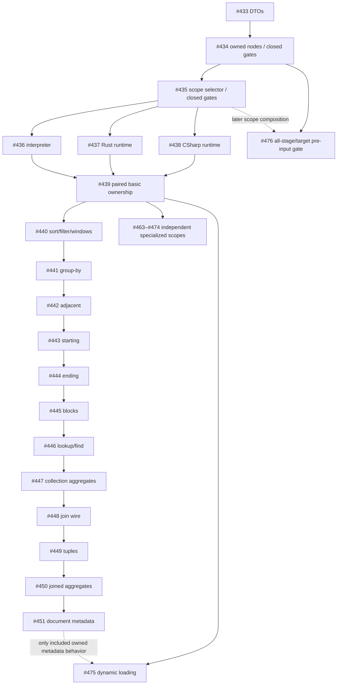

# Explicit source ownership: contributor capability matrix

This design defines explicit source ownership contracts and their semantic prerequisites. [#432](https://github.com/DeandreT/ferrule/issues/432) and [#452](https://github.com/DeandreT/ferrule/issues/452) coordinate implementation; linked issues and PRs track assignment, progress and verification.

The owner/path foundation ([#433](https://github.com/DeandreT/ferrule/issues/433)) defines strict `SourceOwner`, `OwnedSourceRef` and `SourceSelector` data types. Owned field/position nodes ([#434](https://github.com/DeandreT/ferrule/issues/434)) and collection selectors ([#435](https://github.com/DeandreT/ferrule/issues/435)) add representation and typed capability gates. Interpreter execution, generated Rust/C#, native export and GUI authoring require their own qualification; wire representation alone does not enable them.

## Ownership rules

An owner selects immutable primary or one exact named endpoint. Preserve name bytes; reject empty named owners without trimming, alias/prefix fallback or new path restrictions. Paths are endpoint-local. Owned `[]` differs from inherited/null selection; absent-frame differs from root-frame. Preserve legacy fallback, while owned reads never borrow another endpoint. Generated item IDs, function inputs and JoinId remain separate identities.

Keep structural validity separate from executable capability. Preserve strict new forms and reject unsupported execution/emission, including directly constructed Program validation. P2 checks new-kind potential branches, called functions and demanded paths without changing legacy laziness. Codegen keeps its reachable lowering/metadata rules; native export needs whole-design checks before writing. Preserve saved GUI owner data/IDs/wires read-only; authoring/conversion stays closed.

## Group-member occurrence identity

An owned By, AdjacentBy, StartingWith, EndingWith or IntoBlocks group carries a private grouped occurrence at its exact owner and
absolute collection path. It exposes the first surviving ordered member for
scalar reads, a compact group ordinal for positions, and its complete ordered
members for nested collection iteration. A nested member creates an ordinary
occurrence with its own position; other owners and incoming ancestor frames are
preserved. An explicit empty frame at a group-member root reads the immutable
endpoint root. The latest exact-owner frame governs selection, so a nested
ordinary repeated-root member retains its active-item pin behavior.

Group provenance comes from an authenticated source-walk terminal observation,
including root and identity selections. Wrapper labels and pointer equality do
not establish an owner. A group keeps its first member's intermediate prefix;
enumerating members does not reconstruct each member's original crossed-parent
frames. Wrapper-origin redirects preserve the endpoint-local path even when a
legacy named alias names an endpoint root.

Member-retention predicates use candidate contexts and retain a whole group when
any member matches. Parent windows select retained groups after grouping; bindings
and children use the resulting grouped context. These distinct roles also govern
dependency discovery. See [the generated group-by contract](../code-generation.md#explicit-owned-group-by)
for ordering, explicit profile selection and metadata admission.

Adjacent grouping compares only the last constructed run. Filtering before
grouping can bring equal keys together; removing an unretained run afterward
does not merge neighboring runs. The [adjacent contract](owned-group-adjacent-by.md)
uses the same authenticated occurrence and member rules under its own explicit
generation companion.

Starting grouping retains the first false prefix and starts each subsequent
group at a true Boolean boundary. Boundary evaluation precedes member retention;
dropping a group does not recompute boundaries. The
[Starting contract](owned-group-starting-with.md) uses the same member identity
and root-pin rules with Boolean controls and no grouping-key text charge.

Ending grouping closes the current group at each true Boolean boundary; the
candidates after the last true boundary form a trailing group. Boundary
evaluation precedes member retention, and dropping a group never reopens or
merges its neighbors. The [Ending contract](owned-group-ending-with.md) uses the
same member identity, root-pin rules and Boolean-control resource model.

Fixed-block grouping fills consecutive blocks of a positive size evaluated once
in the receiving parent after window bounds; the last block may be partial.
Member retention runs per candidate, and dropping a block never refills its
neighbors. The [IntoBlocks contract](owned-group-into-blocks.md) uses the same
member identity and root-pin rules and charges no grouping-key text.

## Parent-context scalar sequence selection

`SequenceItemAt` over Generate, Tokenize, TokenizeByLength or TokenizeRegex uses
the receiving source context for both producer arguments and its once-evaluated
index. Production completes first, including empty and null-suppressed sequences;
producer errors precede the index. The consumer creates no source frame, so
endpoint ownership, parent pins and group representative/member positions retain
their ordinary meaning. Nested eligible ItemAt expressions use that same rule.

The explicit generated companion selects an orthogonal consumer permission
beside the target-control profile. Inherited closed contexts and owned failure
eligibility remain authoritative. See [the ItemAt contract](owned-sequence-item-at.md)
for admission, complete named catalogues and resource boundaries.

## Failure-rule endpoint walks

An owned failure rule walks rows from exactly its declared endpoint, beside the
unchanged legacy `source` and `sequence` forms. The selected owner's absent or
empty collection yields no rows and is never repaired by another endpoint with
the same path; an unsupplied owner is a typed failure. Rule order, selection and
lazy messages keep their legacy meaning. See the
[failure contract](owned-failure-sources.md).

## Owned path-hierarchy input collections

`OwnedPathHierarchyPlan` pairs an `OwnedSourceRef` input collection with the
legacy separator and generated directory/file/name fields. It is a separate
`owned_path_hierarchy` construction beside the unchanged legacy plan, so older
readers reject it. Its strict reader rejects unknown fields, malformed owners
and legacy path arrays, and keeps the output-structure rules.

The collection is an owned read in the receiving context and creates no source
frame. A same-owner active frame pins its prefix; otherwise the immutable
endpoint root is read, including an endpoint whose root is the collection. The
operator evaluates no expression and admits only Basic contexts. Interpreter,
generated Rust and generated C# share the legacy builder's ordering, bounds and
error categories. Native export and GUI authoring remain closed.

## Owned adjacency-tree row collections

`OwnedAdjacencyTreePlan` pairs an `OwnedSourceRef` row collection with the
legacy row-relative key and parent paths, the generated target key and children
fields, and the optional root expression. It is a separate
`owned_adjacency_tree` construction beside the unchanged legacy plan, so older
readers reject it. Its strict reader rejects unknown fields, malformed owners
and legacy path arrays, and keeps the row and output rules.

The rows are an owned read in the receiving context and create no source frame.
A same-owner active frame pins its prefix; otherwise the immutable endpoint root
is read, including an endpoint whose root is the collection. Key and parent
paths are read from each selected row, never resolved as endpoints. The root
expression keeps the receiving (parent) context and is evaluated after the rows.
The construction admits only Basic contexts. Interpreter, generated Rust and
generated C# share the legacy builder's ordering, bounds and error categories.
Native export and GUI authoring remain closed.

## Recursive collection roots

An owned recursive collection walk selects its root collection from exactly its
declared endpoint, beside the unchanged legacy `recursive_collect` form. Child,
descent and value paths stay relative to each selected group and never select
an endpoint, and the generated item stays a private declaration. Only a Basic
parent-context ItemAt consumes the owned producer. See the
[recursive collection contract](owned-recursive-collect.md).

## Generated-item predicates

`SequenceExists` over the same four producers evaluates producer arguments in
the receiving source context, then evaluates its predicate once per item until
the first true result. The predicate context appends only a private scalar item
frame: the item declaration and empty-path ordinary reads see it, while owned
reads keep the receiving owner, pins and positions. Producer errors precede the
predicate, and an empty sequence never evaluates it. RecursiveCollect, FilterMap
and closed operators inside the predicate remain closed. See
[the Exists contract](owned-sequence-exists.md).

## Owned recursive filtering

A recursive-filter scope with an owned source selector filters groups from
exactly that endpoint; the selector is its only owner and the plan's children
and items stay relative to each visited group. Visited groups and items keep the
owner and a same-shape collection identity, so the predicate's owned reads and
positions resolve the current item and innermost group without falling back.
See the [recursive filter contract](owned-recursive-filter.md).

## Owned search

Owned Lookup and CollectionFind walk one collection of exactly their declared
endpoint, beside the unchanged legacy nodes. A lookup needle executes once in
the parent context; key, value, predicate and find value read only the selected
item, which is the latest occurrence of its owner. The latest active frame of
the same owner anchors the walk, so a search inside an owned row, group or block
sees only that row's, group's or block's items. An absent or empty selected
collection misses without consulting another endpoint, Null-like keys never
match, and the first match in source order wins with a miss as `Null`. See the
[search contract](owned-lookup-find.md).

## Owned join identity

An owned inner join names each source and each condition's left collection by
owner plus endpoint-relative collection. It shares the scope's `join` key with
the legacy plan, but every collection is an owned object, so a reader that only
knows collection arrays refuses it, and one plan never mixes the two forms.
Duplicate, singleton and left-stage checks compare the whole identity: a
primary `Rows` and a named `Rows` are two sources, while the same owner's `Rows`
twice is still a duplicate. The scope's `JoinId` stays independent of these
identities. Validation resolves each source against its own endpoint and each
key path under the exact collection it names. Execution, generation, `.mfd`
export and GUI editing refuse owned joins; the GUI shows a saved one read-only.

## Existing coordinated issues

Reuse these existing scopes; the capability column concerns **explicit ownership**.

| Issue / scope | Dependency | Capability contract |
|---|---|---|
| [#433](https://github.com/DeandreT/ferrule/issues/433) DTOs | None | Strict owner/path data types; execution qualifies separately |
| [#434](https://github.com/DeandreT/ferrule/issues/434) owned field/position nodes | [#433](https://github.com/DeandreT/ferrule/issues/433) | Strict new kinds, schema checks and closed typed gates |
| [#435](https://github.com/DeandreT/ferrule/issues/435) collection/root/nested selector | [#434](https://github.com/DeandreT/ferrule/issues/434) | Source slot/getters/mutators must preserve owner |
| [#436](https://github.com/DeandreT/ferrule/issues/436) interpreter registry/basic frames | [#435](https://github.com/DeandreT/ferrule/issues/435) | exact scalar, collection and position reads; separate generated/function contexts |
| [#437](https://github.com/DeandreT/ferrule/issues/437) Rust runtime registry/walks | [#435](https://github.com/DeandreT/ferrule/issues/435) | preserve legacy context; no emitter opening alone |
| [#438](https://github.com/DeandreT/ferrule/issues/438) C# runtime registry/walks | [#435](https://github.com/DeandreT/ferrule/issues/435) | separate registry from legacy merged named wrapper |
| [#439](https://github.com/DeandreT/ferrule/issues/439) paired basic lowering/emission | [#436](https://github.com/DeandreT/ferrule/issues/436),[#437](https://github.com/DeandreT/ferrule/issues/437),[#438](https://github.com/DeandreT/ferrule/issues/438) | scalar AND collection/position/nesting, checked in all three engines |
| [#440](https://github.com/DeandreT/ferrule/issues/440) sort/filter/windows | [#439](https://github.com/DeandreT/ferrule/issues/439) | parent/item phases and frame provenance |
| [#441](https://github.com/DeandreT/ferrule/issues/441) group-by/post-group filter | [#440](https://github.com/DeandreT/ferrule/issues/440) | grouped frame and representative item |
| [#442](https://github.com/DeandreT/ferrule/issues/442) adjacent grouping | [#441](https://github.com/DeandreT/ferrule/issues/441) | adjacent key/item frames |
| [#443](https://github.com/DeandreT/ferrule/issues/443) starting-boundary grouping | [#442](https://github.com/DeandreT/ferrule/issues/442) | boundary phases/positions |
| [#444](https://github.com/DeandreT/ferrule/issues/444) ending-boundary grouping | [#443](https://github.com/DeandreT/ferrule/issues/443) | membership and frame positions |
| [#445](https://github.com/DeandreT/ferrule/issues/445) fixed-block grouping | [#444](https://github.com/DeandreT/ferrule/issues/444) | block/window membership |
| [#446](https://github.com/DeandreT/ferrule/issues/446) Lookup/CollectionFind | [#445](https://github.com/DeandreT/ferrule/issues/445) | parent needle, owned item predicate/value, missing result Null |
| [#447](https://github.com/DeandreT/ferrule/issues/447) collection aggregates | [#446](https://github.com/DeandreT/ferrule/issues/446) | item predicate/value versus parent argument; excludes generated sequences |
| [#448](https://github.com/DeandreT/ferrule/issues/448) join wire/identity | [#447](https://github.com/DeandreT/ferrule/issues/447) | owner+collection and separate JoinId; execution closed |
| [#449](https://github.com/DeandreT/ferrule/issues/449) join tuples | [#448](https://github.com/DeandreT/ferrule/issues/448) | source-row versus flattened tuple positions |
| [#450](https://github.com/DeandreT/ferrule/issues/450) joined aggregates/correlation | [#449](https://github.com/DeandreT/ferrule/issues/449) | active-source and argument phases |
| [#451](https://github.com/DeandreT/ferrule/issues/451) document-path metadata | [#450](https://github.com/DeandreT/ferrule/issues/450) | exact owned-frame metadata; excludes dynamic loading/XML routes |
| [#452](https://github.com/DeandreT/ferrule/issues/452) specialized matrix | Coordination | Defines focused operator contracts and semantic prerequisites |

## Specialized follow-on issues

[#463](https://github.com/DeandreT/ferrule/issues/463)–[#474](https://github.com/DeandreT/ferrule/issues/474) depend directly on [#439](https://github.com/DeandreT/ferrule/issues/439). [#475](https://github.com/DeandreT/ferrule/issues/475) also depends on [#439](https://github.com/DeandreT/ferrule/issues/439); [#451](https://github.com/DeandreT/ferrule/issues/451) is conditional only when an explicitly included owned document-metadata consumer needs it. An operator's special producer is a prerequisite only for combinations using that producer. Common IR/runtime/emitter file edits require coordination, not blanket serialization behind joins or metadata work.

Each specialized operator qualifies owned integration, interpreter execution, lowering and Rust/C# runtime/emission before its capability opens. Native export and GUI owner authoring qualify separately. The source column identifies legacy behavior and the responsible edit boundary.

| Issue / operator | Direct dependency | Source ownership / focused missing behavior |
|---|---|---|
| [#463](https://github.com/DeandreT/ferrule/issues/463) RecursiveCollect | [#439](https://github.com/DeandreT/ferrule/issues/439) | `mapping/model/graph.rs`, `engine/sequence.rs`, runtime recursive contexts; owned root collection, relative child/descent/value paths |
| [#464](https://github.com/DeandreT/ferrule/issues/464) RecursiveFilter construction | [#439](https://github.com/DeandreT/ferrule/issues/439) | `engine/recursive_filter.rs`, runtime filter/context; reuse [#435](https://github.com/DeandreT/ferrule/issues/435) selector, retain copied group/items/positions |
| [#465](https://github.com/DeandreT/ferrule/issues/465) PathHierarchy | [#439](https://github.com/DeandreT/ferrule/issues/439) | mapping plan, engine/runtime builders; qualify input collection, not generated output paths |
| [#466](https://github.com/DeandreT/ferrule/issues/466) AdjacencyTree | [#439](https://github.com/DeandreT/ferrule/issues/439) | mapping adjacency and engine/runtime tree; qualify rows, keep key/parent relative and root expression in parent |
| [#467](https://github.com/DeandreT/ferrule/issues/467) DynamicSourceField | [#439](https://github.com/DeandreT/ferrule/issues/439) | graph, resolver/context and emitters; exact object/key/frame lookup, not document loading |
| [#468](https://github.com/DeandreT/ferrule/issues/468) XmlMixedContent expression | [#439](https://github.com/DeandreT/ferrule/issues/439) | expression, XML validation/runtime; exact atomization and replacement occurrence phases |
| [#469](https://github.com/DeandreT/ferrule/issues/469) XmlSerialize expression | [#439](https://github.com/DeandreT/ferrule/issues/439) | expression and XML runtime; owned structured read, unchanged schema/options/error order |
| [#470](https://github.com/DeandreT/ferrule/issues/470) XmlMixedContent construction | [#439](https://github.com/DeandreT/ferrule/issues/439) | scope evaluation and mixed runtime; reuse selector and actual item's XML metadata/children |
| [#471](https://github.com/DeandreT/ferrule/issues/471) failure-rule Source iteration | [#439](https://github.com/DeandreT/ferrule/issues/439) | project, failure runtime/emitters; strict owned iteration beside legacy; first failure before publication |
| [#472](https://github.com/DeandreT/ferrule/issues/472) SequenceExists | [#439](https://github.com/DeandreT/ferrule/issues/439) + used producer gate | sequence/context/reducers; separate generated item from endpoint read; first-true/empty-false behavior |
| [#473](https://github.com/DeandreT/ferrule/issues/473) SequenceItemAt | [#439](https://github.com/DeandreT/ferrule/issues/439) + used producer gate | sequence/context; values before parent index; one-based bounds/Null/error behavior |
| [#474](https://github.com/DeandreT/ferrule/issues/474) SequenceAggregate | [#439](https://github.com/DeandreT/ferrule/issues/439) + used producer gate | sequence/aggregate runtimes; item predicate/value, parent argument; separate from [#447](https://github.com/DeandreT/ferrule/issues/447)/#450 |
| [#475](https://github.com/DeandreT/ferrule/issues/475) dynamic driver loading | [#439](https://github.com/DeandreT/ferrule/issues/439); [#451](https://github.com/DeandreT/ferrule/issues/451) only if needed | dynamic path/source iteration and context walks; driver/loaded owner identity, success-only cache and laziness |
| [#476](https://github.com/DeandreT/ferrule/issues/476) pipeline pre-input gate | [#434](https://github.com/DeandreT/ferrule/issues/434); coordinate [#435](https://github.com/DeandreT/ferrule/issues/435) | CLI `pipeline.rs`/`pipeline_preview.rs`; reject unsupported owned stages/targets before read/decode |

Source shorthand omits `crates/` and `src/`; issues supply exact file lists. Reconcile callers/C# runtime helpers; registration alone is not equivalence. Key anchors: `mapping/src/source_owner.rs`, `engine/src/resolve.rs`, `codegen/src/lower.rs`.

Legacy native planners have restrictions and warning/refusal paths, not explicit-owner support. DynamicSourceField warns/skips; some sequence renderers skip unexported items. Preserve that behavior and add strict owned gates without claiming universal legacy refusal or partial owned export.

Ordinary sequence arguments and dynamic bindings/children use core reads/frames. Preserve Generate-only FilterMap, CopyCurrentSource/concat contexts and deliberate primary-only helpers; add no arbitrary endpoint producer.

## Pipeline admission is all-stage, all-target

The engine evaluates **every stage and every primary/named stage target**, including disconnected stages and targets not selected for publication (`engine/src/pipeline.rs`). Selected outputs control publication only. [#476](https://github.com/DeandreT/ferrule/issues/476) must not introduce pruning.

The filesystem and preview host seams validate, then read/decode, then call the engine (`cli/src/pipeline.rs`; `pipeline_preview.rs`). Add P2 capability checks before acquisition, preserving structural/identity precedence and engine refusal before evaluation/publication. Pipeline hosts require their own all-stage and all-target admission gate.

Test an unselected/disconnected owned stage or named target: refuse before reader/parser/loader/debug/trace callbacks, leave output markers unchanged and produce no preview result. Cover every engine-evaluated stage/target's called graphs and new-kind branches, preserving P2 valid-unused-storage rules and legacy laziness. [#476](https://github.com/DeandreT/ferrule/issues/476) enables neither owned execution nor pruning.

## Acceptance checklist

- Reconcile one focused scope/current callers and coordinate common files; add only real semantic prerequisites.
- Specify complete expected values/errors for colliding owners, missing selected owner, root/nested/group frames, positions, phases, limits and laziness.
- Preserve strict new wire, old-reader refusal and legacy behavior. Keep unsupported execution/emission rejected while dependencies land.
- Split representation/gates, interpreter/runtime and paired emission into buildable PRs where needed. Compare complete three-engine results before opening only that operator.
- Gate native export/GUI authoring separately; preserve saved owner data/IDs/wires. Run focused checks and required CI, then update status from results.

