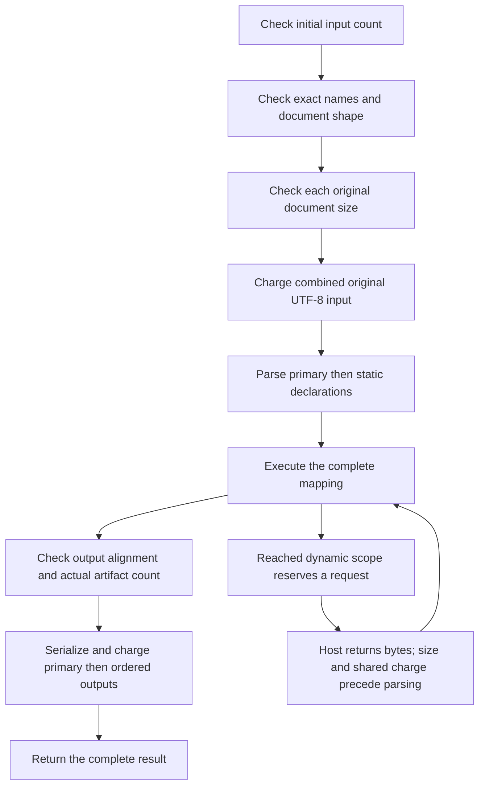

# Generated XML entry points and limits

Use this reference to select a generated **physical XML** entry point. The rows
specify admitted input and output families; a typed or JSON call does not test
an XML parser or writer. A linked fixture identifies a contract, not a passing
execution on every revision.

Use the [XML host guide](code-generation.md#xml-host-boundary) for signatures and
examples. The authoritative adapter dispatch and admission are
[`XmlOutputMode`](../crates/codegen/src/model.rs) and
[`validate_boundary`](../crates/codegen/src/validate/xml.rs). The two emitters are
[`codegen-rust::xml_api`](../crates/codegen-rust/src/xml_api.rs) and
[`codegen-csharp::mapping::xml_api`](../crates/codegen-csharp/src/mapping/xml_api.rs).
Successful typed or JSON generation does not by itself establish an XML adapter.

## Route families

Except for the explicitly byte-only selected-target row, every row has text
and UTF-8 byte inputs and an execution-context variant.
The table shows the text method without a context. In Rust, replace
`execute_xml` with `execute_xml_bytes` for the byte method. In C#, replace
`ExecuteXml` with `ExecuteXmlBytes`. Input bytes and returned bytes are distinct
coverage cells even when one call exercises both.

| Input domain and output form | Rust text method | C# text method | Source fixture family |
| --- | --- | --- | --- |
| Structured or admitted RootView primary → one primary document | `execute_xml` | `ExecuteXml` | [structured_xml_public](../crates/cli/tests/code_generation/structured_xml_public.rs), [xml_text](../crates/cli/tests/code_generation/xml_text.rs) |
| Static Structured inputs → one explicitly selected primary or named physical document (bytes only) | `execute_xml_bytes_selected_target`, `execute_xml_bytes_selected_target_with_host` | `ExecuteXmlBytesSelectedTarget`, `ExecuteXmlBytesSelectedTargetWithHost` | [selected_xml_bytes](../crates/cli/tests/code_generation/selected_xml_bytes.rs) |
| Primary → primary plus static named documents | `execute_xml_outputs` | `ExecuteXmlOutputs` | [xml_output_sets](../crates/cli/tests/code_generation/xml_output_sets.rs) |
| Primary plus complete static named inputs → primary or static output set | `execute_xml_with_sources`, `execute_xml_outputs_with_sources` | `ExecuteXmlWithSources`, `ExecuteXmlOutputsWithSources` | [xml_input_sets](../crates/cli/tests/code_generation/xml_input_sets.rs), [rootview_named_inputs](../crates/cli/tests/code_generation/rootview_named_inputs.rs) |
| Structured primary, optional static inputs and dynamic named loader → primary or static output set | `execute_xml_with_sources_and_dynamic_source_loader`, `execute_xml_outputs_with_sources_and_dynamic_source_loader` | `ExecuteXmlWithSourcesAndDynamicSourceLoader`, `ExecuteXmlOutputsWithSourcesAndDynamicSourceLoader` | [xml_dynamic_inputs](../crates/cli/tests/code_generation/xml_dynamic_inputs.rs) |
| Structured primary → ordered primary document list | `execute_xml_documents` | `ExecuteXmlDocuments` | [xml_dynamic_outputs](../crates/cli/tests/code_generation/xml_dynamic_outputs.rs) |
| Structured primary plus static named inputs → primary document list | `execute_xml_documents_with_sources` | `ExecuteXmlDocumentsWithSources` | [xml_input_document_sets](../crates/cli/tests/code_generation/xml_input_document_sets.rs) |
| Structured primary, optional static inputs and dynamic named loader → primary document list | `execute_xml_documents_with_sources_and_dynamic_source_loader` | `ExecuteXmlDocumentsWithSourcesAndDynamicSourceLoader` | [xml_dynamic_input_document_sets](../crates/cli/tests/code_generation/xml_dynamic_input_document_sets.rs) |
| Structured primary → static primary plus named document lists | `execute_xml_document_outputs` | `ExecuteXmlDocumentOutputs` | [xml_mixed_document_outputs](../crates/cli/tests/code_generation/xml_mixed_document_outputs.rs), [xml_multiple_named_document_outputs](../crates/cli/tests/code_generation/xml_multiple_named_document_outputs.rs) |
| Structured primary plus static named inputs → static primary plus named document lists | `execute_xml_document_outputs_with_sources` | `ExecuteXmlDocumentOutputsWithSources` | [xml_input_document_outputs](../crates/cli/tests/code_generation/xml_input_document_outputs.rs) |
| Structured primary, optional static inputs and dynamic named loader → static primary plus named document lists | `execute_xml_document_outputs_with_sources_and_dynamic_source_loader` | `ExecuteXmlDocumentOutputsWithSourcesAndDynamicSourceLoader` | [xml_dynamic_input_document_outputs](../crates/cli/tests/code_generation/xml_dynamic_input_document_outputs.rs), [validation child](../crates/cli/tests/code_generation/xml_dynamic_input_document_outputs/validation.rs) |
| Structured primary, no named inputs → static primary, one static named document and one or more named document lists | `execute_xml_mixed_outputs` | `ExecuteXmlMixedOutputs` | [xml_mixed_named_outputs](../crates/cli/tests/code_generation/xml_mixed_named_outputs.rs) |

The selected-target row is byte-only, not part of the text/byte substitution
rule above. Its source-aware host call accepts an optional execution context and
admits exactly the selected target's required static inputs, including global
failure-rule requirements. It returns `SelectedXmlBytesTargetOutput`, not a
complete output set. The old singular XML calls remain complete-set calls.

Context names for the other rows follow three rules:

| Method family | Rust context spelling | C# context spelling |
| --- | --- | --- |
| No `with_sources` suffix | Append `_with_context` | Same method, context overload |
| Static `with_sources` suffix | Append `_and_context` | Same method, context overload |
| Dynamic loader suffix | Replace `_with_sources_and_dynamic_source_loader` with `_with_sources_context_and_dynamic_source_loader` | Replace `WithSourcesAndDynamicSourceLoader` with `WithSourcesContextAndDynamicSourceLoader` |

Context reads remain lazy. An overload's existence does not mean a runtime value
or parameter is evaluated. C# null argument/list/accessor guards are also distinct
from wrapped XML input and mapping failures.

### Input admission

`Structured` admits closed ordinary groups, repetition, attributes, scalar text
and String/Int/Float/Bool leaves, including admitted nillable scalars. Each named
input has its own embedded schema. Unsupported alternatives, generic/mixed
content, runtime-named input fields and other advanced shapes do not gain this
reader merely because their typed mapping lowers. See
[structured transport source tests](../crates/codegen/src/tests/structured_xml_transport.rs)
and [transport-emission tests](../crates/codegen/src/tests/structured_xml_transport_emission.rs).

`RootView` is a separate closed observed-primary profile. Its zero-named route
retains eight entry points: singular/output-set × text/bytes × context/no context.
Admitted static Structured named inputs add eight source-aware entry points,
giving sixteen signatures in the
[Rust](../crates/codegen-rust/src/xml_api/named_inputs.rs) and
[C#](../crates/codegen-csharp/src/mapping/xml_api/named_inputs.rs) emitter tests.
An observed primary can also use the separately proved flat static named-output
and combined static-input/static-output shapes. Dynamic inputs or document-list
outputs and observed named-input profiles remain outside RootView admission.
The [observed-input guide](code-generation.md#observed-root-view-input) records
the restrictions; the sixteen-signature count is not a count of all combinations.

Document-list output modes require the proved primary repeating-group driver
and closed member schema. Mixed static/list outputs currently require no named
inputs and exactly one static named declaration. The table does not imply that
all input and output forms compose freely. Invalid explicit policies return a
typed validation/emission failure; unsupported ordinary optional boundaries can
retain the typed/JSON core without XML methods.

## Phase order, resources and ownership

For source-aware Structured calls, the high-level order is:

The host owns the loader's I/O and any publication of returned documents.
Generated libraries do not open output paths or schema-hint locations. Logical
member paths remain opaque and ordered, including duplicate paths. A singular
static-output call still maps and serializes the complete set before selecting
primary. A failure returns no partial result; this is an API-result property,
not a claim about an external application's filesystem publication.

| Resource | Unit and maximum | Counting/priority rule | Source controls |
| --- | --- | --- | --- |
| Each input/output document | Original or serialized UTF-8 bytes; 64 MiB | Byte input size precedes decoding. Each static input size is checked before the combined sum. | [boundary tests](../crates/codegen-runtime/src/xml_boundary/tests.rs), [C# input/runtime tests](../runtime/csharp/Ferrule.Runtime.SmokeTests/XmlTests.cs) |
| Initial/dynamic input count | Documents; 4,096 | Includes primary and statics; each dynamic request reserves a slot before its callback. Repeated loads count again. | [input_set](../crates/codegen-runtime/src/xml_boundary/input_set.rs), [dynamic_inputs](../crates/codegen-runtime/src/xml_boundary/dynamic_inputs.rs) |
| Combined input | Original UTF-8 bytes; 256 MiB | Primary, static declaration order, then reached dynamic requests; independent of output. Returned dynamic bytes charge before parsing. | [input_set](../crates/codegen-runtime/src/xml_boundary/input_set.rs), [C# dynamic document tests](../runtime/csharp/Ferrule.Runtime.SmokeTests/XmlDynamicInputDocumentSetTests.cs) |
| Output count | Actual documents; 4,096 | Static sets include primary; primary lists can be empty; named lists include primary plus members; mixed outputs count primary + static named + all members. Check after mapping and before writers. | [output_set](../crates/codegen-runtime/src/xml_boundary/output_set.rs), [document_set](../crates/codegen-runtime/src/xml_boundary/document_set.rs), [mixed host count cases](../crates/cli/tests/code_generation/xml_mixed_named_outputs.rs) |
| Combined output | Serialized UTF-8 bytes; 256 MiB | Charge before retaining/converting the next document; excludes opaque paths. | [document_outputs](../crates/codegen-runtime/src/xml_boundary/document_outputs.rs), [C# document-output tests](../runtime/csharp/Ferrule.Runtime.SmokeTests/XmlDocumentOutputsTests.cs) |
| Embedded schema / literal hint descriptor | UTF-8 bytes; 8 MiB / 2 MiB | Separate setup limits; hint locations are metadata, not I/O instructions. | [Rust boundary](../crates/codegen-runtime/src/xml_boundary.rs), [C# output](../runtime/csharp/Ferrule.Runtime/FerruleXml.Output.cs) |
| Structured parser/projection | Separate depth, node, field/String-byte, namespace and work ledgers | Per document; not an aggregate Instance or RSS limit. Descriptor JSON depth is separate from logical schema depth. | [limit table](code-generation.md#output-and-limits), [C# structured reader](../runtime/csharp/Ferrule.Runtime/FerruleXml.Input.Structured.cs) |

MiB means 1,048,576 bytes. Text APIs count UTF-8; C# can reject invalid UTF-16
while measuring text. Input ledgers do not count decoded mapping allocations,
and output ledgers do not bound the typed outputs already constructed. These are
eager APIs, with no streaming or peak-memory guarantee.

### Error wrappers

The inner boundary distinguishes `Schema`, `DocumentLimit`, `Utf8`, `Input`,
`Mapping` and `Output`. Preserve the wrapper, phase owner, original boundary and
complete typed cause chain together; category text alone cannot establish parity.
Rust uses the standard `Error::source`; C# retains the boundary as
`InnerException`. Per-document `DocumentLimit` has document bytes/limit. Set
refusals instead retain a resource cause with `resource`, `observed_count` and
`limit`; the boundary's per-document byte fields remain unset.

| Route | Rust error / C# exception | Owner information |
| --- | --- | --- |
| Singular without sources | `XmlBoundaryError` / `FerruleXmlBoundaryException` | Original boundary; no source-aware wrapper |
| Static output set without sources | `XmlOutputSetError` / `FerruleXmlOutputSetException` | Primary or named output declaration for serializer failures |
| Static/dynamic source-aware primary or set | `XmlExecutionError` / `FerruleXmlExecutionException` | Exclusive input/output owner; optional authenticated dynamic request |
| Primary list | `XmlDocumentExecutionError` / `FerruleXmlDocumentExecutionException` | Final primary member index and path |
| Static sources → primary list | `XmlInputDocumentExecutionError` / `FerruleXmlInputDocumentExecutionException` | Input declaration or final primary member |
| Dynamic sources → primary list | `XmlDynamicInputDocumentExecutionError` / `FerruleXmlDynamicInputDocumentExecutionException` | Input/member plus optional authenticated request |
| Static primary + named lists | `XmlDocumentOutputsExecutionError` / `FerruleXmlDocumentOutputsExecutionException` | Primary or named declaration/final member/path |
| Static sources → primary + named lists | `XmlInputDocumentOutputsExecutionError` / `FerruleXmlInputDocumentOutputsExecutionException` | Input declaration or existing output owner |
| Dynamic sources → primary + named lists | `XmlDynamicInputDocumentOutputsExecutionError` / `FerruleXmlDynamicInputDocumentOutputsExecutionException` | Input/output owner plus optional authenticated request |
| Static primary + mixed static/list named outputs | `XmlMixedExecutionError` / `XmlMixedExecutionException` | Primary, static named declaration, or final named member/path |

Whole-set name errors and mapping failures have no guessed document owner.
Output alignment/count and document-list serializer schema setup are unowned.
Input descriptor errors in source-aware routes retain their input declaration.
A dynamic request is present only for an adapter's own recovered product-input
refusal: original declaration index, source, path, one-based reservation ordinal
and whether the host callback ran. A host error, similar text or externally
thrown XML exception cannot fabricate that channel. Recovery requires the
original Rust marker allocation or C# private exception identity; the adapter
is terminal after a failed load.

## Compiled resource qualification

These four controls exercise real generated XML boundaries. They qualify only
the route and resource shown. Each ordinary text/byte and context variant
retains typed input, mapping or output ownership; no failure returns a partial result.

| Boundary | Exact and over-limit behavior |
| --- | --- |
| [Static named input bytes](../crates/cli/tests/code_generation/xml_input_sets/combined_bytes.rs) | 256 MiB combined succeeds; one extra byte reports `xml_input_set_utf8_bytes`. All declared inputs count, including unused ones. An oversized later document fails before a malformed primary is parsed. |
| [Primary output list](../crates/cli/tests/code_generation/xml_dynamic_outputs/combined_output_bytes.rs) | Each document can fit its own 64 MiB limit and still cross `xml_output_set_utf8_bytes` (256 MiB combined). Failure retains the output member index and logical path, even for duplicate paths. |
| [Dynamic requests](../crates/cli/tests/code_generation/xml_dynamic_inputs/request_count.rs) | With primary and one static input, 4,094 callbacks fit. The next request reserves document 4,097 and refuses before its callback. The declaration, path, ordinal and `callback_invoked=false` survive. |
| [Mixed-output count and graph error](../crates/cli/tests/code_generation/xml_mixed_named_outputs/late_mapping_count.rs) | A static primary, one static named output and 4,094 members fit the 4,096-artifact cap. One more reports `xml_output_artifact_count`; a reached graph Raise takes precedence over counting or writing. |

Byte and count limits measure documents, not [process memory](memory-and-limits.md).

### C# host limits for static Structured byte inputs

Pass a `FerruleXmlProjectionLimits` as the last argument to
`ExecuteXmlBytesOutputsWithSources(source, inputs, executionContext, limits)` or
`ExecuteXmlBytesSelectedTargetWithHost(source, selection, inputs, executionContext, limits)`.
The all-output overload takes every declared static input; selected targets take
only their required inputs. Existing overloads retain their signatures and defaults.

`instanceNodes`, `fieldAndStringBytes`, and `projectionWork` are positive,
inclusive limits, at most 1,000,000 nodes, 64 MiB, and 100,000,000 work units,
respectively. Each parsed primary or named document gets a fresh counter set.
Fields and string contents count in UTF-8 bytes; work measures prospective
projection operations, not elapsed time. Crossing a limit raises the existing
input boundary failure with its specific reason and input owner. It returns no
output. A nonpositive or above-default limit throws `ArgumentOutOfRangeException`
at construction. These limits do not change parser, transport, output or process
limits, and do not bound peak process memory.
