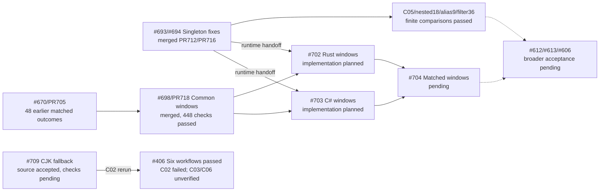
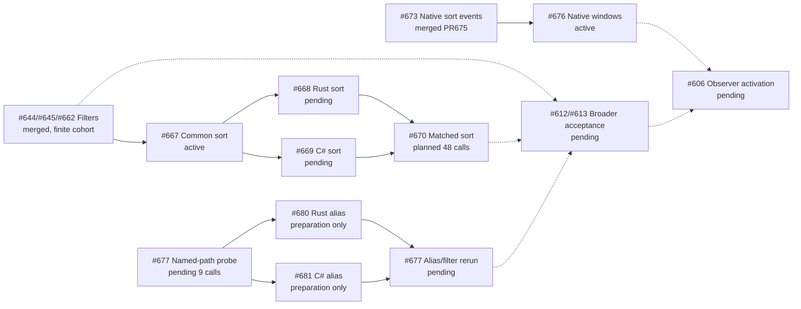
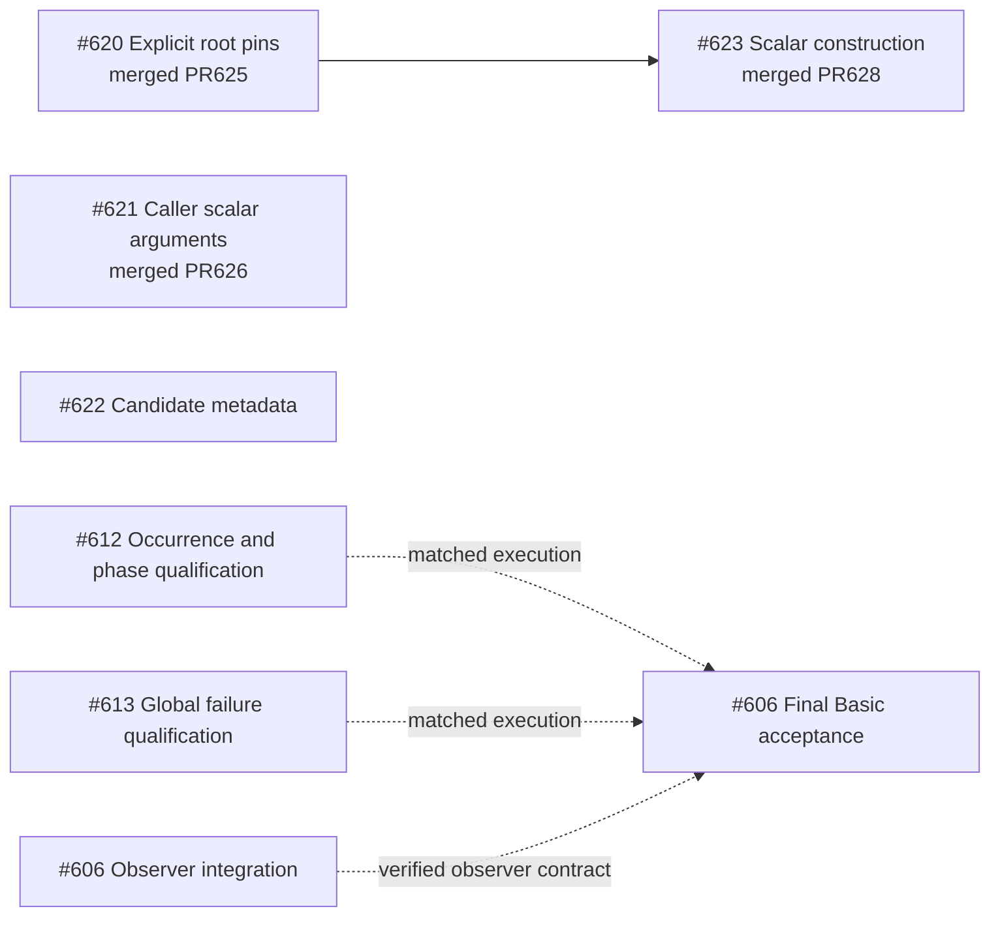
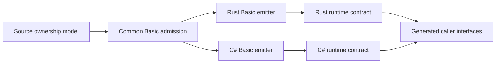
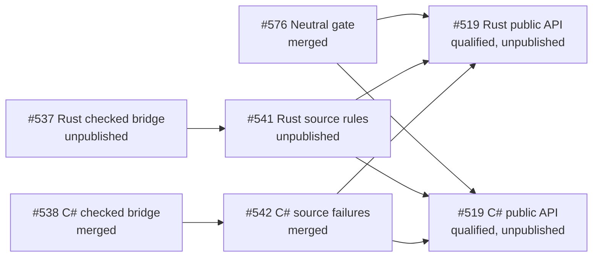
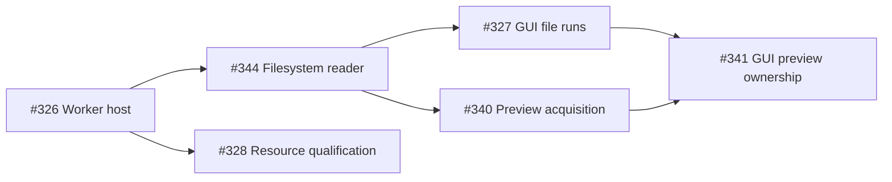
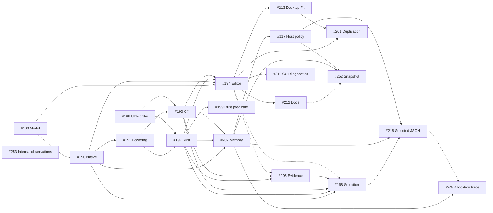

# Parallel Work

The [coordination issue](https://github.com/DeandreT/ferrule/issues/89) tracks
bounded work from the [roadmap](../ROADMAP.md). Issues define the problem,
in/out of scope, likely files and acceptance checks; this page helps contributors
choose a lane and avoid conflicting changes.

## Current Basic milestone handoffs (2026-10-14)

[#697](https://github.com/DeandreT/ferrule/issues/697) coordinates the
[current roadmap](../ROADMAP.md#current-basic-ownership-milestone-2026-10-14)
against merged main [`d92a0bb`](https://github.com/DeandreT/ferrule/commit/d92a0bb67826d13fc3069c9b7c0acad85f7c4073).
Sort profiles and the retained PR705 48-outcome cohort are merged. The separate
singleton runtime corrections are merged in PR712 and PR716. Their local checks
and current C05/nested18/alias9/filter36 comparisons passed within their finite
scopes. PR718 merged the common window profile after 448 local tests passed;
separate backend window implementation is next. Earlier dated tables retain
their historical scope. Source review, local execution and matched outcomes
remain separate evidence.

| Lane | Source ownership | Next gate |
| --- | --- | --- |
| #693 Rust singleton projection | `crates/codegen-runtime/src/context/basic.rs` and `basic_tests.rs`. | Merged in PR712. Current runtime375/backend164-active-plus-ten-ignored and filter24/sort26 checks passed. Bind the merged runtime preimages at #702's handoff; do not reuse older runtime source identities. |
| #694 C# singleton projection | `runtime/csharp/Ferrule.Runtime/ScopeContext.cs` and `Ferrule.Runtime.SmokeTests/BasicOwnershipContextTests.cs`. | Merged in PR716. Backend164/strict and all 45 runtime/generated commands passed, including smoke216/public44/new-singleton33. Bind the fresh runtime source and DLL at #703's handoff. |
| #688/#692 nested-context qualification | Focused conformance fixtures and complete output/error oracles. | Current C05 six-call comparison passed. The original six-model/18-call cohort is accepted after retained-capture reconciliation: four C05 expected strings changed in memory, no execution replay and original failures/fixtures preserved. Broader error and observer qualification remains separate. |
| #677 alias/filter cohorts | Original alias and filter models; no production edits. | Current alias9 and filter36 passed after both fixes, with all ten alias and 16 filter commands passing. Broader nested and matched-sort claims retain separate gates. |
| #698 common windows | Common `lib.rs`, `lower.rs`, `owned_admission.rs`, `validate/mod.rs`, `validate/owned_sources.rs`, `tests/basic_owned_emission.rs`, `tests/owned_admission.rs`. | Merged in PR718 after all four local commands passed, including 448 tests/Basic40/admission32, production and strict checks. The separate backend window handoff is ready. |
| #702 Rust windows / #703 C# windows | Separate backend renderer, entrypoint and test scopes; each owns its language runtime files after the #693/#694 handoff. | Planned implementation is authorized after merged #698. Use the merged singleton runtime preimages, then qualify bounds, both filter/sort orders, First, typed failures and finite generated consumers separately. |
| #704 matched windows | One focused portable window corpus; no production edits. | Follow both qualified backend window merges. Preserve earlier sort and nested-context evidence. |
| #709 CJK font fallback | GUI `main.rs`, new `fonts.rs` and one pinned regular font with OFL/copyright/provenance assets. | Source accepted; local font tests, production and private-display checks are unrun. Preserve Latin/Greek primary fonts and the separate Lucide family; rerun failed C02 after qualification. |
| #406 compact GUI workflows | Current GUI build/tests and alternate-display desktop workflows. | Six of nine workflows passed; C02 failed on CJK glyphs. C03 named hover/accessibility and C06 target-height/pin-edge evidence remain unverified. C09 passed protected186, two normal exits and full source guards. |
| #612/#613/#606 broader acceptance | Claim each remaining engine/host scope separately. | Matched finite cohorts inform acceptance; public observer activation requires its own checks. |

Solid arrows identify implementation prerequisites or file handoffs; dotted
arrows supply finite qualification evidence. Font and desktop work are separate
from common/backend window source scopes. Shared compilation and artifact access
still use one coordinated verification slot.

- [x] Merge sort profiles, the earlier #670 cohort and separate #693/#694 fixes.
- [x] Qualify current C05/nested18/alias9/filter36 against both runtime corrections.
- [x] Verify #698's common window candidate locally with all 448 tests.
- [x] Merge #698's verified common window profile in PR718.
- [ ] Implement separate #702/#703 increments, then qualify #704's cohort.
- [ ] Qualify #709, rerun C02 and complete C03/C06 desktop evidence.
- [ ] Complete broader Basic acceptance before public observer activation.

Merge focused increments after their appropriate local checks without waiting
for CI. Keep failed captures, earlier cohorts and their source identities distinct.

## Current Basic ownership handoffs (2026-10-13)

This [#679](https://github.com/DeandreT/ferrule/issues/679) snapshot records
published main [`23b6167`](https://github.com/DeandreT/ferrule/commit/23b6167895c832b30631289f201ba0bd6e8f2990).
The [current roadmap](../ROADMAP.md#current-basic-ownership-progress-2026-10-13)
records merged common/Rust/C# filters, the finite #662 corpus and native sort
observations. Earlier dated sections and the original #640 outcomes retain their
historical scope. Generated error scope is unknown/unavailable; full filter,
error and total parity remain incomplete.

| Qualified milestone | Completed local checks |
| --- | --- |
| #657/PR661 common filter admission | 423 common tests / 23 admission controls, production and strict. |
| #644/PR663 Rust filters | 357 runtime tests; 158 Rust tests with nine ignored; 14 generated programs / 24 calls, production and strict. |
| #645/PR674 C# filters | 155 backend tests / 77 owned controls; fresh Runtime95; 216 smoke controls / 16 public calls across eight hosts, production and strict. |
| #662/PR678 matched filters | Six models / 36 complete outcomes, 12 per executor; all 16 build/run steps passed. The named legacy path gap remains outside this corrected corpus. |
| #673/PR675 native sort observations | 521 engine tests / 65 trace controls, production and strict. Lifecycle CLI7/GUI28 qualification remains scoped to #654/PR660. |

All current issues below are assigned to `DeandreT`. Source plans do not grant
execution or merge credit. Agree the preimages and released file ownership before
editing; a dependency may allow independent preparation while still blocking
qualification or publication.

| Lane | Source ownership | Handoff and next gate |
| --- | --- | --- |
| [#667 Common sort profile](https://github.com/DeandreT/ferrule/issues/667) | Common `lib.rs`, `lower.rs`, `owned_admission.rs`, `validate/mod.rs`, `validate/owned_sources.rs`, `tests/basic_owned_emission.rs`, `tests/owned_admission.rs`. | Active after matched #662. Add explicit sort APIs; default/filter-only behavior and closed families remain unchanged. Merge before backend sort qualification. |
| [#668 Rust sorting](https://github.com/DeandreT/ferrule/issues/668) | Rust backend `lib.rs`, `owned_basic.rs`, `tests/owned_basic.rs`; runtime `context/basic.rs`, `basic_tests.rs`. | Depends on #667. May proceed in parallel with #669; coordinate runtime-file handoff with #680. Qualify complete bounded sort/filter orders and a finite generated driver. |
| [#669 C# sorting](https://github.com/DeandreT/ferrule/issues/669) | C# backend `lib.rs`, `owned_basic.rs`, `mapping.rs`, `tests/owned_basic.rs`; runtime `ScopeContext.cs`, `BasicOwnershipContextTests.cs`. | Depends on #667. May proceed in parallel with #668; coordinate runtime/backend-test handoff with #681. Fresh runtime and generated consumers precede merge. |
| [#670 Matched sorting](https://github.com/DeandreT/ferrule/issues/670) | Nine new files under `conformance/basic-owned-sort/`; no production/runtime edits. | After #667/#668/#669 merge, freeze and qualify the planned 16-case/48-call cohort. Preserve occurrence/filter corpora and failed captures. |
| [#676 Native window observations](https://github.com/DeandreT/ferrule/issues/676) | Engine `eval_scope.rs` and `tests/trace.rs` only. | Active after #673. Report WindowApplied using the actual receiving parent context and logical First count; preserve output, error and budget order. No generated window or public observer activation. |
| [#677 Named legacy-path probe](https://github.com/DeandreT/ferrule/issues/677) | Focused matched probe; retain the original model/input/outcomes. | Run nine selected-Named calls across owner-relative, prefixed and empty paths in all three executors before choosing a production fix. Probe qualification is pending. |
| [#680 Rust alias child](https://github.com/DeandreT/ferrule/issues/680) | Runtime `context/basic.rs` and `basic_tests.rs` only. | Preparation only until #677's probe confirms the gap. Preserve default traversal, ownership, phases, limits and first errors; sequence overlapping #668 runtime edits. |
| [#681 C# alias child](https://github.com/DeandreT/ferrule/issues/681) | Runtime `ScopeContext.cs`, `BasicOwnershipContextTests.cs`; narrow paired-position control in C# `tests/owned_basic.rs`. | Preparation only until the probe confirms the gap. Preserve the original negative helper/model, rebuild the runtime and sequence overlapping #669 files. |
| [#606 Observers and acceptance](https://github.com/DeandreT/ferrule/issues/606) | Claim each remaining engine/host scope separately. | Lifecycle, candidate, filter and sort observations are merged. Window/error/debug/cancellation observers, public activation and broader #612/#613 acceptance retain independent checks. |

Solid arrows are prerequisites; dotted arrows provide finite qualification
evidence. They do not imply that broader acceptance or public observer activation
is complete. The editable [architecture drawing](architecture-parity.drawio)
retains the broader design and is unchanged.

- [x] Merge #644/#645 and qualify #662's 36 matched filter calls.
- [x] Merge #673's native sort observations; preserve closed public trace/debug gates.
- [ ] Hand common sort ownership from #667 to separate #668/#669 owners, then
  qualify #670. Keep generated windows/grouping and specialized families closed.
- [ ] Qualify #676 native windows and #677's probe, separate #680/#681 fixes and
  subsequent alias/filter rerun. Preserve failed captures and original models.
- [ ] Complete #612/#613 and #606's remaining acceptance checks before activation.

Reserve one shared compiler/artifact lane, check disk headroom, and bind each local
check to current sources and runtime artifacts. Rust and C# source scopes may
proceed in parallel; overlapping backend/runtime edits and engine window/error
work require a handoff. Merge locally verified focused increments without waiting
for CI. Graphical checks use an alternate display. This docs issue owns only the
two current fronts; it changes no runtime or admission capability.

## Current public native ownership lanes (2026-10-13)

This [#624](https://github.com/DeandreT/ferrule/issues/624) snapshot is against
merged main [`80274d0`](https://github.com/DeandreT/ferrule/commit/80274d0079f0adbe70004780701c7bf1cbbe0280),
including [PR618](https://github.com/DeandreT/ferrule/pull/618),
[PR625](https://github.com/DeandreT/ferrule/pull/625),
[PR626](https://github.com/DeandreT/ferrule/pull/626) and
[PR628](https://github.com/DeandreT/ferrule/pull/628). The
[current roadmap](../ROADMAP.md#current-public-native-ownership-2026-10-13)
records the public Basic root/scoped-walk and occurrence-position implementation.
Owned global failure rules, tracing and debugging remain closed; specialized
ownership domains retain their separate gates. #620's explicit nonrepeating
root pins, #621's caller-owned scalar function arguments and #623's Basic owned
scalar construction are merged in PR625, PR626 and PR628. PR628's native
verification passed all 437 engine library tests, including the exact 35-test
core module, 18 source-ownership tests and 31 owned Basic tests. Production
compilation and strict library/test checks also passed. Earlier PR625/PR626
results retain their own increment scopes. Matched generated qualification and
the remaining occurrence, failure and observer work are pending. The planned
18 matched native/Rust/C# calls remain unrun.

[PR619](https://github.com/DeandreT/ferrule/pull/619) is closed without merging
because PR618 superseded its private root executor. Its retained 407-test result
qualifies only the older private proposal.
[#616](https://github.com/DeandreT/ferrule/issues/616) is closed as not planned:
the public executor has no retained success-witness log. Candidate/ancestry
metadata and large-input memory behavior belong to #622.

The active lanes are assigned to `DeandreT`. Coordinate a source handoff before
changing shared files; they are unavailable for a new independent claim. The
older tables and diagrams below remain dated snapshots.

| Lane | Source scope and required handoff | Current status and next gate |
| --- | --- | --- |
| [#620 Explicit nonrepeating root pins](https://github.com/DeandreT/ferrule/issues/620) | `crates/engine/src/owned_context.rs` and `tests/owned_source_basic.rs`; hand off walker changes to #622. | Merged in [PR625](https://github.com/DeandreT/ferrule/pull/625); #620 is closed as completed. Native checks passed: 422 engine library tests, including 31 owned Basic tests, production compilation and strict library/test checks. Exact-owner repeating/inactive-frame distinctions are preserved. #623's prerequisite is satisfied. |
| [#621 Caller-owned scalar function arguments](https://github.com/DeandreT/ferrule/issues/621) | `crates/engine/src/source_ownership.rs` and `tests/source_ownership.rs`; hand shared admission files to #623, then #613. | Merged in [PR626](https://github.com/DeandreT/ferrule/pull/626); #621 is closed as completed. Native checks passed: 429 engine library tests, including the exact 18-test source-ownership module, production compilation and strict library/test checks. Arguments retain caller context; the body remains isolated and inherited specialized contexts retain their refusals. |
| [#622 Large-input candidate metadata](https://github.com/DeandreT/ferrule/issues/622) | Owned walking in `owned_context.rs`, phase storage in `eval_scope.rs`, and focused performance controls; coordinate #620's walker and #623's scope edits. | Measurements remain unrun. Measure retained metadata across First, filters, sorting and windows; bound actual retention with typed limits, then stream eligible paths. Preserve complete outputs and Structural/Selection/Output positions. Keep measurements with the focused implementation increments. |
| [#623 Basic scalar target construction](https://github.com/DeandreT/ferrule/issues/623) | Scalar admission in `source_ownership.rs`, routing in `eval_scope.rs`, and focused tests; hand shared admission files to #613's root-only #627 increment. | Merged in [PR628](https://github.com/DeandreT/ferrule/pull/628); #623 is closed as completed. Native checks passed: 437 engine library tests, including the exact 35-test core module, production compilation and strict library/test checks. The existing constructor/conversion path and specialized refusals are preserved. |
| [#613 Global failure rules and row provenance](https://github.com/DeandreT/ferrule/issues/613) | Root-only #627 owns `failure.rs`, `tests/failure.rs`, `source_ownership.rs` and `tests/source_ownership.rs`; coordinate the admission handoff and later occurrence interface. | Assigned [#627 Static root global failures](https://github.com/DeandreT/ferrule/issues/627) source work is in progress after #623's admission handoff. Root-valued support is the first focused increment; row provenance remains closed. Preserve one stored-order pre-target pass, lazy messages and typed errors. |
| [#612 Public occurrence and phase qualification](https://github.com/DeandreT/ferrule/issues/612) | Current public walker/scope implementation and focused controls; coordinate proposed fixes with the active owner of each touched file. | Pending; the planned 18 matched native/Rust/C# calls remain unrun. Qualify nested counts, outer pins, filters, sorting, windows, bindings and child scopes with complete native/generated outcomes; include #620's root-pin correction. |
| [#606 Observer integration and final Basic acceptance](https://github.com/DeandreT/ferrule/issues/606) | Observer/admission boundaries, necessary host controls and matched execution controls; agree the context interface before independent observer source work. | Pending. Observer implementation may proceed independently; final acceptance requires confirmed matched execution, including #612 and #613. Keep unsupported domains refused. |
| [#624 Current documentation](https://github.com/DeandreT/ferrule/issues/624) | `ROADMAP.md` and `docs/parallel-work.md` only. | Reconcile current implementation/status; verify source claims, links and the diagram while preserving dated evidence and anchors. |

The solid arrow records the #620-to-#623 merge dependency, now satisfied by
PR625. Dashed
arrows identify evidence needed for final #606 acceptance; they do not serialize
independent observer implementation once its interface is agreed. #621 and #622
have distinct behavior scopes. Shared admission, walker and scope-storage files
still require sequenced edits and explicit handoffs.
Serialize shared admission source edits and handoffs in the order #621, then #623,
then #613.

- [x] PR618's public Basic roots, scoped walks and occurrence positions are
  implemented; superseded PR619 and private-only #616 are retired.
- [x] Verify and merge #620 in PR625 using its native local checks.
- [x] Verify and merge #621 in PR626 using its native local checks.
- [x] Verify and merge #623 in PR628 using its native local checks, then hand
  shared admission files to #613's root-only #627 increment.
- [ ] Measure and bound #622 candidate metadata within its implementation work;
  measurements remain unrun. Preserve required materialization and position phases.
- [ ] Qualify #612/#613 against actual public execution and matched generated
  controls, then settle #606 observer behavior and final Basic acceptance.

Reserve shared compiler/artifact capacity before local checks. Reuse compatible
build artifacts, retain exact source/executable identities and check disk
headroom; avoid duplicate caches and concurrent heavy builds. Run graphical
checks on an alternate display. Source review, local execution and physical
workflow evidence remain separate gates. Historical private checks do not
supply current-main qualification.

## Claim a lane

1. Read the issue and its linked contracts. Check current assignees and comments;
   the table below is a snapshot, not a replacement for the live issue.
2. Assign the issue to yourself before starting. Maintainer work is assigned to
   `DeandreT`; an unassigned `help wanted` issue is available. If you cannot set
   an assignee, ask the maintainer to assign you in the issue before proceeding.
3. State the files or modules you plan to own and any shared verification slot
   you will need. Agree on overlapping edits before changing the same source.
4. Keep one bounded result per PR and link its issue. For a newly discovered
   gap, open a scoped issue before implementing it; do not silently widen the
   issue you claimed.
5. Leave concise updates in first person (I/me): result, evidence link, blocker,
   and next step. Release ownership when pausing or handing off so another
   contributor can take it.

## Basic public-family milestone and next lanes

The Rust and C# public Basic emitter families share the common source-ownership
model and admission policy. Each backend owns its renderer and language-specific
runtime integration. The
[roadmap contract](../ROADMAP.md#basic-owned-source-public-family-milestone)
describes target ValueMap, retained-input and failure boundaries.

### Source ownership

| Component | Implementation responsibility | Coordination rule |
| --- | --- | --- |
| Common admission | `crates/codegen/src/capabilities.rs` (capability set and preset table), `crates/codegen/src/validate/owned_sources/` and `crates/codegen/src/tests/basic_owned_emission.rs` | Add a new capability as its own field, table column and `owned_sources` module; agree changes to a shared gate with both backend owners. |
| Rust Basic renderer | `crates/codegen-rust/src/owned_basic.rs` and `crates/codegen-rust/src/tests/owned_basic.rs` | Sequence renderer and source-test edits within the Rust lane. |
| C# Basic renderer | `crates/codegen-csharp/src/owned_basic.rs` and `crates/codegen-csharp/src/tests/owned_basic.rs` | Sequence renderer and source-test edits within the C# lane. |
| Runtime and public interfaces | Each backend's runtime and emission entry points | Preserve each preset's capability set, generated symbols and caller contracts. |
| Documentation | Capability contracts and reusable contributor procedures | Describe implemented behavior; keep task progress, result records and handoff state in issues. |

The public Basic path validates common admission before backend rendering.
Private ordinary failure-map admission remains a separate profile from the
shared/public failure gate. A private renderer change must preserve the public
gate's complete typed refusal and the ordinary emitter's admission behavior.

Target ValueMaps retain potential input edges and runtime error priority.
Retained inventory preserves stored calls and actual referenced bodies, while
failure diagnostics retain rule, expression and source-context origins. Changes
to these contracts need coordinated source ownership even when the languages
can be implemented independently.

The diagram shows shared policy prerequisites and separate backend contracts.
File ownership in the table adds serialization requirements for overlapping
changes.

### Verification and publication procedure

Reserve the shared compiler slot before builds and check available capacity.
Assign a fresh Cargo target and build directory to each attempt and source
profile. Reuse artifacts only within that profile with their retained producer
and executable identities. Source timestamps and requested manifest paths alone
do not establish the source of cached executable bytes.

Bind verification to complete source mappings and exact test inventories.
Keep source admission, generated consumer execution, physical GUI behavior and
external workflows as distinct checks. Preserve complete failure records in
the work item or local investigation evidence. Follow
[development procedures](development.md) for source isolation and owned process
closure; use an alternate display for GUI verification.

Keep each PR focused on its resulting behavior and coordinate shared-file edits
before publication. Record task status and remaining dependencies in the issue;
repository documentation describes durable behavior and procedures.

## Basic owned-source contributor lanes

Snapshot: 2026-10-12, against merged main
[`2d52eba`](https://github.com/DeandreT/ferrule/commit/2d52eba6166124d31996532b5fe46cdacb0ec405).
This [#578](https://github.com/DeandreT/ferrule/issues/578) update covers only the
[#519](https://github.com/DeandreT/ferrule/issues/519) Basic owned-source lane.
The other availability tables and diagrams below retain their dated scope.

The shared IR/admission work in [PR535](https://github.com/DeandreT/ferrule/pull/535)
and [PR548](https://github.com/DeandreT/ferrule/pull/548), private Rust renderer
[PR547](https://github.com/DeandreT/ferrule/pull/547), private Rust failure groundwork
[PR555](https://github.com/DeandreT/ferrule/pull/555), private C# renderer/budget
correction [PR563](https://github.com/DeandreT/ferrule/pull/563), neutral Basic
gate [PR577](https://github.com/DeandreT/ferrule/pull/577), plus the C# checked-input
bridge [PR579](https://github.com/DeandreT/ferrule/pull/579), and C# source-failure
bridge [PR581](https://github.com/DeandreT/ferrule/pull/581) are merged. The public
Basic emitter APIs
remain unpublished; ordinary emitters keep their existing
closed ownership gates.

These maintainer-owned lanes are not an unassigned-work list. Check the live
assignee and arrange a file handoff before taking shared files. Keep each result
in one focused PR.

| Lane | Exclusive source scope | Publication dependency and next gate |
| --- | --- | --- |
| [#537 Rust checked-input bridge](https://github.com/DeandreT/ferrule/issues/537) | `crates/codegen-rust/src/lib.rs`, `owned_basic.rs`, and `tests/owned_basic.rs` | Preserve PR555's failure groundwork and both existing warning fixes. Publish this checked-input scope before the separate #541 source-rule bridge. |
| [#541 Rust source-rule bridge](https://github.com/DeandreT/ferrule/issues/541) | Rust `owned_basic.rs` and `tests/owned_basic.rs` | Follow #537; add ordinary source-rule evaluation and checked/failure interactions. Preserve `lib.rs`, `failure.rs`, and runtime sources. This issue remains open. |
| [#538 C# checked-input bridge](https://github.com/DeandreT/ferrule/issues/538) | `crates/codegen-csharp/src/lib.rs`, `owned_basic.rs`, and `tests/owned_basic.rs` | Merged in [PR579](https://github.com/DeandreT/ferrule/pull/579). Hand these shared files to #542 for the next C# increment. |
| [#542 C# source-failure bridge](https://github.com/DeandreT/ferrule/issues/542) | C# `owned_basic.rs` and `tests/owned_basic.rs` | Merged in [PR581](https://github.com/DeandreT/ferrule/pull/581), preserving #538's checked-input path. Hand these shared files to the C# public-API owner for its next increment. |
| [#519 Rust public API](https://github.com/DeandreT/ferrule/issues/519) | Rust `lib.rs`, `owned_basic.rs`, `failure.rs`, and `tests/owned_basic.rs` | Follow the merged neutral gate and both languages' checked-input/source-rule bridge qualifications. Accepted source checks cover 17 source controls, four existing controls, strict checks, production compilation, public-symbol exposure, and test inventory. [#580](https://github.com/DeandreT/ferrule/issues/580) qualified the corrected consumer fixture; independent result acceptance covers all five external modules / 14 calls. Publication remains pending. Publish separately from C#. |
| [#519 C# public API](https://github.com/DeandreT/ferrule/issues/519) | C# `lib.rs`, `mapping.rs`, `owned_basic.rs`, and `tests/owned_basic.rs` | Follow the merged neutral gate and both languages' checked-input/source-rule bridge qualifications. Independent acceptance covers 50 source controls, strict checks, and seven external consumers / 24 calls; publication remains pending. |
| [#566 private inventory alignment](https://github.com/DeandreT/ferrule/issues/566) | Private emitter emission/catalogue files and focused tests; shared public admission gate read-only | Align the private inventory within its existing renderer scope. Future public target ValueMap support is a separate [#582](https://github.com/DeandreT/ferrule/issues/582) lane; preserve the current public refusal. |
| [#578 scoped documentation](https://github.com/DeandreT/ferrule/issues/578) | `ROADMAP.md` and `docs/parallel-work.md` | Update these two files after coordinating publication status; preserve other workstreams and historical diagrams. |

Publication prerequisites are shown below. Both languages' checked-input and
source-rule bridges need qualification and publication before either public API
is published. PR555 is merged failure groundwork; #541 remains a separate open
Rust source-rule increment. Independent public Rust source reconciliation is accepted.
The [#580](https://github.com/DeandreT/ferrule/issues/580) consumer fixture
correction in Rust `tests/owned_basic.rs` passed compilation and strict checks.
All five external modules / 14 calls now have independent result acceptance.
Coordinate that shared file with the Rust public-API owner. The earlier compile
failure remains a failed record; both public APIs remain unpublished.

- [x] Shared model/admission, both private renderer foundations, Rust failure
  groundwork, the neutral Basic gate, and both C# bridges are merged.
- [ ] Publish #537, then the separate #541 source-rule bridge.
- [x] Qualify the corrected #580 fixture with all five Rust public external
  consumer modules / 14 calls, with independent result acceptance. Retain the
  accepted C# candidate results.
- [ ] Publish the Rust and C# public APIs in separate, independently buildable PRs.

One Rust source owner should sequence #537, #541, and the Rust public API; one
C# owner should take the C# public API after merged #538 and #542.
The public language PRs can be worked on in parallel after their shared gates pass. Those backend scopes do not
own common validator files or runtime source changes. Reserve shared verification
before compiling, and verify complete current-main sources and the required test
inventory when reusing build artifacts. Keep earlier failed checks distinct from
the qualified successor.

## Current ownership and readiness

Snapshot: 2026-10-11 15:57:27 UTC, against merged main [`4e0f95d`](https://github.com/DeandreT/ferrule/commit/4e0f95de957c32e6381a1b66c5f0fe21be75da5c).
Contributor availability below retains its 15:33 UTC snapshot.
This refresh is [#417](https://github.com/DeandreT/ferrule/issues/417).
The original #89 backlog is complete. The current lanes below supersede the older
ownership snapshot for choosing new work; its evidence, counts and diagrams remain
dated history. Verify the live assignee before claiming a lane.

### Available contributor lanes

These seven issues are unassigned in this snapshot. Agree the contract and claim
the issue before implementation; availability does not bypass a dependency or
shared verification slot.

| Issue / scope | Next gate | Coordination boundary |
| --- | --- | --- |
| [#103 Typed SQLite query boundary](https://github.com/DeandreT/ferrule/issues/103) | Settle the read-only query contract first. | Boundary model, SQLite and CLI input; #233 metadata inspection is a separate scope. |
| [#105 Offline mapping bundle export](https://github.com/DeandreT/ferrule/issues/105) | Settle the bundle contract first. | CLI staging, resources and path codecs. |
| [#106 JSON5 interchange metadata](https://github.com/DeandreT/ferrule/issues/106) | Observed metadata retained; executable interchange refused. | [Recorded setting and numeric incompatibilities](conformance/json5-interchange.md); no shared display is retained. |
| [#108 Mapping-path desktop workflow](https://github.com/DeandreT/ferrule/issues/108) | Qualify the existing implementation's desktop workflow. | Coordinate the desktop scenario with #92/#93. |
| [#160 C# JSON5 allocation attribution](https://github.com/DeandreT/ferrule/issues/160) | Agree a matched profiling/retention plan before attribution. | Benchmark/report only; production optimization and filesystem #107 are excluded. |
| [#347 Nested JSON Schema array wrappers](https://github.com/DeandreT/ferrule/issues/347) | Design independent wrapper representation and native/export/generated behavior first; retain the typed refusal until qualified. | Shared IR, format-json and codegen ownership must coordinate with #346. |
| [#387 Bounded input-limit fixture journals](https://github.com/DeandreT/ferrule/issues/387) | Independent design can start; code waits for #382's module to merge. | Test-only `stage_fault382.rs` journal bounds/batching; preserve all 16 frozen rows and production parser/profile behavior. |

### Maintainer lanes and publication gates

The claimed PDF isolation follow-ons under [#104](https://github.com/DeandreT/ferrule/issues/104)
are unavailable for independent claim. Active maintainer lanes remain assigned to
`DeandreT`; coordinate overlapping source and serial resources before adding work.

| Lane | Current qualification | Next gate / dependency |
| --- | --- | --- |
| [#405 / PR409](https://github.com/DeandreT/ferrule/pull/409) | Verified merged importer diagnostics | Preserve the existing importer/repair scope. |
| [#391 / PR411](https://github.com/DeandreT/ferrule/pull/411) | Verified merged scoped report: four attempted callbacks across 12 routes, 84 original records and 25 closed owners | Remaining #396/#398 dependent source/ancestry propagation. |
| [#394 / PR404](https://github.com/DeandreT/ferrule/pull/404) | Merged memory report; 31 accepted streaming controls; 70-row preparation complete once | Refreshed 140-owner resource campaign remains unrun. |
| [#346 / PR413](https://github.com/DeandreT/ferrule/issues/346) | Native A: 397 tests, including 20 new tests, passed on `9d19`; test-only successor `6534f9d` has 100 schemas/270 probes | Exact-head CI is pending; verified A merge precedes B implementation. B's accepted design has 130 calls per language. |
| [#406 / PR410](https://github.com/DeandreT/ferrule/issues/406) | Three exact-head hosted checks and 751 GUI tests pass | Required alternate-display walkthrough remains pending. |
| [#412](https://github.com/DeandreT/ferrule/issues/412) | All 15 controls/29 synthetic subcases matched once; independent review and complete evidence intake accepted | All 70 requests/140 physical owners remain unrun; fresh actor admission is required. No kernel, PDF or resource credit. |
| [#396](https://github.com/DeandreT/ferrule/issues/396) | Dependent propagation remains pending | Preserve each focused source scope and check its exact new head. |
| [#416](https://github.com/DeandreT/ferrule/issues/416) | Eighteen obsolete CSV test executables retired with complete originals retained; observed gain is about 1.14 GiB | Fresh per-actor capacity admission is still required; no build or request campaign is admitted. |

Cargo artifacts/compiler ownership, the native alternate display and same-file
edits are shared serial resources. Completed local #414/#415 cache retirements do
not establish current request/build capacity. Source-only acceptance, hosted
checks and physical workflows carry separate evidence; the survey and historical
progress denominators below are unchanged and overall compatibility is incomplete.

## Earlier ownership and readiness (2026-10-10)

Snapshot: 2026-10-10, against merged main
[`6b94863`](https://github.com/DeandreT/ferrule/commit/6b94863beebbc90f0d094e1387391131f73c5a7c).
Completed rows identify a merged increment or a qualified local prerequisite;
modeled checks remain separate from publication and physical gates. Active maintainer
lanes are assigned to `DeandreT`. Unassigned `help wanted` lanes remain available. Available does not
mean the implementation contract has already been agreed; design-first issues
settle their contract before code changes. Check the live issue for later updates.
This scoped refresh is [#349](https://github.com/DeandreT/ferrule/issues/349),
following merged [#337](https://github.com/DeandreT/ferrule/pull/337).
Rows outside the PDF/duplication refresh and the older validation/publication
observations retain the 2026-10-10 10:53:09 UTC main `0c7b2ca` snapshot date.

PDF design #329 and wire/library #334 are merged; #325 is closed. The 216 local
tests, 81 frozen wire cases, strict warnings and formatting pass; hosted
validation remains pending or unknown. #326's worker host is ongoing on
`feat/pdf-worker-host`. The primary `ResourceSetup` association is corrected.
Initial 11 worker and 52 regular CLI tests pass, alongside owned protocol,
refusal, routing, cache and signal controls. Strict-lint correction #348 and
remaining host failure controls are pending. The synthetic resource-setup
fixture does not qualify an actual resource-limit setup failure.
#344's borrowed reader follows #326; GUI filesystem cancellation #327 and
explicit preview acquisition #340 follow #344. GUI preview ownership #341
follows #327/#340. Resource qualification #328 follows #326 and does not
depend on #327; its [resource profile](performance/pdf-worker-resource-profile.md)
compares worker and in-process extraction on a finite corpus.

#309's duplication candidate passes all 753 GUI tests and strict warnings.
Its 67 native calls match 60 success and seven typed `MappingException`
expectations. All six #316 desktop phases are independently accepted with
normal closure: Main copy/original/history/context has 4/6/10/6 saved pairs;
Named copy/history and original/context has 10/9. The total is 45 complete
Project/layout pairs and 90 byte/JSON comparisons. #316 is closed; earlier
failed attempts remain retained. Native Save/reopen/Save2 and main integration
of #309 remain pending.

Earlier recorded observations follow; #271/#280 is merged.
#207/#249, #217/#251, #218/#262 and #250/#265 are merged, each with three successful
hosted jobs. All 229 selected JSON calls and #248's eight-measurement/eight-verifier/
four-decoder campaign are independently accepted. #248's bounded report is merged in
[#279](https://github.com/DeandreT/ferrule/pull/279), with three successful hosted jobs;
its samples, process counters, diagram scrolling and owned-cleanup limits remain.
#203's fixture publication #266 is merged, with all three hosted jobs successful;
24 interpreter / 51 export-refusal checks, 237 library tests and fresh combined-
main 24+51 / strict / format checks pass. #264 is closed; faithful-form admission
remains open. #261/#270 and #271/#280 are merged with three successful hosted jobs.
The issue/PR states and checks were fetched individually, not simultaneously.
#253/#277 is merged in [#278](https://github.com/DeandreT/ferrule/pull/278), with three
successful hosted jobs. Its three tests / 11 internal controls, 344 engine tests,
ordinary engine build and corrected strict/format checks retain separate evidence.
#263's older 41 simulated policy controls and #268's original 126 XML-oracle
observations (68 helper / 41 compatibility / 17 admission) are independently
accepted. Corrected #283 41+17 reruns pass; helper 68 remains inherited. The neutral
[checkpoint report](conformance/native-saved-design-reopen.md) is merged in
[#287](https://github.com/DeandreT/ferrule/pull/287), with three successful hosted jobs.
Read-only preparation passed, but native execution timed out before first save or
reopen. Later #285 diagnostics timed out, and #291's presentation experiment refused
its visible-UI requirement. All 16 modeled query controls pass. #302's correction of
the new observer exception-closure gap is source-reviewed. Three exception models match
in a completed root-owned run, now independently accepted; mocked branches
do not prove live helper/thread/cleanup closure. Fresh observer qualification and live
query/acknowledgment remain pending; the saved/reopen cycle remains unproved.
#201's 28 controls (10 admitted / 18 refused), 87 snapshots and 92 canvas tables
remain frozen. Three focused tests plan 29 duplication attempts. #298's accepted
capture compiled and formatting passed after #297 restored the locked dependency.
The first focused unit then failed at a missing test-driver wire action: the Project
used the edited source, but the canvas kept its old wire. The independently reviewed
negative retained nine primary previews, zero named previews, two duplication actions
and 19 state records; 16 of 17 reached snapshot assertions matched. #300's wire/checkpoint
driver and #301's named dispatch are separate prerequisites; their first paired
candidate's type/module-path gaps remain source refusals. The revised test-only source
is reviewed, applied and formatted; a later parent-argument refusal preceded compilation.
A fresh root-owned selected test passes all ten admitted cases and 67 local engine
previews (61 primary / six named). Independent review of those complete results is
pending in this dated snapshot. Refusal, keyboard, full GUI and two Main/Named physical
sessions with ten checkpoint pairs remain pending qualification here. Public-codec
materialization and modeled policy 29 pass separately. #288's admitted child route
retains the complete ten-case originals; later gates need fresh resource/source admission.

All three Mermaid fence bodies remain byte-exact historical views from #252 and
earlier refreshes. The table and prose below record newer lanes and dependencies;
the old graph labels are not a current status census. Earlier bounded SVG/PNG
renders retain their cleanup and zoom limits; no fresh render is claimed here.
Source review, local tests, generated calls and physical workflows retain separate
gates. Earlier zero-step billing failures remain failures; hosted execution has
resumed, and pending jobs are not passes.

| Issue | Owner | Next gate | Primary ownership / coordination |
| --- | --- | --- | --- |
| [#89 Coordination](https://github.com/DeandreT/ferrule/issues/89) | Complete; #109 merged | Live issue map; current scoped documentation refresh in #336 | Docs; coordinate all overlaps |
| [#90 Computed JSON properties](https://github.com/DeandreT/ferrule/issues/90) | Complete; #110 merged | Local GUI checks complete; desktop separate | Scope inspector, workspace and GUI tests |
| [#91 Isolated Value map conversion](https://github.com/DeandreT/ferrule/issues/91) | Complete; [#123](https://github.com/DeandreT/ferrule/pull/123) merged | Local conversion gates complete; ordinary #113 remains a distinct context | Runtime helpers and both emitters |
| [#92 Workbook desktop persistence](https://github.com/DeandreT/ferrule/issues/92) | Complete; [#132](https://github.com/DeandreT/ferrule/pull/132) merged | Flat fixture create/save/reopen complete; other workflows separate | Desktop lane; #98 extends primary source setup |
| [#93 XML root annotations](https://github.com/DeandreT/ferrule/issues/93) | DeandreT; active | Metadata observation pending | XML/.mfd metadata; shared display |
| [#94 JSON object conformance cells](https://github.com/DeandreT/ferrule/issues/94) | Complete; [#129](https://github.com/DeandreT/ferrule/pull/129) merged | Proposal/validator checks complete; no Supported cells | Conformance docs and validator fixtures; survey unchanged |
| [#95 Generated XML limit coverage](https://github.com/DeandreT/ferrule/issues/95) | Complete; [#121](https://github.com/DeandreT/ferrule/pull/121) merged | Source/link review complete; rendering unverified; cohorts recorded in #133 | XML coverage index and host guide |
| [#96 Generated JSON5 adapters](https://github.com/DeandreT/ferrule/issues/96) | Complete; initial scope closed | All initial language/public/resource increments merged | Parent contract; broader identifiers/native metadata remain separate |
| [#97 Typed Value map cells](https://github.com/DeandreT/ferrule/issues/97) | Complete; [#128](https://github.com/DeandreT/ferrule/pull/128) merged | Local editor gates complete after #91/#114; desktop separate | Cell editor; no coercion changes |
| [#98 Transposed workbook source setup](https://github.com/DeandreT/ferrule/issues/98) | Complete; [#150](https://github.com/DeandreT/ferrule/pull/150) merged | Local and scoped desktop setup/save/reopen checks complete; workbook execution checked locally | Primary-source workbook wizard; hierarchical/named setup excluded |
| [#99 Browser edit history](https://github.com/DeandreT/ferrule/issues/99) | Complete; [#178](https://github.com/DeandreT/ferrule/pull/178) merged | 43 web tests, fresh WASM and finite 132-command/34-download browser review; original oracle/cleanup limits below | Web app/history/canvas; preserve #165; #177 is separate net-zero correction |
| [#100 Required-only reference siblings](https://github.com/DeandreT/ferrule/issues/100) | Complete; native [#170](https://github.com/DeandreT/ferrule/pull/170) and generated [#174](https://github.com/DeandreT/ferrule/pull/174) merged | Exact native/generated presence subset qualified; broader composition separate | JSON Schema presence subset only; coordinate #101; no general intersection |
| [#101 String-or-Int range constraints](https://github.com/DeandreT/ferrule/issues/101) | Complete; [#183](https://github.com/DeandreT/ferrule/pull/183) merged | Exact native/direct/generated contract; all 152 compiled calls and scoped checks pass | Exact String-or-Int IntegerRange only; IR/JSON constraints and both validators; broader unions separate |
| [#102 Scalar-sequence composition](https://github.com/DeandreT/ferrule/issues/102) | Complete; [#188](https://github.com/DeandreT/ferrule/pull/188) merged | Reviewed design plus 37 proposed feature literals and two legacy controls; execution in separate lanes | [Design](design/scalar-sequence-composition.md) and [full corpus](design/fixtures/scalar-filter-map-v1.json); no implementation in #102 |
| [#103 Typed SQLite query boundary](https://github.com/DeandreT/ferrule/issues/103) | Unassigned | Read-only query contract first | Boundary model, SQLite and CLI input |
| [#104 PDF extraction isolation](https://github.com/DeandreT/ferrule/issues/104) | DeandreT; sequenced follow-ons | #325/#329 design and #334 wire/library merged; #326 host ongoing; #327 GUI and #328 resources depend on #326 | Protocol, worker host, GUI and resource qualification have separate scopes |
| [#105 Offline mapping bundle export](https://github.com/DeandreT/ferrule/issues/105) | Unassigned | Bundle contract first | CLI staging, resources and path codecs |
| [#106 JSON5 interchange metadata](https://github.com/DeandreT/ferrule/issues/106) | Unassigned | Observe saved metadata before implementation | Metadata lane; coordinate display with #93 |
| [#107 JSON output-set memory trials](https://github.com/DeandreT/ferrule/issues/107) | Complete; [#185](https://github.com/DeandreT/ferrule/pull/185) merged | Eight normal-dev measurements, eight separate verifiers and twelve complete documents pass; [report](performance/json-output-set-memory.md) retains finite limits | Fixture/host and filesystem JSON performance report only; #184 uses this baseline; no optimization |
| [#108 Mapping-path desktop workflow](https://github.com/DeandreT/ferrule/issues/108) | Unassigned | Existing implementation; desktop gate open | Desktop scenario; coordinate with #92/#93 |
| [#111 Project Float precision](https://github.com/DeandreT/ferrule/issues/111) | Complete; [#120](https://github.com/DeandreT/ferrule/pull/120) merged | Local precision gates complete; other contexts qualify separately | JSON configuration and persistence fixtures |
| [#112 C# JSON Float rounding](https://github.com/DeandreT/ferrule/issues/112) | Complete; [#120](https://github.com/DeandreT/ferrule/pull/120) merged | Local rounding gates complete in the #111 increment | C# number parser and boundary fixtures |
| [#113 Ordinary Value map JSON null](https://github.com/DeandreT/ferrule/issues/113) | Complete; [#126](https://github.com/DeandreT/ferrule/pull/126) merged | Ordinary direct-helper/public-host checks complete; isolated marker semantics preserved | Ordinary helpers; distinct from #91 |
| [#114 Enabled absent defaults](https://github.com/DeandreT/ferrule/issues/114) | Complete; [#127](https://github.com/DeandreT/ferrule/pull/127) merged | Persistence/history checks complete; legacy missing/null unchanged | Field-local model serialization and history tests |
| [#115 Status refresh](https://github.com/DeandreT/ferrule/issues/115) | Complete; [#125](https://github.com/DeandreT/ferrule/pull/125) merged | Earlier snapshot retained; superseded by #149 | Roadmap and contributor map only |
| [#116 XML input byte boundary](https://github.com/DeandreT/ferrule/issues/116) | Complete; [#131](https://github.com/DeandreT/ferrule/pull/131) merged | Small and opt-in compiled-host checks complete | Static input child; declared census/error precedence retained |
| [#117 XML output byte boundary](https://github.com/DeandreT/ferrule/issues/117) | Complete; [#137](https://github.com/DeandreT/ferrule/pull/137) merged | Small and physical exact/+1 checks complete | Primary document-list child; no partial returned results |
| [#118 XML loader count boundary](https://github.com/DeandreT/ferrule/issues/118) | Complete; [#138](https://github.com/DeandreT/ferrule/pull/138) merged | Real callback and next-reservation checks complete | Dynamic input child; no counter priming |
| [#119 XML mapping/count priority](https://github.com/DeandreT/ferrule/issues/119) | Complete; [#139](https://github.com/DeandreT/ferrule/pull/139) merged | Lazy last-row Raise before mixed count checked | Mixed output child; no pre-target global rule substitute |
| [#122 Numeric codec documentation](https://github.com/DeandreT/ferrule/issues/122) | Complete; [#124](https://github.com/DeandreT/ferrule/pull/124) merged | Source/link/Rustdoc checks complete; rendering unverified | Project-files guide, host-guide paragraph and opening Rustdoc |
| [#130 Native JSON5 nonfinite tokens](https://github.com/DeandreT/ferrule/issues/130) | Complete; [#164](https://github.com/DeandreT/ferrule/pull/164) merged | 190 native controls, 58 CLI calls and full affected suite pass; BOM accounting separate #163 | Native pre-projection admission; generated adapters and metadata excluded |
| [#133 XML qualification documentation](https://github.com/DeandreT/ferrule/issues/133) | Complete; [#147](https://github.com/DeandreT/ferrule/pull/147) merged | Source/link review of four completed cohorts and measurements | XML coverage index and memory guide; no new measurements |
| [#134 Rust JSON5 syntax](https://github.com/DeandreT/ferrule/issues/134) | Complete; [#140](https://github.com/DeandreT/ferrule/pull/140) merged | Shared syntax/scaled-limit checks complete; public projection separate | Pure normalizer and syntax controls |
| [#135 JSON5 Unicode identifiers](https://github.com/DeandreT/ferrule/issues/135) | Unassigned | Shared frozen membership tables and both-language contract first | Optional Unicode extension; initial ASCII subset stays explicit |
| [#136 C# JSON5 syntax](https://github.com/DeandreT/ferrule/issues/136) | Complete; [#146](https://github.com/DeandreT/ferrule/pull/146) merged | Shared syntax/scaled-limit checks complete; public projection separate | Package-free pure normalizer; ordinary source set unchanged |
| [#141 JSON5 closed-object eligibility](https://github.com/DeandreT/ferrule/issues/141) | Complete; [#151](https://github.com/DeandreT/ferrule/pull/151) merged | Policy checks complete with #148; public adapters separate | Shared schema/profile predicate and contract |
| [#142 Rust JSON5 adapters](https://github.com/DeandreT/ferrule/issues/142) | Complete; [#153](https://github.com/DeandreT/ferrule/pull/153) merged | Local optional codec/emitter checks complete; physical gate separate | Optional Rust APIs only; ordinary strict defaults preserved |
| [#143 C# JSON5 adapters](https://github.com/DeandreT/ferrule/issues/143) | Complete; [#155](https://github.com/DeandreT/ferrule/pull/155) merged | Local smoke/emitter/public checks complete; physical gate separate | Optional package-free C# APIs only; ordinary source set preserved |
| [#144 JSON5 generation and small hosts](https://github.com/DeandreT/ferrule/issues/144) | Complete; [#156](https://github.com/DeandreT/ferrule/pull/156) merged | All 184 small compiled public calls and CLI checks complete | Explicit CLI opt-in; 23 literal cases across four routes per language |
| [#145 JSON5 byte boundaries](https://github.com/DeandreT/ferrule/issues/145) | Complete; [#159](https://github.com/DeandreT/ferrule/pull/159) merged | All 48 physical calls pass after all 184 small prerequisites | Serial resource fixtures; whole-host RSS is not an API-only peak or RAM ceiling |
| [#148 JSON5 descriptor duplicates](https://github.com/DeandreT/ferrule/issues/148) | Complete; [#151](https://github.com/DeandreT/ferrule/pull/151) merged | Duplicate/error-priority controls complete with #141 | Descriptor decoder guard; ordinary JSON codec unchanged |
| [#149 Current status refresh](https://github.com/DeandreT/ferrule/issues/149) | Complete; [#152](https://github.com/DeandreT/ferrule/pull/152) merged | Source/link/dependency checks complete; rendering unverified; superseded by #158 | Roadmap and this map; no implementation |
| [#154 JSON5 guide refresh](https://github.com/DeandreT/ferrule/issues/154) | Complete; [#161](https://github.com/DeandreT/ferrule/pull/161) merged | Public routes, all 184 small/all 48 physical calls and whole-host RSS documented | JSON5 contract guide only; rendering unverified |
| [#157 Direct-Program Rust emission](https://github.com/DeandreT/ferrule/issues/157) | Complete; [#168](https://github.com/DeandreT/ferrule/pull/168) merged | 110 tests, three warnings-denied generated hosts and 11 public calls pass | Ordinary Rust expression retention after validation; lowering and #145 fixtures excluded |
| [#158 JSON5 progress and lanes](https://github.com/DeandreT/ferrule/issues/158) | Complete; [#162](https://github.com/DeandreT/ferrule/pull/162) merged | Earlier two-doc source/link/dependency review; rendering unverified; superseded by #173 | Roadmap and this map; separate #154 guide retained |
| [#160 C# JSON5 allocation attribution](https://github.com/DeandreT/ferrule/issues/160) | Unassigned | Matched profiling/retention plan before attribution conclusions | Generated C# benchmark/report only; exclude production optimization and filesystem #107 |
| [#163 Native JSON5 original-byte accounting](https://github.com/DeandreT/ferrule/issues/163) | Complete; [#167](https://github.com/DeandreT/ferrule/pull/167) merged | 45 small controls and eight physical calls pass; original UTF-8 bytes include the BOM | Native reader seam and corresponding memory row; no streaming/RAM claim |
| [#165 Missing browser target bindings](https://github.com/DeandreT/ferrule/issues/165) | Complete; [#166](https://github.com/DeandreT/ferrule/pull/166) merged | Eight layout cases, 38 browser tests and WASM pass; #99 must retain them | Canvas target-wire construction only; history and admission excluded |
| [#169 Generated required-reference qualification](https://github.com/DeandreT/ferrule/issues/169) | Complete; [#174](https://github.com/DeandreT/ferrule/pull/174) merged | 183 native observations, all 594 compiled calls, 23 CLI checks and capture controls pass; closes #100 generated gate | CLI qualification leaf, corpus and Rust/C# hosts; no importer or runtime fix |
| [#171 JSON required-property error precedence](https://github.com/DeandreT/ferrule/issues/171) | Complete; [#172](https://github.com/DeandreT/ferrule/pull/172) merged | 30 direct observations and native/Rust/C# suites pass; #169 compiled mapping witness passes separately | Narrow C# runtime check order and direct tests; no importer/browser edits |
| [#173 Roadmap and lane refresh](https://github.com/DeandreT/ferrule/issues/173) | Complete; [#175](https://github.com/DeandreT/ferrule/pull/175) merged | Earlier two-doc source/link/diagram review; rendering unverified; superseded by #182 | ROADMAP.md and this map only; separate from implementation |
| [#176 Applied browser target names](https://github.com/DeandreT/ferrule/issues/176) | Complete; [#181](https://github.com/DeandreT/ferrule/pull/181) merged | 45 web tests, fresh WASM, 24 actual native browser commands and two typed/byte-checked downloads | Borrowed applied schema title and existing eight layout cases; ordinary canvas/model/wires preserved |
| [#177 Coalesced browser baseline return](https://github.com/DeandreT/ferrule/issues/177) | Complete; [#179](https://github.com/DeandreT/ferrule/pull/179) merged | Exact retained baseline collapse; 45 web tests, scoped strict lint and formatting pass; no fresh browser campaign | Browser history and state-machine regressions; strict byte ledger, discarded redo and distinct focus sessions |
| [#180 Browser Fit view transform](https://github.com/DeandreT/ferrule/issues/180) | Complete; [#195](https://github.com/DeandreT/ferrule/pull/195) merged | 54 unique web tests, 12 Fit checkpoints, 66 browser commands and two complete downloads; owned cleanup required | Whole-node view transform; Project/node layout preserved; broader authoring separate |
| [#182 Browser progress and coordinated lanes](https://github.com/DeandreT/ferrule/issues/182) | Complete; [#187](https://github.com/DeandreT/ferrule/pull/187) merged | Earlier two-doc source/link/diagram review; rendering unverified; superseded by #212 | ROADMAP.md and this map only; dated main302823 snapshot retained |
| [#184 Borrowed ordinary JSON serialization](https://github.com/DeandreT/ferrule/issues/184) | Complete; [#200](https://github.com/DeandreT/ferrule/pull/200) merged | 398 scoped regressions and 126-call byte equality; eight matched fixture peaks 8.7–40.4 MiB lower | Ordinary writer/private view and [report](performance/borrowed-json-output-memory.md); full String, validation and publication preserved; no RAM cap |
| [#186 Generated scalar-UDF argument error order](https://github.com/DeandreT/ferrule/issues/186) | Complete; [#196](https://github.com/DeandreT/ferrule/pull/196) merged | All 18 compiled calls per language match independent expectations; original four mismatches/language retained | Ordinary/nested Rust/C# call rendering only; interpreter/coercion/frame/sequence/GUI policy unchanged |
| [#189 Scalar sequence model and guards](https://github.com/DeandreT/ferrule/issues/189) | Complete; [#197](https://github.com/DeandreT/ferrule/pull/197) merged | 1,759 distinct scoped regressions; model/codec/guard qualification | Two private owners, ordered captures, signatures and legacy serialization; execution separate |
| [#190 Native scalar sequence execution](https://github.com/DeandreT/ferrule/issues/190) | Complete; [#202](https://github.com/DeandreT/ferrule/pull/202) merged | All 37 frozen feature cases, two legacy controls and 1,011 distinct regressions; five local gates | Native eager construction, lazy selected mapper, positions, shared feature limits/cancellation; no global legacy budget |
| [#191 Common scalar sequence lowering](https://github.com/DeandreT/ferrule/issues/191) | Complete; [#204](https://github.com/DeandreT/ferrule/pull/204) merged | 62 complete comparisons, 497 distinct library tests and six local gates | Stage UDF roots, transitive callees and direct Program validation; backend execution separate |
| [#192 Rust scalar sequence execution](https://github.com/DeandreT/ferrule/issues/192) | Complete; [#206](https://github.com/DeandreT/ferrule/pull/206) merged | 188 public calls, 30 separate direct controls, 365 library tests and seven local gates | Rust runtime/emitter; 40 compiled plus seven static/decode profiles; preserve ordinary APIs |
| [#193 C# scalar sequence execution](https://github.com/DeandreT/ferrule/issues/193) | Complete; [#208](https://github.com/DeandreT/ferrule/pull/208) merged | 172 public calls, 35 separate direct controls, 432 library tests, 179 smoke groups and eight local steps | C# runtime/emitter and 43 frozen profiles; full errors/causes retained |
| [#194 Compact scalar sequence editor](https://github.com/DeandreT/ferrule/issues/194) | Complete; [#214](https://github.com/DeandreT/ferrule/pull/214) merged | Final fresh strict/fmt/affected-unit/build pass; historical 20 focused/742 GUI/31 web-demo crate tests; finite desktop inspection, identity Rust/C# generation and two 172-byte public String JSON host calls qualified | Descriptor controls, icons, palette/scopes/history; 16 new tests and 13 local native/Preview recipes; no all-13 physical or all-39 claim; GUI cleanup and normal host closure separate |
| [#198 Generated typed target selection](https://github.com/DeandreT/ferrule/issues/198) | Complete; [#219](https://github.com/DeandreT/ferrule/pull/219) merged | 90 native/Rust/C# comparisons, 435 owning library tests, three compiled regressions and strict/fmt pass | Typed selection preserves all-output APIs, complete static admission, failure order and lazy selected loaders; selected JSON is #218 |
| [#199 Legacy Rust aggregate predicate generation](https://github.com/DeandreT/ferrule/issues/199) | Complete; [#209](https://github.com/DeandreT/ferrule/pull/209) merged | 15 native controls, 45 compiled typed/text/byte calls, 114 Rust tests and six local steps | Existing predicate helper order only; old compiler mismatch retained; frozen new sequence behavior unchanged |
| [#201 Sequence-consumer duplication](https://github.com/DeandreT/ferrule/issues/201) | DeandreT; #309 candidate locally and desktop qualified | All 753 GUI tests and strict warnings pass; all 67 native calls match 60 success/seven typed-error expectations; six desktop phases accepted in #316; native Save/reopen/Save2 and main integration pending | Atomic private-owner remapping; preserve #213 Fit/history/layout and original/copy isolation; general clipboard/arbitrary graph copy excluded |
| [#203 Scalar sequence saved-design interchange](https://github.com/DeandreT/ferrule/issues/203) | DeandreT; fixture published; saved-form design open | 24 interpreter comparisons, 51 typed export refusals and 237 library tests pass; [#266](https://github.com/DeandreT/ferrule/pull/266) merged with three hosted successes; fresh combined-main 24+51 / strict / fmt pass | Frozen synthetic design and public observations admit no faithful new saved form; #264 fixture envelope only; #253 internal and #263 native cycle separate |
| [#205 Generated test artifact retention](https://github.com/DeandreT/ferrule/issues/205) | Complete; [#216](https://github.com/DeandreT/ferrule/pull/216) merged | Five matched tests, two retained failing-comparison controls, portable fallback, strict/fmt pass; full emitted bytes and exposed errors conserved | Rust/C# JSON5 tests and test-only helper; measured log/file bytes do not establish memory saving or unrecorded historical error details |
| [#207 Eager scalar sequence memory study](https://github.com/DeandreT/ferrule/issues/207) | Complete; [#249](https://github.com/DeandreT/ferrule/pull/249) merged | All 72 measured runs, 72 separate complete verifiers and three independent backend reviews pass; [report](performance/scalar-sequence-memory.md) retains both repetitions and 36 matched pairs | Bounded native/Rust/C# fixtures and report; allocation profiling is #248; no production optimization, policy change or RAM guarantee |
| [#217 Older generated CLI host policy](https://github.com/DeandreT/ferrule/issues/217) | Complete; [#251](https://github.com/DeandreT/ferrule/pull/251) merged | Nine helper controls, three paired Rust/C# regressions and three default-cleanup repeats pass; three deliberate environment/configuration refusals retained; all three hosted jobs succeed | Shared host-cache configuration and complete original retention for three older test wrappers; [usage](development.md#reuse-generated-cli-host-builds); production behavior excluded |
| [#210 Sequence editor generation guidance](https://github.com/DeandreT/ferrule/issues/210) | Complete; [#214](https://github.com/DeandreT/ferrule/pull/214) merged | Reviewed one-sentence guidance and cohesive #194 local/finite desktop/generation qualification complete | Same editor source and cohesive GUI increment; no backend/save behavior change |
| [#211 Compact GUI frame diagnostics](https://github.com/DeandreT/ferrule/issues/211) | Complete; [#232](https://github.com/DeandreT/ferrule/pull/232) merged | Same 20 tests retain complete outcomes; logs 538.6 MB to 23.6 MB (95.6%); strict/fmt pass | Test-only frame evidence; log bytes separate from process memory and generated-artifact #205 |
| [#212 Earlier roadmap and lane refresh](https://github.com/DeandreT/ferrule/issues/212) | Complete; [#215](https://github.com/DeandreT/ferrule/pull/215) merged | Dated source/link/checklist and bounded render review; owned cleanup and map zoom limits retained | ROADMAP.md and this map only; latest refresh is #336; no product gate promotion |
| [#213 Desktop Fit node bounds](https://github.com/DeandreT/ferrule/issues/213) | Complete; [#238](https://github.com/DeandreT/ferrule/pull/238) merged | Nine Fit tests plus popup regression, full 749 GUI, strict/fmt/build and four finite alternate-display parts pass | Desktop view transforms on main/named/single/empty; saved Project/layout invariant; bus-helper cleanup distinct from GUI closure; browser/authoring excluded |
| [#218 Selected-target JSON APIs](https://github.com/DeandreT/ferrule/issues/218) | Complete; [#262](https://github.com/DeandreT/ferrule/pull/262) merged | All 229 independent calls pass: 76 native, 76 Rust, 77 C#; three hosted jobs succeed; original 15 C# comparator mismatches and #257 correction retained | Additive text/UTF-8 APIs; public JSON results and separate decoded-wire observations; exact names, static admission, lazy loaders and limits preserved; guide #261 separate |
| [#220 Hosted nightly lint repair](https://github.com/DeandreT/ferrule/issues/220) | Complete; [#222](https://github.com/DeandreT/ferrule/pull/222) merged | 299 local tests, strict/fmt and hosted lint steps pass; later mapping inventory failures retained separately | Four mechanical warning repairs; mapping behavior and toolchain policy unchanged |
| [#221 Generated C# raw X12 004010](https://github.com/DeandreT/ferrule/issues/221) | Complete; [#226](https://github.com/DeandreT/ferrule/pull/226) merged | Bounded package-free raw text/byte/context APIs and synthetic native/compiled controls; later mapping-job failure remains distinct | Opt-in schema-guided X12 reader/writer; ordinary typed/JSON APIs unchanged; external certification excluded |
| [#223 Exact generated test inventories](https://github.com/DeandreT/ferrule/issues/223) | Complete; [#228](https://github.com/DeandreT/ferrule/pull/228) merged | 12 affected mappings, manifest, cleanup controls and strict/fmt pass; all three hosted jobs successful | Exact ordinary 77 / optional 78 filenames; test-only common helper and five wrappers; preserve semantic assertions |
| [#224 Native fixed-width ISA output](https://github.com/DeandreT/ferrule/issues/224) | Complete; [#230](https://github.com/DeandreT/ferrule/pull/230) merged | Independent physical output/refusal controls; ordinary/crate hosted jobs pass; later mapping failure separate | Complete 16-field ISA encoding, fixed widths and caller controls; partial schemas/other dialects preserved |
| [#225 Successful typed XML artifact retention](https://github.com/DeandreT/ferrule/issues/225) | Complete; [#229](https://github.com/DeandreT/ferrule/pull/229) merged | Affected mapping retention and separate default cleanup controls pass; all three hosted jobs successful | Three Drop guards only; coordinate #223 wrappers; commands/assertions and production unchanged |
| [#227 Atomic publication diagnostics](https://github.com/DeandreT/ferrule/issues/227) | Complete; [#231](https://github.com/DeandreT/ferrule/pull/231) merged | Actionable unsupported no-replace diagnostic; original OS failure and paths retained | CLI publication boundary; no non-atomic fallback or general cache cleanup |
| [#233 Read-only SQLite metadata](https://github.com/DeandreT/ferrule/issues/233) | Complete; [#236](https://github.com/DeandreT/ferrule/pull/236) merged | Literal filename/read-only refusal controls and three hosted jobs pass | No CREATE/URI/write fallback or recovery; MFD fallback exact; WAL sidecars remain possible; query model is #103 |
| [#234 Confined MFD resource reads](https://github.com/DeandreT/ferrule/issues/234) | Complete; [#243](https://github.com/DeandreT/ferrule/pull/243) merged | Nested schema/module containment controls and three hosted jobs pass | Canonical authorizing root through transitive reads; accepted contained paths and fallback diagnostics preserved; runtime module execution excluded |
| [#235 CLI executable MFD admission](https://github.com/DeandreT/ferrule/issues/235) | Complete; [#240](https://github.com/DeandreT/ferrule/pull/240) merged | Single-project static admission/refusal before publication and three hosted jobs pass | Explicit --require-executable; ordinary repair imports and ordered rules unchanged; pipeline combination refused |
| [#237 Variadic Boolean logical calls](https://github.com/DeandreT/ferrule/issues/237) | Complete; [#245](https://github.com/DeandreT/ferrule/pull/245) merged | Native/generated ordered Boolean and arity controls; three hosted jobs pass | and/or admit at least two strict Bool operands; eager evaluation; nullable external equivalence separate |
| [#239 Nested target clone ownership](https://github.com/DeandreT/ferrule/issues/239) | Complete; [#244](https://github.com/DeandreT/ferrule/pull/244) merged | Unequal/equal declared branches, ordered outputs and refusal controls; three hosted jobs pass | Declared ancestor distribution and source anchors; no ownership inferred from counts or competing singular-feed winner |
| [#241 Singular-target multiple feeds](https://github.com/DeandreT/ferrule/issues/241) | DeandreT; contract preparation | Independent cardinality/order/null/error contract before admission or execution | Same-scope competing feeds remain refused; distinct expressions preserved; #239 ancestor branches are separate |
| [#242 Linux memory-study guard](https://github.com/DeandreT/ferrule/issues/242) | Complete; merged in [#249](https://github.com/DeandreT/ferrule/pull/249) | Linux host warning-denied build and six recorder controls pass; publication complete | Source guards exclude Linux observations elsewhere; no actual other-platform compilation or generated portability change |
| [#246 Memory-study Rust workspace packaging](https://github.com/DeandreT/ferrule/issues/246) | Complete; merged in [#249](https://github.com/DeandreT/ferrule/pull/249) | Corrected offline composition/build and full #207 campaign pass; initial lock failure retained | Only composed member manifests lose standalone workspace markers; raw emitted artifact sets unchanged |
| [#247 Pages deployment HTTP 404](https://github.com/DeandreT/ferrule/issues/247) | DeandreT; repaired 2026-10-15 | Pages was disabled; Actions publishing enabled, main attempt 2 succeeded, all 13 public files matched the artifact; landing/docs/default demo observed | [Configuration/evidence record](pages-deployment.md); site content, workflow and mapping code unchanged; broader GUI qualification separate |
| [#248 C# large-string allocation attribution](https://github.com/DeandreT/ferrule/issues/248) | Complete; [#279](https://github.com/DeandreT/ferrule/pull/279) merged | Eight measurements, eight independent output verifiers and four trace decoders accepted; report source/data and one full diagram reviewed; three hosted jobs succeed | #207 fixtures; samples/stacks and trace perturbation separate from RSS; owned cleanup/viewport scroll retained; no exact ledger, phase-clock, capture-cause, optimization or new budget claim |
| [#250 Generated C# X12 format options](https://github.com/DeandreT/ferrule/issues/250) | Complete; [#265](https://github.com/DeandreT/ferrule/pull/265) merged | Bounded directional 004010 option qualification and all three hosted jobs pass | Parsing/numeric/lexical/completion contracts preserve supplied contexts, strict defaults and typed/JSON APIs; external certification and other versions excluded |
| [#252 Earlier roadmap and lane refresh](https://github.com/DeandreT/ferrule/issues/252) | Complete; [#255](https://github.com/DeandreT/ferrule/pull/255) merged | Dated two-doc source/link/render review, strict/fmt and three hosted jobs pass; diagrams retain zoom/cleanup limits | Only ROADMAP.md and this map; historical graphs preserved; current refresh is #336 |
| [#253 Internal sequence observations](https://github.com/DeandreT/ferrule/issues/253) | Complete; [#278](https://github.com/DeandreT/ferrule/pull/278) merged | Three tests / 11 internal controls, 344 engine tests, ordinary engine build and corrected strict/fmt pass; independent complete observations accepted; three hosted jobs succeed | Engine unit leaf, lib.rs registration and borrowed cfg(test) sink; #203 public observations separate; #277 prerequisite merged; construction reach is not allocator telemetry |
| [#257 Selected JSON error comparator](https://github.com/DeandreT/ferrule/issues/257) | Complete; merged in [#262](https://github.com/DeandreT/ferrule/pull/262) | All 77 corrected C# calls pass; original 11 small and four size mismatches remain retained failures | Sole test comparator uses the frozen JSON-boundary Detail; production/runtime/emitter/oracles unchanged; qualification prerequisite of #261 |
| [#261 Selected JSON API guide](https://github.com/DeandreT/ferrule/issues/261) | Complete; [#270](https://github.com/DeandreT/ferrule/pull/270) merged | Independent source and rendered-diagram review, all three hosted jobs and fresh combined-main strict/fmt pass; issue closed | docs/code-generation.md only; merged #218 and corrected #257 remain prerequisites; no implementation/status-report changes |
| [#263 Native saved-file reopen checkpoint](https://github.com/DeandreT/ferrule/issues/263) | DeandreT; diagnostic report [#287](https://github.com/DeandreT/ferrule/pull/287) merged; cycle open | Earlier simulated 41 and complete XML controls accepted; read-only preparation passes; native 180-second timeout and later negatives retained; no first save/reopen/save2 | Neutral [checkpoint](conformance/native-saved-design-reopen.md); #268 oracle prerequisite, #285 diagnosis and #291 exact-owned query/handling gate; no faithful filter/map seed inferred |
| [#264 Public parent-position fixture envelope](https://github.com/DeandreT/ferrule/issues/264) | Complete; [#266](https://github.com/DeandreT/ferrule/pull/266) merged | Corrected public 24+51 cohort passes with frozen fixtures; original four case-8 failures retained; issue closed | Test-only ordinary Parents/Driver source frames preserve parent7/terminal1; prerequisite of #203 public qualification; no production position change |
| [#268 Complete XML checkpoint oracles](https://github.com/DeandreT/ferrule/issues/268) | Complete; protocol in [#287](https://github.com/DeandreT/ferrule/pull/287) | Original 68 helper / 41 byte compatibility / 17 admission observations accepted; #281/#283 failures retained, corrected 41+17 accepted; unchanged helper 68 inherited | Complete independent XML trees/lexical allowances; earlier #263 simulated 41 remains separate; complete native saved-file structure and reopen remain unproved; no observed-output oracle |
| [#271 Earlier roadmap and lane refresh](https://github.com/DeandreT/ferrule/issues/271) | Complete; [#280](https://github.com/DeandreT/ferrule/pull/280) merged | Dated two-doc source/link review and three hosted jobs succeed; historical fences preserved | ROADMAP.md and this map only; current scoped snapshot is #336; no product or new render promotion |
| [#277 Capture-observation helper let-chain](https://github.com/DeandreT/ferrule/issues/277) | Complete; [#278](https://github.com/DeandreT/ferrule/pull/278) merged | Single test-only condition independently reviewed; same three tests / 11 controls, 344 engine tests and strict/fmt pass; original warning failure retained; three hosted jobs succeed | Prerequisite of #253 publication in the same focused PR; preserve evaluation order/complete observations and production code; no added distinct control cohort |
| [#285 Native execution stall diagnosis](https://github.com/DeandreT/ferrule/issues/285) | DeandreT; bounded read-only diagnostics qualified | Eight groups / 13 observer subcases accepted; real phase180 timeout and repeated completion-dialog captures retained; exact window ownership unproved | Continues #263; no input/action or saved/reopen acceptance; #291 is the separate handling/query prerequisite |
| [#288 GUI evidence-storage route](https://github.com/DeandreT/ferrule/issues/288) | DeandreT; modeled controls accepted; admitted real child route retains ten-case run | Corrected70 modeled cases pass; original dependency/compile negatives retained; complete passing ten-case originals retained, independent semantic review pending; remaining GUI gates need fresh admission | Prerequisite of #201; child temporary output on separately admitted storage, owner scratch/build caches unchanged; compiler scratch follows child binding; no quota or guarantee |
| [#290 Canonical desktop source paths](https://github.com/DeandreT/ferrule/issues/290) | DeandreT; source and modeled controls accepted | Three literal source-path guards reviewed; all 29 affected policy rows pass after #294; fresh desktop use pending | Prerequisite of #201; reject normalized aliases before path conversion, preserve complete source coverage; no duplication/product policy change |
| [#291 Owned completion-dialog handling](https://github.com/DeandreT/ferrule/issues/291) | DeandreT; query source/model accepted; observer qualification pending | Fresh 41+17 stub and historical query16 modeled controls pass; presentation exits16 at visible-UI requirement; #302 source accepted and three exception models independently accepted; fresh query16/live query/acknowledgment unqualified | Depends on #285 and #302; continues #263; exact application PID/birth/server ownership before action; no title/shared-service association or suppression guarantee |
| [#293 Late storage-parent control](https://github.com/DeandreT/ferrule/issues/293) | Complete; corrected modeled 70 accepted | Original69-match/one-fixture failure retained; sole parent-mode change reaches unchanged expected refusal; fresh 70 match | Test-fixture prerequisite of #288; no real GUI/storage-route acceptance or new capacity admission |
| [#294 Desktop hash-guard model input](https://github.com/DeandreT/ferrule/issues/294) | Complete; corrected modeled 29 accepted | Original28-match/one missing-input failure, source-custody refusal and owner-argv refusal retained; corrected 29 rows / 90 borrowed observations match | Qualification-harness prerequisite of #201/#290; unchanged real guards, frozen29 expectations and GUI source; no physical result |
| [#297 Locked GUI dependency restoration](https://github.com/DeandreT/ferrule/issues/297) | Complete; locked offline resolution restored | Missing package checksum/readback verified; source and lock unchanged; dependency resolution passes; later test compilation tracked in #298 | Local Linux prerequisite of #201/#288; no dependency upgrade, new cache profile or GUI test pass |
| [#298 Complete keyboard frame capture](https://github.com/DeandreT/ferrule/issues/298) | DeandreT; source accepted, capture compiles and formatting passes | Original unsupported frame Debug compile failure retained; exhaustive capture preserves Project/layout/history oracles; all ten admitted local cases pass after #300/#301; keyboard qualification pending | Same cohesive #201 test leaf; supported fields retained, opaque callbacks/image pixels not serialized; dependencies/editor behavior unchanged; no whole GUI qualification |
| [#299 Earlier scoped roadmap refresh](https://github.com/DeandreT/ferrule/issues/299) | DeandreT; recorded source preparation | Dated main 0c7b2ca snapshot of merged278/279/280/287, retained #201 negatives, ten-case/67-local-preview pass and accepted #302 modeled three | ROADMAP.md and this map only; earlier publication state retains its snapshot date |
| [#300 Explicit duplication-test wire action](https://github.com/DeandreT/ferrule/issues/300) | DeandreT; revised test-only source reviewed, applied and formatted; ten-case local run passes | First stale-wire failure, paired source type/module-path gaps and later invocation refusal retained; all ten admitted cases pass with unchanged literals, independent result review pending; refusal/keyboard checks pending here | Prerequisite of #201; existing connection action and whole editor undo checkpoint, production behavior unchanged |
| [#301 Frozen named-canvas test dispatch](https://github.com/DeandreT/ferrule/issues/301) | DeandreT; one-dispatch source reviewed and applied; named local case completes | Frozen Named discriminator and exact target index preserved; initial named case was not reached; corrected root-owned run completes six named local previews, independent result review pending | Prerequisite of #201 alongside #300; Project/layout/output expectations unchanged; local previews do not qualify physical Named session |
| [#302 Query-helper exception closure](https://github.com/DeandreT/ferrule/issues/302) | DeandreT; source and three modeled exception checks independently accepted | Original fast-exit source gap retained; post-created-helper exceptions block before poll; all three mocked models match, but no live helper/thread/finally closure proof | Prerequisite of #291; observer/hash bindings only, same read-only actions/deadlines; fresh query16/live query/acknowledgment/saved-cycle qualification pending |
| [#316 Desktop duplication campaign](https://github.com/DeandreT/ferrule/issues/316) | Complete; issue closed | Six independently accepted phases, 45 complete saved pairs / 90 component comparisons and normal closure; original failed attempts retained | Native Save/reopen/Save2 and main integration of #309 remain separate |
| [#325 PDF isolation design](https://github.com/DeandreT/ferrule/issues/325) | Complete; #329 merged | Issue closed; design prerequisite complete | Portable PDF isolation contract; execution increments separate |
| [#326 PDF worker host](https://github.com/DeandreT/ferrule/issues/326) | DeandreT; active | Initial 11 worker / 52 CLI tests and owned protocol, refusal, routing/cache and signal controls pass; #348 strict-lint correction and remaining failure controls pending | `feat/pdf-worker-host`; prerequisite for #344 and #328; no default activation |
| [#327 PDF GUI filesystem runs](https://github.com/DeandreT/ferrule/issues/327) | DeandreT; dependent | Requires #326/#344 | GUI file Run/pipeline Run and cancellation; preview excluded |
| [#328 PDF resource qualification](https://github.com/DeandreT/ferrule/issues/328) | DeandreT | Reproducible [resource profile](performance/pdf-worker-resource-profile.md) and plain boundary tests | Resource qualification; independent of #327 GUI; no default change |
| [#336 PDF and desktop progress refresh](https://github.com/DeandreT/ferrule/issues/336) | Complete; #337 merged | Earlier two-document progress snapshot | Historical record; later updates belong to #349 |
| [#340 Preview input acquisition](https://github.com/DeandreT/ferrule/issues/340) | DeandreT; dependent | Requires #326/#344 | CLI preview and pipeline-preview input seams; bounded memory outputs, no publication |
| [#341 GUI preview ownership](https://github.com/DeandreT/ferrule/issues/341) | DeandreT; dependent | Requires #327/#340 | GUI preview service, cancellation and shutdown after the filesystem Run integration |
| [#344 Borrowed filesystem reader](https://github.com/DeandreT/ferrule/issues/344) | DeandreT; source review | Three additive filesystem routes and 26 frozen controls; implementation and execution unrun | CLI filesystem reader seams; requires #326; no GUI, preview or default activation |
| [#348 PDF host strict lint](https://github.com/DeandreT/ferrule/issues/348) | DeandreT; active | Retained failing warning check; private three-host-file equivalent correction independently reviewed; formatting/lint and affected reruns pending | Correction within #326; affected controls must be rerun |
| [#349 Current desktop and PDF coordination](https://github.com/DeandreT/ferrule/issues/349) | DeandreT; active | Record six accepted desktop phases and distinct PDF lanes | ROADMAP.md and this map only; existing diagram bodies preserved |

Computed JSON properties retain their #110 local qualification; normal desktop
authoring remains separate. The #111/#112 precision increment merged in #120,
followed by #91 in #123, ordinary declared JSON-null matching #113 in #126, enabled
absent-default persistence #114 in #127, and typed-cell authoring #97 in #128.
Those increments preserve their distinct ordinary/isolated and persistence/UI
contracts. The original input-conversion and precision cohorts are not a claim
that every later editor workflow has desktop coverage.

The #92 ordinary flat-workbook desktop fixture is qualified in #132. The #98
primary transposed-source wizard is merged in #150 after local checks and a
separate six-phase desktop create/save/reopen workflow at 1200 × 800 / 1200 × 760.
Complete Project comparisons and saved/reopened body equality passed; workbook
execution was checked separately in local tests. Earlier collector-protocol
failures remain distinct from product behavior. Desktop workbook execution and
broader hierarchical/named setup are not claimed. Mapping-path desktop #108
remains open. Metadata lanes #93/#106 must observe
settings before changing interchange admission. #130/#163 now separately
qualify native nonfinite admission and original-byte accounting; neither observes
interchange metadata.

The #94 proposal merged in #129 with 224 independent cells: 48 Unverified,
176 Unassessed and no Supported promotion. The protected survey remains unchanged.
The source/link-reviewed #95 index and #122 numeric guide retain their earlier
rendering limitations. The four XML public-host cohorts #116–#119 are now merged;
#133/#147 records their exact gate ownership and workload-specific memory
observations in the [coverage index](generated-xml-qualification-index.md) and
[memory guide](memory-and-limits.md#compiled-xml-host-observations).
These cohorts do not establish external execution, general design coverage or a
universal RAM limit. Source reviews and emission passes remain separate from
compiled public calls.

Pure JSON5 syntax is merged in #140/#146, and the shared policy #141 with its
descriptor duplicate guard #148 is merged in #151. Explicit Rust and C#
companions are merged in #153/#155; CLI opt-in and the complete 184 small compiled
public calls are merged in #156. The 23 public cases comprise 17 representation
and six mapping/context cases, each across four routes in both languages. This
cohort is distinct from the 75-case pure syntax inventory. Ordinary strict JSON
APIs and default artifact sets stay unchanged. The complete 48 serial physical
calls in #145 are merged in #159 after a fresh complete small prerequisite
cohort: original input, normalized input and strict output exact/+1 workloads
across all eight public language/API routes. Full results/typed causes, source
and library guards, and normal process closure are retained. Whole-host RSS
includes startup, input handling, public mapping, output retention and host
checks; it establishes neither an API-only peak, a RAM ceiling nor streaming.

The [companion contract](generated-json5-contract.md) separates policy, syntax,
projection, mapping and strict output. Its #154 refresh is merged in
[#161](https://github.com/DeandreT/ferrule/pull/161), including all physical
boundary results and measured whole-host memory ranges. The unassigned
#160 benchmark/report lane will attribute generated C# allocation peaks through
matched profiling and uninstrumented controls, excluding production optimization
and the filesystem multi-output trials in #107. Direct-Program Rust retention
#157 is now merged in #168 after 110 emitter tests, three warnings-denied hosts
and 11 public calls; full validation order is preserved. Native nonfinite
admission #130 is merged in #164 after 190 controls and 58 CLI calls, preserving
the original nullable-reader failure and corrected outcomes. Original-byte/BOM
accounting #163 is merged in #167 after 45 small controls and eight physical
calls. These input-boundary checks make no streaming or total-memory promise.
Unicode identifiers #135 and native metadata #106 remain independent and
available. The initial #96 companion scope is complete and closed. Broader
identifier membership and native/desktop contracts remain separate.

The native #100 increment is merged in #170: seven focused groups and 388 JSON
tests pass, with one existing physical-resource opt-in test ignored. It admits
only the proved required-only object/object-null profile, retains each physical
resource's dialect and ordered presence, and bounds required lists and merged
sets to 256 within that subset. Unsupported shapes/assertions and undeclared new
names still refuse. Generated qualification #169 is merged in
[#174](https://github.com/DeandreT/ferrule/pull/174), completing #100's exact
native/generated acceptance. The finite cohort passes 183 native observations
and all 594 compiled calls: 297 each in Rust and C#, across nine profiles,
16 mappings and 66 cases. Each language passes its full [131, 117, 30, 16, 3]
call vector for generated JSON mappings, independent readers, ordinary typed
execution, typed writers and admission controls. The strict compiled error-order
witness passes on the native #100/#170 and runtime #171/#172 prerequisites.
All 23 owning CLI checks, scoped strict lint and formatting pass. Fourteen
harness controls retain complete originals, including 13 intentional mismatches
and a later valid control. Earlier compiler/nullability and authored expected-text
failures remain preserved separately from the final successful cohort.
The separate #171 direct-runtime correction passed 30 observations and the
affected native/Rust/C# suites. All three hosted #174 jobs completed as failures
without executing any validation step because of the account billing/spending-limit
restriction, as in #170/#172. Local verification, source review and compiled calls
remain distinct from hosted execution.

The #99 browser-history increment is merged in
[#178](https://github.com/DeandreT/ferrule/pull/178) after 43 web tests, fresh
WebAssembly and a separate finite actual browser review: 132 native commands,
34 native GUID-completed downloads and 32 public-helper matches. The two
original helper refusals are preserved; their compact draft originals were
separately qualified by complete-byte comparison. No campaign exit-0 or helper
pass is claimed for those two. The browser/server close calls fulfilled, then
remaining owned descendants needed cleanup before final closure was proven.
Earlier failures remain distinct from this bounded product acceptance. The
#165/#166 missing-binding controls remain prerequisites, without widening the
browser history claim to arbitrary editor or native-desktop parity.

The separate #177 exact coalesced baseline correction is merged in
[#179](https://github.com/DeandreT/ferrule/pull/179), with all 45 web tests, scoped
strict lint and formatting passing. It preserves the strict retained-byte ledger,
transient redo discard and distinct focus sessions; no fresh browser campaign
is claimed. Applied target titles #176 are merged in
[#181](https://github.com/DeandreT/ferrule/pull/181) after 45 web tests, fresh
WebAssembly and 24 actual native browser commands in wide/compact views, with
two complete typed and whole-byte-checked downloads. That owned browser run also
needed descendant cleanup before final closure was proven. Whole-node Fit #180
is merged in [#195](https://github.com/DeandreT/ferrule/pull/195): 54 unique web tests,
12 wide/compact Fit checkpoints, 66 browser commands and two complete verified
downloads pass. It changes only the view transform. Owned descendant cleanup
was required; normal closure was false and final closure was proven. Original
lint, startup and fixture failures remain retained.

The #101 exact String-or-Int IntegerRange contract is merged in
[#183](https://github.com/DeandreT/ferrule/pull/183). Three IR and four native
focused groups, 202 direct calls per language, all 179 C# smoke groups and all
152 compiled generated text/byte calls pass across seven mappings. Full typed,
serialized and refusal oracles cover primary and named boundaries. All 797
affected Rust checks, scoped strict warnings and formatting pass, with one
existing resource test ignored. The original native error-text oracle failure
and its source-reviewed correction remain retained. The optional full generated
catalog was explicitly stopped after early checks and owned cleanup; it is not
claimed passed. Three hosted jobs executed zero steps under the account billing
restriction. String assertions, enum/format behavior and strict Contains remain
separate from integer branch intervals; broader scalar unions are not admitted.
The #107 ordinary filesystem JSON study is merged in
[#185](https://github.com/DeandreT/ferrule/pull/185): eight normal-development-profile
measurements, eight separate verifiers and twelve complete output documents pass.
The [individual-run report](performance/json-output-set-memory.md) records
120.3–194.6 MiB whole-process peaks and all four matched second-output increases:
31.2–39.4 MiB. Both repetitions, full typed/serialized expectations, original
phase/process observations and normal closure remain recorded. The earlier
numeric-parser source finding and its bounded correction are preserved; all 45 numeric
controls pass. Three hosted jobs executed zero validation steps because of the
account billing/spending restriction. Two workloads and two repetitions do not
establish statistical significance, streaming, allocation-exclusive peaks or a
universal RAM cap. The separate #160 generated allocation scope is unchanged.

The ordinary JSON writer #184 is merged in
[#200](https://github.com/DeandreT/ferrule/pull/200). Its ordered private view borrows
ordinary target text and member names rather than constructing a complete owned
`serde_json::Value` tree before pretty rendering. The returned String, APIs,
order, null behavior, coercion, validation/errors and publication stay intact;
container metadata, arbitrary JSON and validation snapshots can still allocate.
All 398 scoped regressions and 126 complete writer-comparison calls pass.
The [matched report](performance/borrowed-json-output-memory.md) preserves the
historical #107 baseline and eight fresh original/candidate fixture comparisons,
with 16 separate verifiers and 24 complete documents. Whole-process peaks are
8.7–40.4 MiB lower for these fixtures only; source/layout/startup/cache differences
limit attribution. No streaming, exclusive allocation saving or RAM cap follows.

The reviewed [scalar sequence design](design/scalar-sequence-composition.md) and
[all 39 proposed literals](design/fixtures/scalar-filter-map-v1.json) are merged
in #102/[#188](https://github.com/DeandreT/ferrule/pull/188). These are 37 feature
cases and two legacy controls; approving a design does not execute them. Model,
codec and private-owner admission #189/#197 pass 1,759 distinct scoped regressions.
Native execution #190/#202 separately passes all 37 feature cases, two legacy
controls and 1,011 distinct regressions. Common lowering #191/#204 passes 62
complete comparisons and 497 library tests, retaining predicate/mapper roots and
transitive UDF callees. Broader nested/higher-order shapes and failure-rule
transform authoring remain outside the initial contract.

Rust #192/#206 passes 188 whole public calls and 30 separately labeled direct
controls across 40 compiled profiles plus seven static/decode controls, with 365
library tests and seven local gates. C# #193/#208 passes 172 public calls across
43 profiles, 35 direct controls, 432 library tests, 179 C# smoke groups and eight
local steps. Complete values, positions, limits, checker boundaries and typed
causes retain their finite public/direct observability scopes. A failed public
mapping does not expose a partial output. Original host/compiler/lint and fixture
failures remain distinct from the corrected cohorts. These results are not GUI,
external-interchange or whole-product qualification.

Ordinary/nested UDF argument ordering #186 is merged in
[#196](https://github.com/DeandreT/ferrule/pull/196): evaluate all raw arguments
left to right before adaptation; all 18 compiled calls per language match frozen
expectations after the original four mismatches per language. Interpreter,
coercion, frame and legacy sequence policy remain unchanged. The separate legacy
Rust aggregate helper-order fix #199 is merged in
[#209](https://github.com/DeandreT/ferrule/pull/209), with 15 independent native
controls, 45 compiled typed/text/byte calls, 114 Rust tests and six local steps.
Its original generated compiler mismatch was observed before the correction.
Earlier hosted sequence jobs did not start under the account billing/spending
restriction; no local result is a hosted pass. Hosted execution later resumed.
All three jobs succeed for #228/#229/#236/#238/#240/#243/#244/#245/#249/#251,
#255/#262/#265/#266/#270/#278/#279/#280/#287 at this scoped snapshot.
Local and hosted checks retain separate records; repeated runs add no distinct cases. #222/#226/#230/#231 retain reached mapping-job failures. #249 merged
at 00:07:26 UTC and #251 at 00:16:28 UTC on 2026-10-10. Successful site builds do not close the Pages
HTTP 404 tracked independently in [#247](https://github.com/DeandreT/ferrule/issues/247).

Compact GUI #194 and guidance #210 are merged in
[#214](https://github.com/DeandreT/ferrule/pull/214). The final 21-role source and
bounded fixture/style corrections are independently accepted. Earlier checks pass
20 focused tests, the complete 742-test GUI suite and 31 web-demo crate tests;
those crate checks are distinct from actual browser UI. Final source passes fresh
strict warnings after 454 required source timestamp refreshes, formatting, one
affected unit check already included in the 742-test suite, and the fresh production build.
Repeated checks do not increase the distinct totals. Earlier compiler, fixture,
strict-lint, timeout and chooser/registration failures remain preserved.

Finite desktop parts observe current-item properties at 1200 × 900 and scope
selection from 900 × 700 to 1200 × 900. Both exit 0 with owned helper cleanup,
which is separate from normal cleanup-free closure. Ordinary editor-driven
identity Rust and C# library generation also exits 0 with owned helper cleanup;
One public String JSON call from each editor-generated identity library matches
the complete independently authored 172-byte golden. The five host commands exit 0
with normal owned closure and no cleanup; this cannot replace the earlier GUI
cleanup observations. All three hosted #214 jobs executed zero validation steps
because of the account billing/spending restriction. These finite observations
do not qualify all 13 physical workflows or all 39 sequence design cases. Constant-7
controls do not prove a real parent frame. Independent document copies are in
scope; same-project duplication is #201.

Desktop Fit #213 is merged in [#238](https://github.com/DeandreT/ferrule/pull/238).
Nine focused Fit tests plus the popup regression, the full 749 GUI tests and fresh
strict/fmt/production build checks pass. Four finite alternate-display parts cover
main/named/single/empty canvases at 900 × 700 and 1200 × 900, preserving complete
saved Project/layout files. GUI process closure is normal; owned private bus
helpers need cleanup. These parts do not qualify every desktop authoring workflow
or browser Fit. Source/model/history and factories/icons remain unchanged.

The earlier two-document refreshes #158/#162, #173/#175, #182/#187 and #212/#215
remain dated records. #212's revised two fences have two SVGs and four PNGs under
the fixed bounds, with owned helper cleanup; its complete map needs zoom. The
unchanged roadmap fence retains its earlier rendered evidence. #252/#255 also
completed its bounded review of the two changed parallel fences. This #336 refresh
preserves every fence body and its historical rendering/zoom/cleanup limits.
The newer ownership and prerequisite relationships are stated in the table and
prose; no fresh or complete-label visual inspection is claimed. No source/link/
diagram check establishes additional product execution.

## Next acceptance gates

- [x] Complete #194's earlier 20 focused/742 GUI/31 web-demo crate checks and final fresh
  strict warnings, formatting, affected unit and production build gates; retain
  original failures and do not double-count repeated checks.
- [x] Observe finite desktop current-item properties and responsive scope selection,
  and generate identity Rust/C# libraries through the editor; owned helper cleanup
  was needed and the broad physical workflow scope is not complete.
- [x] Qualify the two editor-generated identity String JSON host calls against the
  complete 172-byte independent golden, with five normal exit-0 commands and
  cleanup-free owned host closure. Broader saved-input pointer/keyboard, Preview,
  save/reload and history coverage remains separate from this finite increment.
- [x] Qualify #198's 90 native/Rust/C# typed-selection comparisons and owning
  regressions, with complete static admission, global rules once, lazy selected
  loaders and counters; #205's shared C# test-source release is preserved.
- [x] Independently accept #201's public-codec two fixtures / ten Project-layout pairs
  and all 29 modeled policy rows after #290/#294. These are separate from GUI tests.
- [x] Qualify #201's [#309](https://github.com/DeandreT/ferrule/pull/309) candidate
  locally: all 753 GUI tests and strict warnings pass; all 67 native calls match
  60 success and seven typed `MappingException` expectations.
- [x] Complete #316's six independently reviewed desktop phases: 45 complete
  saved Project/layout pairs and 90 byte/JSON comparisons with normal closure.
  Main copy/original/history/context covers 4/6/10/6 pairs; Named
  copy/history and original/context covers 10/9. Earlier failures remain
  retained; native Save/reopen/Save2 and main integration remain pending.
  Preserve #213's Fit hooks, original/copy isolation and history/layout.
- [x] Merge PDF design #329, closing #325, and the wire/library increment #334.
  The 216 local tests, 81 frozen wire cases, strict warnings and formatting pass;
  hosted validation remains pending or unknown.
- [ ] Complete worker host #326, ongoing on `feat/pdf-worker-host`. Initial
  worker/CLI and owned filesystem controls pass; #348 strict-lint correction,
  affected reruns and remaining host failure controls are pending.
- [ ] Add borrowed filesystem reader #344 after #326.
- [ ] Complete GUI filesystem cancellation #327 after #326/#344.
- [ ] Add explicit preview input acquisition #340 after #326/#344.
- [ ] Complete GUI preview ownership #341 after #327/#340.
- [x] Execute resource qualification #328 after #326 as a reproducible
  [resource profile](performance/pdf-worker-resource-profile.md).
  This scope does not depend on #327.
- [x] Materialize and qualify #203's 24 public interpreter observations and 51
  separate typed export refusals; all 237 interchange library tests, strict
  warnings and formatting pass on the fixture candidate. #264's test-only parent
  envelope correction preserves frozen oracles and the original case-8 failure.
- [x] Merge fixture publication #266 after fresh combined-main 24+51 / strict /
  format checks; all three hosted jobs succeed and #264 is closed. External
  save/reopen and faithful-form admission
  remain separate from public Ferrule observations and typed export refusal.
- [x] Qualify #263's 41 simulated controller-policy controls, retaining complete
  exceptions, copies, refusal ordering and exact saved1-path branch. Simulation
  and external owner closure do not establish any real native application call.
- [x] Qualify #268's complete XML oracles: original 68 helper / 17 admission / 41 byte-
  compatibility observations and corrected #283 fresh 41+17 match independent expectations.
  Earlier #263 simulated 41, inherited helper 68 and repeated cohorts remain distinct.
- [x] Publish the neutral checkpoint protocol and retained native negative in #287,
  with three successful hosted jobs; #281 staging and #283 fixture failures are retained.
- [ ] Qualify #263's individually admitted native save/reopen/save2 cycle after exact
  owned-window proof. Native 180-second timeout, #285 diagnostics and #291 presentation refusal
  remain negatives; modeled 16 query checks and helper source do not prove live ownership.
- [x] Qualify #253's focused engine unit controls against #203's published frozen
  fixture: three tests / 11 complete internal observations, all 344 engine tests,
  ordinary engine build and corrected workspace strict/format checks pass locally.
  Public-host observations and borrowed internal records stay separate; construction
  reach is not allocator telemetry and no production getter is introduced.
- [x] Publish #253 with the single test-helper let-chain prerequisite #277 in
  [#278](https://github.com/DeandreT/ferrule/pull/278); all three hosted jobs succeed.
  The original strict-warning failure and both complete focused cohorts are retained;
  repeated runs do not add distinct cases.
- [x] Execute #205's five matched tests and two deliberate comparison-failure
  controls. Full exposed originals remain equal; raw logs are 137,823,450 versus
  124,980 bytes and retained files 876,481 versus 6,110,354 bytes. Two admission logs
  grow. No memory saving or unrecorded old diagnostic detail is inferred.
- [x] Freeze and execute #207's 72 measured native/Rust/C# runs and 72 separate
  complete verifiers. The [report](performance/scalar-sequence-memory.md) retains
  two repetitions, 36 matched pairs and raw/sparse whole-process counter limits.
  Linux guards #242 and composed-workspace packaging #246 are qualified in the
  same increment, merged in #249; all three hosted jobs succeed.
- [x] Complete #248's eight measurements, eight independent output verifiers and
  four trace decoders using #207's merged fixtures, retaining both repetitions.
- [x] Publish #248's bounded [report](performance/csharp-scalar-sequence-profile.md)
  in [#279](https://github.com/DeandreT/ferrule/pull/279), with three successful hosted jobs.
  Source/data and one full rendered diagram are independently reviewed; the 100% viewport requires scrolling. Browser-helper
  cleanup was needed; closure is proven, with normal cleanup-free closure false.
  Samples/stacks are not an exact object ledger, RSS is not allocation attribution,
  and no exact phase clock or capture cause is inferred.
- [x] Qualify #211's same 20 controls and full outcomes; logs change from 538.6 MB
  to 23.6 MB (95.6%). Production behavior and process memory are separate.
- [x] Publish #212's dated two-doc/link/diagram refresh in #215. Historical rendered
  diagrams retain owned cleanup and zoom limitations.
- [x] Qualify #213's complete-rectangle Fit in nine focused tests plus the popup
  regression, all 749 GUI tests and four finite alternate-display main/named/single/
  empty views at 900 × 700 / 1200 × 900; saved Project/layout files remain exact.
- [x] Qualify #217's nine helper controls, three paired regressions, three default
  cleanup repeats and three configuration refusals with one compatible cache.
  Merged in #251 after #249, with all three hosted jobs successful; this does not
  change production behavior.
- [x] Execute #218's frozen 40-recipe/229-call selected JSON contract: 76 native,
  76 Rust and 77 C# calls pass, merged in #262. Actual public returns precede
  separately decoded-wire observations. Preserve the original 15 comparator
  mismatches and the qualified test-only #257 correction.
- [x] Merge the independently source/render-reviewed #261 guide in #270; all three
  hosted jobs and fresh combined-main strict/format checks pass, and #261 is closed.
- [x] Qualify #250's bounded generated C# 004010 options, merged in #265; supplied
  contexts, strict defaults and ordinary typed/JSON APIs remain preserved.
- [ ] Settle #241's explicit competing-feed contract before admission and execution.
- [x] Repair #247's disabled Pages configuration and verify the successful main
  deployment, complete 13-file public readback and landing/docs/default-demo
  observations; [dated evidence and procedure](pages-deployment.md).
- [x] Publish #252's dated two-doc/source/link/render review in #255, with three
  hosted jobs successful; historical diagram cleanup and zoom limits remain.
- [x] Publish #271's dated two-doc status refresh in #280, with three successful hosted jobs.
  Existing fences stay byte-exact; no new rendering or product qualification is inferred.
- [ ] Review and publish #336's scoped main 4d32a3a two-document refresh;
  preserve unrelated lanes and the same historical fences.

## Dependencies and shared areas

A solid arrow below is a prerequisite for the labeled checks. A dotted arrow
means coordinate shared source or verification resources; it does not block
independent design/source work. In particular, generated JSON5 adapters and
native JSON5 metadata are separate contracts, and XML annotations do not have to
finish before JSON5 observation can begin. #100/#170 and #171/#172 are
prerequisites for #169's compiled mapping checks. #99 is the retained history
baseline for #177; #176 precedes #180's applied-title Fit checks. #101 closes only
its exact native/generated profile; #107 supplies #184's matched measurement baseline.
#89 and dated status refreshes coordinate work rather than gate implementation.

The merged #102 contract precedes #189's buildable model/guards, then #190 native
execution and #191 common lowering. #192/#193 separately qualify their languages
on that baseline and the #186 UDF-order policy; #194 native authoring needs the model
and native engine, while backend actions need their respective qualified emitter.
#198's typed-selection qualification is merged independently of GUI implementation.
Its shared C# test-source handoff from #205 preserves complete artifact/error
capture; that release edge is not another backend qualification. #199's predicate
correction remains intact. #218 builds on #198's typed routes; #207/#217 are merged
and release their shared source. #218's 229-call qualification and publication
are complete. The test-only #257 correction is part of that qualification;
#218 → #257 and #218/#257 → #261 describe the guide's prerequisite chain.
#248 uses #207's published fixtures for its accepted finite analysis campaign;
the report is merged in #279; later C# runtime optimization remains a separate scope.

#201's contract/source work is independent, but GUI adoption preserves the released
#194 and #213 hooks. #288 → #201 supplies separately admitted child evidence storage;
#293 → #288 repairs only its late-parent model fixture. #297 → #201 restores the locked
Linux dependency, while #298 → #201 supplies the accepted capture that now compiles.
#300 → #201 restores the ordinary test wire action and undo checkpoint; #301 → #201
corrects the frozen named-context dispatch. The first paired successor's type/module-path
source gaps remain distinct from the actual stale-wire failure. Revised source is
reviewed, applied and formatted; a later invocation refusal precedes compilation.
The 10:53:09 UTC snapshot recorded the corrected selected test passing all ten
admitted cases and 67 local engine previews (61 primary / six named), with review
pending then. The later #309 candidate passes all 753 GUI tests and strict warnings;
its 67 native calls match 60 success/seven typed-error expectations. #316's six
desktop phases are now independently accepted: 45 saved pairs / 90 complete
component comparisons and normal closure. The earlier incomplete named
attempts remain retained. Native Save/reopen/Save2 and main integration remain
pending.
#290 → #201 supplies canonical source guards; #294 → the modeled #290/#201 controls
supplies the missing input and exact copied-fixture/owner bindings. Public-codec two
fixtures / ten pairs and modeled 29 remain separate from GUI duplication and physical
sessions. The first failed unit's nine primary previews remain a distinct historical
cohort; the completed local cohort does not qualify the two physical sessions.
#264 → #203 is the test-fixture prerequisite for the accepted public 24+51 cohort;
it does not alter production position semantics. #203's design admits no faithful
new saved form and does not edit execution/GUI files. #268 → #263 supplies complete
independent XML checkpoint oracles. Original 126 and corrected #283 fresh 58 are accepted;
helper 68 is inherited and earlier #263 simulated 41 stays separate. #281 → #263 repairs
read-only seed staging, and #283 → the affected controls repairs their owned-copy fixture.
The protocol/retained-negative report is merged in #287, but native save/reopen remains
unproved. #285 → #291 supplies bounded diagnostic observations; #291 must prove exact
live application/window ownership before any acknowledgment. Presentation refusal,
completion-dialog images and modeled 16 do not establish causality or a saved cycle.
#302 → #291 blocks retention on post-launch observer exceptions; its source correction
is accepted and three new mocked exception models match the independently accepted
root-owned run. Fresh query16 and live observer/query qualification
remain pending; no worker/thread/finally closure is inferred from the mocked branch.
#211 and #213 have completed their separate test-only/view-only increments.
#253's internal engine-unit lane depends on #203's published frozen fixture and
keeps complete internal observations separate from public saved-design results.
Its narrow test-only sink changes no public API, budgets or execution policy.
The explicit #277 → #253 publication dependency is the single let-chain condition
in the capture test helper; both are merged in #278 with three successful hosted jobs.
It remains a prerequisite relationship, not shared-resource coordination.
#217's merged PR followed #207's publication because they share a parent/source handoff,
not because memory results supply a host-policy contract. #242/#246 are bounded
parts of #207. #250/#265 is merged on the admitted raw X12 #221 and native ISA #224 boundaries;
#241 distinguishes competing feeds from #239's declared ancestor branches.
#233 metadata inspection and #103's typed query contract remain separate.

#325's PDF isolation design is merged in #329, followed by the wire/library
increment #334. Worker host #326 builds on that contract. Borrowed reader #344
follows #326 and supplies GUI filesystem cancellation #327 and preview
acquisition #340. GUI preview ownership #341 follows #327/#340. Resource
qualification #328 depends on #326 and remains independent of GUI work.
Fixture/source preparation can proceed while the host is in progress, but #328's
82 planned requests remain unrun.

#212/#215, #252/#255, #271/#280 and #299 are dated documentation records.
#336's earlier refresh merged in #337. #349 updates these two files against
main 6b94863 for completed desktop qualification and current PDF dependencies;
the older publication observations retain their 10:53:09 UTC snapshot date.
The Pages #247 workflow repair is independent of mapping implementation and these docs.
The existing diagrams below remain historical dependency views from #252;
their solid arrows are prerequisites and dotted arrows coordinate shared files
or resources without preventing independent source work.

The current PDF implementation lanes use separate file ownership. A solid
arrow means the upstream API must be ready; fixture preparation and source
review can proceed in parallel. All nodes below remain open implementation or
qualification work, and resource qualification gates later default activation.

The compact view below remains the earlier #252 graph. The current table and
explicit prose dependencies above are authoritative for the additional lanes;
the historical graph is not a current completion map. #253 depends on
#203's frozen fixture, whose design lane is outside this compact view; that edge
is explicit in the complete map below.

Complete issue dependency map (93 issues)

Labels in the complete map identify each issue and topic; status and ownership
remain in the table above. All prerequisite and coordination links are retained.

`needs` marks a prerequisite; `share` marks source or resource coordination.
The table and dependency prose above describe the scopes. Full original arrow
descriptions are retained beside their arrows in the diagram source.

```mermaid
flowchart TB
    C89["#89 Coordination"]
    C115["#115 Status"]
    C122["#122 Numeric docs"]
    C133["#133 XML docs"]
    C149["#149 Status"]
    C154["#154 JSON5 guide"]
    C158["#158 Status"]
    C173["#173 Docs"]
    C182["#182 Docs"]
    C212["#212 Snapshot docs"]
    C252["#252 Current docs"]
    subgraph gui["GUI and browser"]
        G90["#90 Properties"]
        G97["#97 Typed cells"]
        G98["#98 Transposed setup"]
        G99["#99 Browser history"]
        G165["#165 Missing bindings"]
        G176["#176 Target titles"]
        G177["#177 History baseline"]
        G180["#180 Browser Fit"]
        G194["#194 Sequence editor"]
        G201["#201 Duplication"]
        G210["#210 Generation help"]
        G211["#211 GUI diagnostics"]
        G213["#213 Desktop Fit"]
    end
    subgraph generated["Generated execution"]
        G91["#91 Conversion"]
        G111["#111 Float precision"]
        G112["#112 JSON rounding"]
        G113["#113 JSON null"]
        G114["#114 Absent defaults"]
        G95["#95 XML index"]
        G116["#116 XML input"]
        G117["#117 XML output"]
        G118["#118 XML load count"]
        G119["#119 XML errors"]
        G157["#157 Rust emission"]
        G169["#169 Compiled checks"]
        G171["#171 Presence errors"]
        G186["#186 UDF order"]
        G192["#192 Rust sequences"]
        G193["#193 C# sequences"]
        G198["#198 Typed selection"]
        G199["#199 Rust predicate"]
        G205["#205 Artifact evidence"]
        G217["#217 Host policy"]
        G218["#218 Selected JSON"]
        G220["#220 Nightly lint"]
        G221["#221 C# raw X12"]
        G223["#223 Test inventory"]
        G225["#225 Test retention"]
        G250["#250 X12 options"]
    end
    subgraph json5["Explicit generated JSON5 companions"]
        G96["#96 JSON5 scope"]
        G134["#134 Rust JSON5 syntax"]
        G136["#136 C# JSON5 syntax"]
        G148["#148 Duplicate guard"]
        G141["#141 Eligibility"]
        G142["#142 Rust JSON5 API"]
        G143["#143 C# JSON5 API"]
        G144["#144 Small calls"]
        G145["#145 Physical calls"]
        G135["#135 Unicode names"]
    end
    subgraph schema["Schema interoperability"]
        G94["#94 Object schemas"]
        G100["#100 Reference subset"]
        G101["#101 Union ranges"]
    end
    subgraph design["Model and host contracts"]
        G102["#102 Sequence contract"]
        G189["#189 Sequence model"]
        G190["#190 Native sequences"]
        G191["#191 Common lowering"]
        G203["#203 Saved designs"]
        G253["#253 Internal observations"]
        G207["#207 Sequence memory"]
        G103["#103 SQLite boundary"]
        G104["#104 PDF isolation"]
        G105["#105 Offline bundle"]
        G107["#107 Memory baseline"]
        G160["#160 C# allocation"]
        G184["#184 JSON writer"]
        G242["#242 Linux guard"]
        G246["#246 Study workspace"]
        G248["#248 Allocation trace"]
        G241["#241 Multiple feeds"]
        G237["#237 Variadic logic"]
        G239["#239 Clone owners"]
    end
    subgraph formats["Format and publication boundaries"]
        G224["#224 ISA encoding"]
        G227["#227 Publish diagnostics"]
        G233["#233 SQLite metadata"]
        G234["#234 Resource roots"]
        G235["#235 Import admission"]
        G247["#247 Pages deployment"]
    end
    subgraph observed["Desktop, native metadata and JSON5 input"]
        G92["#92 Workbook save"]
        G93["#93 XML annotations"]
        G106["#106 JSON5 metadata"]
        G108["#108 Mapping paths"]
        G130["#130 Token admission"]
        G163["#163 Original bytes"]
    end
    C89 -.-> G94
    C89 -.-> G90
    C89 -.-> G102
    C89 -.-> G107
    C89 -.-> G184
    C89 -.-> G186
    C89 -.-> G92
    C89 -.-> C115
    C89 -.-> C122
    C89 -.-> C149
    C89 -.-> C158
    C89 -.-> C173
    C89 -.-> C182
    C89 -.-> G180
    %% original:     C158 -.->|Same two docs; later snapshot| C173
    C158 -.->|share| C173
    %% original:     G169 -.->|Separate source; coordinate status| C173
    G169 -.->|share| C173
    %% original:     G99 -.->|Separate source; coordinate status| C173
    G99 -.->|share| C173
    %% original:     C173 -.->|Same two docs; later snapshot| C182
    C173 -.->|share| C182
    %% original:     G99 -.->|Finite browser evidence status| C182
    G99 -.->|share| C182
    %% original:     G176 -.->|Applied-title evidence status| C182
    G176 -.->|share| C182
    %% original:     G177 -.->|Local correction status only| C182
    G177 -.->|share| C182
    %% original:     G180 -.->|Earlier active snapshot retained| C182
    G180 -.->|share| C182
    %% original:     G101 -.->|Exact native/generated completion| C182
    G101 -.->|share| C182
    %% original:     G107 -.->|Qualified memory baseline status| C182
    G107 -.->|share| C182
    %% original:     G102 -.->|Earlier design-only snapshot retained| C182
    G102 -.->|share| C182
    %% original:     G184 -.->|Earlier available snapshot retained| C182
    G184 -.->|share| C182
    %% original:     G186 -.->|Earlier source-gap snapshot retained| C182
    G186 -.->|share| C182
    %% original:     C149 -.->|Same two docs| C158
    C149 -.->|share| C158
    %% original:     C154 -.->|Separate guide; coordinate status| C158
    C154 -.->|share| C158
    %% original:     C115 -.->|Same two docs| C149
    C115 -.->|share| C149
    %% original:     C122 -.->|Separate docs files| C149
    C122 -.->|share| C149
    %% original:     C133 -.->|Separate docs files| C149
    C133 -.->|share| C149
    %% original:     G95 -->|Host guide follows merged index| C122
    G95 -->|needs| C122
    %% original:     G111 -->|Merged precision contract| C122
    G111 -->|needs| C122
    G112 --> C122
    %% original:     G111 -.->|One precision increment| G112
    G111 -.->|share| G112
    G111 --> G91
    G112 --> G91
    G111 --> G114
    G112 --> G114
    G91 --> G113
    %% original:     G91 -->|Isolated conversion checks| G97
    G91 -->|needs| G97
    %% original:     G114 -->|Default persistence checks| G97
    G114 -->|needs| G97
    G116 --> C133
    G117 --> C133
    G118 --> C133
    G119 --> C133
    G92 -.-> G98
    %% original:     G165 -->|Preserve missing-binding controls| G99
    G165 -->|needs| G99
    %% original:     G99 -->|Retained history baseline| G177
    G99 -->|needs| G177
    %% original:     G99 -.->|Shared web app; separate label correction| G176
    G99 -.->|share| G176
    %% original:     G176 -->|Applied titles before Fit workflow| G180
    G176 -->|needs| G180
    %% original:     G177 -.->|Preserve history tests; shared display/build| G180
    G177 -.->|share| G180
    %% original:     G100 -->|Merged native subset before compiled checks| G169
    G100 -->|needs| G169
    %% original:     G171 -->|Merged presence-first runtime before compiled checks| G169
    G171 -->|needs| G169
    G100 -.-> G101
    %% original:     G101 -.->|Shared build lane; separate source| G107
    G101 -.->|share| G107
    %% original:     G107 -->|Retained baseline before matched trials| G184
    G107 -->|needs| G184
    %% original:     G101 -.->|Shared format-json crate; separate writer scope| G184
    G101 -.->|share| G184
    %% original:     G102 -.->|Separate contract; preserve qualified UDF policy| G186
    G102 -.->|share| G186
    G101 -.-> G96
    G95 -.-> G96
    G95 -.-> G116
    G95 -.-> G117
    G95 -.-> G118
    G95 -.-> G119
    G96 -.-> G141
    G134 --> G142
    G136 --> G143
    %% original:     G148 -->|Before policy qualification and merge| G141
    G148 -->|needs| G141
    %% original:     G141 -->|Before adapter qualification| G142
    G141 -->|needs| G142
    %% original:     G141 -->|Before adapter qualification| G143
    G141 -->|needs| G143
    %% original:     G142 -.->|Shared contract; separate language files| G143
    G142 -.->|share| G143
    G142 --> G144
    G143 --> G144
    %% original:     G144 -->|All small calls before any large call| G145
    G144 -->|needs| G145
    %% original:     G142 -->|Public API guide claims| C154
    G142 -->|needs| C154
    %% original:     G143 -->|Public API guide claims| C154
    G143 -->|needs| C154
    %% original:     G144 -->|Compiled small-cohort status| C154
    G144 -->|needs| C154
    %% original:     G145 -->|Resource status only| C154
    G145 -->|needs| C154
    %% original:     G145 -->|Resource row only| C158
    G145 -->|needs| C158
    %% original:     G142 -.->|Shared Rust emitter; separate scope| G157
    G142 -.->|share| G157
    %% original:     G145 -.->|Shared workload/evidence; no optimization| G160
    G145 -.->|share| G160
    %% original:     G143 -.->|Shared C# boundary; profiling only| G160
    G143 -.->|share| G160
    G135 -.-> G96
    %% original:     G134 -->|Frozen Rust syntax prerequisite| G135
    G134 -->|needs| G135
    %% original:     G136 -->|Same C# syntax contract| G135
    G136 -->|needs| G135
    G93 -.-> G106
    G92 -.-> G108
    G93 -.-> G108
    G106 -.-> G130
    %% original:     G130 -->|Finite admission before overlapping byte seam| G163
    G130 -->|needs| G163
    C89 -.-> C212
    %% original:     C182 -.->|Same two docs; later snapshot| C212
    C182 -.->|share| C212
    %% original:     G184 -.->|Finite writer report status| C212
    G184 -.->|share| C212
    %% original:     G186 -.->|Qualified UDF order status| C212
    G186 -.->|share| C212
    %% original:     G194 -->|Fresh verified snapshot before docs publication| C212
    G194 -->|needs| C212
    %% original:     G198 -.->|Source-only status| C212
    G198 -.->|share| C212
    %% original:     G205 -.->|Test-only source status| C212
    G205 -.->|share| C212
    %% original:     G102 -->|Approved contract before model| G189
    G102 -->|needs| G189
    %% original:     G189 -->|Model and ownership before native execution| G190
    G189 -->|needs| G190
    %% original:     G190 -->|Qualified native contract before lowering adoption| G191
    G190 -->|needs| G191
    %% original:     G191 -->|Common stage roots before Rust execution| G192
    G191 -->|needs| G192
    %% original:     G191 -->|Common stage roots before C# execution| G193
    G191 -->|needs| G193
    %% original:     G186 -->|Qualified ordinary UDF order| G192
    G186 -->|needs| G192
    %% original:     G186 -->|Qualified ordinary UDF order| G193
    G186 -->|needs| G193
    %% original:     G189 -->|Model ownership before authoring| G194
    G189 -->|needs| G194
    %% original:     G190 -->|Native Preview capability| G194
    G190 -->|needs| G194
    %% original:     G192 -->|Qualified Rust generation action| G194
    G192 -->|needs| G194
    %% original:     G193 -->|Qualified C# generation action| G194
    G193 -->|needs| G194
    %% original:     G192 -->|Typed Rust execution before selection| G198
    G192 -->|needs| G198
    %% original:     G193 -->|Typed C# execution before selection| G198
    G193 -->|needs| G198
    %% original:     G190 -->|Native selection controls| G198
    G190 -->|needs| G198
    %% original:     G194 -.->|Shared verification lane; source independent| G198
    G194 -.->|share| G198
    %% original:     G199 -.->|Shared Rust emitter; preserve correction| G198
    G199 -.->|share| G198
    %% original:     G192 -->|Qualified runtime before legacy predicate checks| G199
    G192 -->|needs| G199
    %% original:     G189 -->|Private-owner contract before duplication| G201
    G189 -->|needs| G201
    %% original:     G190 -->|Native counterpart before duplicate Preview| G201
    G190 -->|needs| G201
    %% original:     G194 -->|Shared GUI files released before adoption| G201
    G194 -->|needs| G201
    %% original:     G102 -->|Frozen sequence contract| G203
    G102 -->|needs| G203
    %% original:     G189 -->|Exact descriptors| G203
    G189 -->|needs| G203
    %% original:     G190 -->|Native semantics for interchange qualification| G203
    G190 -->|needs| G203
    %% original:     G203 -.->|Shared alternate display only| G93
    G203 -.->|share| G93
    %% original:     G192 -->|Qualified Rust test baseline| G205
    G192 -->|needs| G205
    %% original:     G193 -->|Qualified C# test baseline| G205
    G193 -->|needs| G205
    %% original:     G194 -.->|Shared build lane; separate test files| G205
    G194 -.->|share| G205
    %% original:     G205 -->|Release shared C# json5_output_tests.rs before selected-target test rebase| G198
    G205 -->|needs| G198
    %% original:     G190 -->|Native measurement capability| G207
    G190 -->|needs| G207
    %% original:     G192 -->|Rust measurement capability| G207
    G192 -->|needs| G207
    %% original:     G193 -->|C# measurement capability| G207
    G193 -->|needs| G207
    %% original:     G107 -.->|Separate fixtures; coordinate measured build lane| G207
    G107 -.->|share| G207
    %% original:     G192 -->|Qualified capability before guidance| G210
    G192 -->|needs| G210
    %% original:     G193 -->|Qualified capability before guidance| G210
    G193 -->|needs| G210
    %% original:     G210 -.->|Same editor; one cohesive increment| G194
    G210 -.->|share| G194
    %% original:     G194 -->|New frame helper released before adoption| G211
    G194 -->|needs| G211
    %% original:     G205 -.->|Distinct helpers; coordinate evidence policy| G211
    G205 -.->|share| G211
    %% original:     G194 -->|Shared GUI view-transform files released before adoption| G213
    G194 -->|needs| G213
    %% added:     G213 -->|Preserve released Fit hooks before GUI adoption| G201
    G213 -->|needs| G201
    %% added:     G207 -->|Publication parent/source release before PR251| G217
    G207 -->|needs| G217
    %% added:     G198 -->|Qualified typed selection APIs| G218
    G198 -->|needs| G218
    %% added:     G207 -->|Release shared emitter/build lane| G218
    G207 -->|needs| G218
    %% added:     G217 -->|Release shared CLI host helpers| G218
    G217 -->|needs| G218
    %% added:     G207 -->|Published matched fixtures before allocation analysis| G248
    G207 -->|needs| G248
    %% added:     G218 -.->|Coordinate later C# runtime edits and serial profiling lane| G248
    G218 -.->|share| G248
    %% added:     G207 -->|Study example owns platform guard| G242
    G207 -->|needs| G242
    %% added:     G207 -->|Study preparer owns workspace composition| G246
    G207 -->|needs| G246
    %% added:     G221 -->|Qualified bounded raw X12 baseline| G250
    G221 -->|needs| G250
    %% added:     G224 -->|Native ISA encoding baseline| G250
    G224 -->|needs| G250
    %% added:     G239 -.->|Distinct ancestor ownership versus competing singular feeds| G241
    G239 -.->|share| G241
    %% added:     G233 -.->|Read-only metadata versus typed query contract| G103
    G233 -.->|share| G103
    %% added:     G198 -->|TargetSelection filename in test inventory| G223
    G198 -->|needs| G223
    %% added:     G220 -->|Reached hosted inventory failure after lint repair| G223
    G220 -->|needs| G223
    %% added:     G223 -.->|Three shared XML wrapper files| G225
    G223 -.->|share| G225
    %% added:     G234 -.->|MFD resource-reader and executable-admission coordination| G235
    G234 -.->|share| G235
    %% added:     G237 -.->|Separate logical catalog and target-clone semantics| G239
    G237 -.->|share| G239
    %% added:     G198 -.->|Separate C# selected API and optional raw-X12 modules| G221
    G198 -.->|share| G221
    %% added:     C212 -.->|Same two docs; later dated snapshot| C252
    C212 -.->|share| C252
    %% added:     G207 -->|Bind final memory-study publication| C252
    G207 -->|needs| C252
    %% added:     G217 -->|Bind final host-policy publication| C252
    G217 -->|needs| C252
    %% added:     C89 -.->|Independent workflow lane; no mapping prerequisite| G247
    C89 -.->|share| G247
    %% added:     G203 -->|Frozen synthetic fixture before internal unit observations| G253
    G203 -->|needs| G253
```

Shared-file changes need explicit coordination even when the issues are otherwise
independent. Examples include app/workspace and test registrations, the workbook
draft, the JSON Schema facade, generated runtime/adapter modules, and CLI input
or artifact staging. Record a bounded file/function ownership split or sequence
the edits; preserve the other issue's complete behavior and tests.

## Verification resources

- Reserve one build lane when contributors share Cargo artifacts. Check disk
  space before and after substantial builds, reuse compatible caches, and use
  bounded jobs and incremental settings. See [Development](development.md#build-space-and-desktop-isolation).
- Reserve graphical or external-application sessions separately. Use an alternate
  display and an isolated chooser/session route; never drive another contributor's
  process or the user's active desktop. Bind the executable to the tested source
  and retain owned process closure, including failed attempts.
- Keep source review, focused local tests, generated public-host calls, normal
  desktop interactions, external execution and memory trials distinct. A source
  review or an emission pass does not close an execution gate.
- Measurements need their own finite input/profile/trial plan and full output
  checks. An observed peak is not a universal RAM limit or a streaming promise.

## Complete or hand off

A PR should describe the concrete resulting behavior, link the issue and record
which acceptance checks ran, with evidence or a precise blocker for checks still
open. Update only the corresponding roadmap/conformance gate after its required
evidence exists. Preserve earlier failures and narrower supported profiles.

The [conformance inventory](../conformance/README.md) remains incomplete. Do not
rewrite the protected survey as part of ordinary feature or coordination work,
mark unknown cells supported, or infer whole-product parity from a local cohort.
The coverage index in #95 keeps helper-only and compiled public-route evidence
separate; #133 records the completed #116–#119 slices without closing every XML
gap. Design-only #102 ends with an agreed follow-on plan rather than unreviewed
code.
