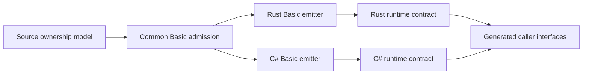

# Parallel Work

GitHub issues are the only live source for claims and status. This page explains
how contributors find, claim and hand off issues, and how they share files and
verification resources without conflicting changes. [Contributing](../CONTRIBUTING.md)
is the short path; [Development](development.md) lists the checks.

## Find an unclaimed lane

A lane is one open issue with a stated outcome, reserved paths, exclusions and
acceptance criteria. Coordination issues group independent lanes; for example,
[#1090](https://github.com/DeandreT/ferrule/issues/1090) indexes the incoming
contributor lanes. An index row describes a lane's scope; open the issue itself
for its current state, assignee and comments.

- An open issue without an assignee is unclaimed.
- `help wanted` marks issues suited to an outside contributor. An unassigned
  issue without that label may need maintainer-only resources, such as a licensed
  reference application or a CI runner; ask in the issue before claiming it.
- `deferred` issues are recorded backlog and are not available for implementation.

```sh
gh issue list --state open --label "help wanted" --search "no:assignee"
gh issue list --state open --search "no:assignee"
```

## Claim a lane

1. Read the issue, its linked contracts and its comments.
2. Comment on the issue with the files you plan to change, within its reserved
   paths, and any shared resource you need.
3. Get assigned before editing. Assign yourself if you can; otherwise the
   maintainer assigns you in response to your comment. Maintainer work is
   assigned to `DeandreT`.
4. Keep one bounded result per PR and link the issue. For a newly discovered gap,
   open a separately scoped issue rather than widening the one you claimed.
5. Leave concise updates in the issue: result, evidence link, blocker and next
   step. When you pause or stop, say so in the issue so the assignment can be
   released and another contributor can take the lane.

## Work in a separate branch and worktree

Start each lane from current `main` in its own worktree:

```sh
git fetch origin
git worktree add ../ferrule-<topic> -b <type>/<topic> origin/main
```

Use a descriptive branch such as `fix/<topic>`, `feat/<topic>`, `docs/<topic>`
or `test/<topic>`. Never work in another contributor's checkout or branch. Give
each worktree its own Cargo target directory; the default `target/` inside the
worktree does this. Sharing one target directory between checkouts can leave
stale artifacts that look fresh. Remove the worktree and branch after the PR merges.

## Shared files and handoffs

An issue's reserved paths belong to its assignee. Files outside every lane are
shared entry points, not parallel ownership. Examples include the workspace
`Cargo.toml` and `Cargo.lock`, crate `lib.rs`/`main.rs` module registrations,
app/workspace and test registrations, generated
[technical references](reference/README.md), CI definitions, the workbook draft,
the JSON Schema facade, generated runtime/adapter modules, and CLI input or
artifact staging.

Before editing a shared file, agree a handoff in the issue: the file or function
you will change, who edits it and in which order. The maintainer integrates
registrations that a lane cannot make inside its own paths. Preserve the other
issue's complete behavior and tests, and rebase after a handoff merges.

## Generated-code source ownership

The Rust and C# public Basic emitter families share the common source-ownership
model and admission policy. Each backend owns its renderer and language-specific
runtime integration. The
[roadmap contract](../ROADMAP.md#basic-owned-source-public-family-milestone)
describes target ValueMap, retained-input and failure boundaries.

| Component | Implementation responsibility | Coordination rule |
| --- | --- | --- |
| Common admission | `crates/codegen/src/capabilities.rs` (capability set and preset table), `crates/codegen/src/validate/owned_sources/` and `crates/codegen/src/tests/basic_owned_emission.rs` | Add a new capability as its own field, table column and `owned_sources` module; agree changes to a shared gate with both backend owners. |
| Rust Basic renderer | `crates/codegen-rust/src/owned_basic.rs` and `crates/codegen-rust/src/tests/owned_basic.rs` | Sequence renderer and source-test edits within the Rust lane. |
| C# Basic renderer | `crates/codegen-csharp/src/owned_basic.rs` and `crates/codegen-csharp/src/tests/owned_basic.rs` | Sequence renderer and source-test edits within the C# lane. |
| Runtime and public interfaces | Each backend's runtime and emission entry points | Preserve each preset's capability set, generated symbols and caller contracts. |
| Documentation | Capability contracts and reusable contributor procedures | Describe implemented behavior; keep task progress, result records and handoff state in issues. |

The public Basic path validates common admission before backend rendering.
Private ordinary failure-map admission remains a separate profile from the
shared/public failure gate. A private renderer change must preserve the public
gate's complete typed refusal and the ordinary emitter's admission behavior.

Target ValueMaps retain potential input edges and runtime error priority.
Retained inventory preserves stored calls and actual referenced bodies, while
failure diagnostics retain rule, expression and source-context origins. Changes
to these contracts need coordinated source ownership even when the languages
can be implemented independently.



The diagram shows shared policy prerequisites and separate backend contracts.
File ownership in the table adds serialization requirements for overlapping
changes.

## Verification resources

- Run the checks for your change locally before requesting review; see
  [Development](development.md#run-the-appropriate-checks).
- Reserve one build lane when contributors share Cargo artifacts. Check disk
  space before and after substantial builds, reuse compatible caches, and use
  bounded jobs and incremental settings. See [Development](development.md#build-space-and-desktop-isolation).
- Reuse build artifacts only within the source profile that produced them. Source
  timestamps and manifest paths alone do not establish which source produced
  cached executable bytes.
- Reserve graphical or external-application sessions separately. Use an alternate
  display and an isolated chooser/session route; never drive another contributor's
  process or the user's active desktop. Bind the executable to the tested source
  and retain owned process closure, including failed attempts.
- Keep source review, focused local tests, generated public-host calls, normal
  desktop interactions, external execution and memory trials distinct. A source
  review or an emission pass does not close an execution gate.
- Measurements need their own finite input/profile/trial plan and full output
  checks. An observed peak is not a universal RAM limit or a streaming promise.

## Complete or hand off

A PR summarizes the changes it makes and links its issue. Keep it short and leave
out test-result narration; reviewers expect the relevant local checks to have
passed. Mention a limitation or blocker only when it affects review. Record
qualification evidence and remaining acceptance checks in the issue or the
lane's qualification document, and update the corresponding roadmap or
conformance gate only after its required evidence exists. Preserve earlier
failures and narrower supported profiles.

The [conformance inventory](../conformance/README.md) remains incomplete. Do not
rewrite the protected survey as part of ordinary feature or coordination work,
mark unknown cells supported, or infer whole-product parity from a local cohort.

## History

Earlier revisions of this page recorded dated lane tables, handoffs, acceptance
checklists and dependency diagrams for completed coordination rounds, including
[#89](https://github.com/DeandreT/ferrule/issues/89),
[#173](https://github.com/DeandreT/ferrule/issues/173),
[#182](https://github.com/DeandreT/ferrule/issues/182),
[#212](https://github.com/DeandreT/ferrule/issues/212),
[#252](https://github.com/DeandreT/ferrule/issues/252),
[#271](https://github.com/DeandreT/ferrule/issues/271),
[#299](https://github.com/DeandreT/ferrule/issues/299),
[#336](https://github.com/DeandreT/ferrule/issues/336),
[#349](https://github.com/DeandreT/ferrule/issues/349),
[#417](https://github.com/DeandreT/ferrule/issues/417),
[#578](https://github.com/DeandreT/ferrule/issues/578),
[#624](https://github.com/DeandreT/ferrule/issues/624),
[#679](https://github.com/DeandreT/ferrule/issues/679) and
[#697](https://github.com/DeandreT/ferrule/issues/697). Those coordination
issues are closed. The
[last revision containing those records](https://github.com/DeandreT/ferrule/blob/d151ded4cf17ecd206146b718cc6ffce53b1adda/docs/parallel-work.md)
preserves them unchanged; its availability tables are not current. The
[roadmap history](../ROADMAP.md#history) keeps the matching dated progress snapshots.
