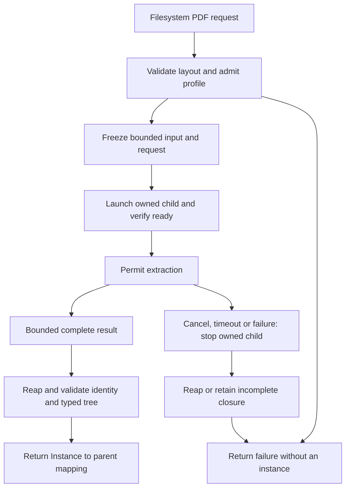
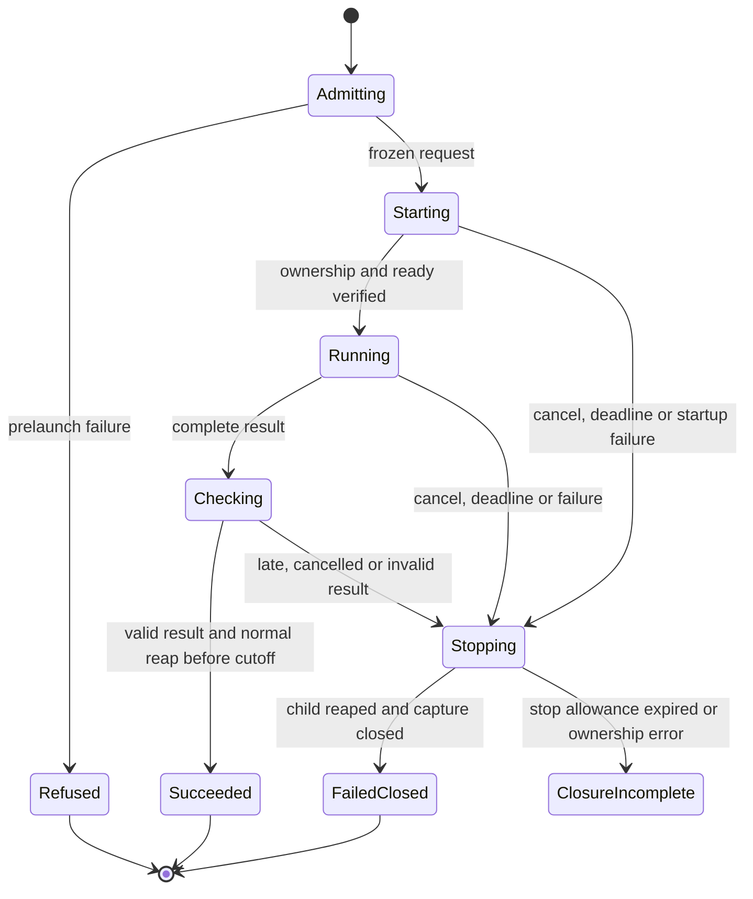

# PDF Worker Contract

Status: **wire codec implemented and locally verified in
[#325](https://github.com/DeandreT/ferrule/issues/325)**. The Linux owner and CLI
opt-in, file-input preview acquisition and GUI cancellation are implemented in the
dependent increments below; resource qualification remains. The codec does not
launch processes or install resource limits.
The planned first execution profile is one PDF extraction in an owned Linux
child, using local filesystem documents. Mapping and target publication stay in
the parent.

## Current boundary

[`format-pdf`](../crates/format-pdf/src/lib.rs) exposes `read(path, layout)` and
`from_bytes(bytes, layout)`. Both reject a repair-dependent layout before reading
or decoding PDF bytes. Path reading checks file size and reads at most the input
limit plus one byte; byte reading checks the original slice length.

| Existing library boundary | Limit |
| --- | ---: |
| Original PDF input | 8 MiB |
| Pages, checked after document loading and page traversal | 256 |
| Collected visual events | 1,000,000 |
| Collected decoded text, in aggregate | 1 MiB |
| Layout output nodes | 1,000,000 |
| Layout output value bytes, in aggregate | 1 MiB |
| Layout evaluation work units | 1,000,000 |
| Output instance depth | 64 |
| Validated layout command nodes / depth / aggregate strings | 4,096 / 64 / 1 MiB |

MiB means 1,048,576 bytes. The separate collection and evaluation ledgers are
not interchangeable. Output field names, object overhead, retained capacities,
and upstream parser allocations are not a total-memory ledger.

[`extract_pages`](../crates/format-pdf/src/extract/mod.rs) loads the document,
traverses pages and extracts content before layout evaluation. It catches
unwinding panics around some upstream operations and rejects encrypted PDFs;
this does not recover an allocation abort or bound decompression, recursive
content traversal, CPU use, or wall time before collector callbacks. The worker
must preserve current positioned-text, painted-edge, page-box/rotation and
layout semantics, including explicit unsupported and repair-dependent errors.
It adds no PDF output, OCR, rendering service, or new extraction command.

The [filesystem dispatcher](../crates/cli/src/lib.rs) calls `format_pdf::read`
for configured primary, static and dynamic PDF sources. The
[payload dispatcher](../crates/cli/src/payload.rs) calls `from_bytes`; its general
64-MiB document limit does not replace PDF's smaller 8-MiB limit.
GUI [file runs](../crates/gui/src/app/run.rs) run on a Rust thread and check
cancellation through debug and before-publication controls. Without the owned
worker those checks cannot interrupt synchronous PDF decoding; the opt-in below
moves extraction into a child that cancellation can stop.

## Eligible host and compatibility

The proposed profile identifier is `linux-x86_64-v1`. It requires Linux x86_64,
a packaged matching worker executable, PIDfd signaling/wait ownership, and
successful installation of the limits below. Missing capabilities, a missing
executable or failed resource setup return `UnsupportedHost` or `ResourceSetup`
before PDF parsing. There is no automatic fallback after isolation was requested.
Other operating systems and architectures are unsupported by this profile;
their worker entry point must refuse rather than start extraction.

The first CLI increment adds an explicit worker policy/flag for filesystem PDF
reads. The current default, pure library APIs and payload/stdio APIs keep their
existing in-process behavior. Changing a default requires a later qualified
increment. An isolated request accepts one regular local file, not a URL, pipe,
device, socket, inline payload or caller-selected command. The host resolves the
packaged worker independently of mapping input and does not search a PDF's
directory or invoke a shell. Native filesystem paths need not become UTF-8 wire
identities. This is process/resource isolation, not a filesystem, network or
malicious-code sandbox.

One owner runs one worker at a time per mapping run. Each PDF load has its own
request; the existing dynamic-source cache and target/source selection rules
stay in the parent. A per-extraction deadline is not a deadline for the whole
mapping or all dynamic loads. Payload PDF isolation and generated backends are
outside this first profile.

## Bounded request and result

The parent creates a fresh owned directory with mode `0700`. Names inside it are
fixed: `request.json`, `input.pdf`, `instance.part`, `instance.json`, and
`result.json`. No request supplies an output destination or relative sibling
dependency. Reject symlinks and nonregular files at open, using the opened file's
identity for subsequent checks. Close unneeded inherited descriptors and clear
unneeded environment entries. The worker must not launch children.

The parent first validates the layout and its repair dependency, checks the host
profile, and takes a bounded snapshot of the opened PDF into `input.pdf`.
Compare input identity/size/modification metadata before and after copying;
refuse an observed change. Freeze the complete snapshot and request read-only
before launch. The worker rereads and verifies the snapshot's byte count/hash.
Metadata checks do not prove that a concurrently written original was unchanged;
the request identifies the exact staged bytes, and callers must keep the
original stable when they require original-file snapshot semantics.

| New host transport boundary | Proposed fixed limit |
| --- | ---: |
| One request JSON, original UTF-8 bytes | 4 MiB |
| Staged PDF | Existing 8 MiB |
| Serialized typed instance, original UTF-8 bytes | 64 MiB |
| Result/error envelope | 64 KiB |
| Ready frame / total captured stderr | 4 KiB / 64 KiB |
| JSON container depth in request and result transport | 256 |
| Logical bytes retained in one job directory | 80 MiB |

These are additional host limits, not new library limits. A layout/output that
the pure library can represent may exceed the transport cap and receive a typed
host refusal. Admit at least 96 MiB of additional local scratch headroom per
job, while preserving the caller's other disk reservations. File-system block
overhead, retained earlier failures and concurrent unrelated work are separate.
Do not copy a full instance to stdout or accumulate unbounded diagnostics.

Request fields are exactly `protocol: "ferrule.pdf-worker/1"`, a fresh 32-character
lowercase hexadecimal `request_id`, `profile: "linux-x86_64-v1"`, the existing
serialized `PdfLayout`, and `input: {name: "input.pdf", byte_len, sha256}`.
Unknown versions, duplicate envelope keys, unknown envelope fields, invalid
integer lengths or a mismatched profile refuse. A bounded structural scan
precedes recursive deserialization; `PdfLayout` construction must still perform
its existing validation. No request may raise resource limits or choose paths.

The child installs policy before reading the request or PDF, publishes one
bounded ready frame containing the request identity and effective limits, then
waits for the owner's single start token. The parent acquires ownership before
that token. EOF or malformed control input refuses. Control pipes carry only
handshake/diagnostics; the PDF and typed result remain filesystem documents.

The result envelope repeats protocol, request ID and profile and contains exactly
one outcome. `ok` names only `instance.json` and records its complete length and
SHA-256. A separate tagged wire tree represents ordered Group field pairs,
Repeated items, String scalars and Null scalars; those are the current PDF output
variants. It must preserve field/item order, empty strings, nulls and Unicode
exactly. No generic numeric coercion, DocumentSet or MappedSequence is admitted.
The encoder writes through a capped writer to `instance.part`, closes it and
renames it only after complete encoding. The parent independently recounts
nodes/depth/value bytes and validates the wire shape before rebuilding an
`ir::Instance`; checksums alone do not establish semantic correctness.

`pdf_error` carries the existing `PdfError` variant and its structured data,
including repair dependency, I/O kind and any value path. Bounded display/cause
text is diagnostic, with an explicit truncation flag; it never substitutes for
the variant. A valid library error can exceed the 64-KiB envelope cap because
layout names and paths have a larger aggregate string budget. In that case,
return the distinct host outcome `ErrorEnvelopeTooLarge`, retaining the original
`PdfError` variant identity, complete attempted encoded length and SHA-256 of the
attempted error envelope. Count and hash through a streaming sink without
buffering the oversized envelope. Do not reconstruct a `PdfError` from truncated
structured fields; any bounded diagnostic excerpt must declare truncation.
Host protocol, snapshot, resource and output-limit errors have separate
categories. `ok` requires child exit 0; a complete declared error
requires exit 2. Other exits/signals are retained as `WorkerExit`, even if a
partial document exists. A missing, trailing, duplicate or inconsistent result
is `ProtocolError`. Never interpret an empty/malformed result as an empty PDF.

## Resource and child-ownership policy

| Profile control | Proposed policy |
| --- | --- |
| Address space | `RLIMIT_AS` soft and hard 512 MiB |
| Child CPU | `RLIMIT_CPU` soft 30 s, hard 31 s |
| Each child-created file | `RLIMIT_FSIZE` soft and hard 64 MiB; smaller transport caps still apply |
| Core dumps | `RLIMIT_CORE` soft and hard zero |
| Owner work deadline | 30 s from admission, including snapshot, launch, handshake, extraction, result validation and normal reap |
| Stop/reap allowance | At most 5 additional seconds; at most 1 s TERM grace, then KILL for the held child |

Install no broader limits than the caller already has: reject an inherited limit
that cannot admit this fixed profile, rather than raising it. Verify effective
limits before the start token. The finite
[resource profile](performance/pdf-worker-resource-profile.md) measures these
numbers with the packaged executable and small self-authored PDFs; it does not
change them. Linux [`RLIMIT_AS`](https://man7.org/linux/man-pages/man2/getrlimit.2.html)
limits virtual address space. Allocation or stack expansion can fail or terminate
the child; it is not an RSS measurement. `RLIMIT_RSS` supplies no usable modern
Linux RSS enforcement for this policy. CPU and file-size limits likewise do not
replace the owner's wall clock or per-file protocol checks.

The sole launch/reap owner keeps the `Child` and a held PIDfd, records child PID
and birth identity, and validates the spawn relationship before start. Acquire
the PIDfd while the direct child is unreaped; require ordinary `SIGCHLD`
disposition, no `SA_NOCLDWAIT` and no competing reaper. Refuse an incompatible
embedding host. [`pidfd_open`](https://man7.org/linux/man-pages/man2/pidfd_open.2.html)
is available from Linux 5.3; its direct-child acquisition guarantee depends on
those reaping conditions. A version number alone does not prove availability.
Signals use the [held PIDfd](https://man7.org/linux/man-pages/man2/pidfd_send_signal.2.html),
never a reused PID, broad process name or unrelated process group. Unknown child
or descendant observations are lifecycle errors; the profile authorizes no
signal to an unowned process.

Before ready, the worker also installs a parent-death `SIGKILL` and checks the
expected parent on both sides of setup. The launch thread remains alive until
reap. [`PR_SET_PDEATHSIG`](https://man7.org/linux/man-pages/man2/PR_SET_PDEATHSIG.2const.html)
refers to the creating thread, and a parent already gone before installation
does not trigger the signal. This is a last-resort exit mechanism, not a
replacement for the live owner's wait proof or a promise of cleanup after a
parent crash.

## Deadline, cancellation and terminal states

Cancellation is checked before any job creation, during bounded staging and
owner polling, and immediately before returning a validated instance. Once
cancellation is observed it wins over a late success and stops the active child;
no mapping target is staged by extraction. A worker deadline is independent of
GUI debug pause time, which starts after input extraction. The work cutoff is
checked again after complete result validation, normal reap and required
evidence publication. Success cannot be published by an operation that overran
the cutoff while writing its receipt.

Closing control input, TERM grace, PIDfd KILL, exit collection, pipe closure and
all descriptor/file releases are explicit owner steps. Retain raw exit/signal,
observed primary reason, monotonic timestamps, effective limits, byte counts,
bounded diagnostics and every cleanup error. A signal number or `ENOMEM` alone
does not identify the cause. [Dropping Rust `Child`](https://doc.rust-lang.org/std/process/struct.Child.html)
does not kill or wait for it; `try_wait`/wait must establish actual reap.

`Cancelled` and `TimedOut` may be returned as closed failures only after reap;
`ClosureIncomplete` preserves the original reason and every ownership/cleanup
error. It returns no instance and permits no target publication or reuse of that
job/owner. The manager retains the child handle and unresolved ownership and
keeps servicing closure rather than detaching it. GUI integration must remain
Stopping/defer close while that responsibility is unresolved. Blocked kernel or
filesystem operations can defeat prompt termination; 30+5 s is an acceptance
cutoff, not a guaranteed bound on physical exit. Parent crash, SIGKILL, unexpected
descendants and a lost wait relationship cannot produce a normal-closure claim.

Delete a successful job only after its child and files are closed and the typed
result is owned by the caller. Retain bounded failed-job evidence for explicit
caller cleanup; protect it from mapping target replacement. Cleanup failure
prevents normal success and stays observable. Retention does not grant permission
to read arbitrary sibling files or delete a caller's original PDF.

## GUI coupling and source ownership

The worker client needs a cancellation token that can be polled during input
loading. It must not invoke the existing `before_publish` callback to implement
PDF cancellation: that callback runs after evaluation and may pause or authorize
target publication. Preserve that boundary and all existing target-file
transaction rules. File-run and filesystem pipeline adapters can pass their
existing cancellation flags through an explicit worker-enabled API. Pending GUI
state must own the extraction manager until closed; a detached Rust thread and
a flag are insufficient closure evidence.

Project previews select their inputs explicitly through
[`ProjectPreviewInputs`](../crates/cli/src/preview_inputs.rs): caller-owned payloads,
which never reach a PDF reader, or the configured files, acquired exactly as a
file run acquires them (the primary once, only selected static sources, dynamic
sources as requested) and optionally through a borrowed `FilesystemPdfReader`.
[Pipeline previews](../crates/cli/src/pipeline_preview.rs) accept payload hosts or
host files. File hosts are read once each, after graph, identity, format, policy
and metadata byte-budget preflight; dynamic named sources stay refused. Previews
return artifacts and publish nothing. Arbitrary editor text and payload library
calls remain in-process.

The GUI has an off-by-default session option to extract file PDFs in the packaged
`ferrule-pdf-worker` beside `ferrule-gui`; a failed admission is an error, never an
in-process fallback. A signal-free [`OwnedPdfReader`](../crates/gui/src/app/pdf_extraction.rs)
owns the manager on the run or preview thread, forwards that thread's single
cancellation flag, and returns only after the job is closed. A job whose closure
is unresolved keeps being serviced, so its thread stays pending. Saved-file runs,
pipeline runs, file-input previews and pipeline previews use it; editor-text
previews stay on the payload route. Cancellation observed before, during or
after extraction wins over a late result, so nothing is published or reported.
Pending runs keep their exact thread until it is joined. An owned preview whose
UI owner is dropped hands its thread to the
[preview service](../crates/gui/src/app/preview_service.rs), and the desktop
runner joins whatever the service still retains after the window closes. App
close is deferred while an owned run or preview, or a retained preview thread, is
pending; the existing dirty-document confirmation follows.
There is no hard process-memory claim for the parent, decoded tree, mapping,
preview retention or serialized targets. See [Memory use and boundary limits](memory-and-limits.md).

| Increment | Owned source boundary | Dependency and qualification |
| --- | --- | --- |
| [A. Versioned wire/library boundary (#325)](https://github.com/DeandreT/ferrule/issues/325) | New `crates/pdf-worker` protocol/error codec and bounded fixture tests; workspace registration | Implemented; 81 frozen cases, affected library tests, formatting and strict lint verified |
| [B. Linux filesystem worker and CLI opt-in (#326)](https://github.com/DeandreT/ferrule/issues/326) | `crates/pdf-worker` Linux owner/client and worker binary; narrow `crates/cli` filesystem-policy/dispatch/packaging tests | A; real ready/limits/kill/reap and complete library-versus-worker fixture comparisons |
| [C. GUI filesystem cancellation (#327)](https://github.com/DeandreT/ferrule/issues/327) | File-run and filesystem pipeline adapters/pending-state tests in `crates/gui`; narrow CLI cancellation API seam | B; alternate-display cancellation/close and existing publication regressions |
| [D. Finite resource qualification (#328)](https://github.com/DeandreT/ferrule/issues/328) | Owned synthetic fixture/protocol tests and public bounded report | B; add C cases after C merges; repeated separate child/parent measurements before any default-policy change |
| [E. File-input preview acquisition (#340)](https://github.com/DeandreT/ferrule/issues/340) | Explicit payload-or-file project and pipeline preview inputs in `crates/cli` | B and the borrowed reader (#344) |
| [F. GUI preview ownership and shutdown (#341)](https://github.com/DeandreT/ferrule/issues/341) | Preview service, file-input preview selection and app-close deferral in `crates/gui` | C and E; the option stays off by default until D |

Keep `format-pdf` extraction/layout semantics, `mapping::PdfLayout` and `ir` model
unchanged. Wire code belongs to the worker package, not a process-launching
pure format reader. B must remain usable without C; C must not reopen A's
protocol. Each branch/PR has one increment and merges after its own gates pass.
The design and pure codec received independent source review. Host, CLI and GUI
implementation must retain the reviewed protocol and qualify their own behavior.

[`pdf-worker`](../crates/pdf-worker/src/lib.rs) provides bounded request,
instance, result, ready and start codecs. Ordered field pairs preserve duplicate
data names, empty structures, absent values and Unicode. Instance byte counts and
digests are checked before decoding. Its PDF error encoder retains all twelve
existing variants; an oversized structured error produces a distinct host error
with the complete attempted encoding's length and digest.

The nine codec test functions execute 72 independently frozen cases plus nine
additive controls. Two small synthetic PDFs match their complete expected
`format-pdf` results; repair-layout priority and oversized input rejection also
run through that library. These checks establish the portable wire boundary.
They do not qualify subprocess limits, cancellation or memory use.

## Acceptance gates

- [x] Review the protocol, new host limits, Linux policy and default/unsupported
  behavior for this design. Reconcile again against each implementation increment's fresh main.
- [x] Render both diagrams and inspect complete legibility; source fences alone
  are not render evidence.
- [x] Freeze independently expected small PDFs/layouts/typed results before
  codec and library execution, preserving full fields, order, nulls and all existing errors.
- [x] Exercise the pure codec's exact and one-over request/result/instance,
  diagnostic, depth and node limits; duplicate/unknown keys, digest/length mismatch,
  unsupported instance kinds, all PDF error variants and borrowed writer failures.
- [ ] Repeat boundary checks through the real worker, including input limits,
  sparse and growing inputs, repair-layout priority, invalid/encrypted content,
  upstream panic/abort and malformed/truncated/mismatched result controls;
  retain oversized structured errors as `ErrorEnvelopeTooLarge` with the complete
  attempted encoding's length/digest rather than a truncated library error.
- [ ] Verify unsupported OS/capabilities and resource setup fail before parsing;
  no fallback, shell invocation, unbounded capture or unexpected file creation.
- [ ] Qualify early exit before ready, ready without start, TERM ignored, KILL,
  cancellation at each transition, late result/receipt publication, PID reuse,
  lost/competing wait, failed signal/reap and incomplete closure as distinct facts.
- [ ] Use real Linux children for lifecycle gates. Injected clock/process models
  supplement those gates and do not prove kernel signaling or physical closure.
- [ ] Compare primary/static/dynamic selected-source acquisition and destination
  preservation with existing CLI controls; no unnecessary worker for unused sources.
- [ ] Qualify GUI cancellation and app close on an alternate virtual display,
  keeping the user's active monitors untouched and all publication controls intact.
- [x] Record executable/profile/kernel/effective limits, repeated child and parent
  RSS/CPU/wall brackets, exact outputs and all failures. Address-space limits,
  RSS observations, input bytes and typed tree size remain separate quantities.
  See the [resource profile](performance/pdf-worker-resource-profile.md).

Design review, diagram rendering and pure wire/library checks are complete. The
Linux worker, CLI, GUI and resource qualification gates remain pending. The codec
checks establish no actual worker success, hostile PDF safety, streaming behavior
or RSS ceiling.
