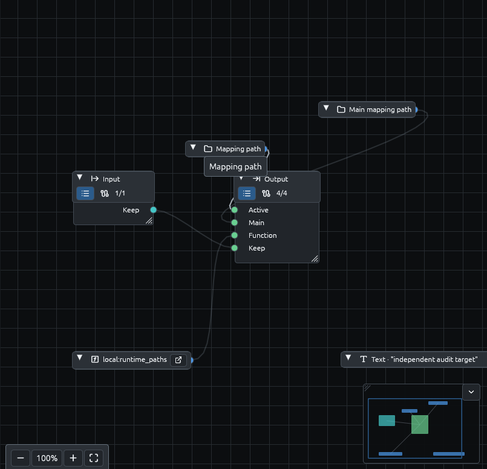
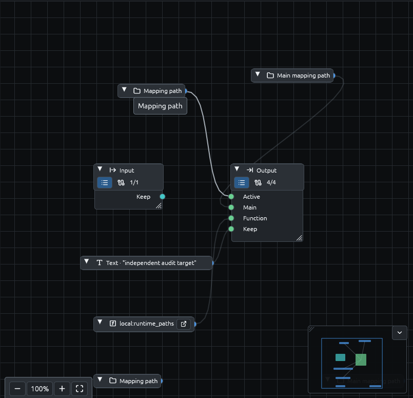
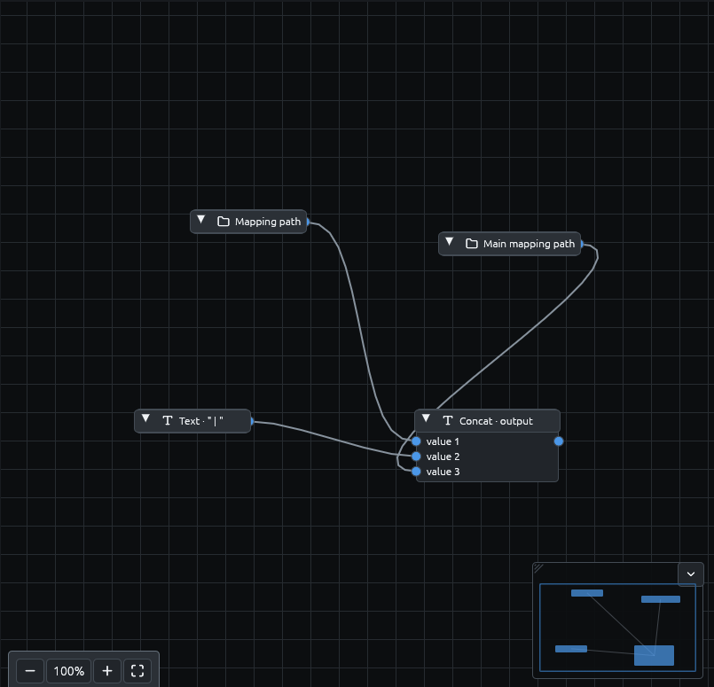

# Mapping-path desktop qualification — 2026-10-25

The ordinary Linux Ferrule editor completed the focused desktop workflow in
[#108](https://github.com/DeandreT/ferrule/issues/108). No runtime or GUI production
code changes were needed. This qualifies this self-authored scenario, not other
desktop gates or other platforms.

## Observed result

- Both **Mapping path** and **Main mapping path** were created through the real
  right-click search palette on the main, `audit` target, and isolated
  `local:runtime_paths` function canvases. Search aliases and both keyboard and
  pointer selection were exercised. The compact labels, hover labels and
  connection pins were usable; these fixed runtime values have no editable
  properties.
- Real pointer drags connected each target's own runtime nodes and the function's
  two runtime nodes. The function concatenates active path, ` | `, and main path.
  Both target outputs also call that function. Primary `Keep` reads the input;
  audit `Keep` is a different constant, so an accidentally reused primary result
  cannot pass the complete output comparison.
- Node movement, Undo and Redo restored the entire serialized layout in each
  canvas. Complete project comparisons retained all node identities, function
  ownership, bindings and wires. While real Save As choosers were pending,
  attempted palette creation and Undo did not change the project or layout on
  any of the three canvases.
- Native Open and Save As choosers selected the seed and `saved.json`. A later
  native Open reopened `saved.json`; saving again retained the complete project
  and sidecar byte-for-byte, including the open target/function tabs.
- Ordinary Preview, separately from the primary and audit tabs after reopening,
  returned complete expected JSON. `Active`, `Main`, and both halves of
  `Function` exactly equal the real absolute `saved.json` path. Standalone
  Preview has the same active and main mapping identity; this run does not
  claim to give them different identities.
- Missing context was checked separately by the engine tests, not by pretending
  an unsaved Preview has no context. The added regression checks the specific
  missing-runtime-value error for each path inside an isolated function.
- The application received the ordinary window-close request and exited with
  code zero. All 14 captured owned application/display/D-Bus/portal/helper
  process IDs were absent afterward. The user's active desktop was not used.

The session used a normal `cargo build -p gui` executable, a private Xvfb display,
private application preferences and private D-Bus. The installed portal opened
the actual native KDE file chooser. Ferrule's window was 1400 × 960 on a
1440 × 1000 virtual display. Both Preview clipboard outputs were compared in
full; their on-screen horizontal clipping was not treated as complete evidence.

### Matched canvas captures

These equal-sized crops contain only the self-authored mapping. Full originals,
native chooser captures, history/lock snapshots, project/sidecar files, complete
Preview clipboard outputs and process inventory remain in the private run
directory, not in the repository.

| Main | Named target | Function |
| --- | --- | --- |
|  |  |  |

## Repeat the scenario

Requirements: Linux, Xvfb, `xdotool`, `dbus-run-session`, ImageMagick (`import`),
`xclip`, a working native file chooser, and the repository's pinned Rust toolchain.
Use a new private run directory. Do not point these commands at the active
desktop or reuse another session's target directory.

```sh
export CARGO_TARGET_DIR="$HOME/.cache/ferrule-desktop108/target"
export TMPDIR="$HOME/.cache/ferrule-desktop108/tmp"
mkdir -p "$TMPDIR"
cargo build -p gui --locked -j 2
work="$HOME/.cache/ferrule-desktop108/run-$(date +%Y%m%d-%H%M%S)"
python3 scripts/qualification/mapping-path-desktop.py prepare "$work"
python3 scripts/qualification/mapping-path-desktop.py desktop \
  "$work" "$CARGO_TARGET_DIR/debug/ferrule-gui"
```

The last command remains running until Ferrule closes. `owner.json` identifies
the newly allocated display; all input commands must use that display. The
launcher removes `WAYLAND_DISPLAY`, `WAYLAND_SOCKET`, `XDG_RUNTIME_DIR`,
`XDG_SESSION_TYPE` and the inherited D-Bus address. It starts its own D-Bus
session and closes its X server when Ferrule exits.

1. Open `seed.json` through **File → Open**. The seed has schemas, a source
   field, an audit constant, a function call and the function's concat scaffold,
   but no runtime nodes and no target bindings.
2. On main, right-click empty space, search `active mapping file`, then select
   **Mapping path**. Repeat with `top level caller` and **Main mapping path**.
   Connect these to `Active` and `Main`, source `Keep` to `Keep`, and the function
   call to `Function`. Save As `saved.json` through the native chooser.
3. Select `audit` in the target selector. Create both runtime nodes through the
   palette again and connect the same target fields. Connect the audit constant,
   not the input, to `Keep`; connect the function call to `Function`.
4. Use **Functions → Browse functions → Open in tab**. Create both runtime nodes
   in `runtime_paths`, then connect active path to concat input 1 and main path
   to input 3. Preserve the separator on input 2 and the function output.
5. Visit both main and audit after creating their shared graph nodes, so both
   canvas layouts have materialized entries for the complete graph. Save.
   For each canvas, save/capture before a single node move, after moving, after
   Undo, and after Redo. Use snapshot names `history-main-before`,
   `history-main-after`, `history-main-undo`, `history-main-redo`, and the same
   suffixes with `history-audit` and `history-function`.
6. On each canvas, save/capture `lock-CANVAS-before`. Open Save As, explicitly
   focus Ferrule while the native chooser remains open, and try the palette and
   Undo. Cancel the native chooser, explicitly refocus Ferrule, save, and capture
   `lock-CANVAS-after`, where `CANVAS` is `main`, `audit`, or `function`.
7. Save/capture `before-reopen`, reopen `saved.json` through the real chooser,
   save/capture `after-reopen`, and inspect all three canvases.
8. Preview primary and audit independently with
   `{"Keep":"self-authored desktop 108"}`. Use **Copy preview** (not Copy path)
   to retain the complete output as `main-preview.json` and `audit-preview.json`.
9. Close Ferrule normally. Run the complete comparison after the desktop command
   returns. The helper below can send the ordinary close request on bare Xvfb.

Useful commands from a second terminal:

```sh
tool=scripts/qualification/mapping-path-desktop.py
# Commands are directed only at the display recorded by the launcher.
python3 "$tool" action "$work" search --onlyvisible --name ferrule
python3 "$tool" action "$work" windowfocus WINDOW_ID
python3 "$tool" action "$work" snapshot history-main-before
python3 "$tool" action "$work" clipboard main-preview.json
python3 "$tool" action "$work" close WINDOW_ID
python3 "$tool" verify "$work"
```

`snapshot` copies the already-saved project and sidecar and captures the display;
it does not save the editor. Hold and release pointer buttons across separate
frames when wiring. Recheck coordinates after Undo/Redo because a canvas rebuild
may recenter the viewport. On bare Xvfb, refocus Ferrule after a native chooser:
pointer input can work while keyboard focus is still on the closed chooser.

An early audit comparison added previously unmaterialized shared-node entries
to the inactive main layout during rebuild; no existing position or project
content changed. The complete history comparison was repeated after both views
contained all shared nodes. Earlier focus/coordinate attempts and their captures
remain retained separately from the passing comparisons.

The verifier compares the complete expected project, entire before/after layout
objects, complete Preview outputs, and normal exit/owned process closure. The
focused engine suite and `cargo clippy -p engine --all-targets --locked -- -D
warnings` also passed. No external application, vendor sample, or fake-dialog
test is used as evidence for this desktop result.
