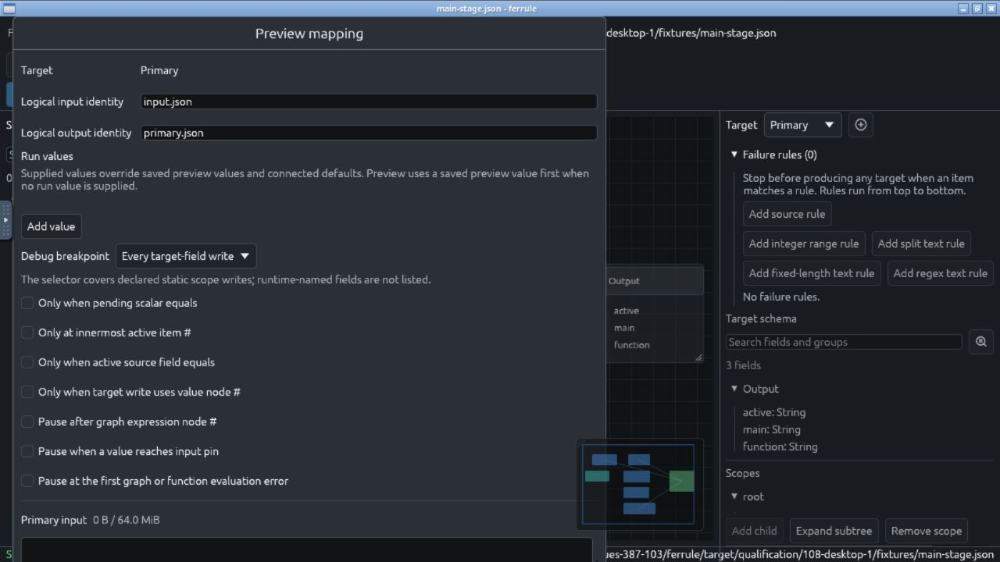
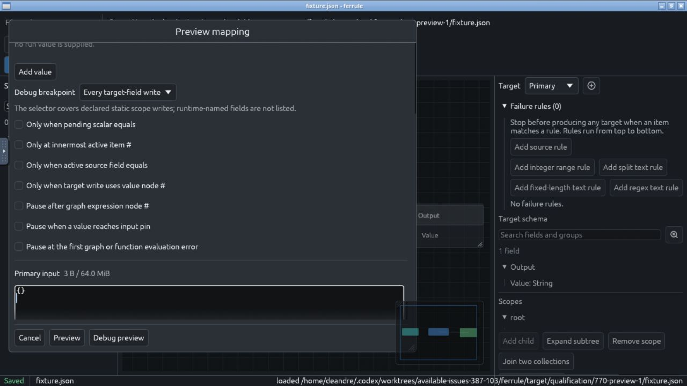
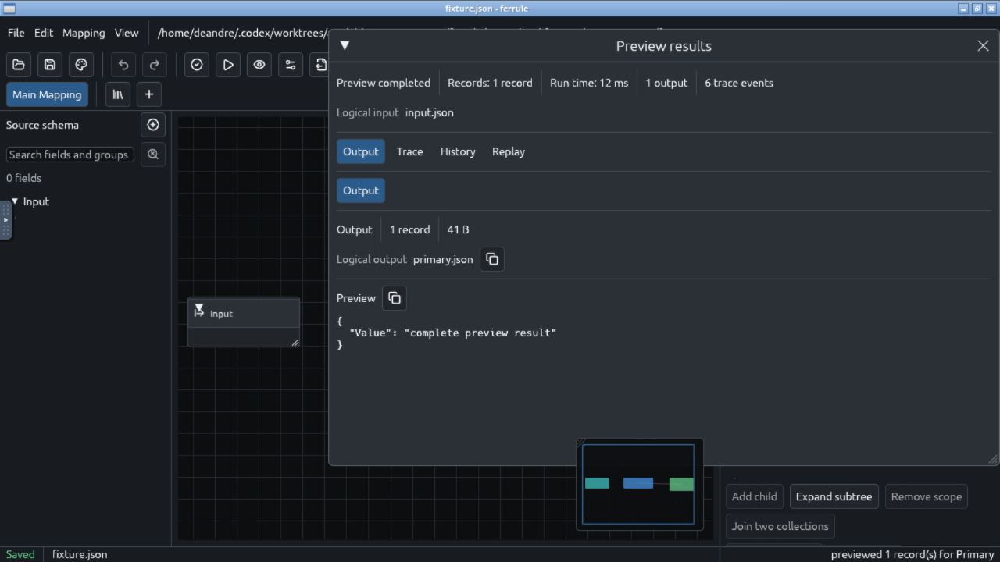

# Preview controls on shorter windows: 2026-10-15

The Preview setup now scrolls vertically, keeping its input and actions
reachable on a short desktop. Its nested input editor also has a finite height
when the outer scrolling window offers unbounded content space.

On main `4c1aa380`, the original 1280 × 720 native session showed the input
starting below the screen and no reachable action row. The real-theme widget
regression independently reproduced a 792-pixel window in a 699-pixel client.



The rebuilt ordinary GUI used its own X11 display, session bus and Zenity chooser.
At the same native display size, fifteen outer wheel events exposed the editor,
Cancel, Preview and Debug preview. Entering the complete three-byte `{}\n` input
and clicking Cancel returned to the clean project. Reopening and entering that
input again, then clicking Preview, completed one record and one 41-byte output.



The [complete desktop fixture](preview-window-2026-10-15.mapping.json) has an empty
input group and one string output bound to the literal `complete preview result`.
The app's actual **Copy preview** button transferred the full result into the
visible noVNC clipboard textarea. Its original text was retained before comparing
every byte against this independent expected value, including the final newline:

```json
{
  "Value": "complete preview result"
}
```



The original fixture, input and expected bytes stayed unchanged. The GUI exited
normally, every owned desktop process group closed, and all bound source files
and the retained executable matched their pre-session identities.

Separate widget tests exercised 1280 × 699 and 960 × 560 client sizes, actual
scroll and button events, the complete output and unchanged project after
Cancel. The [evidence index](preview-window-2026-10-15.evidence.json) binds the
source, executable, original captures and fixture to this session.

These observations cover Preview reachability and a constant-output mapping.
The [mapping-path desktop record](mapping-path-desktop-2026-10-25.md) covers
authoring and persistence on its own fixture.
